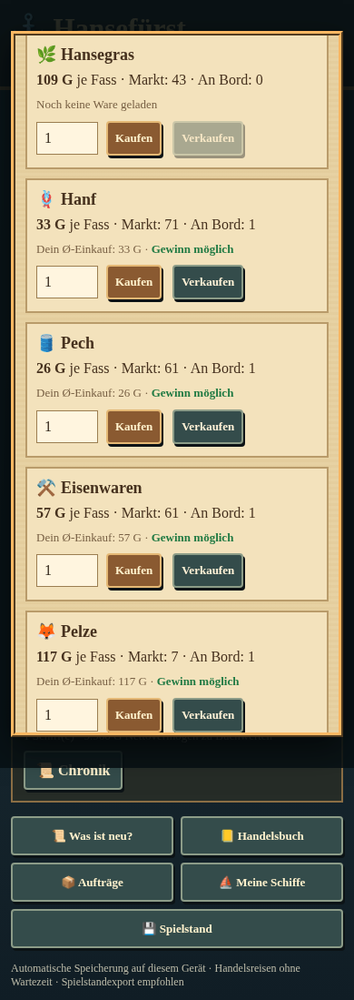

# Hansefürst 0.5c – Vier neue Handelswaren

24.10.2026 · Zweig `feature/phase05c-four-goods` · Ausgangsstand `development/v04-foundation`, `f3a711a5d477c0fa049dbdbd18d5f52b8eb49bc6` (fünf Lagerhäuser über PR #11 übernommen).

**Ergebnis:** Elf Waren sind vollständig kaufbar, verkaufbar, transportierbar, lagerbar und buchhalterisch erfasst. Hanf, Pech, Eisenwaren und Pelze wurden an die bisherigen sieben Einträge angehängt. Fünf Städte, Schiffe und Kapazitäten bleiben erhalten; keine Produktion oder neue Schiffbauregeln.

Geprüfter Spielcodecommit: **`2384479fa1d5eb0cda47250265e36097a584451b`**. HTML-SHA-256: `d050e97158f10fcab60cbcd1d5552f425170f392a97264eea28f5e3c3f211584`. Dieser Bericht ist ein nachfolgender Dokumentationsschritt. [Zwischenstand 1](https://github.com/psonnen-lgtm/Hansef-rst/commit/4492003) und [Zwischenstand 2 mit Funktion/Tests/Bildern](https://github.com/psonnen-lgtm/Hansef-rst/commit/2384479) wurden zuvor unmittelbar veröffentlicht.

## 1. Katalog und vorläufige Balancewerte

Planungsgrundlage [Issue #7](https://github.com/psonnen-lgtm/Hansef-rst/issues/7) wurde über die GitHub-Webseite geprüft. Die erste Waren-Ausbaustufe wird umgesetzt; weitere Waren und Städte werden nicht vorgezogen. Hanf und Hansegras bleiben ausdrücklich zwei verschiedene Waren.

| Index | Ware | Symbol | Basispreis Gold | Status |
|---|---|---|---:|---|
| 0 | Getreide | 🌾 | 16 | unverändert |
| 1 | Bier | 🍺 | 25 | unverändert |
| 2 | Holz | 🪵 | 19 | unverändert |
| 3 | Salz | 🧂 | 31 | unverändert |
| 4 | Fisch | 🐟 | 22 | unverändert |
| 5 | Tuch | 🧵 | 56 | unverändert |
| 6 | Hansegras | 🌿 | 84 | unverändert |
| 7 | Hanf | 🪢 | 32 | neu, vorläufig |
| 8 | Pech | 🛢️ | 28 | neu, vorläufig |
| 9 | Eisenwaren | ⚒️ | 72 | neu, vorläufig |
| 10 | Pelze | 🦊 | 110 | neu, vorläufig |

Die neuen Preise sind spielerische Ausgangswerte, **keine historisch belegten Wechselkurse**. Hanf und Pech liegen als gewöhnliche Materialien im mittleren Preisbereich, Eisenwaren höher, Pelze als hochwertige Ware über den bisherigen Basispreisen, aber ohne extreme Vervielfachung. Spätere Verwendung für Seile/Takelage, Reparatur oder Schiffbau ist lediglich Roadmap, kein neuer Verbrauch oder Rezept. Nowgorod existiert noch nicht im Spiel.

## 2. Regionale Anfangsverteilung

Bei einem **neuen Spiel** werden neue Marktpreise wie bisher zufällig aus rund 70–130 % des Basispreises erzeugt. Es gibt keinen regionalen Preisbonus und keine neue Preisformel. Die neuen Bestände werden innerhalb dieser Bereiche ausgelost (Fass):

| Stadt | Hanf | Pech | Eisenwaren | Pelze |
|---|---:|---:|---:|---:|
| Lübeck | 45–75 | 40–70 | 40–80 | 8–20 |
| Hamburg | 35–65 | 30–60 | 50–90 | 6–16 |
| Rostock | 65–95 | 60–90 | 35–75 | 10–24 |
| Stralsund | 70–100 | 65–95 | 30–70 | 12–26 |
| Stettin | 80–110 | 75–105 | 35–75 | 14–28 |

Hanf/Pech sind anfangs im Osten häufiger, Eisenwaren in mehreren Häfen verfügbar, Pelze deutlich seltener. Das ist eine einfache historisch inspirierte Startcharakteristik, keine Behauptung einer vollständigen historischen Regionalwirtschaft.

Die bisherigen sieben Waren behalten ihre Startpreis-/Bestandsregel. `initialMarkets()` erzeugt zunächst ihre gesamten fünf Marktzeilen in der bisherigen Zufallsreihenfolge und hängt anschließend die vier neuen Spalten an. Dadurch bleiben die bisherigen Startzellen bei gleicher eingehender Zufallsfolge gleich. Die neuen Waren brauchen zusätzliche Ziehungen; spätere Zufallsereignisse einer neuen Elf-Waren-Partie müssen deshalb nicht den alten Sieben-Waren-Archiven entsprechen. Wiederholungen im gleichen neuen Codestand bleiben deterministisch.

**Grenze:** Die vorhandene tägliche Bestandsfortschreibung bleibt unverändert und kann die Startprofile nivellieren. Pelze sind nicht dauerhaft garantiert selten. Kein Produktions-, Verbrauchs-, Knappheits- oder Transportnachfragemodell wurde erfunden. Die kleinen Tests bestätigen technische Funktion und gültige Zustände, keine langfristige Balance oder begrenzten Maximalgewinn über beliebige Spielzeit. Diese Werte bleiben vorläufig.

## 3. Technische Integration und Bedienung

`GOODS`/`GOOD_COUNT` aus Phase 0.5a steuern bereits Markt, Preisbuch, Lager und indexierte Ladung. Genau diese vorhandenen Wege werden für die vier neuen Einträge weitergenutzt:

- Kaufen/Verkaufen im bisherigen Handelsbuch, ein Fass belegt weiterhin einen Kapazitätsplatz.
- Schiffsladung, FIFO-Herkunftslose, gewichtete tatsächliche Anschaffungskosten und konservative Buchwerte verwenden auch Indizes 7–10.
- Alle fünf Lager nutzen denselben Transferkern. Umlagern erzeugt weder Gold noch Vermögens-/Kreditgewinn und verändert keine Warenherkunft.
- Preisbuch und Lageransichten enthalten elf Waren. Alte unbekannte neue Preisnotizen erscheinen als „—“ statt als erfundene Zahl oder „null G“.
- UI-/Neuigkeitenkennung nennt 0.5c; der Export verwendet den neutralen Dateinamen `hansefuerst-spielstand.json` statt einer veralteten Versionsnummer. Keine neuen Hauptmenüs oder Stadtgrafiken.

Preisformel einschließlich Niedrigpreiskorrektur, Bestandsfortschreibung, Reisegebühren, Kredite, Politik und Schiffsmechanik bleiben unverändert. Bestehende Waren-/Stadtindizes werden nicht verschoben. Hanf wird nicht mit Hansegras vermischt.

### Lieferaufträge

`QUEST_GOOD_INDICES` bleibt exakt **[0,1,2,3,4,5]**. Weder Hansegras noch neue Waren werden automatisch in das Angebot aufgenommen. Bei identischem Eingangs-Zufallsstrom erzeugt die aktuelle Funktion dieselben 100 kontrollierten Angebote wie die bisherige. Zusätzliche neue Spielstart-/Tagesziehungen verändern möglicherweise den konkreten Seedpfad, nicht die Auswahlwahrscheinlichkeiten des Auftragsmechanismus.

Fremde Warenherkunft, FIFO, Frist, Menge und Einmaligkeit der Auszahlung gelten wie bisher. Lagerumlagerung ist kein Verkauf. Eine spätere Erweiterung des Angebotspools muss separat beschlossen und geprüft werden.

## 4. Spielstandformat v5 und gesicherte Übernahme

**Warum v5:** Ein alter gültiger Stand hat sieben Markt-/Preisbuchspalten, ein neuer gültiger Stand elf. Die Versionsmarkierung trennt diese beiden Zustände eindeutig. Teilweise beschädigte Elf-Waren-Arrays dürfen nicht als vermeintlich alte Daten still ergänzt werden.

Der bisherige Browser-Speicherschlüssel `hansefuerst-v04` bleibt als Ablageort erhalten, damit kein existierender Stand verloren geht. Der Inhalt trägt danach `v:5`. Alte Software ist für diese Daten nicht freigegeben; vor Rückwechseln die Originaldatei exportieren. Die neuen Sicherungen ersetzen keine vorhandenen Sicherungsdateien.

Übernahme:

1. Kopie des JSON prüfen; v3/v4 muss vollständig sieben Waren enthalten, v5 vollständig elf. Warenreferenzen in Schiffen/Lagern und Preisnotizen werden gegen die zum Format gehörige Anzahl geprüft. Ein angeblicher v4-Stand mit Ware 7 wird nicht einfach akzeptiert.
2. Die bisherigen Übernahmen ohne Lager bzw. mit Lübecker Lager ergänzen wie zuvor fehlende Stadtlager. Bereits vorhandene Lagerdaten bleiben erhalten; ungültige Daten werden nicht durch leere Bestände ersetzt. V5 verlangt die vollständigen Lager- und Marktstrukturen.
3. Alte Marktspalten 0–6 bleiben unverändert. Neue Spalten erhalten **Basispreis und mittleren regionalen Startbestand** aus der obigen Tabelle. Das verbraucht für v3/v4 keine Zufallswerte und erzeugt keine direkten Preisunterschiede zwischen Städten bei dieser Übernahme.
4. Neue Spalten alter Preisnotizen bleiben unbekannt (`null`, nur für die ergänzten Waren zulässig). Die bestehende Beobachtung im aktuellen Hafen zeigt anschließend dessen reale Preise; entfernte Städte erhalten keine erfundenen Beobachtungen.
5. Auf v5 umstellen, erneut prüfen und erst nach erfolgreicher Sicherung speichern. Vorhandene Konten, Rang, Ansehen, Aufträge, Schiffe, Ladung, Kosten und FIFO-Herkunft bleiben erhalten. Neue Waren erscheinen nicht als kostenlose Schiff-/Lagerladung.

Neue Spielstarts haben Zufallsbereiche, Migrationen deterministische Mittelwerte; diese Unterscheidung ist bewusst. Wiederholtes Laden eines v5-Stands initialisiert keine Ware erneut. Auch v3/v1-Migrationsfixtures bestehen; die besonderen v1-Übernahmeschritte verwenden weiterhin den bisherigen Frischspielpfad. Der Nachweis „keine Zufallsaufrufe bei Sieben-Waren-Übernahme“ wurde ausdrücklich für v4 geprüft, nicht pauschal für jeden historischen v1-Sonderfall behauptet.

### Sicherungen und Fehlerfälle

- Neues einmaliges Originalbackup: `hansefuerst-v04-goods11-migration-backup`.
- Separates einmaliges altes Import-JSON: `hansefuerst-v04-goods11-import-backup`.
- Frühere Lager-/Stadterweiterungsbackups bleiben erhalten. Auch der ältere Rückfall-Migrationsbackup und die alten Import-Migrationssicherungen werden nicht mehr ungeprüft überschrieben.
- Die gewöhnliche `hansefuerst-v04-backup`-Sicherung beim Import enthält weiterhin den unmittelbar vorher aktuellen Stand; dies bleibt ihr bisheriger Zweck.

Scheitert das notwendige Backup wegen fehlendem Speicherplatz, wird der neue Stand nicht automatisch über die alte Hauptdatei geschrieben. Ungültige Daten führen zu abgewiesener Übernahme und bleiben im ursprünglichen Hauptspeicher erhalten. Die Fehlerfälle wurden im Browser geprüft. Neue und alte Originaldaten werden nicht mit historischen Simulationsdateien vermischt.

## 5. Automatisierte Prüfungen

| Prüfung | Ergebnis |
|---|---|
| `four-goods-checks.cjs` | **16/16** neue Waren-/Migrationsgruppen |
| `test-v04.cjs` | **19/19** Basistests |
| `phase1.cjs` | **18/18** Regelregressionen |
| `warehouse-checks.cjs` | **19/19** Lagergruppen |
| `warehouse-cities-checks.cjs` | **13/13** Mehrstadtgruppen |
| `edges.cjs` | **14/14** kleine Mechanikprüfungen; bekannter einheitlicher Reparaturtarif weiterhin als KNOWN gekennzeichnet |
| `integration-checks.cjs` | Registry-/Informationsschutz bestanden |
| `telemetry.cjs`, `share.cjs` | Datenschutz/Teilen/Abbruch/Fallback bestanden, keine echte Übertragung |

Alle Skripte liegen unter `tests/` beziehungsweise `tests/simulation/` und wurden mit Node ausgeführt. Neue Abdeckung insbesondere:

- alte Identitäten und neue Indizes; getrennte Symbole/Namen von Hanf/Hansegras;
- gültige regionale Startbereiche und Erhalt bisheriger Anfangsziehungen;
- **55** Stadt-/Warenkombinationen im unmittelbaren Kauf/Verkauf, **20** neue-Ware/Stadt-Lagerkombinationen;
- Mischkapazität, tatsächlicher Transport, FIFO/Kosten, Buchwerte und keine Umlagergewinne;
- 400 kontrollierte Tage mit gültigen 55 Marktpositionen, identische Wiederholung; gleicher Seed liefert auch im gemischten Handels-/Lager-/Reisepfad gleiche Zustände und Ereignisse;
- Migration ohne Lager, mit Lübeck-only und mit fünf gefüllten/benutzbaren Lagern; **100** Save-/Load-Zyklen ohne erneute Initialisierung;
- beschädigte/teilweise Arrays, unzulässige Indizes und fehlende v5-Strukturen werden abgewiesen;
- unveränderte Auftragsauswahl und keine falschen Prämien durch lokale neue Ware oder Umlagern;
- Sicherungsschutz und Quotenfehler.

### Notwendige Anpassungen vorhandener Tests

Die bisherige Erwartung `v===4` wird für neue gültige Zustände auf v5 geändert. Als v3/v4 deklarierte Fixtures enthalten nun tatsächlich sieben Markt-/Preisbuchspalten; das gilt auch für die alte v1-Marktfixture. Invaliditätsfälle verwenden Index **11** statt jetzt gültigem Index 7. Altstände werden weiterhin vollständig mit ihrer Sieben-Waren-Projektion verglichen; die ergänzten Daten werden separat geprüft. Die vorhandenen Kapazitäts-, Herkunfts-, Gebühren-, Zins- und Auftragsassertionen bleiben erhalten.

Anfangs scheiterte erwartungsgemäß die alte v4-Versionsassertion. Außerdem verwendete eine Testkopie der alten Frischspielfunktion versehentlich den neuen globalen Elf-Waren-Katalog. Die Fixture wurde auf den tatsächlichen alten Katalog begrenzt; der Spielalgorithmus wurde dafür nicht geändert. Die finale Gesamtheit der oben genannten Tests bestand. Keine ungeklärten Testfehler.

Historische Ganzdatei-/Preisbahnidentitätsprüfungen werden nicht als aktuelle v5-Verhaltensprüfungen ausgegeben. Keine neue 90er-/1.500er-/2.250er-Wirtschaftssimulation. Die ausdrückliche Testgrenze dieses Auftrags beschränkt die allgemeine AGENTS-Neuberechnungsvorgabe. Historische Ergebnisse bleiben bytegleich.

## 6. Chromium, Bedienung und tatsächliche Bilder

`four-goods-browser-checks.cjs` lief mit Chromium/Playwright über einen lokalen Testserver bei **390×844**, **820×1180** und **1280×900**. Alle vier neuen Waren wurden tatsächlich gekauft, teilweise verkauft, eingelagert und wieder verladen. Elf Mengenfelder, Kostenanzeigen, zwölf bzw. dreizehn relevante Tabellen-/Labelstrukturen einschließlich Stadt/Stand, Schiffsladung und Reload funktionieren. Das Preisbuch besitzt elf Waren plus Stadt/Stand, also **13 Kopfzellen**. Horizontal wird bei Bedarf innerhalb der Preistabelle gescrollt, nicht die gesamte Seite.

Die alte Spielseite aus dem veröffentlichten Sieben-Waren-Code erzeugte einen echten Altspeicher. Auf der neuen Seite wurden Startup-Migration, Originalbackups, vorhandene Lager, tatsächlicher FileReader-Import und anschließendes Speichern/Laden geprüft. Wiederholte Übernahme initialisiert nichts doppelt. Simulierte Speichervoll- und korrupte Altdatenfälle lassen die Hauptdatei unverändert. Keine Seiten-JavaScriptfehler.

Beide bisherigen Lagerbrowserprüfungen bestanden zusätzlich nach dem expliziten Vergleich alter sieben Spalten mit dem neuen erweiterten Stand; fünf Städte bleiben erreichbar. Die bestehenden historischen Screenshots wurden nicht ersetzt.

Tatsächlich erzeugt:

- [Handelsansicht mit neuen Waren, Handybreite](2026-10-24_0.5c_handelswaren-mobile.png)
- [Erweitertes Preisbuch, Desktop](2026-10-24_0.5c_preisbuch-desktop.png)

Testvoraussetzungen: Chromium und Playwright, Projekt über lokalen HTTP-Server erreichbar. Für die neue Browserprüfung konfiguriert `HANSE_BROWSER_BASE` die Testadresse (Standardport 8766), `HANSE_CHROMIUM` das Programm und `HANSE_GOODS_SHOTS` das explizite Screenshotziel; Standardausgabe `/tmp`. Keine tatsächlichen iPhone-/iPad-/Safari-Geräte getestet, nur Chromium mit entsprechenden Bildschirmbreiten.

## 7. Offene Grenzen und spätere Erweiterung

Die Werte sind eine vorläufige Erstintegration. Keine Aussage, dass die langfristigen Gewinnspannen, Pelzknappheit oder Aufstiegszeiten bereits ausgewogen seien. Regionale Startbestände halten unter der vorhandenen täglichen Regel nicht zwingend dauerhaft an. Die bekannten Marktmodell-/Preiswanderungsfragen aus Phase 1.6d bleiben außerhalb dieses Auftrags.

Stadtanzahl und Nummern sind unverändert; die Katalog-/Indexvorbereitung aus 0.5a sowie die fünf gemeinsamen Lager werden genutzt. Elf Städte benötigen später zusätzliche Entfernungen, Karten/Bilder, regionale Daten und eine explizite Erweiterungsmigration. Auch die zusätzlichen vier Waren bis 15 benötigen neue Profile und eine versionierte Migration; bloßes Anhängen ohne Prüfung wird nicht als fertig vorbereitet ausgegeben. Produktions- und Schiffbausysteme, neue Auftragswaren und andere Schiffe bleiben separate Entscheidungen.

Bestandshashes bestätigen unveränderte historische Simulationsdaten, Strategien und frühere Bilder. Der vollständig geprüfte Funktionsstand wurde **vor diesem ausführlichen Bericht** gesichert. [Fortschrittsbericht](2026-10-24_0.5c_fortschritt.md). Kein automatischer Merge und keine Folgeaufgabe begonnen.
