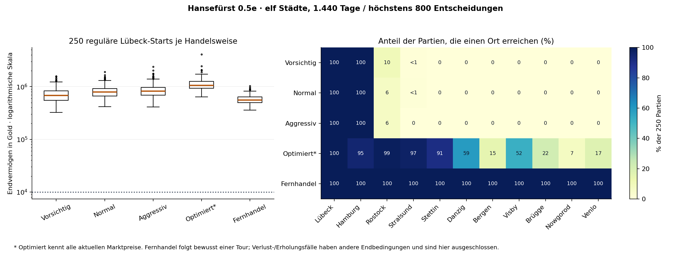

# Hansefürst 0.5e – Wirtschaftsanalyse der elf Städte

24.10.2026 · `analysis/phase05e-eleven-city-economy` · reine Analyse, keine Balanceänderung

## Ergebnis für die nächste Entscheidung

**Alle elf Städte tragen profitable Handelsfahrten. Das Spiel fördert ihre freiwillige Erkundung aber noch zu wenig.** Die drei beobachtungsbasierten Standardhändler verbringen 94,40–97,65 % ihrer Reisen auf Lübeck↔Hamburg und besuchen keine neue Stadt. Ein bewusst reisender Fernhändler erreicht dagegen in allen 250 Partien sämtliche elf Städte, bleibt zahlungsfähig und erreicht Eldermann. Sein Median-Endvermögen beträgt 556.708 Gold; normale Händler erreichen 792.658,5 Gold.

Die größere Hansewelt ist damit wirtschaftlich nutzbar. Dauerhafte Unterhaltung, ausgeprägte regionale Unterschiede und das Ziel von 20–30 aktiven menschlichen Spielstunden bis Eldermann sind weiterhin nicht belegt. Besonders problematisch ist die Kombination aus sehr sicheren erfolgreichen Routinen und einer harten Liquiditätssackgasse nach gezielt schweren Fehlern: Alle 250 Stressfälle stranden mit positivem Vermögen, aber 0–5 Gold und ohne weiteren Kreditspielraum.

**Tatsächlicher Umfang:** 1.500 neue eindeutige Partien, jeweils mit identischem vollständigem Replay. Ein ursprünglicher Workerabbruch bleibt als technischer Vorbehalt dokumentiert: Der unveränderte gezielte Wiederholungsversuch desselben Seeds bestand Replay und Beobachtervergleich; die Ursache des ersten Abbruchs wurde nicht isoliert. Keine Schutzprüfung wurde abgeschwächt.

## 1. Datenherkunft, Testaufbau und Aussagegrenzen

Der aktuelle Entwicklungszweig enthielt vor Beginn bereits die über PR #14 integrierte Version 0.5d. Geprüfter Spielstand: `1267533bdea2bd03f7bf5c718a180f92cff4616a`. HTML-SHA-256: `a51a6858a8fc3e62f9823a6bd244955be58e8bab45e2b52a5b685814aecc5727`. Der Spielcode ist während dieser Phase bytegleich geblieben.

Der Runner wurde vor dem Lauf in [`715f04ad8bcc712952acca0988ed50baf8210677`](https://github.com/psonnen-lgtm/Hansef-rst/commit/715f04ad8bcc712952acca0988ed50baf8210677) eingefroren. [Testkonzept und Zwischenstände](2026-10-24_0.5e_fortschritt.md). Rohdaten und erste Zusammenfassung wurden **vor diesem ausführlichen Bericht** in [`01b0f56e92faf7489e1f36e5e17c03e03e5f96d6`](https://github.com/psonnen-lgtm/Hansef-rst/commit/01b0f56e92faf7489e1f36e5e17c03e03e5f96d6) veröffentlicht.

Quellen:

- [Manifest mit Seeds, Grenzen, Node-Version und allen Quellhashes](../../tests/simulation/phase05e-20261024-01/manifest.json)
- [1.500 Einzelnachweise und sechs Archivprüfsummen](../../tests/simulation/phase05e-20261024-01/results-manifest.json), [SHA256SUMS](../../tests/simulation/phase05e-20261024-01/SHA256SUMS)
- [Zusammenfassung einschließlich 1.500 Fallkennzahlen](../../tests/simulation/phase05e-20261024-01/summary.json), [zusätzliche Reise-/Preisbelege](2026-10-24_0.5e_kennzahlen.json)
- [Abschließende Archiv-/Aggregatprüfung](2026-10-24_0.5e_pruefung.json)
- [Regressionsprotokoll](../../tests/simulation/phase05e-20261024-01/regressions.json), [kontrollierte Mechanikprüfungen](../../tests/simulation/phase05e-20261024-01/mechanism-checks.json), [Herkunft/Bestandsschutz](../../tests/simulation/phase05e-20261024-01/provenance.json)
- [0.5d-Abschlussbericht](2026-10-24_0.5d_elf-spielbare-staedte.md), [historische Gesamtanalyse 1.6d](2026-10-24_0.4.2_phase-1.6d.md)

### Strategien und Abbruchbedingungen

Alle sechs Gruppen enthalten **250 Seeds 10001–10250**, Mulberry32, feste Testuhr. Jeder Fall startet regulär in Lübeck mit 5.000 Gold, einer unbewaffneten Kogge und 9.960 Nettovermögen. Keine gesonderten Starts in neuen Städten in dieser Hauptstichprobe; die ausdrücklich so markierten kurzen 0.5d-Standortproben wurden nicht mitgezählt.

| Gruppe | Auswahl und Wissen | Ende |
|---|---|---|
| Vorsichtig | vorhandener beobachteter Planer, hohe Geldreserve, kleine Ladung | 1.440 Tage / 800 Entscheidungen oder Reiseblockade |
| Normal | vorhandener beobachteter Planer, normale Reserve und Ladung | dieselben Grenzen |
| Aggressiv | vorhandener beobachteter Planer, geringere Reserve | dieselben Grenzen |
| Optimiert | vorhandener **allwissender** Zugriff auf alle aktuellen Preise | dieselben Grenzen; alte Auftragsroutenplanung weiterhin nicht als optimal validiert |
| Verlust/Erholung 20 | vorhandene allwissende absichtliche Verlustauswahl, danach Erholung nur mit örtlichen und protokollierten Preisen | höchstens 160 Verlustversuche bis Ziel 20; danach Startvermögen wieder erreicht, Blockade oder 1.440 Erholungstage / 800 Erholungsentscheidungen |
| Fernhändler | getrennte Zusatzstrategie, bestehende normale Waren-/Reservewahl und ausschließlich beobachtete Preise; festgelegte Rundreise | 1.440 Tage / 800 Entscheidungen oder Reiseblockade |

Die Fernreise führt Hamburg–Brügge–Venlo–Bergen–Lübeck–Rostock–Stralsund–Stettin–Danzig–Visby–Nowgorod–Lübeck und beginnt dann erneut. Bei unbekannten Zielpreisen wird zunächst erkundet. Die Tour ist bewusst vorgegeben, keine neue Spielerregel. Informationsschutz des bisherigen Planers bleibt aktiv.

Die letzte Reise darf die Tagesgrenze überschreiten. Gemessen: Standardhändler jeweils 1.440–1.443 Tage, optimiert 1.440–1.455, Fernhändler 1.440–1.468. Die Stressfälle dauern insgesamt 112–618 Tage und enden aus anderen Gründen; ihr Endvermögen ist keine faire Renditerangliste neben vierjährigen Handelsläufen.

### Laufqualität und technischer Vorbehalt

Zunächst sechs Pilotfälle mit Replays, dann Fortsetzung unter Wiederverwendung dieser Checkpoints. Vier effiziente Node-Worker; keine Browserinstanzen. Pilotlauf 2,448 Sekunden, Hauptsitzung 458,166 Sekunden, zusätzlich gezielte Nachprüfung, Archivierung und Regressionen. Jeder akzeptierte Fall enthält vollständige Ereignisse, Anfangs-/Endzustände, tägliche Marktstatistiken und bestätigte Finanz-/Warensalden.

Der Messbeobachter fügt in der VM eine reine tägliche Beobachtungsstelle ein; kein zusätzlicher Zufallsaufruf oder geänderte Formel. Für die sechs Pilotstrategien und den nachgeprüften Seed wurde die **vollständige** Zustands-/Ereignisgleichheit zur unbeobachteten Ausführung geprüft. Alle akzeptierten 1.500 Fälle bestehen einen exakten beobachteten Replay. Sieben zusätzliche unbeobachtete Vergleichsausführungen sind keine weiteren unterschiedlichen Partien.

Ein Worker für **Fernhändler/10103** meldete einmal `hidden market access from planner`. Die erste Hauptsitzung endete deshalb korrekt mit 1.499 vorhandenen Fällen und einem Fehler. Der isolierte unveränderte Wiederholungsversuch bestand beide Ausführungen sowie den unabhängigen unbeobachteten Vergleich und wurde einzeln ergänzt. [Ursprüngliches Protokoll](../../tests/simulation/phase05e-20261024-01/attempts.jsonl), [ursprünglicher Abschluss](../../tests/simulation/phase05e-20261024-01/execution-complete.json), [abschließender Abgleich](../../tests/simulation/phase05e-20261024-01/reconciled-complete.json), [gezielte Validierung](../../tests/simulation/phase05e-20261024-01/retry-validation.json) bleiben nebeneinander erhalten. Die ursprüngliche Ursache ist offen; es wird weder ein behobener Spielfehler noch ein nachgewiesen harmloser Fehler behauptet.

Es gibt 3.000 erfolgreiche veröffentlichte Fallausführungen inklusive Replays, sieben zusätzliche unbeobachtete Vergleiche und einen fehlgeschlagenen Worker mit ein bis zwei weiteren teilweisen/zusätzlichen Engineaufrufen. Die genaue Zahl dieser letzten Aufrufe ist nicht unterscheidbar. Das sind **1.500 unterschiedliche Strategie/Seed-Fälle**, keine 3.000 oder 3.007 unterschiedlichen Stichproben. Die Seeds sind zwischen Strategien gepaart; statistische Unabhängigkeit sämtlicher Fälle wird nicht behauptet. Das Feld `independentCases` in der ursprünglichen Herkunftsmetadatei bezeichnet unterschiedliche Strategie/Seed-Paare, keine statistische Unabhängigkeit.

## 2. Vermögen, Liquidität und Ertrag

Goldbeträge; Endvermögen enthält Schiffsbuchwert und ist kein gesicherter Verkaufserlös. In diesen Handelsläufen sind Bank und Schulden null. Warengewinn bedeutet realisierten Verkaufserlös minus Einkaufskosten der verkauften Ware, vor Gebühren, verlorener Ladung und Schiffswertänderung.

| Händler | Endvermögen Mittel | Median | Minimum–Maximum | Bargeld Mittel | Warengewinn/Reise | Nettovermögenszuwachs/Tag Mittel |
|---|---|---|---|---|---|---|
| Vorsichtig | 724.843 | 682.217,5 | 324.269–1.569.880 | 721.402 | 1.502 | 496,1 |
| Normal | 823.924 | 792.658,5 | 416.359–1.897.600 | 820.483 | 1.707 | 564,8 |
| Aggressiv | 869.297 | 823.613,0 | 409.913–2.382.786 | 865.856 | 1.800 | 596,3 |
| Optimiert (allwissend) | 1.128.976 | 1.063.094,0 | 642.887–4.091.439 | 1.125.535 | 2.962 | 775,9 |
| Fernhändler | 575.152 | 556.708,0 | 359.704–1.028.974 | 571.708 | 4.197 | 390,1 |

Warengewinn/Reise ist das Verhältnis der Gruppensummen. Nettovermögenszuwachs/Tag ist der Mittelwert der Laufquotienten; beide Kennzahlen dürfen nicht verwechselt werden. Alle 1.250 regulären Handelsfälle bleiben finanziell handlungsfähig; keine Negativvermögens-Insolvenz und keine Reisegeldblockade. Auch der vorsichtigste Handelsfall endet noch mit 324.269 Gold Vermögen. Das beschreibt diese erprobten Bots, keine Erfolgswahrscheinlichkeit aller Menschen.

Bei gepaarten Seeds liegt normal in 194/250 Fällen über vorsichtig, aggressiv in 160/250 über normal, optimiert in 193/250 über aggressiv. Die bewusste Fernreise liegt in 31/250 Fällen über normal. Entscheidungen verändern spätere Zufallsfolgen; dies ist keine isolierte Kausalanalyse einzelner Reserveparameter.

Die Abbildung schließt die anders endende Verlustgruppe aus. Die Prozentzahlen rechts messen Partien mit mindestens einem Besuch, einschließlich des regulären Anfangsaufenthalts in Lübeck. Kleine positive Anteile unter einem Prozent sind als `<1` gekennzeichnet.

## 3. Stadtbesuche und dominierende Routen

Die folgende Tabelle zählt **tatsächliche Ankünfte**, nicht unterschiedliche Partien und nicht den Anfangsaufenthalt in Lübeck:

| Stadt | Vorsichtig | Normal | Aggressiv | Optimiert | Verlust/Erholung | Fernhändler |
|---|---|---|---|---|---|---|
| Lübeck | 59.401 | 59.480 | 59.720 | 19.525 | 489 | 5.546 |
| Hamburg | 57.423 | 58.829 | 59.285 | 12.682 | 620 | 2.938 |
| Rostock | 3.332 | 1.830 | 1.419 | 20.713 | 610 | 2.783 |
| Stralsund | 129 | 170 | 0 | 20.456 | 587 | 2.779 |
| Stettin | 0 | 0 | 0 | 15.182 | 575 | 2.777 |
| Danzig | 0 | 0 | 0 | 3.062 | 511 | 2.775 |
| Bergen | 0 | 0 | 0 | 192 | 422 | 2.876 |
| Visby | 0 | 0 | 0 | 1.737 | 498 | 2.771 |
| Brügge | 0 | 0 | 0 | 719 | 503 | 2.936 |
| Nowgorod | 0 | 0 | 0 | 36 | 395 | 2.764 |
| Venlo | 0 | 0 | 0 | 567 | 379 | 2.911 |

Lübeck↔Hamburg macht 94,40 % der vorsichtigen, 96,85 % der normalen und 97,65 % der aggressiven Reisen aus. Diese drei Gruppen erreichen keine neue Stadt. Der Oracle ist mit 18,32 % wesentlich weniger an diese eine Strecke gebunden, bevorzugt aber weiterhin viele kurze Verbindungen im alten Netz. Keine frei planende Handelsgruppe besucht in einer einzelnen Partie sämtliche elf Städte. Die bewusste Tour schafft das in 250/250 Fällen; die Stressgruppe in 98/250 Fällen, allerdings bei absichtlich schlechten Geschäften.

**Nachvollziehbarer Auswahlmechanismus:** Der beobachtungsbasierte Planer kennt außerhalb des aktuellen Hafens nur eigene alte Preisnotizen. Findet er dort eine positive Marge, wählt er Handel statt Erkundung. In Lübeck und Hamburg entstehen durch die täglichen Preisunterschiede wiederholt solche Gelegenheiten. Unbekannte ferne Märkte erscheinen dabei nicht als positiv bepreiste Alternative. Beim vorsichtigen/normalen Händler wirkt zusätzlich die Bewertung pro Reisedauer; der aggressive Händler zeigt, dass die fehlende weitere Erkundung nicht allein an der Zeitgewichtung liegt. Dies ist eine am Code belegte Erklärung des Botverhaltens, kein Nachweis, dass menschliche Spieler genauso entscheiden.

### Häufigste und ausgewählt ertragreiche Strecken

„Netto aus Handel“ in den folgenden Routentabellen bedeutet Warengewinn minus Hafengebühr und Einkaufskosten geraubter Ware. **Nicht enthalten:** Auftragsprämien, Zinsen und Schiffswertänderungen. Verkäufe werden der unmittelbar vorhergehenden tatsächlichen Reise zugeordnet; alle Bots nutzen ein Schiff. Auch leere Erkundungsfahrten bleiben im Nenner. Reisebelege einschließlich negativer Fahrten stehen in den zusätzlichen Kennzahlen.

| Strategie / Strecke | Reisen | Netto/Reise | Netto/Reisetag |
|---|---|---|---|
| Normal: Lübeck → Hamburg | 58.355 | 1.648 | 552 |
| Normal: Hamburg → Lübeck | 58.163 | 1.677 | 562 |
| Normal: Rostock → Lübeck | 1.270 | 2.744 | 916 |
| Optimiert (allwissend): Stettin → Stralsund | 9.198 | 2.212 | 742 |
| Optimiert (allwissend): Stralsund → Stettin | 9.156 | 2.366 | 794 |
| Optimiert (allwissend): Hamburg → Brügge | 116 | 13.570 | 1.247 |

Eine selten ausgewählte Route kann im Nachhinein ertragreicher pro Tag sein als die häufigste. Beispielsweise Rostock→Lübeck in der normalen Gruppe: 1.270 Reisen gegenüber mehr als 58.000 je Richtung zwischen Lübeck und Hamburg. Daraus folgt kein überall verfügbarer garantierter Rostock-Vorteil. Die Oracle-Verbindung Hamburg→Brügge beruht auf 116 selektiv gewählten Fahrten; ihre hohen Werte sind eine Auswahl günstiger Situationen und keine Zusage an einen nicht allwissenden Spieler.

### Welche Waren tragen den Gewinn?

Anteile am gesamten realisierten Warengewinn je Gruppe; kein Gewinn je investiertem Gold:

| Ware | Normal | Optimiert | Fernhändler |
|---|---|---|---|
| Getreide | 2,1 % | 0,2 % | 0,7 % |
| Bier | 4,1 % | 1,5 % | 2,3 % |
| Holz | 3,0 % | 0,4 % | 1,4 % |
| Salz | 5,3 % | 1,8 % | 3,5 % |
| Fisch | 3,4 % | 0,6 % | 1,7 % |
| Tuch | 12,1 % | 10,2 % | 11,2 % |
| Hansegras | 19,3 % | 24,5 % | 23,5 % |
| Hanf | 5,0 % | 2,9 % | 3,5 % |
| Pech | 5,0 % | 1,9 % | 3,3 % |
| Eisenwaren | 17,2 % | 18,6 % | 16,6 % |
| Pelze | 23,5 % | 37,3 % | 32,4 % |

Pelze, Hansegras und Eisenwaren tragen große absolute Gewinnanteile. Bei begrenztem Fass-Laderaum bringen teure Waren mit ähnlichen relativen Preisschwankungen oft größere absolute Goldmargen. Das ist eine plausible mechanische Erklärung, aber kein kontrollierter Vergleich mit geänderten Basispreisen. In dieser Phase wurde kein Warenwert angepasst.

## 4. Fernhandel, Nowgorod und Venlo

Alle sechs neuen Städte werden vom Fernhändler regelmäßig besucht. Die folgende Tabelle enthält seine Ankünfte, die tatsächlich gewählten Anfahrtsstrecken und alle zugehörigen Fahrten, nicht nur erfolgreiche Verkäufe:

| Ziel / Anfahrt | Reisen | mittlere Tage | Netto/Reise | Netto/Reisetag | Fahrten mit negativem Netto |
|---|---|---|---|---|---|
| Stettin → Danzig | 2.775 | 5,5 | 3.986 | 727 | 288 |
| Venlo → Bergen | 2.876 | 26,6 | 4.067 | 153 | 284 |
| Danzig → Visby | 2.771 | 6,6 | 4.185 | 637 | 280 |
| Hamburg → Brügge | 2.936 | 10,1 | 4.424 | 438 | 282 |
| Visby → Nowgorod | 2.764 | 18,0 | 4.298 | 239 | 289 |
| Brügge → Venlo | 2.911 | 8,4 | 4.094 | 487 | 294 |

Danzig und Visby sind auf dieser Tour relativ zügig erreichbar. Nowgorod und die besonders lange konkrete Teilstrecke Venlo→Bergen bleiben im Mittel profitabel, liefern aber deutlich weniger Gold je gebundenem Schiffstag. Zum Vergleich derselben Fernhändler: Lübeck→Hamburg 4.118 Gold netto je Reise und 1.420 je Reisetag; Nowgorod→Lübeck 4.516 je Reise, aber nur 168 je Tag. Die Fahrten nach Bergen aus anderen Ausgangshäfen können wesentlich kürzer sein; aus dieser einen Tour wird keine allgemeine Mindestattraktivität aller Bergen-Verbindungen abgeleitet.

Die negative Spalte enthält insbesondere die anfänglichen Erkundungsfahrten ohne Warenverkauf und später ungünstige Preis-/Piratenereignisse. Zum Beispiel Visby→Nowgorod: 289/2.764 Fahrten negativ, Minimum −1.556 Gold. Profitabler Gruppendurchschnitt ist deshalb kein garantierter Kreislaufgewinn. Nowgorod→Lübeck enthält 12/2.747 negative Fahrten, Minimum −3.540 Gold.

Der Oracle erreicht Danzig in 147/250, Visby in 130/250, Brügge in 54/250, Venlo in 43/250, Bergen in 37/250 und Nowgorod in 18/250 Fällen. Seine ausgesuchten Bergen-Ankünfte verdienen im Mittel rund 1.667 Gold netto je Reisetag, während die regelmäßige konkrete Tour Venlo→Bergen auf 153 kommt. Das verdeutlicht die Bedeutung von Information, Ausgangsort und Auswahl; es widerlegt die einfache Aussage „Bergen ist immer unrentabel“ ebenso wie „Bergen zahlt immer am besten“.

**Zeitmodell:** Fahrtanteil `ceil(Entfernung / zustandsabhängiges Tempo)` plus drei feste Umschlagtage je Binnenendpunkt Nowgorod oder Venlo. Nowgorod ist ein logischer Warenhandelsplatz über Ostsee/Newa/Ladoga/Wolchow, Venlo über Nordsee/Maas; kein neues Flussschiffsystem. Die Aufschläge sind enthalten, keine versteckten Zusatzgebühren. Eine Reise würfelt genau eine Ereignisrunde. Längere Fahrten haben deshalb nicht automatisch mehr Piratenwürfe; sie binden Zeit und verändern Märkte, Fristen und gegebenenfalls Zinsen. Eine isolierte Simulation ohne Umschlagaufschlag wurde nicht durchgeführt, daher kein kausaler Goldbetrag „Kosten genau dieser drei Tage“.

Venlos Hansegras-Fahne/Beschreibung bleibt Atmosphäre. Handelspreise und Prämien enthalten keinen garantierten Venlo-Bonus; die beobachteten Erträge sind gewöhnlicher Handel.

## 5. Marktprofile, Preise und Bestände

Die sechs neuen Anfangsbestandsprofile folgen Danzig/Getreide-Holz, Bergen/Fisch, Visby/Umschlag, Brügge/Tuch, Nowgorod/Pelze und Venlo/Hansegras. Die elf Basispreise und vorhandenen Marktformeln gelten überall gleich. Beim täglichen Bestand kommt weiterhin gleichverteilt −6 bis +9 hinzu, begrenzt auf 3–240 Fass; der unbeschränkte mittlere Schritt beträgt **+1,5 Fass je Tag**. Die Profile sind Anfangszustände, keine dauerhafte örtliche Produktion oder Nachfrage.

**Gemessen:** In der normalen Gruppe liegen die mittleren Endbestände der sechs nie besuchten neuen Städte über Waren und Partien hinweg nur zwischen **234,94 und 235,25 Fass**. Lübeck und Hamburg liegen wegen des tatsächlichen Handels bei 181,04 und 183,03. Damit unterscheiden sich die unbesuchten Regionalmärkte langfristig kaum nach Anfangsprofil. Über alle 121 Märkte und Tage steht der normale Verlauf zu 34,19 % exakt am Bestandsdeckel 240; bei den einzelnen neuen Städten rund 35,70–35,95 %. Der Rest dieser Beobachtungen ist nicht ebenfalls „ständig voll“; diese Häufigkeit ist ausdrücklich kein 100-%-Befund.

Die tägliche Preisbewegung reagiert nicht unmittelbar auf gekaufte/verkaufte Mengen und zieht Preise nicht zum regionalen Basiswert zurück. In den fünf Handelsgruppen liegen sämtliche gemessenen täglichen Preise zwischen 4 und 1.843 Gold. Beispiele: optimiert/Seed 10142, Bergen/Pelze 1.703; Fernhändler/Seed 10033, Hamburg/Eisenwaren 1.843. Beim Normalhändler erreicht unbesuchtes Bergen/Pelze in Seed 10021 1.425. Die Marktbeobachtung erfasst auch unbesuchte Orte, wird aber nicht an den beobachtungsbasierten Planer weitergereicht.

Die alten eingefrorenen Niedrigpreise wurden nicht wiedergefunden: Untergrenze 4 und gültige Preise sind geprüft; über normale Marktbeobachtungen liegen rund 0,60 % bei 4 Gold, und die vorhandene Niedrigpreisbewegung bleibt aktiv. Große Spitzen sind **kein alleiniger Nachweis allgemeiner Inflation**. Belegt sind breite Streuung und fehlende dauerhafte regionale Preisrückführung; eine zusätzliche A/B-Ursachenprüfung wurde nicht gestartet.

## 6. Risiken, Kredite und Erholung

### Erfolgreicher Handel ist in diesen Bots sehr wenig belastet

Gebühren plus Einkaufskosten geraubter Ladung entsprechen nur 0,73 % des gesamten Warengewinns beim normalen Händler, 0,50 % beim Oracle und 0,29 % beim Fernhändler. Alle fünf erfolgreichen Gruppen nutzen keine Kredite, Reparaturen, Bewaffnung, zusätzlichen Schiffe, Spenden oder Badehausbesuche. Ein Teil dieser Nullen folgt ihrer Programmpolitik; sie beweisen nicht, dass die Mechaniken für Menschen wertlos sind. Dass alle diese Gruppen dennoch durchgehend Eldermann erreichen, zeigt aber, wie wenig sie für erfolgreichen Standardhandel benötigt werden.

Bei normal 120.309 Reisen gibt es 15.604 Piratenbegegnungen einschließlich Abwehr, 9.463 tatsächliche Ladungsverlustereignisse, 18.941 verlorene Fass und 16.993 Stürme. Die zugehörigen Einkaufskosten der geraubten Ware betragen 769.150 Gold über alle 250 Fälle, gegenüber 205.361.786 Gold Warengewinn. Piraten- und Sturmereignisse werden deshalb nicht als „fehlend“ dargestellt; ihre wirtschaftliche Belastung ist im Verhältnis zum erzielten Gewinn klein.

Die vorhandene Regel würfelt 13 % Piratenbegegnung und weitere 14 % Sturm je Reise; ein einzelnes unbewaffnetes Schiff hat bei Piraten 39 % Abwehrchance. Zwei unbewaffnete Schiffe bringen 48 %, erhöhen die Gebühr aber auf 12 statt 6 Gold. Das wurde als kleiner kontrollierter Konvoi-/Ereignistest geprüft, nicht als große Konvoi-Wirtschaftsstichprobe. Verlust bei erfolgreichem Piratenraub bleibt 1–3 Fass; Rumpfschäden sinken regulär nicht unter 30 %. Sämtliche 1.000 Standard-/Oracle-Schiffe enden bei 30 %, der Fernhändler in 246/250 Fällen ebenfalls, ohne Reparatur und ohne Aufgabe der Profitabilität.

### Verlustgruppe: keine allgemeine „Erholungsquote nach 20 Fehlern“

Die absichtliche Verlustauswahl sucht mit vollständiger Marktkenntnis schädliche Ziele. 94/250 Fälle schaffen tatsächlich 20 gezählte negative Warenverkäufe; 156 brechen bei 14–19 ab, weil ein weiterer Verlustkauf nicht mehr finanzierbar ist. Die Zielgruppe wurde also nicht homogen mit exakt 20 Fehlern erreicht. Bei den tatsächlich vollständigen 20 Fällen erholen sich **0/94**, über alle Stressfälle **0/250**. Auch bei vorzeitigem Ende sind es 0/156. Die Zahl echter negativer Verkäufe wird aus den tatsächlichen Handelsdaten gezählt.

Alle 250 enden mit 0–5 Gold, ohne Bankguthaben und ohne zusätzlichen Kreditspielraum, bei benötigten 6 Gold Reisegebühr. Das Nettovermögen bleibt positiv: 1.352,53–2.711,63 Gold, Median 2.386,15. Der vorhandene Schiffsbuchwert beträgt 3.441–4.960 Gold, ist aber im Spiel kein automatisch auszahlbarer Verkaufserlös. Das ist eine Liquiditätssackgasse, keine Negativvermögens-Insolvenz.

Fall **recovery20/10001**: tatsächlich 20 Verluste; danach noch zwei Erholungsfahrten. Endstand 2 Gold, Schiffsbuchwert 4.808,10, Schulden 2.278,67, Nettovermögen 2.531,43. Ein weiterer Hafenwechsel scheitert an den 6 Gold. Dieser konkrete Fall ist im Roharchiv vollständig nachlesbar.

Über alle Stressfälle: 533.625 Gold geliehen, 10.966,08 Zinsen, 544.591,08 Restschuld; im Mittel 2.178,36 Restschuld. Die Prüfungen bestätigen Kreditgrenzen vor jeder neuen Aufnahme und exakte taggenaue Salden. Ein bestehender Kredit kann nach Verlusten höher sein als der später geschrumpfte Rahmen; das ist kein Beleg einer unzulässigen zusätzlichen Kreditaufnahme. Kontrolliert ergeben 360 Tage weiterhin effektiv 2 % Guthaben- und 6 % Kreditzins.

### Geld-/Warenfehler und Grenze des Nachweises

Alle akzeptierten Fälle bestehen Bargeld-, Bank-, Schulden- und Warenflussabrechnung; keine negativen Geld-/Markt-/Warenbestände, ungültigen Zahlen, überladenen Schiffe oder doppelten Waren im protokollierten Ablauf. Echte Auftragsauszahlungen wurden gegen gültigen aktuellen Auftrag, Stadt, Frist, ausreichende fremde Verkaufsmenge und genaue Prämie geprüft. Historische Herkunfts-/FIFO-/Doppelprämienregressionen bestehen zusätzlich.

Direkter Kauf/Rückverkauf am gleichen Preis erzeugt in den kontrollierten Prüfungen keinen Gewinn. Je Stadt 100 Ein-/Auslagerungszyklen erhalten Gold, Marktwerte, Waren und Vermögen. In der Hauptstichprobe selbst nutzen die Bots keine Lagertransfers; ihre Langzeitlagerstrategie ist deshalb ungeprüft. Kreditaufnahme erzeugt keinen wachsenden Kreditrahmen aus der Aufnahme selbst. Das ist kein mathematischer Vollbeweis gegen jeden denkbaren unendlichen Geldkreislauf. Regelmäßig profitabler Handel über vergehende Spieltage bleibt von einer unzulässigen Geldschöpfung ohne entsprechenden Vorgang zu unterscheiden.

## 7. Badehaus und Lieferaufträge

**Badehaus im Hauptlauf:** null Besuche, daher kein gemessener Vorteil für eine natürliche Badehausstrategie. Die bestehende Sonderregel wurde ergänzend kontrolliert, ohne sie zu verändern. Ein Geheimtipp dauert nur 3–6 Tage. Bei unbeschädigter Kogge sind höchstens **28/110 gerichtete verschiedene Stadtverbindungen** innerhalb sechs Tagen erreichbar, nur 14/110 schon innerhalb drei Tagen. Schnigge: 46/110 beziehungsweise 20/110; Holk: 20/110 beziehungsweise 8/110. Dabei wird direkt nach dem Bad gestartet; beschädigte Schiffe oder fehlende passende Ladung verschlechtern die Erreichbarkeit weiter. Nicht jedes mögliche Paar ist gleich häufig als Angebot, deshalb sind diese Zahlen keine empirische Erfolgsquote aller generierten Gerüchte.

Ein kontrolliertes Visby→Nowgorod-Geschäft mit Drei-Tage-Frist läuft vor der Ankunft ab. Eine künstlich festgehaltene erreichbare Verkaufsofferte kann dagegen 168 Gold Warenmarge minus 6 Gebühr liefern. Dieser isolierte 162-Gold-Befund enthält ausdrücklich kontrollierte Preise und bereits gekaufte Ware; er ist kein natürlicher Badehaus-Erwartungswert, berücksichtigt in dieser Rechenprobe keine Badekosten und kein allgemeiner Sonderbonus. Der normale Badbesuch kostet unverändert 15 Gold und einen Tag. Zudem setzt ein Geheimtipp den Preis auf einen Basispreisfaktor statt auf garantiert mehr als den bisherigen Preis; bereits teure Märkte können daher anders reagieren. Dazu wurde keine große Badstrategie erfunden.

**Lieferaufträge im Hauptlauf:** Nur der Oracle ruft regulär die Auftragsansicht auf. Er erfüllt **486 Aufträge für 549.340 Gold Prämien**; tatsächliche Ereignisse und interne Zähler stimmen überein. Alle übrigen Gruppen null. Diese Null ist bei deren Politik kein Nachweis unmöglicher Aufträge.

Die neuen Stadtfristen decken mindestens eine konservative Hin-/Rückfahrt zum nächsten anderen Handelsplatz plus drei Tage ab; alle elf Orte wurden kontrolliert geprüft, Warenpool bleibt 0–5. Das sichert mindestens eine strukturell mögliche Herkunftsroute, nicht jede beliebige Fernquelle, ausreichenden aktuellen Bestand oder einen erfolgreichen Rücktransport. Alte Stadtfristen bleiben 8–15 Tage. Die ursprüngliche optimierte Auftragsroutenplanung gilt weiterhin nicht als vollständige Lieferstrategie; ihre bloße Prämienzahl misst deshalb nicht die Qualität aller Aufträge. Historische 1.849 Oracle-Aufträge aus 1.6c werden bei geändertem Welt-/Zufallsstand nicht als direkt vergleichbare Erfolgsquote verwendet.

## 8. Politischer Aufstieg

Alle 1.250 Händler der fünf tatsächlich wahlaktiven Gruppen erreichen Rang 1, 2, 3 und Eldermann. Die Verlust-/Erholungsgruppe strebt keine Wahlen an und bleibt Rang 0; ihre 0/250 Eldermann sind deshalb keine gemessene politische Misserfolgsquote.

| Gruppe | Eldermann | Spieltage Median (min.–max.) | abgeschlossene Reisen bis dahin Median | erfolgreiche protokollierte Aktionen Median |
|---|---|---|---|---|
| Vorsichtig | 250/250 | 546,5 (327–926) | 184,0 | 553,0 |
| Normal | 250/250 | 471,5 (262–774) | 159,0 | 479,0 |
| Aggressiv | 250/250 | 448,5 (281–768) | 152,5 | 459,5 |
| Optimiert (allwissend) | 250/250 | 387,5 (228–580) | 110,0 | 333,5 |
| Fernhändler | 250/250 | 662,5 (419–960) | 67,0 | 185,0 |

„Aktionen“ zählt erfolgreiche protokollierte Käufe, Verkäufe, abgeschlossene Reisen, Bankgeschäfte, Gerüchte, Reparaturen, Beförderungen, Spenden und Schiffskäufe/-bewaffnung. Es zählt weder jedes Öffnen einer Ansicht noch erfolglose Wahlversuche oder echte Mausklicks. Auftragsprämien sind automatisch und werden nicht als eigener Spielerhandgriff gezählt. Eine Entscheidung des Handelsbots ist üblicherweise ein Handels-/Erkundungszyklus mit einer Reise; diese Größen sind nicht gleichbedeutend.

Der Fernhändler braucht mehr Spieltage, aber weniger protokollierte Aktionen bis Eldermann. Das ist eine wichtige Produktfrage: Soll Fernhandel je Tag oder je bewusstem Reiseentscheid attraktiv sein? Eine Umrechnung dieser Werte in 20–30 menschliche Spielstunden wäre unbegründet. Dafür fehlen beobachtete menschliche Spielzeiten und deren Pausen, Lesedauer, Fehlentscheidungen und Menübedienung.

## 9. Historischer Vergleich ohne falschen A/B-Schluss

Die archivierten 1.500 Fälle verwenden sechs ältere Labels `cautious`, `normal`, `aggressive`, `optimized`, `bad`, `ruin`. Sie enthalten bereits andere Reparatur-/Aufstiegs-/Stressentscheidungen. `results.json.gz` und `phase1-results.json.gz` sind byteidentische Kopien desselben 1.500er-Datensatzes, keine 3.000 unterschiedlichen Fälle. Die 2.250 Fälle aus Phase 1.6c verwenden neun validierte Gruppen, fünf Städte/sieben Waren und den älteren Preisstand. Die historische Untersuchung 1.6d dokumentiert die damalige Rundungsfalle; der aktuelle Stand enthält die inzwischen korrigierte Niedrigpreisbewegung und elf Waren/Städte.

Zeitlich ähnlich sind die 250er-Handelsgruppen mit rund 1.440 Tagen. Historische 1.6c-Mittelvermögen: vorsichtig 451.722, normal 520.554, aggressiv 542.176, optimiert 690.328 Gold. Aktuell liegen die Mittelwerte höher. Das darf nicht allein den sechs Städten zugerechnet werden: Waren, Preise, neue Zufallsaufrufe und teils Strategiedetails/Endgründe unterscheiden sich. Besonders der historische optimierte Händler hatte einen vorzeitigen Planerabbruch; aktuell erreichen alle 250 den Horizont und Eldermann.

Historisch dominierte Lübeck↔Hamburg bei den drei beobachtungsbasierten Gruppen mit rund 78–84 % der Reisen, jetzt 94–98 %. Das Problem ist damit weiterhin klar sichtbar; sein Anstieg ist keine isolierte Wirkung nur der Stadterweiterung. Die historische 20er-Stressgruppe erholte sich in 144/250 Fällen bei 247 tatsächlich vollständig erreichten Verlustzielen; aktuell werden nur 94 Ziele vollständig erreicht und kein Fall erholt sich. Die allwissende Verlustauswahl hat nun andere Waren, Ziele, Reisezeiten und Preisfolgen. Diese Zahlen beschreiben unterschiedliche Stresslagen, keine allgemeine Verschlechterungsquote menschlicher Fehlererholung.

Alle 33 bereits vorhandenen Roh-/Zusammenfassungs-/Archivdateien blieben bytegleich. Historische Ergebnisse wurden gelesen, nicht neu simuliert oder überschrieben.

## 10. Die fünf wichtigsten Balanceprobleme

### 1. Bekannte Kurzrouten verdrängen freiwillige Erkundung

- **Beobachtung:** 94–98 % Lübeck↔Hamburg bei Standardbots; keine Besuche neuer Städte. Erzwungene Erkundung ist dagegen in allen 250 Fernpartien profitabel.
- **Mögliche Ursache:** fortlaufend attraktive bekannte Margen und fehlende Information über neue Märkte; kurze Wege erlauben häufiges Reagieren. Der Code unterstützt diese Erklärung, isoliert getestet wurde sie nicht.
- **Spielerische Auswirkung:** elf vorhandene Städte können sich wie ein Zweistädtespiel anfühlen.
- **Vorschlag:** zunächst menschliche Entscheidungen beobachten und einen kleinen, separat freizugebenden Anreiz-/Informationsvergleich testen, etwa bessere echte Hinweise auf fernes Angebot. Kein pauschaler Fernhandels-Goldbonus.
- **Änderungsrisiko:** zu genaue Hinweise werden zu einem Preis-Oracle; garantierte Boni könnten nur die dominante Pendelroute verlagern.

### 2. Regionale Anfangsprofile verschwinden, Preise bleiben breit ungebunden

- **Beobachtung:** sechs unbesuchte neue Märkte enden im Mittel fast gleich bei 235 Fass; zahlreiche Beobachtungen am Deckel. Marktspitzen bis 1.843 Gold, teure Waren dominieren absolute Gewinne.
- **Mögliche Ursache:** gemeinsamer positiver Bestandsschritt und fehlender dauerhafter regionaler Bezug der täglichen Marktbewegung. Keine Messung beweist, dass allein ein einzelner Parameter den gesamten Gewinn verursacht.
- **Spielerische Auswirkung:** regionale Identität bleibt eher Name/Anfangsbild; Preiswanderung kann Spezialwissen über Orte verdrängen.
- **Vorschlag:** vor einer Produktionswirtschaft einen kleinen freizugebenden Vergleich zur dauerhaften regionalen Einordnung prüfen; getrennt Preisrückführung und Bestandsverhalten untersuchen.
- **Änderungsrisiko:** feste billige/teure Regionen schaffen garantierte Arbitrage; zu starke Rückführung macht Märkte vorhersehbar und entwertet vorhandene Ladung.

### 3. Erfolgreicher Routinehandel benötigt wenig Risikomanagement

- **Beobachtung:** 1.250/1.250 wahlaktive Händler werden Eldermann ohne Reparatur, Bewaffnung, Zusatzschiff oder Kredit. Gebühren plus Piratenwarenkosten liegen nur bei rund 0,29–0,73 % der Warengewinne der drei beispielhaft ausgewiesenen Gruppen.
- **Mögliche Ursache:** begrenzter Raub von 1–3 Fass, keine zusätzliche Ereignisrunde für lange Fahrten, endlicher Rumpfabfall bis 30 % und große Warenmargen. Das sind bestehende Regeln, keine neu eingeführten Fehler.
- **Spielerische Auswirkung:** Wer eine Routine kennt, braucht wenig weitere wirtschaftliche Entscheidungen; Hafenfunktionen können nebensächlich bleiben.
- **Vorschlag:** zunächst gezielt messen, ob Reparatur-/Konvoientscheidungen für Menschen einen Nutzen haben, und erst danach ein kleines Risikomanagement-Szenario freigeben. Nicht pauschal alle Piraten oder Gebühren erhöhen.
- **Änderungsrisiko:** zusätzliche laufende Kosten treffen liquiditätsschwache Anfänger stärker als millionenschwere Routinen und können Problem 4 verschärfen.

### 4. Harte Liquiditätssackgasse trotz Schiffswert

- **Beobachtung:** 250/250 adversarielle Stressfälle bleiben bei 0–5 Gold und positivem Vermögen stecken; 0/94 Erholungen nach wirklich erreichten 20 Verlusten.
- **Mögliche Ursache:** nicht liquidierbarer Schiffsbuchwert, ausgeschöpfter Kredit und unvermeidliche Mindestgebühr. Der Stressbot sucht besonders schädliche Fälle, nicht typische menschliche Fehler.
- **Spielerische Auswirkung:** wirtschaftlich vorhandene Werte helfen nicht mehr; eine Partie kann ohne klaren Abschluss oder Rückweg stehenbleiben.
- **Vorschlag:** Produktentscheidung über eine begrenzte Rettung oder ein verständliches Partieende treffen. Ein späterer Vorschlag muss auch das einzige Schiff, Schulden und Ersatz-/Weiterhandeln berücksichtigen.
- **Änderungsrisiko:** grenzenloser Notkredit oder garantierte Wiederherstellung des Startvermögens würden absichtliche Verluste belohnen und neue Geldschöpfung erlauben.

### 5. Sondergeschäftsfristen passen nur teilweise zum großen Netz

- **Beobachtung:** Kogge erreicht selbst bei 100 % Zustand nur 28/110 Verbindungen innerhalb der längsten sechs Tage einer Badehaus-Sonderofferte. Neue Auftragsfristen erlauben einen nahen Rückweg, nicht jede gewählte Fernquelle.
- **Mögliche Ursache:** alte kurze Sonderfristen treffen auf erheblich längere Wege und Binnenaufschläge. Ein Auftragsabschluss wird weiterhin regelgerecht geprüft.
- **Spielerische Auswirkung:** Hinweise können unerreichbar wirken; ein atmosphärischer Fernhafen ist für eine kurze Gelegenheit ungeeignet.
- **Vorschlag:** künftig Angebote/fristenbezogene Hinweise an tatsächlich mögliche Anreise koppeln oder unerreichbare Angebote verständlich kenntlich machen; separat testen und freigeben.
- **Änderungsrisiko:** überall verlängerte Fristen ermöglichen leichtes Abgrasen hoher Prämien; „erreichbar“ darf nicht mit garantiert profitabel verwechselt werden.

## 11. Fünf wichtige positive Erkenntnisse

1. **Fernhandel funktioniert wirtschaftlich:** alle sechs neuen Ziele können auf einer echten Lübeck-Partie profitabel genutzt werden; 250/250 Tourpartien bleiben handlungsfähig und erreichen Eldermann.
2. **Nachvollziehbare Abrechnung:** 1.500 gültige Fälle mit übereinstimmenden Finanz-/Warenflüssen und vollständigen Replays. Kein gemessener neuer Geld-, Waren- oder Kapazitätsbruch.
3. **Unterschiedliche Spielweisen haben Folgen:** Reserve-/Mengenwahl verändert Ergebnisse; der Fernhändler braucht weniger Handlungen, aber mehr Spieltage, der Oracle hat einen klar benannten Informationsvorteil.
4. **Bestehender Bestandsschutz trägt:** kompakte Migrations-, Lager-, Waren-, Herkunfts-, Preis- und Reiseprüfungen bestehen; historische Daten und Spielcode bleiben unverändert. Die Welt muss für diese Analyse nicht neu gebaut werden.
5. **Sicher auswertbare Grundlage für Entscheidungen:** sechs separat archivierte Gruppen, genaue Seeds/Quellen, tägliche Marktstatistiken und konkrete Einzelbelege erlauben spätere kleine Hypothesentests ohne erneute Rekonstruktion dieser Runde.

## 12. Prüfungen, Grenzen und offene Fragen

Zwölf bestehende kompakte Befehle bestehen: `tests/test-v04.cjs`, `tests/phase1.cjs` sowie unter `tests/simulation/` `edges.cjs`, `warehouse-checks.cjs`, `warehouse-cities-checks.cjs`, `four-goods-checks.cjs`, `city-v6-migration-checks.cjs`, `eleven-cities-checks.cjs`, `eleven-cities-compat-checks.cjs`, `optimized-delivery-checks.cjs`, `price-rounding-checks.cjs`, `integration-checks.cjs`. Zusätzlich sieben neue kontrollierte Mechanikgruppen und zwei technische Plan-/Publikationsgruppen. Das Protokoll enthält die tatsächlichen Ausgaben; keine umfangreiche Browserprüfung wurde ohne Anlass wiederholt. Die ausdrücklich historischen Fünf-Städte-Ganzdatei-Snapshot-Suiten sind keine aktuellen Laufzeittests.

**Belegt:** Zahlen dieses Berichts, beobachtete Geld-/Warenflüsse, tatsächlich besuchte Orte, gültige Prämien und geprüfte Einzelmechaniken. **Am Code erklärt:** Zeit-/Ereignismodell, Bestandsdrift, Informations-/Auswahlpolitik. **Begründete Vermutungen:** Auswirkungen auf menschliche Langeweile, hinreichende Rolle einzelner Ursachen und Wirksamkeit vorgeschlagener Änderungen. **Ungeprüft:** 20–30 menschliche Stunden, natürliche Bad-/Konvoi-/Lagerstrategien über lange Zeit, vollständige Optimierung der alten Quest-KI, tatsächliche Safari-Bedienung und jeder denkbare Exploit. Der einmalige ungeklärte Workerabbruch bleibt zusätzlich offen.

Fragen an den Grünen Eldermann:

- Soll Fernhandel vor allem mehr Ertrag je Spieltag, mehr Ertrag je Reiseentscheidung oder mehr Abwechslung bieten?
- Sollen Ortsprofile dauerhaft wirtschaftlich erkennbar werden, und wie vorhersehbar dürfen regelmäßige Handelsvorteile sein?
- Soll eine zahlungsunfähige Partie enden oder einen begrenzten, gegen Ausnutzung abgesicherten Rückweg erhalten?
- Welche menschlichen Testpartien sollen die angestrebten 20–30 aktiven Stunden erstmals messen?
- Sollen zuerst Erkundungsanreize, regionale Märkte oder Sonderfristen in einem kleinen gesonderten Vergleich geprüft werden?

Empfohlene Reihenfolge: zuerst die Liquiditätssackgasse als Produktentscheidung klären; parallel reale Erkundungs-/Spieldauerbeobachtung planen; danach genau **eine** kleine Markt-/Informationshypothese kontrolliert testen. Diese Empfehlungen wurden nicht umgesetzt. Keine neue komplizierte Wirtschaft, kein Bonus für Venlo, keine Änderung an Gebühren, Krediten, Piraten, Reisezeiten, Schiffen, Waren oder politischen Voraussetzungen.

## 13. Reproduktion und GitHub-Übergabe

Die sechs Roharchive liegen unter `tests/simulation/phase05e-20261024-01/`: `cautious.tar.gz`, `normal.tar.gz`, `aggressive.tar.gz`, `optimized.tar.gz`, `recovery20.tar.gz`, `remote.tar.gz`. Jedes enthält 250 Dateien im Format `STRATEGIE-SEED.json.gz`. Einzel-/Archivprüfsummen liegen daneben. Die 53.834.776 Archivbytes sind neue Daten, keine Kopie eines behaupteten neuen historischen Laufs.

Einen einzelnen Fall kann man mit dem dokumentierten Node-/Quellstand mittels `node tests/simulation/phase05e-run.cjs --worker normal 10001` neu prüfen; die Ausgabe enthält ein vollständiges Ergebnis und dessen Replaybestätigung. Laufzeiten/Ressourcenwerte sind Ausführungsmetadaten und müssen nicht byteidentisch wiederkehren; das verglichene wissenschaftliche Ergebnis einschließlich Ereignissen und Zuständen muss identisch sein. Ein vollständiger neuer Lauf verlangt ausdrücklich `--execute --pilot --directory NEUER_PFAD` und danach `--execute --resume --directory DERSELBE_PFAD`. Hier wurde keine weitere Stichprobe nachgeschoben.

Die reine Nachauswertung liest Archive: `phase05e-analyse.py`, `phase05e-evidence.py` und `phase05e-figures.py`; sie starten keine Engine. Der ursprüngliche Analyzer erwartet die gesicherten Einzelcheckpoints aus dem Archiv in einem neuen Arbeitsverzeichnis und schreibt in einen neuen Zielordner. Bereits vorhandene Zielordner/Datendateien werden bei der Auswertung nicht als neue Läufe ausgegeben.

- [Zwischenstand 1 – Testkonzept/Runner](https://github.com/psonnen-lgtm/Hansef-rst/commit/715f04ad8bcc712952acca0988ed50baf8210677)
- [Zwischenstand 2 – vollständige Rohdaten/erste Zusammenfassung](https://github.com/psonnen-lgtm/Hansef-rst/commit/01b0f56e92faf7489e1f36e5e17c03e03e5f96d6)
- [Arbeitszweig](https://github.com/psonnen-lgtm/Hansef-rst/tree/analysis/phase05e-eleven-city-economy)
- [Vergleich gegen development/v04-foundation](https://github.com/psonnen-lgtm/Hansef-rst/compare/development/v04-foundation...analysis/phase05e-eleven-city-economy)

Abschlussbericht, Index, Kennzahlen und Abbildung sind in [`47b7d1fcaf9348bf063ca3aaa9591d8c56da6a22`](https://github.com/psonnen-lgtm/Hansef-rst/commit/47b7d1fcaf9348bf063ca3aaa9591d8c56da6a22) nach der gesicherten Datengrundlage veröffentlicht. Die PR-Anlage mit `gh pr create` scheiterte konkret an `Post "https://api.github.com/graphql": Forbidden`. Git-Push funktioniert; der Arbeitszweig und der direkte Vergleich oben sind die Übergabe. Der Entwicklungszweig blieb unverändert bei `1267533`. Keine automatische Zusammenführung.
