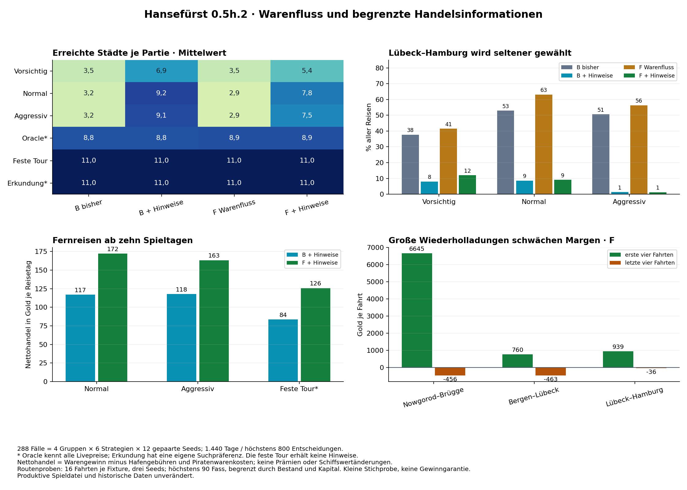

# Hansefürst 0.5h.2 – Regionale Wirtschaft spielreif vorbereiten

25.10.2026 · `analysis/phase05h2-regional-flows` · isolierte Analyse/Prototypen, keine produktive Aktivierung

## Ergebnis und Empfehlung

**Empfohlen für eine später ausdrücklich freizugebende Umsetzung: das Warenflussmodell F mit begrenzten Handelsinformationen und gemeinsamer Preisstabilisierung.** Es erzeugt regionale Preise tatsächlich über Versorgung, erhöht die gemessenen Fernhandelserträge gegenüber B und bringt normale Händler ohne feste Rundtour in neue Städte. Die untersuchte Parametrisierung ist trotzdem **noch keine uneingeschränkte Balance- oder Produktionsfreigabe**.

Normale Händler erreichen unter F mit Informationen im Mittel **7,83 statt 2,92 Städte**, mit **182 statt null Ankünften** in den sechs neuen Städten. Lange Reisen erzielen rund **172 Gold netto je Spieltag**, gegenüber 117 bei B mit Informationen. Die feste Ferntour steigt von 84 auf 126 Gold je langem Reisetag. Große wiederholte Pelz-/Tuchladungen schwächen die Marktgelegenheit deutlich ab. Kleine Ladungen bleiben in dieser begrenzten Probe allerdings durchgehend profitabel; Bergen verdient weiterhin wenig. Diese Punkte müssen vor der produktiven Entscheidung geklärt werden.

Wichtig: Informationen allein wirken stark. B mit Informationen erreicht bei normalen Händlern sogar mehr Städte als F mit Informationen (9,25 gegenüber 7,83), verdient aber weniger. F allein führt weiterhin keinen der Standardhändler in eine neue Stadt. Die Empfehlung beruht auf regionalem Warenfluss, Ertrag, Vielfalt und Reaktion auf Handel gemeinsam; sie ist keine Behauptung, dass eine Variante bei jeder Kennzahl gewinnt.



## 1. Grundlage, Quellen und getesteter Code

Ausgangspunkt ist der aktuelle integrierte Entwicklungszweig mit 0.5h: **`8ec30ba8c53756769e98921f9125163313bf1666`**. 0.5h hat ausschließlich Analyse-/Testvarianten ergänzt; die produktive Wirtschaft ist damit noch nicht B. Sie bleibt auch jetzt unverändert.

Gelesen und wiederverwendet: [Bericht 0.5h](2026-10-25_0.5h_regionale_wirtschaft.md), [Analyse 0.5e](2026-10-24_0.5e_wirtschaftsanalyse.md), [Simulationsdokumentation](../../tests/simulation/README.md), B-Prototyp, bestehende Handelsstrategien, täglicher Beobachter, Ereignis-/Finanzabrechnung und Regressionen. Keine neue Wirtschaftsengine, keine Neuberechnung der historischen 1.500er-Analyse.

- Tatsächlich getestete produktive HTML: Basiscommit oben; letzter Spielcode-Änderungscommit `d624977baeb4d710a346ced8d5d06be44b67dfa1`. SHA-256: `507191e59dc592cf4eef658ba27289eff21a04c181ef88d2d63a79c24c5af949`. Datei bytegleich.
- Eingefrorene und tatsächlich ausgeführte Hauptprototypen/Informationsplanung: **`6016c3653bbd7c8af54d606e018a05d52c104a1a`**. Sämtliche Manifest-Quellhashes stimmen nach Abschluss weiter überein.
- Tatsächlich ausgeführte ergänzende Markt-, Routen- und Migrationsprüfungen sowie Auswertung/Grafik: **`5465450ab90519db4e1be5327cefc413ad103c47`**. Der Bericht wurde danach erstellt, ohne selbstreferenzielle Code-ID.
- **371 zuvor vorhandene Ergebnis-/Protokolldateien** bleiben bytegleich. Alle 72 aktuellen B-Kontrollfälle stimmen vollständig mit ihren 0.5h-Vorgängern überein, nach Entfernen ausschließlich des neu hinzugefügten Informationsprotokolls. 48 Oracle-/Tour-Kontrollen sind zwischen Info-Aus und Info-An vollständig identisch.

## 2. Warum das bisherige B noch nicht genügte

B bringt typische Bestände hervor, bindet Preise aber gleichzeitig direkt an regionale Richtwerte. Die Preisformel verwendet `1 − 0,32 × Regionalprofil` und misst Knappheit relativ zum **jeweiligen regionalen Zielbestand**. Ist dieser erreicht, verschwindet der Knappheitsbeitrag; der regionale Preisabstand bleibt. Ursache der dauerhaften Preisunterschiede ist damit wesentlich die direkte Zielpreisvorgabe.

Eine gezielte Sechsjahresprobe entfernt nur diesen direkten Preisabstand. Bestände bleiben dieselben; erwartete regionale Preisrichtung im sechsten Jahr fällt von **45/45 auf 18/45** spezialisierten Zellen. Das stützt die Ursachenanalyse unmittelbar. Es ist kein Beleg, dass Bestände in B niemals wirken: große Käufe verändern auch dort vorübergehend den Knappheitsbeitrag.

Langreisen binden unter unveränderten Regeln Zeit, Kapital und höchstens 90 Fass Koggenraum. Ein geringer Stückgewinn bei Fisch/Getreide lässt sich nicht beliebig durch mehr Fass ausgleichen. Große Mengen können das Ausgangsangebot ausschöpfen und das Ziel überversorgen. Kurze bekannte Margen bleiben für zeitbewertende Planer attraktiv; unbekannte Preise erscheinen ohne Hinweise nicht als Alternative. Deshalb werden Mengen, Zeit, Kapital, Marge und Zielversorgung gemeinsam betrachtet, statt entfernte Ziele mit pauschalen Prämien zu belohnen.

## 3. Zielmodell: regionale Warenflüsse statt regionaler Preisaufschläge

Die **unveränderten elf Stadtprofile aus 0.5h** bleiben erhalten. Beispiel: Nowgorod Pelze/Pech, Brügge Tuch/Eisenwaren, Bergen Fisch, Danzig Getreide/Holz. Venlo bleibt Hansegras-/Bierprofil ohne Sonderauszahlung. Hanf und Hansegras sind getrennt; alle Stadt-/Warenindizes bleiben unverändert. Die Profile sind plausible Spielentwürfe, keine wissenschaftliche Rekonstruktion mittelalterlicher Produktion.

F erweitert den vorhandenen B-Prototyp ausschließlich im Testkontext. Der vorhandene Markt-Zellschritt wird wiederverwendet; Reisen, Handel, FIFO, Bank, Gebühren, Piraten, Karriere und Speicherfunktionen bleiben tatsächlicher Spielcode.

| Bestandteil | B unverändert | F Warenfluss |
|---|---|---|
| Regionalität der Preise | direkter Faktor ±32 % und Bestand relativ zu regionalem Ziel | **keine Stadt-/Profilvariable in der Preisformel** |
| Saldo regionaler Produktion/Verbrauch | Rückführung auf Zielbestände 175/110/45 | Überschuss +1,2 Fass/Tag, neutral 0, Mangel −1,2 |
| Gemeinsamer Bestandsausgleich | 0,035 × (regionaler Zielbestand − Bestand) | 0,015 × (110 − tatsächlicher Bestand) |
| Bestandszufall | −7…+7, gerundet | gleich |
| Rechnerische Bestandsruhelage | 175 / 110 / 45 | 190 / 110 / 30 |
| Bezug für Knappheit | regionaler Zielbestand | **einheitlich 110 Fass** |
| Knappheitsstärke | 0,55 je 100 Fass Differenz | 0,90 relativ zu 110 Fass |
| Preisrückführung je ausgelöstem Update | 0,030 | 0,020 |
| Richtpreisfaktor begrenzt | 0,45–1,80 | 0,40–2,00 |

F-Bestandsschritt:

`Bestand morgen = begrenze(runde(Bestand + Zufall + 1,2 × Profil + 0,015 × (110 − Bestand)); 3; 240)`.

Dies ist ein **saldierter örtlicher Warenfluss**: typische Produktion/Verbrauch plus allgemeiner Versorgungsausgleich, keine neue Fabrik mit Arbeiter- oder Ressourcenketten. Nettowarenfluss meint nicht, dass an jeder einzelnen Zufallstagsziehung tatsächlich genau 1,2 ganze Fass entstehen. Bestehende Zufallsbewegung und Rundung bleiben enthalten. Die rechnerische Ruhelage ist wegen Grenzen, Zufall und Rundung nicht gleich dem gemessenen Mittelbestand.

F-Preisrichtwert:

`Bestandsfaktor = begrenze(1 + 0,90 × (110 − Bestand)/110; 0,40; 2,00)`.

Bei einem wie bisher mit 35 % Wahrscheinlichkeit ausgelösten Update gilt vor Rundung/Untergrenze:

`neuer Preis = bisherige Zufallsbewegung + 0,020 × (Warenbasispreis − bisheriger Preis) + 0,020 × Warenbasispreis × (Bestandsfaktor − 1)`.

Der erste Zusatz ist die **gemeinsame Preisstabilisierung**, der zweite der **Bestandsbeitrag**. Keine Stadt erhält allein aufgrund ihres Namens einen Rabatt. Bei gleicher Ware, gleichem Preis und Bestand ist die weitere Preisformel in allen Städten gleich; das wird direkt geprüft. Produktion und Verbrauch ändern anschließend die Bestände unterschiedlich. Keine zusätzliche Zufallsziehung, keine Änderung am sofortigen Kauf-/Verkaufspreis. Eigener Handel wirkt über den Bestand in folgenden Tagesupdates.

Die Richtfaktorgrenze ist **kein harter Preisdeckel**. Tatsächliche Preise können durch Zufall und vorhandene Ereignisse davon abweichen. Untergrenze 4 Gold und tägliche Bestandsgrenzen 3–240 bleiben. Direktes Aufkaufen kann den Bestand vor dem nächsten Tag auf null reduzieren; großer Verkauf kann ihn vor dem nächsten täglichen Ausgleich über 240 erhöhen. Negative Bestände bleiben unzulässig.

### Warum die gemeinsame Preisstabilisierung vorerst bleibt

Sie ist nicht mit regionalen Preisaufschlägen gleichzusetzen, aber weiterhin ein wesentlicher Eingriff. Ohne sie steigt der normalisierte mittlere Preisindex von F in der kontrollierten Probe bis Jahr 6 auf **2,618**, statt **1,015** mit Stabilisierung; die Mangelwaren erreichen im Mittel 8,855 Basiswerte. Einzelpreise reichen dann bis 3.909 Gold. Diese absichtlich problematische Ablation wurde nicht als Kandidat weiterverwendet.

Über 182.544 ausgelöste F-Updates ergeben sich absolute **ungerundete** Korrekturbeträge von 49.935 Gold aus Stabilisierung und 52.313 aus Beständen. Die Stabilisierung entspricht damit 48,8 % der Summe beider Absolutbeträge. Das ist **kein Anteil erklärter Preisvarianz** und keine Behauptung, die Hälfte jedes Preises sei künstlich erzeugt. Es zeigt, dass die direkte gemeinsame Rückführung nicht als bedeutungslos verschwiegen werden darf. Die Entscheidung, sie beizubehalten, ist durch die getrennte Ablation begründet.

## 4. Handelsinformationen ohne Fernpreis-Oracle

Der isolierte Prototyp unterscheidet drei Ebenen:

1. **Ortskunde:** typische Überschuss-/Mangelwaren, unabhängig von heutigen Preisen.
2. **Datierter Versorgungsbericht:** höchstens ein nichtlokaler Stadt-/Warenbericht je aktuellem Hafen und Spieltag. Inhalt: Stadt, Ware, Datum und Band „reichlich / gewöhnlich / knapp“, **kein exakter Bestand und kein Preis**. Derselbe Hafen-/Tag liefert beim erneuten Öffnen keinen weiteren Bericht. Auswahl erfolgt ohne Suche nach einem günstigen Preis.
3. **Eigenes Preisbuch:** tatsächlich besuchte Preise mit Beobachtungsdatum, unverändert durch öffentliche Berichte.

Beispiel für eine spätere Einbettung beim bestehenden Hafenmeister oder in Händlergespräche – aus dem gespeicherten F_info-Pilotlauf, keine erfundenen aktuellen Fernpreise:

> Ortskunde: „Nowgorod ist für Pelze und Waldwaren bekannt.“
>
> Bericht aus Stralsund, Tag 145 / 1351: „Aus Nowgorod wird ein reichliches Pelzangebot gemeldet.“
>
> Eigenes Preisbuch: „Lübeck, Tag 1 / 1350: Pelze 142 Gold.“ Dieser alte selbst beobachtete Wert wird nicht durch den Bericht ersetzt.

Weitere tatsächlich publizierte Pilotbeispiele: Bergen/Getreide knapp (Tag 342 / 1350), Brügge/Tuch reichlich (Tag 253 / 1350). Ein Bericht kann inzwischen veraltet sein und ist keine Gewinnzusage.

**Umgesetzt ist der isolierte Informations- und Planungsprototyp, keine fertige produktive Bedienoberfläche.** Keine neuen Hauptmenüs oder heimlichen Fernpreislisten. Die konkrete Einbindung in Hafenmeister/Badehaus/Preisbuch bleibt ein später freizugebender Umsetzungsschritt.

### Wie der beobachtungsbasierte Bot daraus entscheidet

Er schätzt aus eigenen Preisnotizen einen Warenrichtwert und verwendet öffentliches Ortswissen als unsicheren Faktor: Überschuss 0,60, neutral 1,00, Mangel 1,40. Für beide Marktmodelle gelten **dieselben** Annahmen; der Bot kennt weder F-Parameter noch heutige Fernpreise. Ein höchstens 90 Tage alter Bericht verschiebt den Schätzwert um Faktor 0,90 bei reichlich oder 1,10 bei knapp. Unbekannte Verkaufspreise werden um 20 % abgewertet, unbekannte Einkaufspreise um 20 % erhöht. Dies sind ausdrücklich angenommene Planungsregeln, keine vom Spiel garantierten Spannen.

Standardhändler vergleichen den erwarteten wirtschaftlichen Ertrag mit ihrer bestehenden Mengen-, Reserve- und Zeitbewertung. Auch ein leerer Einkaufsausflug muss einen positiven geplanten Rundreiseertrag nach zwei Gebühren, Kapitalbedarf, Kapazität und Sicherheitsabschlag zeigen. Die angenommene Rückfahrt wird nicht erzwungen und nicht als gelungen gezählt, wenn der Händler später anders fährt. Normale Händler erhalten **keine zusätzliche Neugierprämie**. Der bereits vorhandene Explorer behält dagegen seine ausdrücklich benannte Suchpräferenz.

Ein feindlicher Proxy sperrt dem neuen Planer sämtliche Märkte und Zufallszugriffe; 120 kontrollierte Planungskombinationen werden geprüft. Der Berichtspublizierer kann nur Bestände lesen, selbst bei gesperrten Fernpreiseigenschaften. Eigene beobachtete Preise bleiben getrennt. Die bereits vorhandenen normalen Planungen behalten zusätzlich ihren ursprünglichen Beobachtungsaudit. Kein Spielstand erhält neue Informationsfelder; die datierten Berichte sind im Prototyp vorübergehendes Sitzungswissen.

**Grenze der Wirkungszuordnung:** Ortskunde und datierte Berichte wurden zusammen zugeschaltet. Ihre Einzelbeiträge sind deshalb nicht als kausal getrennte Effekte gemessen. Die protokollierte Basis einer Entscheidung zeigt, welcher Hinweis benutzt wurde, ersetzt aber keine zusätzliche Ablation.

## 5. Vergleichsplan und tatsächlicher Umfang

Vier Gruppen: **B, B + Info, F, F + Info**, jeweils sechs bestehende Handelsweisen und zwölf gepaarte Seeds **10001–10012**. Echter Lübeck-Start, 5.000 Gold, 9.960 Gold Buchvermögen, eine Kogge. Bis 1.440 Tage/800 Entscheidungen, letzte Reise darf überschreiten. Tatsächlich **1.440–1.481 Tage**, alle Fälle erreichen den Tageshorizont; keine vorzeitigen technischen oder finanziellen Abbrüche.

**288 Gruppen-/Strategie-/Seed-Fälle, 312 vollständige Engine-Ausführungen**: 24 Pilotfälle mit 24 exakten Replays, anschließend 264 Ergänzungen; die Pilotfälle werden wiederverwendet. Kein technischer Fehlversuch und kein nachträgliches Parametertuning. Keine neue 1.500er-/2.250er-Simulation. Der explizite Nutzerumfang ersetzt hier den allgemeinen 1.500er-Hinweis aus `AGENTS.md`.

Der Oracle kennt alle Livepreise. Die feste Ferntour erzwingt alle elf Städte. Beide erhalten bewusst keinen Informationsaufsatz und sind unveränderte Kontrollen; ihre 48 Info-An/Info-Aus-Fälle sind wirtschaftlich identische Wiederholungen, keine unabhängigen Informationsnachweise. Der Explorer besitzt eine eigene Suchpräferenz. Die 72 B-Fälle wiederholen historische Seeds zur Vergleichssicherung; sie sind keine zusätzliche unabhängige historische Stichprobe.

Zusätzlich, **keine vollständigen Strategiepartien**:

- zehn deterministische Sechsjahres-Marktverläufe: B, B ohne direkten Regionalpreis, F, F ohne gemeinsame Preisstabilisierung, F ohne regionale Warenflüsse; jeweils Seeds 61001/61002;
- vier gepaarte Kauf-/Lagerimpulsproben (B/F × 20/90 Fass, Seed 61101);
- 84 kurze Routen-Fixtures mit 1.344 echten Fahrten: sieben Routen-/Warenvorgaben × zwei Modelle × drei Seeds × zwei Mengen, je 16 Fahrten; sechsjährige Marktaufwärmung ohne Händler vor dem gesetzten Teststart;
- acht Mechanikgruppen und 24 historische v6-Aktivierungsproben mit beiden Hafenarbeitsmarkerzuständen.

Zwölf Seeds je Hauptgruppe und drei je Routenprobe erlauben eine begrenzte Untersuchung, keine zuverlässigen seltenen Risikoquoten. Simulierte Tage sind keine menschlichen Spielstunden; 20–30 aktive Stunden bis Eldermann bleiben ungeprüft.

## 6. Städte, Routen und wirtschaftlich begründete Erkundung

Städte schließen den Start Lübeck ein. „Neue Ankünfte“ zählt tatsächliche Reisen nach Danzig, Bergen, Visby, Brügge, Nowgorod oder Venlo. Routen sind gerichtete Stadtpaare; Ø jeweils pro Partie. Leerfahrten bleiben im Nenner.

| Gruppe / Strategie | Städte Ø | alle elf / 12 | neue Ankünfte | Routen Ø | Lübeck↔Hamburg |
|---|---:|---:|---:|---:|---:|
| B bisher / Vorsichtig | 3,50 | 0 | 0 | 8,2 | 37,7 % |
| B bisher / Normal | 3,17 | 0 | 0 | 6,5 | 53,0 % |
| B bisher / Aggressiv | 3,17 | 0 | 0 | 7,2 | 50,5 % |
| B bisher / Oracle* | 8,83 | 0 | 447 | 37,3 | 9,2 % |
| B bisher / Feste Tour | 11,00 | 12 | 816 | 12,0 | 8,7 % |
| B bisher / Erkundung* | 11,00 | 12 | 408 | 34,2 | 7,0 % |
| B + Info / Vorsichtig | 6,92 | 0 | 186 | 18,3 | 8,0 % |
| B + Info / Normal | 9,25 | 1 | 384 | 29,6 | 8,6 % |
| B + Info / Aggressiv | 9,08 | 0 | 574 | 38,5 | 1,3 % |
| B + Info / Oracle* | 8,83 | 0 | 447 | 37,3 | 9,2 % |
| B + Info / Feste Tour | 11,00 | 12 | 816 | 12,0 | 8,7 % |
| B + Info / Erkundung* | 11,00 | 12 | 397 | 34,4 | 10,5 % |
| F Warenfluss / Vorsichtig | 3,50 | 0 | 0 | 7,9 | 41,5 % |
| F Warenfluss / Normal | 2,92 | 0 | 0 | 5,8 | 63,1 % |
| F Warenfluss / Aggressiv | 2,92 | 0 | 0 | 5,8 | 56,3 % |
| F Warenfluss / Oracle* | 8,92 | 0 | 380 | 36,7 | 7,3 % |
| F Warenfluss / Feste Tour | 11,00 | 12 | 814 | 12,0 | 8,7 % |
| F Warenfluss / Erkundung* | 11,00 | 12 | 431 | 38,4 | 8,4 % |
| F + Info / Vorsichtig | 5,42 | 0 | 37 | 15,4 | 12,0 % |
| F + Info / Normal | 7,83 | 0 | 182 | 26,4 | 9,1 % |
| F + Info / Aggressiv | 7,50 | 0 | 516 | 27,6 | 1,2 % |
| F + Info / Oracle* | 8,92 | 0 | 380 | 36,7 | 7,3 % |
| F + Info / Feste Tour | 11,00 | 12 | 814 | 12,0 | 8,7 % |
| F + Info / Erkundung* | 11,00 | 12 | 358 | 36,8 | 7,8 % |

Warenfluss allein erzeugt noch keine Entdeckung: **0 neue Ankünfte bei allen 36 Standardpartien ohne Information**, sowohl B als auch F. Bei F + Info erreichen normale Händler 6–9 Städte; kein normaler Händler besucht alle elf. Vorsichtige Händler bleiben überwiegend im alten Netz: im vierten Jahr keine neue Ankunft in dieser Gruppe. Der gemeinsame Lübeck↔Hamburg-Anteil der drei Standardgruppen fällt B→B_info von **47,02 auf 7,55 %**, F→F_info von **53,60 auf 9,91 %**.

Der normale F_info-Händler besucht neue Städte nicht nur einmal: Jahresankünfte 63 / 41 / 49 / 28, danach eine überziehende letzte Fahrt. Im vierten Jahr entspricht das **28/1.163 = 2,41 %** seiner Reisen. Aggressive Händler erreichen im vierten Jahr 128/218 = 58,72 % neue Ziele, verzichten mit ihrer unveränderten Zeitbewertung aber auf höhere Tageserträge. Dauerhafter Fernhandel ist damit je Spielweise unterschiedlich stark, nicht allgemein gelöst.

Die alten Explorer erreichen in allen Gruppen 12/12-mal elf Städte. Dass normale Händler ohne deren Informationspräferenz nun mehr Orte erreichen, ist der neue Nachweis. Ihre wirtschaftliche Auswahl ist trotzdem ein Botmodell mit guten öffentlichen Ortskenntnissen, kein beobachtetes menschliches Verhalten.

### Schätzungen und tatsächliche Ergebnisse getrennt

Unter F_info Normal sind **62 direkt informationsgestützte Handelsfahrten** erfasst, davon **19 mit negativem Nettohandel**; tatsächlich rund 135 Gold Netto je Reisetag. Die Gesamtheit seiner langen Fahrten erzielt 172 Gold/Tag, weil dort auch später mit eigenen Preisnotizen gewählte Reisen enthalten sind. Das sind verschiedene Nenner und dürfen nicht gleichgesetzt werden.

Zusätzlich 20 wirtschaftlich geplante Einkaufsausflüge: 13 kehren unmittelbar zum Ausgangshafen zurück. Diese 13 Paare erzielen zusammen 27.992 Gold nach Gebühren/Warenverlusten, keines davon negativ. Sieben andere Weiterverläufe werden **nicht** als erfolgreiche geplante Rundreise ausgegeben. Das ist keine 20/20-Erfolgsbehauptung. Die Informationsprognosen sind erkennbar fehlbar; ihre Erwartungsgewinne werden nicht als erspielter Gewinn verbucht.

## 7. Ertrag, Liquidität und politischer Aufstieg

Nettohandel = realisierter Warengewinn minus Hafengebühren und Einkaufskosten geraubter Ware. Prämien, Zinsen und Schiffswertänderungen sind nicht enthalten. Alle Verkäufe haben bekannte Einkaufskosten. Verkäufe werden der tatsächlichen unmittelbar vorhergehenden Reise zugeordnet. Gewinne je Tag verwenden tatsächliche Laufzeit, keine ungleichen nominellen Horizonte. Endvermögen enthält Buchwerte; Gold ist liquide.

| Gruppe / Strategie | Endvermögen Median | Gold Median | Netto/Reise | Netto/Tag | Eldermann / 12 |
|---|---:|---:|---:|---:|---:|
| B bisher / Vorsichtig | 228.876 | 225.435 | 475 | 151 | 12 |
| B bisher / Normal | 335.566 | 332.126 | 691 | 222 | 12 |
| B bisher / Aggressiv | 423.116 | 419.676 | 938 | 285 | 12 |
| B bisher / Oracle* | 430.143 | 426.702 | 1.205 | 290 | 12 |
| B bisher / Feste Tour | 167.819 | 164.334 | 1.177 | 109 | 1 |
| B bisher / Erkundung* | 329.772 | 326.332 | 979 | 220 | 12 |
| B + Info / Vorsichtig | 230.356 | 226.914 | 511 | 154 | 12 |
| B + Info / Normal | 349.820 | 346.380 | 1.020 | 236 | 12 |
| B + Info / Aggressiv | 215.140 | 211.340 | 2.351 | 143 | 10 |
| B + Info / Oracle* | 430.143 | 426.702 | 1.205 | 290 | 12 |
| B + Info / Feste Tour | 167.819 | 164.334 | 1.177 | 109 | 1 |
| B + Info / Erkundung* | 322.677 | 319.236 | 979 | 216 | 12 |
| F Warenfluss / Vorsichtig | 288.522 | 285.080 | 618 | 198 | 12 |
| F Warenfluss / Normal | 387.714 | 384.272 | 811 | 261 | 12 |
| F Warenfluss / Aggressiv | 503.659 | 500.218 | 1.064 | 331 | 12 |
| F Warenfluss / Oracle* | 516.672 | 513.230 | 1.475 | 351 | 12 |
| F Warenfluss / Feste Tour | 261.698 | 258.258 | 1.866 | 174 | 12 |
| F Warenfluss / Erkundung* | 457.910 | 454.468 | 1.460 | 311 | 12 |
| F + Info / Vorsichtig | 347.630 | 344.188 | 731 | 231 | 12 |
| F + Info / Normal | 492.317 | 488.876 | 1.291 | 338 | 12 |
| F + Info / Aggressiv | 294.496 | 290.871 | 3.673 | 188 | 12 |
| F + Info / Oracle* | 516.672 | 513.230 | 1.475 | 351 | 12 |
| F + Info / Feste Tour | 261.698 | 258.258 | 1.866 | 174 | 12 |
| F + Info / Erkundung* | 470.246 | 466.805 | 1.406 | 325 | 12 |

Die Informationen führen nicht automatisch zu mehr Reichtum: F aggressiv verdient rund 331 Gold/Tag, F_info aggressiv nur 188, aber je Reise 1.064 gegenüber 3.673. Er reist weiter und trifft andere Entscheidungen. Normale Händler profitieren in dieser Probe dagegen sowohl bei Vielfalt als auch Vermögen/Ertrag. Das stützt die gemeinsame Betrachtung von Ertrag je Tag, je Entscheidung und Risiko.

In allen 288 Hauptfällen **keine finanzielle Reiseblockade, kein negatives Endvermögen**. Keine dieser Erfolgspolitiken nutzt Kredit, Reparatur, Schiffverkauf oder Hafenarbeit. Daraus folgt keine Sicherheit für absichtliche Verluste oder typische menschliche Fehler; die historische Stressgruppe wurde nicht neu gespielt. Kredit-/Rettungsfunktionen werden separat gezielt geprüft.

Alle sechs Gruppen versuchen Beförderung. Eldermann B/B_info/F/F_info: **61/72 / 59/72 / 72/72 / 72/72**. Unter B_info bleiben zusätzlich zwei aggressive Händler unter Eldermann; B-Ferntour schafft es nur 1/12-mal. F erreicht bei unveränderten politischen Voraussetzungen auch mit der festen Tour 12/12. Das ist eine wirtschaftliche Wirkung, keine Änderung der Karrierebedingungen oder Aussage zur gewünschten menschlichen Spieldauer.

Natürliche Aufträge entstehen nur beim Oracle: B und B_info jeweils **36 / 36.636 Gold**, F und F_info jeweils **28 / 30.962 Gold**. Tatsächliche Ereignisse, geprüfte Herkunft/Prämien und optimierte Strategiezähler stimmen überein. Diese Prämien sind im Endgold, nicht im Nettohandel. Die ältere Oracle-Auftragsroutenwahl bleibt nur teilweise validiert.

### Lange Reisen gesondert

„Lang“ bedeutet hier mindestens **zehn tatsächlich benötigte Spieltage**, keine neue Reise- oder Gebührenregel. Neue Städte sind damit nicht identisch. Alle langen Reisen einschließlich leerer/negativer bleiben enthalten.

| Gruppe / Strategie | lange Reisen | Netto/Reise | Netto/Reisetag | negative lange Reisen |
|---|---:|---:|---:|---:|
| B bisher / Oracle* | 157 | 1.900 | 138 | 0,0 % |
| B bisher / Feste Tour | 640 | 1.661 | 84 | 8,8 % |
| B bisher / Erkundung* | 191 | 1.202 | 72 | 27,2 % |
| B + Info / Normal | 142 | 1.912 | 117 | 9,9 % |
| B + Info / Aggressiv | 744 | 2.492 | 118 | 7,0 % |
| B + Info / Oracle* | 157 | 1.900 | 138 | 0,0 % |
| B + Info / Feste Tour | 640 | 1.661 | 84 | 8,8 % |
| B + Info / Erkundung* | 223 | 1.458 | 85 | 21,1 % |
| F Warenfluss / Oracle* | 179 | 2.452 | 170 | 1,1 % |
| F Warenfluss / Feste Tour | 638 | 2.499 | 126 | 7,8 % |
| F Warenfluss / Erkundung* | 232 | 2.162 | 130 | 21,1 % |
| F + Info / Normal | 101 | 2.224 | 172 | 6,9 % |
| F + Info / Aggressiv | 720 | 3.791 | 163 | 5,4 % |
| F + Info / Oracle* | 179 | 2.452 | 170 | 1,1 % |
| F + Info / Feste Tour | 638 | 2.499 | 126 | 7,8 % |
| F + Info / Erkundung* | 201 | 2.355 | 148 | 22,9 % |

Ohne Information führen normale/aggressive Standardhändler unter B/F keine so langen Reisen aus; fehlende Fahrten sind kein gemessener Gewinn von null. Die feste Tour verbessert sich F gegenüber B von **84 auf 126 Gold/Tag**, der selektive Oracle von 138 auf 170. Die historische produktive Kontrollwirtschaft aus 0.5h lag bei der festen Tour bei rund **237 Gold/Tag**. F verbessert damit B, übertrifft nicht das bisherige ungebundene Zufallssystem. Selektiv gute Oracle-Fahrten sind keine Gewinnzusage für einen nicht allwissenden Spieler.

## 8. Wiederholte Routen, Mengen und Aufnahmefähigkeit

Drei Seeds **62001–62003**, jeweils 16 Fahrten pro Fixture. Anfangs nach sechsjähriger Marktaufwärmung eine Kogge mit 5.000 Gold im festgelegten Quellhafen; dieser gesetzte Standort ist **kein erspielter Fernstart**. Warenwahl je Richtung fest, kein Preis-Oracle. Kleine Sollmenge 22, große 90 Fass; tatsächliche Menge zusätzlich durch Bestand und Kapital begrenzt. Echte Käufe, Reisezeiten, Gebühren, Ereignisse und Verkäufe, keine gratis Transporttage.

Routenwaren: Nowgorod→Brügge Pelze/zurück Tuch; Bergen→Lübeck Fisch/zurück Getreide; Danzig→Brügge getrennt Getreide oder Holz/zurück Tuch; Venlo→Brügge Hansegras/zurück Tuch; Venlo→Hamburg Hansegras/zurück Holz; Lübeck→Hamburg Salz/zurück Bier. Die Vorgaben sind Versuchsstrategien, keine Empfehlung für jedes aktuelle Marktangebot.

| Modell / Route | Sollmenge | tatsächlich gekauft Ø | Netto/Fahrt Ø | Netto/Tag | negative Fahrten / 48 |
|---|---:|---:|---:|---:|---:|
| B / Nowgorod–Brügge | 22 | 22,0 | 921 | 29 | 0 |
| B / Nowgorod–Brügge | 90 | 88,1 | 2.097 | 66 | 3 |
| B / Bergen–Lübeck | 22 | 22,0 | 60 | 5 | 11 |
| B / Bergen–Lübeck | 90 | 73,8 | -146 | -12 | 27 |
| B / Danzig–Brügge (Getreide) | 22 | 22,0 | 472 | 27 | 2 |
| B / Danzig–Brügge (Getreide) | 90 | 90,0 | 872 | 50 | 17 |
| B / Danzig–Brügge (Holz) | 22 | 22,0 | 505 | 29 | 1 |
| B / Danzig–Brügge (Holz) | 90 | 90,0 | 992 | 56 | 11 |
| B / Venlo–Brügge | 22 | 22,0 | 186 | 25 | 17 |
| B / Venlo–Brügge | 90 | 63,2 | -267 | -36 | 33 |
| B / Venlo–Hamburg | 22 | 21,6 | -142 | -11 | 37 |
| B / Venlo–Hamburg | 90 | 33,2 | -302 | -24 | 43 |
| B / Lübeck–Hamburg | 22 | 22,0 | 55 | 20 | 23 |
| B / Lübeck–Hamburg | 90 | 45,4 | 22 | 8 | 32 |
| F / Nowgorod–Brügge | 22 | 22,0 | 1.632 | 51 | 0 |
| F / Nowgorod–Brügge | 90 | 89,1 | 1.820 | 57 | 17 |
| F / Bergen–Lübeck | 22 | 21,8 | 134 | 11 | 5 |
| F / Bergen–Lübeck | 90 | 55,6 | 29 | 2 | 25 |
| F / Danzig–Brügge (Getreide) | 22 | 22,0 | 828 | 47 | 0 |
| F / Danzig–Brügge (Getreide) | 90 | 84,5 | 1.382 | 78 | 15 |
| F / Danzig–Brügge (Holz) | 22 | 22,0 | 915 | 52 | 0 |
| F / Danzig–Brügge (Holz) | 90 | 85,7 | 1.525 | 87 | 12 |
| F / Venlo–Brügge | 22 | 22,0 | 416 | 56 | 11 |
| F / Venlo–Brügge | 90 | 53,9 | 454 | 61 | 24 |
| F / Venlo–Hamburg | 22 | 19,5 | -147 | -12 | 35 |
| F / Venlo–Hamburg | 90 | 32,2 | -305 | -25 | 42 |
| F / Lübeck–Hamburg | 22 | 22,0 | 183 | 68 | 6 |
| F / Lübeck–Hamburg | 90 | 36,8 | 279 | 104 | 17 |

**Nowgorod bleibt langfristig interessant, jedoch mengenabhängig.** Bei großen F-Ladungen sinkt der mittlere Gewinn von 6.645 Gold in den ersten vier auf −456 Gold in den letzten vier Fahrten. Insgesamt 17/48 negative Fahrten; B bei denselben neuen Prüfseeds nur 3/48 negativ. Die historische 69/72-Probe hat andere Seeds/Umfang und wird nicht fälschlich als direkt gepaarte Verbesserung ausgegeben.

Bei 22 Fass sind die Nowgorod–Brügge-Fahrten dagegen sowohl unter B als auch F **48/48-mal positiv**, unter F im Mittel 1.632 Gold/Fahrt beziehungsweise 51 Gold/Tag. Auch die kleinen Danzig-Fahrten bleiben in dieser Stichprobe durchgehend positiv. Das ist ein offenes Risiko sehr verlässlicher Routinen, kein Beweis eines von Menge/Zeit/Marktlage unabhängigen garantierten Gewinns. Große Mengen können Vorteile übernutzen; kleine könnten sich durch den regelmäßigen Warenfluss weitgehend regenerieren. Eine profitable Produktions-/Verbrauchsroute ist nicht automatisch ein technischer Exploit.

**Bergen ist der schwächste gewünschte Fernhandelsfall.** F bringt kleine Fisch-/Getreideladungen im Mittel auf 11 Gold/Tag, große nur auf 2; 25/48 große Fahrten sind negativ. Die tatsächlich gekaufte große Menge beträgt wegen Kapital-/Versorgungsgrenzen im Mittel nur 55,6 Fass. Geringe Stückwerte, Aufnahmefähigkeit und lange Reise begrenzen den Ertrag. Mit diesem Versuch ist eine dauerhaft attraktive volle Bergen-Kogge noch nicht hinreichend belegt. Es wurden keine Fischpreise, Kapazitäten oder Reisezeiten heimlich erhöht beziehungsweise verkürzt.

Venlo→Hamburg bleibt im Mittel verlustreich. Venlo→Brügge ist unter F gewinnbringender, aber große Ladungen haben 24/48 negative Fahrten. Kein automatischer Hansegras-Gewinn wurde eingebaut oder nachgewiesen. Auch Lübeck↔Hamburg kann unter wiederholten großen festen Warenladungen ausgereizt werden; die Vergleichsbots wählen im Hauptlauf dagegen flexibel andere Waren. Beide Ergebnisse sind deshalb nicht widersprüchlich.

### Isolierte Kaufimpulse und spätere Erholung

Vier gepaarte Proben kaufen tatsächlich 20/90 Fass Pelze in Nowgorod und lagern sie ein. Beide Kontexte entwickeln sich danach mit identischen Zufallsziehungen; es erfolgt kein künstlicher Verkauf oder Warenzuwachs im Spielerbestand. Der zugehörige unbehandelte Vergleich bleibt ohne Kauf.

Bei 90 Fass liegt F nach 60 Tagen **zehn Gold höher** als ohne Kauf, nach 180 Tagen noch fünf, nach 360 Tagen ein Gold. Bestandsunterschiede bauen sich wieder ab. Das belegt sowohl Abschwächung durch Aufkauf als auch Regeneration des Angebots. Unter B beträgt der Preisunterschied nach 60 Tagen 13 Gold.

**Grenze:** Ein 20-Fass-Kauf ändert im sehr reichlich versorgten F-Markt dieses Seeds den Preis gar nicht, obwohl Bestand fehlt. Die Richtfaktorsättigung und Rundung können kleine Impulse wirkungslos lassen. Das ist ausdrücklich kein Nachweis, dass jede einzelne Handelsmenge den Preis sichtbar bewegt. Es wurde nach dem Hauptvergleich keine neue Parameteroptimierung begonnen.

## 9. Mehrjährige Marktentwicklung und Preisrückführung

Alle 121 Stadt-Waren-Kombinationen der Hauptpartien werden täglich auf endliche Preise und nichtnegative ganze Bestände geprüft, mit Jahresfenstern. Die ergänzenden zehn 2.160-Tage-Marktverläufe ohne Händler isolieren die Modellursachen. „Preisindex“ normalisiert jede Zelle nach dem unveränderten Warenbasiswert und gewichtet alle 121 Zellen gleich.

| Variante | Preisindex Jahr 1 | Jahr 4 | Jahr 6 | richtige regionale Preisrichtung Jahr 6 | Bestand Ø Jahr 6 |
|---|---:|---:|---:|---:|---:|
| B | 1,025 | 1,010 | 1,007 | 45/45 | 110,4 |
| B_no_direct_region | 1,025 | 1,005 | 1,010 | 18/45 | 110,4 |
| F | 1,067 | 1,034 | 1,015 | 45/45 | 113,0 |
| F_no_anchor | 1,175 | 2,103 | 2,618 | 45/45 | 113,0 |
| F_no_regional_flow | 1,068 | 1,011 | 1,003 | 21/45 | 112,6 |

B ohne direkten Regionalpreis hat trotz typischer Bestände keine verlässlichen Preisprofile. F ohne regionale Warenflüsse verliert diese ebenfalls (21/45). **F bildet Region über Versorgung** und erreicht im sechsten Jahr 45/45 erwartete Preisrichtungen im Mittel; das gilt nicht für jeden Einzelmarkt an jedem Tag. F ohne Stabilisierung behält zwar Preisrichtungen, entwickelt aber unplausibel große Niveauunterschiede. Beides ist für eine Empfehlung zu unterscheiden.

Gemessenes F-Jahr-6-Profil: Überschusswaren im Mittel 192,0 Fass und Preisindex 0,492; neutrale 112,0 / 0,991; Mangelwaren 40,8 / 1,593. Diese Werte sind Ergebnisse, keine fest garantierten Preise oder die rechnerische Ruhelage 190/110/30. Ein Ziel kann nach Lieferung überversorgt, ein Produktionshafen nach Aufkauf knapp sein; der Preis folgt dem tatsächlichen Bestand mit Verzögerung.

In den Hauptpartien beobachtete Preisbereiche: B **4–243**, B_info **4–261**, F **4–371**, F_info **4–387** Gold. Keine ungültigen, negativen oder nicht endlichen Preise/Bestände. Bestandsgrenzen verhindern unbegrenzte tägliche Marktanhäufung. Private Lagerbestände sind davon getrennt. Die zwei Sechsjahres-Seeds belegen keine mathematische Driftfreiheit oder Sicherheit für beliebig lange Partien; seltene Spitzen und große Flotten bleiben begrenzt geprüft.

## 10. Bestandsschutz und konkreter Einführungsplan

**Heute:** Kein produktiver Schalter, keine Migration, kein neues dauerhaftes Feld. Die unveränderte produktive HTML lädt bestehende v6-Stände weiterhin wie bisher. Informationsberichte und Modellwahl bestehen nur im jeweiligen isolierten Testkontext. Indizes, Warenherkunft, Bank/Kredit, Schiffverkauf, Hafenarbeit, Hafengebühren, Reisezeiten und politische Regeln bleiben unverändert.

24 echte historische v6-Endstände aus normalem Handel, Ferntour und Verlust-/Erholungsgruppe (je acht Seeds) wurden unverändert in den Test geladen. Installation von F und Informationen verändert **kein einziges gespeichertes Feld**, JSON-Rundlauf und Sofort-Nettovermögen bleiben exakt. Ein weiterer Tag erhält Gold, Schiffe, Ladung, Lager, FIFO und Flags, während normale Zinsen/Marktzeit wirken. Hafenarbeitsmarker false/true werden zusätzlich erhalten. Alle produktiven Speicherzugriffe sind in dieser Probe gesperrt: **keine Datei und kein lokaler Spielstand wird konvertiert**.

### Vorschlag für eine später ausdrücklich freizugebende Einführung

1. **Auswahl pro Partie klären:** neue Partien könnten nach Freigabe F verwenden; bestehende bleiben zunächst bei ihrer bisherigen Wirtschaft. Keine heimliche globale Umstellung.
2. **Original sichern:** unverändertes Original-v6 als separate unveränderliche Sicherung einschließlich ursprünglichem JSON und Prüfsumme erhalten; bei Backupfehler abbrechen.
3. **Vorschau ohne Vermögensänderung:** v6 validieren und exakt klonen. Gold, Bank, Schulden, 121 Preise/Bestände, Schiffe, Kapazitäten, Standorte, Ladung, Kosten, FIFO, elf Lager, Aufträge, Preisbuch und Hafenarbeitsmarker übernehmen. Nicht sofort auf neue Idealpreise oder Idealbestände setzen.
4. **Modus eindeutig speichern:** die Formel selbst benötigt kein neues Wirtschaftsfeld. Dauerhaft unterscheidbare alte/neue Partien benötigen jedoch eine freizugebende Modus-/Versionskennung. Bevorzugt wäre eine eindeutig versionierte neue Speicherhülle, etwa v7 mit Wirtschaftsmodus, sodass alte Clients sie ausdrücklich ablehnen statt stillschweigend nach alten Regeln fortzusetzen. Der genaue Schlüssel/Version ist noch keine implementierte Migration. Bloß ein von alten Clients ignoriertes Flag wäre unzureichend.
5. **Erst folgende Tage ändern:** bei ausdrücklicher Umstellung schrittweise mit den tatsächlichen vorhandenen Preisen/Beständen weiterrechnen. Kein sofortiger Goldbonus, kein Neubewerten von FIFO-Einkaufskosten, keine Neuzuordnung von Waren/Städten. Alte Preisnotizen bleiben datiert, sind bei neuer Wirtschaft aber wirtschaftlich weniger verlässlich.
6. **Ergebnis gemeinsam sichern:** erst nach erfolgreicher vollständiger Validierung die neue Partie atomar schreiben; Originalbackup behalten. Bei Fehlern Original weiter nutzbar lassen. Keine tägliche Hin-und-her-Moduswahl als Ausnutzungsweg anbieten. Rückkehr zum Original bedeutet Rückkehr zum damaligen Sicherungszeitpunkt, nicht Vermischen beider Wirtschaftslagen.
7. **Laufende menschliche Partien prüfen:** vor Freigabe repräsentative alte Ladungen, große Lager, hohe Schulden und langfristige Verträge beobachten; Herkunftsschutz allein garantiert keine wirtschaftlich faire Preisumstellung. Entscheidung, ob alte Partien überhaupt wechseln sollen, bleibt beim Nutzer.

Die Punkte 1–7 sind ein konkreter **noch nicht aktivierter Einführungsplan**. Die heutige Prüfung belegt die unveränderte Übernahme und den Folgetag, keine bereits abgenommene v7-Implementierung oder vollständige Fairness laufender menschlicher Partien. Für eine spätere dauerhaft erinnerte Gerüchtehistorie wäre zusätzlich zu entscheiden, ob beziehungsweise wie sie gespeichert wird; im Prototyp geht dieses Sitzungswissen beim Laden verloren, das echte Preisbuch bleibt erhalten.

## 11. Prüfungen, Quellen und Reproduktion

**16 einschlägige aktuelle Befehle, alle Exitcode 0** – vollständige Ausgaben in [phase05h2-regressions.json](../../tests/simulation/phase05h2-regressions.json):

```text
node tests/test-v04.cjs
node tests/phase1.cjs
node tests/telemetry.cjs
node tests/share.cjs
node tests/simulation/edges.cjs
node tests/simulation/warehouse-checks.cjs
node tests/simulation/warehouse-cities-checks.cjs
node tests/simulation/four-goods-checks.cjs
node tests/simulation/city-v6-migration-checks.cjs
node tests/simulation/eleven-cities-checks.cjs
node tests/simulation/eleven-cities-compat-checks.cjs
node tests/simulation/optimized-delivery-checks.cjs
node tests/simulation/price-rounding-checks.cjs
node tests/simulation/integration-checks.cjs
node tests/simulation/ship-sale-checks.cjs
node tests/simulation/harbor-work-checks.cjs
```

Zusätzlich tatsächlich ausgeführt:

- `node tests/simulation/regional-flow-checks.cjs tests/simulation/phase05h2-20261025-01/mechanism-checks.json`: **acht Gruppen**, einschließlich Preisbildung ohne Regionalvariable, gleicher RNG-Ziehungszahl, 484 Rückverkaufs-/Lagerkreisen und 9.680 Lagerbewegungen ohne Gold-/Waren-/FIFO-Zuwachs, Informationsschutz, v6, sechsjährigen Grenzen/Zinsen, 18 unveränderten Regelkörpern sowie tatsächlichem Schiffverkauf und einmaliger Hafenarbeit. Mindestpreis und echte Prämien-/Herkunftsprüfungen bleiben erhalten.
- `node tests/simulation/phase05h2-run.cjs --execute --pilot --directory tests/simulation/phase05h2-20261025-01`, danach derselbe Befehl ohne `--pilot`: 24 Pilotfälle + 24 Replays, 264 Ergänzungen, keine Abbrüche. Der Import des Runners startet keine Partien; ohne `--execute` wird nur der Plan gezeigt.
- `node tests/simulation/regional-flow-market-probes.cjs tests/simulation/phase05h2-20261025-01/market-probes.json.gz`: zehn kontrollierte Sechsjahresverläufe und vier gepaarte Impulse.
- `node tests/simulation/regional-flow-route-probes.cjs tests/simulation/phase05h2-20261025-01/route-probes.json`: 84 kurze Fixtures / 1.344 Reisen, keine finanzielle Blockade.
- `node tests/simulation/regional-flow-migration-checks.cjs tests/simulation/phase05h2-20261025-01/migration-checks.json`: 24 historische v6-Trockenproben und beide Hafenarbeitsmarkerzustände, keine produktive Speicherung.
- `phase05h2-analyse.py`, `phase05h2-evidence.py`, `phase05h2-figures.py`: **ausschließlich lesende Nachauswertung**, keine Engine-Starts. Auswertung mit neuem `/tmp/phase05h2-summary.json` und `/tmp/phase05h2-evidence.json`, anschließend verlustfreie Komprimierung. Syntax, lokale Berichtslinks, Rohdateiprüfsummen und bestehende Dateien abschließend geprüft.

Die historischen Ganzdatei-/Fünf-Städte-Wächter `catalog-foundation-checks.cjs` und `city-preparation-checks.cjs` bleiben unverändert und wurden nicht als aktuelle Laufzeittests ausgegeben. Keine Abschwächung historischer Schutzassertions. Keine große Browser-/Safari-Abnahme bei unverändertem Produktivcode und ohne produktive neue Oberfläche. Nicht ausgeführte Prüfungen gelten nicht als bestanden.

Quellen unter [phase05h2-20261025-01](../../tests/simulation/phase05h2-20261025-01):

- [Manifest mit Seeds, Grenzen und Codehashes](../../tests/simulation/phase05h2-20261025-01/manifest.json), [Pilotfreigabe](../../tests/simulation/phase05h2-20261025-01/pilot-gate.json), [Abschluss](../../tests/simulation/phase05h2-20261025-01/execution-complete.json), [tatsächliche Ausführungen](../../tests/simulation/phase05h2-20261025-01/attempts.jsonl).
- 288 einzelne Rohdateien `GRUPPE-STRATEGIE-SEED.json.gz`: vollständige Ereignisse, Start/Ende, Finanz-/Warenabrechnung, tägliche Marktstatistiken/Jahresfenster und Informationsentscheidungen. `summary.json.gz` enthält Gruppen, Fälle, Städte, Waren, Routen und Rohdatei-Prüfsummen; `groups.csv` ist eine einfache Vergleichstabelle.
- [evidence.json.gz](../../tests/simulation/phase05h2-20261025-01/evidence.json.gz): historische B-Parität, unveränderte Kontrollen, jährliche Besuche, nachweislich gewählte Informationsfahrten, echte Rückfahrten, Ablationen und Mengenrouten.
- [market-probes.json.gz](../../tests/simulation/phase05h2-20261025-01/market-probes.json.gz), [route-probes.json](../../tests/simulation/phase05h2-20261025-01/route-probes.json), [migration-checks.json](../../tests/simulation/phase05h2-20261025-01/migration-checks.json), [mechanism-checks.json](../../tests/simulation/phase05h2-20261025-01/mechanism-checks.json), [verification.json](../../tests/simulation/phase05h2-20261025-01/verification.json).
- [Zwischenstände](2026-10-25_0.5h2_fortschritt.md) und [exportierbare Vergleichsgrafik](2026-10-25_0.5h2_vergleich.png). Historische 0.5h-/0.5e-Dateien bleiben unverändert lesbar und werden nicht als neue Ergebnisse ausgegeben.

## 12. Nachweise, Vermutungen und offene Entscheidungen

**Nachgewiesen:** bessere regionale Herleitung aus Beständen; langfristige Preisrichtungen in den kontrollierten Fällen; mehr normale Händlerziele mit begrenzten Informationen; höhere lange Tageserträge gegenüber B; deutliche Abschwächung großer Wiederholgeschäfte; geprüfte Abrechnung/Grenzen/FIFO und unveränderte v6-Übernahme. Keine unmittelbare Gold-/Lager-/Kreditvermehrung in den geprüften Kreisen. Keine technischen Abbrüche oder fehlgeschlagenen aktuellen Prüfbefehle dieser Runde.

**Begründete spielerische Vermutung:** F mit Hinweisen könnte das gewünschte Patrizier-Spielgefühl besser tragen, weil Versorgung und Ortskunde wichtiger werden. Menschlicher Spielspaß, verständliche Bedienung und echte Entdeckung wurden noch nicht beobachtet. Die öffentliche Ortskenntnis der Bots und ihre numerischen Schätzregeln sind deutlich systematischer als Anfängerwissen.

**Offen vor produktiver Freigabe:**

1. **Bergen:** Die untersuchte Fisch-/Getreide-Kogge ist noch keine überzeugende dauerhafte Fernroute. Reicht der größere Warenfluss ohne gesonderte Preis-/Zeitänderung für das gewünschte Spielziel?
2. **Kleine Routinen:** 48/48 positive kleine Pelz-/Tuchfahrten und positive kleine Danzig-Kreise bleiben zuverlässig. Wie viel planbare Produktionsroute ist erwünscht? Allgemeine Exploitfreiheit ist nicht bewiesen.
3. **Kleine Marktimpulse:** Richtwertsättigung/Rundung können sie unsichtbar machen. Der 20-Fass-Pelzkauf ist der konkrete offene Fall; eine nachträgliche Änderung wurde nicht ungeprüft eingebaut.
4. **Information:** Normale F_info-Händler erreichen mehr, aber nicht alle elf Städte; ihre vierte Jahresquote neuer Ziele bleibt klein. 19/62 direkte Informationsfahrten verlieren Geld. Welche Genauigkeit und Warnhinweise sind für Menschen sinnvoll? Ortskunde/Berichte wurden noch nicht getrennt abgetragen.
5. **Stabilisierung:** Gemeinsame Rückführung ist empirisch nötig; regionaler Preisrabatt entfällt. Die Rückführung darf vor Produktivumsetzung weder entfernt noch als unwichtig ausgegeben werden.
6. **Einführung:** Soll F + begrenzte Information als Ziel für die spätere Implementierung beschlossen werden? Sollen alte Partien unverändert bleiben oder ausdrücklich umstellen dürfen? Speicherkennung, Originalbackup und realer Fairnessübergang sind noch zu entscheiden/umzusetzen.
7. **Prüfgrenzen:** seltene Ereignisse, sehr große Flotten/Lager und lange menschliche Partien sind nicht erschöpfend geprüft. Die alte teilweise validierte Oracle-Auftragsplanung ist nicht neu entwickelt worden. Keine Ableitung von 20–30 menschlichen Stunden aus Tagen.

**Fazit:** F plus begrenzte Informationen ist gegenüber B der besser begründete Kandidat für eine spätere produktive Umsetzung. Regionale Warenbewegung, reale Marktreaktion und wirtschaftlich bewertete Entdeckung funktionieren in den dokumentierten Proben. Die offenen Mengen-, Bergen- und Einführungsfragen verhindern eine pauschale Behauptung vollständiger Spielreife. Die produktive Wirtschaft bleibt unverändert; keine Folgephase begonnen.

## GitHub-Sicherung

- [Zwischenstand 1 – Ursachen und Versuchsplan](https://github.com/psonnen-lgtm/Hansef-rst/commit/284d0a7)
- [Zwischenstand 2 – Prototypen und erfolgreicher Pilot](https://github.com/psonnen-lgtm/Hansef-rst/commit/6016c3653bbd7c8af54d606e018a05d52c104a1a)
- [Ergebnisse, Zusatzprüfungen und Rohdaten](https://github.com/psonnen-lgtm/Hansef-rst/commit/5465450ab90519db4e1be5327cefc413ad103c47)
- [Arbeitszweig](https://github.com/psonnen-lgtm/Hansef-rst/tree/analysis/phase05h2-regional-flows)
- [Vergleich gegen development/v04-foundation](https://github.com/psonnen-lgtm/Hansef-rst/compare/development/v04-foundation...analysis/phase05h2-regional-flows)

Keine automatische Zusammenführung und keine produktive Aktivierung.

Abschlussbericht, Index und finale Prüfsummen: [229b8c9c23a3a721b5d783ea9843b3367091044b](https://github.com/psonnen-lgtm/Hansef-rst/commit/229b8c9c23a3a721b5d783ea9843b3367091044b). Der danach tatsächlich ausgeführte Versuch `gh pr create` gegen `development/v04-foundation` scheiterte mit `Post "https://api.github.com/graphql": Forbidden`. Kein Pull Request wurde erstellt. Git-Push funktioniert; der veröffentlichte Arbeitszweig und direkte Vergleich oben sind die Übergabe. Der abschließende Remotevergleich bestätigt den Entwicklungszweig weiterhin bei `8ec30ba8c53756769e98921f9125163313bf1666`.
