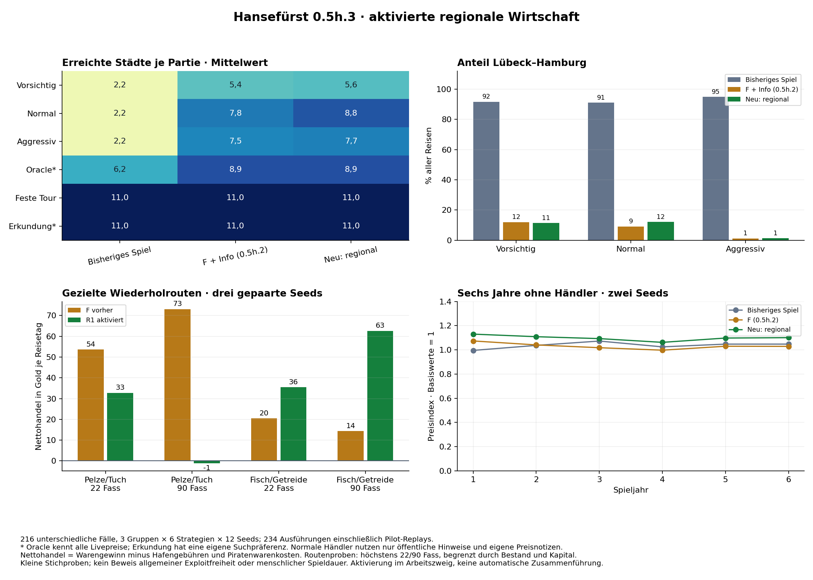

# Hansefürst 0.5h.3 – Regionale Wirtschaft aktivieren

25.10.2026 · `feature/phase05h3-regional-economy` · spielbare Integration, keine automatische Zusammenführung

## Ergebnis

**Die regionale Wirtschaft ist in der tatsächlichen Spieldatei des Arbeitszweigs aktiviert.** Neue und erfolgreich übernommene Partien verwenden Warenflussmodell R1 als gezielte Weiterentwicklung von F. Hafenmeister, Badehaus und Handelsbuch zeigen öffentliche Ortskunde und datierte Versorgungsnachrichten. Ein paralleler produktiver Altmarktmodus wurde nicht eingeführt. Der Entwicklungszweig und die öffentliche Bereitstellung wurden nicht eigenständig verändert.

Die drei Prüfziele verbessern sich in den dokumentierten Proben:

- **Bergen:** große Fisch-/Getreideladungen auf Bergen↔Lübeck verdienen im kontrollierten Vergleich rund **63 statt 14 Gold je Spieltag**; 13/48 Fahrten bleiben verlustreich. Normale Händler erreichen Bergen achtmal in sechs von zwölf Partien, vorher zweimal in zwei Partien.
- **Kleine Pelz-/Tuchkreise:** unter denselben neuen Prüfsamen sind **11/48 statt 0/48** Fahrten negativ. Die Route bleibt häufig profitabel, verliert aber bei Wiederholung deutlich an Ertrag. Kein pauschaler Preisabschlag oder Transaktionszuschlag wurde eingeführt.
- **Bestandsschutz:** v7/Wirtschaftsversion 1 übernimmt alle vorhandenen v6-Werte zunächst exakt, sichert Originale vor der Umstellung und erhält FIFO sowie Hafenarbeitsmarker. 274 historische Stände, gezielte Speicherfehler und echte Browserimporte wurden geprüft. Ein zusätzlich gefundener unsicherer Neustart nach fehlgeschlagener Übernahme wurde behoben.

216 Vergleichsfälle, 234 vollständige Ausführungen einschließlich Pilot-Replays; alle 72 neuen Handelsfälle erreichen Eldermann und zeigen keine finanzielle Reiseblockade. Das sind begrenzte Botproben, keine allgemeine Exploitfreiheit oder Messung menschlicher Spielstunden.



## 1. Geprüfte Grundlage und Versionen

Ausgangspunkt: aktueller integrierter Entwicklungszweig **`ff741a6421176e904e622f4c01af455efe6092cd`**, einschließlich 0.5h.2. Gelesen und wiederverwendet: [0.5h](2026-10-25_0.5h_regionale_wirtschaft.md), [0.5h.2](2026-10-25_0.5h2_regionale_wirtschaft_optimierung.md), [Schiffverkauf](2026-10-25_0.5f_schiffverkauf.md), [Hafenarbeit](2026-10-25_0.5g_hafenarbeit.md), bestehende Migrations-, Ereignis-, Strategie- und Regressionstestwerkzeuge.

- **Tatsächlich simulierter Integrationsstand:** `2474007f38bf10fe67e498a24dacd8b7d519bd95`. Hier sind neue Wirtschaft, Informationen, v7 und der erfolgreiche Pilot gesichert.
- **Finaler tatsächlich technisch und im Browser geprüfter Spielcode:** **`5c9c77c07bfc558fee4db0067d4d2b0d24e2b9e1`**. SHA-256 der [Spieldatei](../../Hansefuerst_0_4.html): `0251b3e0f6fb23c2e33f9e5e831f6f714f96a120ed74c9d10fb2045871f5e1e0`.
- Nach den Hauptsimulationen änderten sich nur der bestätigte/sicher gespeicherte Neustart und ein dafür optional erzwungenes Originalbackup. **17 relevante Regelkörper, Initialzustand und nächster Zufallswert sind exakt gleich**. Die Wirtschaftsstichprobe wurde wegen dieses Startschutzes nicht unnötig wiederholt. [Quellvergleich](../../tests/simulation/phase05h3-20261025-01/final-rule-preservation.json).
- **672 zuvor vorhandene Ergebnis-/Protokolldateien bleiben bytegleich.** Alle 72 alten Produktionskontrollen stimmen vollständig mit den entsprechenden 0.5h-Daten überein, alle 72 F_info-Kontrollen mit 0.5h.2. Keine historischen Simulationsergebnisse wurden überschrieben oder als zusätzliche neue Stichproben ausgegeben.

Der Bericht nennt bereits gesicherte Code-IDs; er erfindet keine selbstreferenzielle Commit-ID. [Zwischenstände und Fehlerchronik](2026-10-25_0.5h3_fortschritt.md).

## 2. Tatsächlich aktivierte Warenflüsse und Preise

Öffentliche Märkte erhalten regelmäßigen regionalen Nachschub beziehungsweise Verbrauch. **Private Ladung und Lagerbestände werden dabei nicht verbraucht.** Preise berücksichtigen den tatsächlichen örtlichen Marktbestand, nicht einen direkten Stadtpreisrabatt. Käufe und Verkäufe verändern weiterhin nur Gold, Ladung und Bestand zum angezeigten Stückpreis; ihre Wirkung auf Preise folgt in den kommenden Spieltagen.

Gemeinsame Grundwerte bleiben F: Bezug 110 Fass, saldierter Regionalfluss +1,2 / 0 / −1,2 Fass pro Tag für Überschuss/neutral/Mangel und allgemeiner Versorgungsausgleich `0,015 × (110 − Bestand)`. Dazu kommt wie im Prototyp zentrierter Bestandszufall −7…+7. Es sind saldierte Modellflüsse, keine historisch gemessenen Produktionszahlen oder neuen Produktionsgebäude.

Gezielte Änderungen:

| Bereich | Aktivierte Regel | Zweck |
|---|---|---|
| Preisrichtwert | `2 / (1 + (Bestand/110)^2)` × unveränderter Warenbasiswert | Glatter Verlauf auch bei reichlich versorgten Märkten; keine flache Richtfaktorzone wie bei F |
| Preisupdate | wie bisher 35 % Auslösung, bestehende Zufallsbewegung plus `0,020 × (Richtwert − Preis)` | Gemeinsame Stabilisierung bleibt erhalten, kein regionaler Goldbonus |
| Pelze und Tuch | Regionalfluss **und** allgemeiner Bestandsausgleich mit Faktor **0,35** | Langsamere Erholung, gleiche rechnerische typische Bestände |
| Bergen/Fisch | Regionalfluss **und** Ausgleich mit Faktor **1,5** | Häufiger verfügbares Angebot, ohne Fischbasispreis oder Reisedauer zu ändern |
| Lübeck/Fisch | neu typischer Bedarf | Nachvollziehbarer Absatzbedarf für nördliche Fischlieferungen |
| Rundung | unverzerrte Rundung von Bruchteilsflüssen aus Restwert derselben Zufallsziehung | Kleine regelmäßige Flüsse verschwinden nicht täglich durch Rundung |
| Grenzen | Preise ab folgenden Tagen 4–1.000.000.000 Gold, täglicher Bestand 3–240 | Untergrenze und vorhandener gültiger Speicherbereich bleiben geschützt |

Die theoretischen Bestandsruhelagen bleiben etwa **190 / 110 / 30 Fass**. Der Pelz-/Tuchfaktor ändert die Geschwindigkeit, nicht diese Ruhelagen. Tatsächliche Mittelwerte weichen durch Zufall, Rundung, Handel und Grenzen ab. Bei Bergen/Fisch ist die Erholung schneller, aber eine große fortlaufende Nachfrage kann auch dieses Angebot ausreizen.

Die neue Preisformel enthält keine Stadt-/Profilvariable. Bei gleicher Ware, gleichem Preis und Bestand gilt überall dieselbe Preisentwicklung. Ein typischer Produktionshafen kann nach großen Aufkäufen knapp werden; ein Mangelhafen nach Lieferungen überversorgt. Preise können sich gegen ihre normale regionale Richtung entwickeln.

Es gibt weiterhin **keinen zusätzlichen Zufallsaufruf je Marktzelle**. Der ganzzahlige Bestandsschritt und sein Rest werden aus derselben Bestandsziehung abgeleitet. Bei niedrigen Preisen wird der Rest innerhalb der bisherigen −1/0/+1-Preisziehung für die kleine Rückführung genutzt. Die unverzerrten Flüsse und die Symmetrie niedriger Preise oberhalb der Untergrenze sind kontrolliert geprüft. Der historische Helfer `dailyMarketPrice` bleibt für bestehende Prüfungen erhalten; der produktive Tagespfad ruft ausschließlich `regionalMarketDay` auf.

Die neuen Regeln wirken erst auf folgende Tage. Unmittelbar nach großem Verkauf kann ein Markt weiter über 240 Fass liegen; nach Aufkauf bei null. Der nächste Tagesausgleich begrenzt wieder auf 3–240. Einzelne nach altem Format gültige Preise unter 4 würden beim Laden zunächst erhalten und ab dem folgenden Tag auf die aktive Untergrenze gebracht. Kein rückwirkendes Ändern bereits gebuchter Käufe, Kosten oder Prämien.

## 3. Profile aller elf Städte

Die Profile aus 0.5h.2 bleiben erhalten, ergänzt um Fischbedarf in Lübeck. Alle nicht besonders eingeordneten Waren sind neutral. Hanf und Hansegras bleiben unterschiedliche Waren, Stadt- und Warenindizes unverändert. Geografische Plausibilität ist eine Designbegründung, keine Behauptung exakt rekonstruierter Hansewirtschaft.

| Stadt | Typisches Angebot | Typischer Bedarf | Neutrale Waren |
|---|---|---|---|
| Lübeck | Bier, Salz | Fisch, Pelze | Getreide, Holz, Tuch, Hansegras, Hanf, Pech, Eisenwaren |
| Hamburg | Bier, Tuch | Holz, Pech | Getreide, Salz, Fisch, Hansegras, Hanf, Eisenwaren, Pelze |
| Rostock | Getreide, Bier | Tuch, Eisenwaren | Holz, Salz, Fisch, Hansegras, Hanf, Pech, Pelze |
| Stralsund | Getreide, Fisch | Salz, Tuch | Bier, Holz, Hansegras, Hanf, Pech, Eisenwaren, Pelze |
| Stettin | Holz, Hanf, Pech | Salz, Tuch | Getreide, Bier, Fisch, Hansegras, Eisenwaren, Pelze |
| Danzig | Getreide, Holz | Tuch, Eisenwaren | Bier, Salz, Fisch, Hansegras, Hanf, Pech, Pelze |
| Bergen | Fisch | Getreide, Bier, Hanf | Holz, Salz, Tuch, Hansegras, Pech, Eisenwaren, Pelze |
| Visby | Holz, Pech | Getreide, Eisenwaren | Bier, Salz, Fisch, Tuch, Hansegras, Hanf, Pelze |
| Brügge | Tuch, Eisenwaren | Holz, Pelze | Getreide, Bier, Salz, Fisch, Hansegras, Hanf, Pech |
| Nowgorod | Pech, Pelze | Bier, Salz, Tuch | Getreide, Holz, Fisch, Hansegras, Hanf, Eisenwaren |
| Venlo | Bier, Hansegras | Fisch, Pelze | Getreide, Holz, Salz, Tuch, Hanf, Pech, Eisenwaren |

Lübeck/Hamburg stehen für Umschlag und Verarbeitung, Rostock/Stralsund/Danzig für agrarisches Hinterland, Stettin für Wald-/Schiffsausrüstungsgüter, Bergen für Fisch und Versorgungsimporte, Brügge für Fertigwaren, Nowgorod für Waldwaren/Pelze. Visbys Holz-/Pechprofil bleibt eine vereinfachte Insel-/Umschlagannahme. Venlos Hansegras ist ausdrücklich Spielatmosphäre und keine historische Kulturpflanzenbehauptung. Kein Ort erhält eine feste Auszahlung, kein Hansegrasverkauf garantiert Gewinn.

## 4. Gezielte Variantenwahl und kleine Preisimpulse

Vor Integration wurden **F, R1 und R2** isoliert verglichen. R2 verwendete Pelz-/Tuchfaktor 0,20 und Bergen-Fischfaktor 1,25; R1 die kleineren ausreichenden Änderungen 0,35 und 1,5. Beide ersetzen die flache Richtfaktorbegrenzung durch die glatte Bestandskurve und nutzen unverzerrte Bruchteilsrundung.

54 kontrollierte Routen-Fixtures: drei Modelle × drei Seeds **63001–63003** × drei Strecken × Sollmengen 22/90 Fass, je 16 Fahrten. Nach sechsjähriger Marktaufwärmung startet eine Kogge mit 5.000 Gold am gesetzten Quellhafen. Kein erspielter Fernstart, kein Preis-Oracle. Tatsächliche Mengen sind zusätzlich durch Geld, Bestand und Kapazität begrenzt. Es gelten echte Zeit, Gebühren und Reiseereignisse.

| Variante | Pelze/Tuch 22 Fass: Netto/Tag | negative Fahrten / 48 | Bergen 90 Fass: Netto/Tag | negative Fahrten / 48 |
|---|---:|---:|---:|---:|
| F | 54 | 0 | 14 | 17 |
| R1 | 33 | 11 | 63 | 13 |
| R2 | 18 | 18 | 60 | 13 |

**R1 wurde ausgewählt:** Es reduziert die sichere Routine deutlich und verbessert Bergen, ohne die Pelzroute so stark wie R2 zu dämpfen. Keine zusätzliche Variante oder nachträgliche Parameteroptimierung nach dem Hauptvergleich. Die alten 48/48- beziehungsweise 69/72-Proben verwendeten andere Seeds/Umfänge; direkte Verbesserungszahlen beziehen sich hier auf die neuen gepaarten F/R1-Proben.

18 weitere kontrollierte Abgleich-Fixtures im **tatsächlich integrierten Spiel** wiederholen R1 exakt: 288 Fahrten mit identischen Mengen, Preisen, Ereignissen und Endgold zu den ausgewählten Prototypfällen. Es handelt sich um technische Replays, keine 18 zusätzlichen unabhängigen Strategiepartien.

Bei einem echten 20-Fass-Pelzkauf im kontrollierten reichlichen Markt zeigt die neue Wirtschaft innerhalb 120 Tagen bis zu **7 Gold Preisunterschied** gegenüber der ungehandelten Vergleichsfolge. Vier unmittelbare Käufe à fünf Fass ergeben dieselbe weitere Marktfolge wie ein Kauf von 20 Fass. Sofortiger Rückverkauf erzeugt weiterhin keinen Gewinn. Nicht jedes einzelne Fass muss sofort eine sichtbare ganze Goldstufe auslösen; wiederholte Mengen wirken nachvollziehbar auf folgende Updates.

## 5. Bergen und wiederholte Handelsrouten

Die drei kontrollierten Strecken verwenden feste Waren: Nowgorod→Brügge Pelze/zurück Tuch; Bergen→Lübeck Fisch/zurück Getreide; Lübeck→Hamburg Salz/zurück Bier. Eine starre Warenwahl ist keine Empfehlung, ungeachtet des aktuellen Marktes weiterzukaufen.

Nettohandel = tatsächlich realisierter Warengewinn minus Hafengebühren und Einkaufskosten geraubter Ware. Prämien, Zinsen und Schiffswertänderungen sind nicht darin enthalten. Ertrag je Tag verwendet tatsächliche Reisedauer.

| Modell / Strecke | Sollmenge | gekauft Ø | Netto/Fahrt Ø | Netto/Tag | negative Fahrten / 48 |
|---|---:|---:|---:|---:|---:|
| F / Nowgorod–Brügge | 22 | 22,0 | 1.744 | 54 | 0 |
| F / Nowgorod–Brügge | 90 | 89,1 | 2.378 | 73 | 15 |
| F / Bergen–Lübeck | 22 | 22,0 | 261 | 20 | 4 |
| F / Bergen–Lübeck | 90 | 59,4 | 183 | 14 | 17 |
| F / Lübeck–Hamburg | 22 | 22,0 | 131 | 45 | 9 |
| F / Lübeck–Hamburg | 90 | 39,5 | 198 | 69 | 21 |
| R1 / Nowgorod–Brügge | 22 | 22,0 | 1.067 | 33 | 11 |
| R1 / Nowgorod–Brügge | 90 | 58,5 | -35 | -1 | 32 |
| R1 / Bergen–Lübeck | 22 | 22,0 | 455 | 36 | 0 |
| R1 / Bergen–Lübeck | 90 | 66,8 | 802 | 63 | 13 |
| R1 / Lübeck–Hamburg | 22 | 22,0 | 106 | 37 | 12 |
| R1 / Lübeck–Hamburg | 90 | 38,6 | 161 | 56 | 23 |

### Bergen: sinnvollere Rolle, keine garantierte Nordreise

Große Fisch-/Getreideladungen steigen von rund 14 auf 63 Gold je Reisetag, kleine von 20 auf 36. Große R1-Fahrten bleiben 13/48-mal negativ. Die ersten vier R1-Fahrten erzielen im Mittel 1.761 Gold, die letzten vier nur 9 Gold: auch das verbesserte Angebot und der Lübecker Bedarf können ausgereizt werden. Ein Händler muss Menge, aktuellen Bestand und Alternativen beachten.

In den vollständigen Partien steigen Bergen-Ankünfte bei Normal von **2 auf 8** (besuchende Partien 2→6 von zwölf), bei Aggressiv von **62 auf 113**, beim Explorer von **13 auf 38**. Das ist mehr wirtschaftliche Nutzung, aber keine allgemeine Bergen-Dominanz. Bei normalen Händlern fallen sechs Ankünfte ins erste und zwei ins dritte Jahr, keine ins vierte.

Nicht jede Bergen-Kennzahl verbessert sich: Die feste Ferntour erzielt auf Bergen→Lübeck bei frei gewählter Ware rund **132 statt 148 Gold je Reisetag**. Ihre Auswahl und Marktgeschichte unterscheiden sich von der gezielten Fischprobe. Die Aktivierung wird deshalb nicht mit einer pauschalen Aussage „jede Bergenreise ist jetzt besser“ begründet. Keine Reisedauer, Kapazität, Hafengebühr oder Fischbasispreis wurde verändert.

### Pelze und Tuch: profitabel nutzbar, empfindlicher gegen Wiederholung

Kleine R1-Ladungen bleiben in **37/48** Fahrten profitabel, verlieren aber in **11/48**. Der mittlere Gewinn der ersten vier Fahrten beträgt 1.662 Gold, der letzten vier 698; der Ertrag nimmt erkennbar ab. Große R1-Ladungen verlieren in **32/48** Fahrten und liegen über die gesamte starre Serie im Mittel knapp negativ. Das ist ein Signal zum Wechseln oder Warten, kein Anlass, wahllos alle Pelz-/Tuchpreise zu verschlechtern.

Langsamere Regeneration und empfindlichere Bestandsbewertung erklären den Unterschied. Die rechnerische Erholungsgeschwindigkeit von Pelzen/Tuch sinkt von 0,015 auf 0,00525 je Tag; Basispreise bleiben 110/56. Produktion und Verbrauch können Chancen nach einer Handelspause wieder entstehen lassen. Die Stichprobe beweist **keine allgemeine Exploitfreiheit**; es wurde aber kein von Menge, Zeit und Marktlage unabhängiger garantierter Gewinn nachgewiesen.

## 6. Informationen im tatsächlichen Spiel

Hafenmeister, Badehaus und vorhandenes Handelsbuch enthalten denselben kleinen Informationsabschnitt:

1. **Ortskunde:** typische Angebots-/Bedarfswaren der aktuellen Stadt und aufklappbare Übersicht der elf Städte. Keine aktuellen Preise.
2. **Datierte Hafennachrichten:** ein fernes Stadt-/Warenpaar mit Band „reichlich / gewöhnlich versorgt / knapp“, Datum und Alter in Spieltagen. Über 90 Tage alte Hinweise werden als veraltet markiert. Kein exakter Fernbestand, kein Preisangebot.
3. **Eigenes Preisbuch:** ausschließlich eigene regelgerecht beobachtete Preise mit Datum/Alter. Unbekannte Städte bleiben mit Strichen dargestellt; eine Nachricht füllt keine Preiszeile.

Eine Nachricht pro Hafen und Spieltag, auch nach wiederholtem Öffnen oder erneutem Laden dieselbe. Die Auswahl verwendet Datum und Hafen, keine Suche nach dem günstigsten Fernpreis und keinen zusätzlichen Zufall. Bis zu **36 Nachrichten**, beim Erzeugen auf das letzte Spieljahr begrenzt, werden in der Partie gespeichert. Die Ansicht zeigt die letzten fünf. Bei Speicherfehler wird keine neue Nachricht als gespeichert ausgegeben; vorhandene Aufzeichnungen bleiben erhalten.

Laden und Import aktualisieren keine alten Preisnotizen. Erst ein tatsächlicher Marktbesuch erfasst die örtlichen Preise; Reisen und echte Handelsaktionen behalten ihre vorhandene Beobachtung. Bestehende rechtmäßig erworbene Badehausgerüchte/Sonderangebote bleiben eine getrennte bisherige Mechanik.

Die normalen Testhändler verwenden ausschließlich diese echten öffentlichen Nachrichten, die Profile und eigene Preisnotizen. Ihre unsicheren Schätzannahmen bleiben wie in 0.5h.2: typische relative Richtwerte 0,60/1,00/1,40, Berichtsfaktor 0,90/1,10, 20 % Abschlag auf unbekannte Verkäufe beziehungsweise Zuschlag auf unbekannte Einkäufe, höchstens 90 Tage alte Berichte. Keine heimlichen Livepreise und keine zusätzliche Neugierprämie. Der alte Explorer behält seine ausdrücklich bekannte Suchpräferenz. Die Tests messen nicht, ob Menschen diese systematische Ortskenntnis ebenfalls besitzen.

Die Implementierung ändert neben dem Markt auch die echte Informationsspeicherung: F_info aus 0.5h.2 hatte vorübergehende, umfassendere Sitzungsberichte; die neue Version begrenzt und persistiert sie. Der Hauptvergleich isoliert deshalb nicht ausschließlich einen einzelnen Preisparameter.

## 7. Simulationen: Umfang, Vergleich und Ergebnisse

**216 verschiedene Modell-/Strategie-/Seed-Fälle**, drei Gruppen × sechs Handelsweisen × zwölf gepaarte Seeds **10001–10012**. 18 Pilotfälle jeweils vollständig reproduziert, anschließend 198 ergänzt: **234 vollständige Ausführungen einschließlich 18 Replays**, keine technischen Workerabbrüche. Keine 1.500er-/2.250er-Neuberechnung; der explizite Nutzerumfang ersetzt den allgemeinen 1.500er-Hinweis aus `AGENTS.md`.

Verglichen werden der eingefrorene frühere Produktivcode, das historische F_info und das tatsächliche neue Spiel. Keine zweite produktive Wirtschaftsengine: alte HTML wird ausschließlich im Testkontext geladen. Alle starten wirklich in Lübeck mit 5.000 Gold, 9.960 Buchvermögen und einer Kogge. 1.440 Tage oder 800 Entscheidungen, letzte Reise darf überziehen; tatsächlich **1.440–1.481 Tage**. Startmärkte/Finanzen sind gleich, neu ist nur die v7-Wirtschaftshülle. Gleiche Seeds bedeuten bei anderen Entscheidungen nicht identische spätere Ereignisfolgen.

Der Oracle kennt sämtliche aktuellen Märkte, die feste Tour erzwingt alle elf Städte. Beide sind ausdrücklich keine Nachweise menschlicher freiwilliger Erkundung. Die historischen Kontrollwiederholungen sind keine neuen unabhängigen historischen Beobachtungen. Zwölf Seeds pro Gruppe sind ein begrenzter Abnahmevergleich, kein Nachweis seltener Risikoquoten.

### Städte und Routen

Städte schließen den Lübeck-Start ein. Neue Ankünfte betreffen Danzig, Bergen, Visby, Brügge, Nowgorod und Venlo. Routen sind gerichtete Stadtpaare; Ø jeweils pro Partie. Leere Reisen bleiben im Nenner.

| Gruppe / Strategie | Städte Ø | neue Ankünfte | Routen Ø | Lübeck↔Hamburg |
|---|---:|---:|---:|---:|
| Bisheriges Spiel / Vorsichtig | 2,17 | 0 | 2,3 | 91,6 % |
| Bisheriges Spiel / Normal | 2,17 | 0 | 2,7 | 91,0 % |
| Bisheriges Spiel / Aggressiv | 2,17 | 0 | 2,7 | 94,8 % |
| Bisheriges Spiel / Oracle* | 6,25 | 206 | 15,7 | 23,6 % |
| Bisheriges Spiel / Feste Tour | 11,00 | 822 | 12,0 | 8,6 % |
| Bisheriges Spiel / Erkundung* | 11,00 | 408 | 26,6 | 19,6 % |
| F + Info (0.5h.2) / Vorsichtig | 5,42 | 37 | 15,4 | 12,0 % |
| F + Info (0.5h.2) / Normal | 7,83 | 182 | 26,4 | 9,1 % |
| F + Info (0.5h.2) / Aggressiv | 7,50 | 516 | 27,6 | 1,2 % |
| F + Info (0.5h.2) / Oracle* | 8,92 | 380 | 36,7 | 7,3 % |
| F + Info (0.5h.2) / Feste Tour | 11,00 | 814 | 12,0 | 8,7 % |
| F + Info (0.5h.2) / Erkundung* | 11,00 | 358 | 36,8 | 7,8 % |
| Neu regional / Vorsichtig | 5,58 | 42 | 17,4 | 11,5 % |
| Neu regional / Normal | 8,75 | 334 | 29,4 | 12,1 % |
| Neu regional / Aggressiv | 7,67 | 537 | 27,6 | 1,4 % |
| Neu regional / Oracle* | 8,92 | 420 | 36,0 | 11,7 % |
| Neu regional / Feste Tour | 11,00 | 817 | 12,0 | 8,7 % |
| Neu regional / Erkundung* | 11,00 | 395 | 37,8 | 12,6 % |

Gemeinsam fällt der Lübeck↔Hamburg-Anteil der drei Standardgruppen gegenüber dem früheren Spiel von **92,46 auf 10,81 %**; F_info lag bei 9,91 %. Die neue Wirtschaft senkt diesen Anteil also nicht nochmals in jeder Gruppe. Sie erhält die weit größere Vielfalt gegenüber dem bisherigen Produktivspiel.

Normale neue Händler erreichen **7–10 Städte**, im Mittel 8,75, aber keine dieser zwölf Partien alle elf. Ihre neuen Ankünfte steigen gegenüber F_info von 182 auf 334. Im vierten Jahr bleiben 50/1.056 = **4,73 %** ihrer Reisen bei neuen Städten; das kurze Netz bleibt später wichtig. Vorsichtige neue Händler besuchen Bergen gar nicht und im vierten Jahr nur einmal eine neue Stadt. Das ist eine fortbestehende Strategiegrenze, kein Beleg, dass alle Menschen die ganze Hanse freiwillig bereisen werden.

### Finanzielle Ergebnisse und Karriere

Endvermögen enthält Buchwerte, Gold ist liquide. Nettohandel umfasst Warengewinn abzüglich Gebühren/Piratenwarenkosten, ohne Prämien und Schiffswertänderung; nur tatsächliche Ereignisse zählen. Gewinne je Tag verwenden tatsächliche Dauer. Die jüngere Variante wird nicht nur nach maximalem Reichtum beurteilt.

| Gruppe / Strategie | Vermögen Median | Gold Median | Netto/Reise | Netto/Tag | Eldermann / 12 |
|---|---:|---:|---:|---:|---:|
| Bisheriges Spiel / Vorsichtig | 741.171 | 737.730 | 1.588 | 532 | 12 |
| Bisheriges Spiel / Normal | 907.838 | 904.397 | 1.912 | 639 | 12 |
| Bisheriges Spiel / Aggressiv | 867.143 | 863.702 | 1.879 | 626 | 12 |
| Bisheriges Spiel / Oracle* | 1.075.086 | 1.071.646 | 2.729 | 744 | 12 |
| Bisheriges Spiel / Feste Tour | 630.057 | 626.616 | 4.509 | 422 | 12 |
| Bisheriges Spiel / Erkundung* | 1.519.580 | 1.516.139 | 4.220 | 949 | 12 |
| F + Info (0.5h.2) / Vorsichtig | 347.630 | 344.188 | 731 | 231 | 12 |
| F + Info (0.5h.2) / Normal | 492.317 | 488.876 | 1.291 | 338 | 12 |
| F + Info (0.5h.2) / Aggressiv | 294.496 | 290.871 | 3.673 | 188 | 12 |
| F + Info (0.5h.2) / Oracle* | 516.672 | 513.230 | 1.475 | 351 | 12 |
| F + Info (0.5h.2) / Feste Tour | 261.698 | 258.258 | 1.866 | 174 | 12 |
| F + Info (0.5h.2) / Erkundung* | 470.246 | 466.805 | 1.406 | 325 | 12 |
| Neu regional / Vorsichtig | 360.392 | 356.950 | 801 | 251 | 12 |
| Neu regional / Normal | 532.944 | 529.503 | 1.563 | 360 | 12 |
| Neu regional / Aggressiv | 272.046 | 268.377 | 3.365 | 179 | 12 |
| Neu regional / Oracle* | 623.196 | 619.754 | 1.673 | 416 | 12 |
| Neu regional / Feste Tour | 270.207 | 266.766 | 1.938 | 181 | 12 |
| Neu regional / Erkundung* | 498.636 | 495.196 | 1.570 | 338 | 12 |

Alle **216** Fälle enden ohne finanzielle Reiseblockade oder negatives Vermögen. Alle **72 neuen** Fälle erreichen Eldermann, wie die beiden Kontrollgruppen jeweils 72/72. Keine dieser Erfolgspolitiken verwendet Kredit, Reparatur, Schiffverkauf oder Hafenarbeit. Diese Funktionen sind gezielt separat geprüft; die Aussage ist keine allgemeine Insolvenzwahrscheinlichkeit menschlicher Partien und keine neue adversarielle Verlustsimulation.

Die politischen Voraussetzungen bleiben bytegleich. Median-Tage bis Eldermann bei Normal: **461,5 früher / 559,5 F_info / 516,5 neu**; bei neuer fester Tour 1.019,5 Tage. Mehr simulierte Tage sind keine menschlichen Spielstunden. Das Ziel 20–30 aktiver menschlicher Stunden bleibt unbelegt.

Natürliche Aufträge entstehen in diesen Gruppen nur beim Oracle: früher **14 / 13.860 Gold**, F_info **28 / 30.962**, neu **32 / 30.444**. Tatsächliche Herkunft/Prämien und interne optimierte Zähler stimmen überein. Keine unbelegte Aussage, dass die ältere teilweise validierte Auftragsroutenplanung nun vollständig optimiert wäre.

### Lange Reisen

Auswertungsgrenze: mindestens zehn tatsächlich benötigte Spieltage, keine neue Reise- oder Gebührenregel. Alle entsprechenden Reisen einschließlich leerer/negativer zählen.

| Gruppe / Strategie | lange Reisen | Netto/Reise | Netto/Reisetag | negative lange Reisen |
|---|---:|---:|---:|---:|
| Bisheriges Spiel / Oracle* | 88 | 14.020 | 907 | 0,0 % |
| Bisheriges Spiel / Feste Tour | 638 | 4.696 | 237 | 5,3 % |
| Bisheriges Spiel / Erkundung* | 307 | 6.996 | 516 | 16,9 % |
| F + Info (0.5h.2) / Normal | 101 | 2.224 | 172 | 6,9 % |
| F + Info (0.5h.2) / Aggressiv | 720 | 3.791 | 163 | 5,4 % |
| F + Info (0.5h.2) / Oracle* | 179 | 2.452 | 170 | 1,1 % |
| F + Info (0.5h.2) / Feste Tour | 638 | 2.499 | 126 | 7,8 % |
| F + Info (0.5h.2) / Erkundung* | 201 | 2.355 | 148 | 22,9 % |
| Neu regional / Normal | 199 | 2.442 | 185 | 8,5 % |
| Neu regional / Aggressiv | 767 | 3.392 | 156 | 8,0 % |
| Neu regional / Oracle* | 140 | 2.891 | 214 | 0,7 % |
| Neu regional / Feste Tour | 640 | 2.189 | 110 | 8,0 % |
| Neu regional / Erkundung* | 266 | 2.226 | 146 | 21,4 % |

Die früheren normalen/aggressiven Standardhändler machen keine solchen langen Reisen; fehlende Fahrten werden nicht als Gewinn null interpretiert. Neue normale Händler verdienen rund **185 statt 172 Gold je langem Tag** gegenüber F_info. Die feste Tour verdient dagegen **110 statt 126**, der Explorer 146 statt 148, der Oracle 214 statt 170. Die Integration verbessert gezielte Probleme, nicht jeden Fernhandelsindikator. Gegenüber der alten ungebundenen Zufallswirtschaft sind viele Tageserträge weiterhin niedriger; dies wird nicht als uneingeschränkte Renditeverbesserung dargestellt.

Unter den 65 ausdrücklich informationsgestützten direkten neuen Normal-Handelsfahrten verlieren **22** Geld. Dazu kommen 28 wirtschaftlich geplante Einkaufsausflüge, davon 21 mit unmittelbarer Rückkehr; andere Weiterverläufe gelten nicht automatisch als geglückte geplante Rundreise. Die Hinweise liefern reale Erkundungsanreize, keine zuverlässigen Verkaufspreise.

## 8. Marktstabilität über Jahre

Sechs kontrollierte Sechsjahresverläufe ohne Händler, drei Wirtschaften × Seeds **64001/64002**. Alle 121 Zellen werden täglich gemessen. Preisindex 1 bedeutet den nach unveränderten Warenbasiswerten normalisierten Mittelwert, jede Zelle gleich gewichtet.

| Modell | Preisindex Jahr 1 | Jahr 4 | Jahr 6 | Bestand Ø Jahr 6 | erwartete Preisrichtung Jahr 6 |
|---|---:|---:|---:|---:|---:|
| Bisheriges Spiel | 0,995 | 1,025 | 1,048 | 235,0 | 21/45 |
| F (0.5h.2) | 1,074 | 0,997 | 1,029 | 109,9 | 45/45 |
| Neu regional | 1,130 | 1,062 | 1,101 | 108,9 | 46/46 |

Die neue Wirtschaft bewahrt im sechsten Jahr bei **46/46 spezialisierten Zellen** die erwartete mittlere Preisrichtung gegenüber neutralen Städten derselben Ware. Das sind Jahres-/Gruppenmittel, keine tägliche Gewinnzusage. Gemessene neue Jahr-6-Werte: Überschusswaren im Mittel 185,4 Fass / Preisindex 0,540; neutrale 109,0 / 1,037; Mangelwaren 38,2 / 1,814.

Das neue allgemeine Preisniveau liegt höher als bei F. Es zeigt in diesen zwei Sechsjahres-Seeds keinen fortgesetzten starken Anstieg; 1,130 im ersten gegenüber 1,101 im sechsten Jahr. Das ist **kein mathematischer Beweis von Inflationsfreiheit**. Die gemeinsame Preisstabilisierung wurde beibehalten; ihre notwendige Wirkung wurde in 0.5h.2 separat nachgewiesen. Nicht sämtliche Niveauunterschiede dürfen ausschließlich der verlangsamten Pelzproduktion zugeschrieben werden.

In den vollständigen Fällen reichen täglich beobachtete Preise früher/F_info/neu über **4–983 / 4–387 / 4–448 Gold**. Keine negativen, ungültigen oder nicht endlichen Preise/Bestände. Der tägliche Marktbestand bleibt begrenzt; keine Warenverdopplung im Spielerbesitz. Seltene Spitzen, beliebig lange Partien und sehr große Flotten sind nicht erschöpfend untersucht.

## 9. Spielstände: sichere Übernahme, Import/Export und Fehlerfälle

**v7 mit `economy.version=1`** macht die Wirtschaft eindeutig. Die Hülle enthält ausschließlich die Version und bis zu 36 Versorgungsberichte, keine neuen dauerhaften Preisreste/Produktionszähler pro Zelle. Die eigentliche Bestands-/Preislogik braucht keine zusätzlichen gespeicherten Flussfelder.

Bei unterstützten alten Ständen arbeitet zunächst die vorhandene Migration zu elf Städten/v6. Anschließend werden Version/Hülle ergänzt. Bei gültigem v6 bleiben **alle bisherigen Felder und Werte exakt**, darunter Preise, Bestände, Gold, Bank/Schulden, Schiffe, Ladung, Kosten, FIFO, elf Lager, Ränge, Aufträge, Preisbuch, Chronik und Hafenarbeitsmarker. Keine rückwirkende Umbuchung, keine sofortige Preisneusetzung, kein sofortiger Vermögensbonus. Laufende Partien erhalten die neuen Regeln erst bei folgenden Tagesfortschritten.

Vor erforderlicher Übernahme wird das Original-JSON unverändert gesichert:

- Start: `hansefuerst-v04-economy-v7-startup-backup`
- Import: `hansefuerst-v04-economy-v7-import-backup`
- Bei abweichender vorhandener Originalkopie neue Plätze `-2`, `-3` usw.; vorhandene Originale werden nie ersetzt. Dasselbe Original wird wiedererkannt. Nach 100 belegten Plätzen wird die Übernahme abgelehnt, statt eine Sicherung zu überschreiben.

Erst gültiger Kandidat, erfolgreiche Original-/aktuelle Sicherung und dauerhafter Zielschreibvorgang erlauben den Wechsel der aktiven Partie. Fehlende Schreibbestätigung, Quota oder ungültige Zukunftsformate lassen das bisherige Original unangetastet. Wiederholte v7-Ladevorgänge sind keine erneute Migration und vermehren keine Waren/Nachrichten. Import sichert wie bisher außerdem die aktuell ersetzte Partie unter dem **allgemeinen letzten Backup**; dieser bisherige Backupplatz ist von den unveränderlichen neuen Originalkopien zu unterscheiden.

Die lokalen Originalkopien bleiben im Browser, sie werden nicht automatisch als Dateien heruntergeladen oder gemeinsam mit einem aktuellen Export auf andere Geräte übertragen. Ein normaler Export enthält den vollständigen aktuellen v7-Spielstand einschließlich Nachrichten/Hafenarbeitsmarker. Alte Spielversionen verstehen v7 nicht und lehnen es ab; beim automatischen Laden im echten alten Chromium-Spiel geprüft, ohne Trunkierung. Ein ausdrücklich gestartetes neues Spiel in einer älteren Version ist dadurch nicht abgesichert; dafür die aktuelle Spielversion verwenden. Wer die damalige alte Wirtschaft wieder benötigt, braucht das gesicherte Original und die entsprechende alte Spielversion. Es gibt keinen beliebig wechselbaren Wirtschaftsmodus.

### Nachgewiesener und behobener Neustartfehler

Im zusätzlichen Sicherheitsreview zeigte ein Regressionstest: Nach fehlgeschlagener Übernahme blieb das alte KEY-Original zwar erhalten, der angezeigte Startbildschirm konnte es aber mit „neues Spiel“ ohne erneute Bestätigung/Originalsicherung ersetzen. Dieser geerbte Pfad wurde korrigiert.

Bei vorhandenen ungeladenen Daten verlangt Neustart nun Bestätigung und erfolgreiches Originalbackup. Abbrechen, Backupfehler und fehlgeschlagener Startschreibvorgang erhalten die alte Partie; ein erfolgreicher Neustart wird erst nach dauerhaftem Speichern aktiv. Das gilt auch für noch vorhandene v7-/nicht lesbare Originaldaten. Fehlernachweis vor Korrektur, 13. Schutzgruppe und echter Browserdurchgang sind gesichert. Nach dieser Korrektur bestehen alle aktuellen Prüfungen. Keine zusätzliche Balanceänderung und keine Simulation der unveränderten Wirtschaft allein wegen des Startdialogs.

### Historische breite Kontrolle

**274 echte v6-Endstände:** zwölf normale, zwölf Ferntour- und alle 250 alten Verlust-/Erholungsstände aus 0.5e. Jeder wird exakt übernommen, serialisiert, erneut geladen und einen Tag weitergeführt. Alle alten Werte bleiben bei Übernahme erhalten; nach dem Folgetag insbesondere Gold, Schiffe/Ladung, Lager/FIFO, Flags, abgeschlossene Aufträge und Rang, während reguläre Märkte/Zinsen wirken. Beide Zustände des Hafenarbeitsmarkers und reale Startup-/FileReader-Backups werden zusätzlich gezielt geprüft.

Die alten 250 Stressfälle wurden damit **nicht erneut als vollständige Verluststrategien simuliert**. Ein früher gestrandeter Stand wird durch Migration nicht automatisch reich oder gerettet. Die unveränderte einmalige Hafenarbeit bleibt gegebenenfalls der begrenzte bestehende Rettungsweg.

## 10. Tatsächlich ausgeführte Prüfungen

**16 aktuelle Regressionstest-Befehle bestehen auf dem finalen Spielcode**, vollständige Ausgaben und Codehash in [final-game-regressions.json](../../tests/simulation/phase05h3-20261025-01/final-game-regressions.json):

```text
node tests/test-v04.cjs
node tests/phase1.cjs
node tests/telemetry.cjs
node tests/share.cjs
node tests/simulation/edges.cjs
node tests/simulation/warehouse-checks.cjs
node tests/simulation/warehouse-cities-checks.cjs
node tests/simulation/four-goods-checks.cjs
node tests/simulation/city-v6-migration-checks.cjs
node tests/simulation/eleven-cities-checks.cjs
node tests/simulation/eleven-cities-compat-checks.cjs
node tests/simulation/optimized-delivery-checks.cjs
node tests/simulation/price-rounding-checks.cjs
node tests/simulation/integration-checks.cjs
node tests/simulation/ship-sale-checks.cjs
node tests/simulation/harbor-work-checks.cjs
```

Zusätzliche aktuelle Befehle mit expliziten neuen Ausgabepfaden:

- `regional-activation-checks.cjs`: **13 Schutzgruppen**, unverzerrte Flüsse, neue Preisgrenzen/kleine Impulse, 121 Handels-/Lagerkreise mit 4.840 Umlagerungen ohne Gewinn/FIFO-Veränderung, exakte R1-Helfer, geschützte Markt-/Bank-/Reise-/Karrierefunktionen, Originalbackups/Importfehler, Berichtsbegrenzung, sechs Jahre mit Replay und sicherer Neustart. [Finales Ergebnis](../../tests/simulation/phase05h3-20261025-01/activation-checks-final.json).
- `phase05h3-run.cjs --execute --pilot --directory tests/simulation/phase05h3-20261025-01`, anschließend derselbe Befehl ohne `--pilot`: 18 Pilotfälle + 18 exakte Replays, 198 Ergänzungen, null Abbrüche. Ohne `--execute` wird nur der Plan ausgegeben.
- `phase05h3-choice-probes.cjs`: 54 isolierte Varianten-/Routen-Fixtures. Der alte Ausgangscode ist ausdrücklich gepinnt, keine versehentliche Ausführung historischer Prototypen auf der neuen aktiven Engine.
- `phase05h3-market-probes.cjs`: sechs Sechsjahresverläufe und 18 exakte integrierte Routen-Replays.
- `phase05h3-history-checks.cjs`: 274 historische Übernahmen plus einen Folgetag, keine vollständigen Strategiepartien.
- `regional-activation-browser-checks.cjs`: echte Chromium-Oberfläche/Dateien/Storage, drei Größen, Screenshots.
- `phase05h3-analyse.py`, `phase05h3-evidence.py`, `phase05h3-figures.py`: ausschließlich lesende Nachauswertung/Grafik; keine Engine-Starts. Neue `/tmp`-Ziele, anschließend verlustfreie Sicherung der Zusammenfassungen.

### Dokumentierte notwendige Testanpassungen

Die früheren Versionsannahmen v6 werden für den aktuellen Export/Ladepfad auf v7 aktualisiert. Synthetische alte v3/v4/v5-Fixtures, die aus aktuellem `fresh` entstehen, entfernen ausdrücklich die neue Wirtschaftshülle. Projektionen vergleichen anschließend **sämtliche** alten Werte unverändert, nicht nur Gold oder Warenanzahl. Die vorhandene v6-Zwischenmigration bleibt separat unverändert geprüft.

Wächter, die eine vollständig unveränderte Fresh-/Tageswirtschaft verlangen, können die beauftragte Änderung nicht unverändert akzeptieren. Sie prüfen jetzt unveränderte Nichtmarktregeln beziehungsweise explizite Versionierung; die neue Tagesformel hat eigene strenge R1-, Mengen-, Rundungs- und Grenzprüfungen. Die bisherigen Kredit-, FIFO-, Herkunfts-, Prämien-, Reise-/Gebühren-, Schiffverkaufs- und Hafenarbeitsassertions bleiben erhalten. Keine bloße Entfernung wichtiger Schutzprüfungen.

Erste fehlgeschlagene Altversions-/Projektionsprüfungen bleiben als `regressions-attempt1.json` und `regressions-attempt2.json` gesichert. Außerdem korrigiert: ein neuer Negativtest deklarierte seine lokale Variable wiederholt im selben VM-Gültigkeitsbereich; danach wird der begrenzte Funktionsbereich genutzt. Der echte Neustartfehler ist davon getrennt dokumentiert und behoben. Nicht ausgeführte historische Ganzdatei-/Fünf-Städte-Snapshot-Suiten (`catalog-foundation-checks.cjs`, `city-preparation-checks.cjs`) bleiben unverändert historisch und werden nicht als aktuelle Erfolge ausgegeben.

## 11. Browserabnahme und echte Screenshots

**Chromium 154.0.8037.57**, tatsächlich ausgeführt mit Playwright und Touch-Ansicht: **390×844, 820×1180, 1280×900**. Keine echte Safari-/iPhone-/iPad-Abnahme behauptet.

Geprüft: unveränderte echte alte v6-Partie bei Startup, exaktes Originalbackup, kein doppelter Bericht beim Wiederöffnen/Badehaus/Preisbuch, Alter in Spieltagen, elf Preis-/Stadtzeilen und unbekannte Fernpreise, tatsächliche Reise zu **allen sechs neuen Städten**, Kauf/Ein-/Auslagerung/Verkauf mit erhaltenen FIFO-Kosten, echter JSON-Download, FileReader-Import, erneutes Laden und erhaltener verbrauchter Hafenarbeitsmarker. Der breite Preistisch ist innerhalb des Panels horizontal verschiebbar; kein horizontaler Überlauf der Seite.

Zusätzlich echte Web-Storage-Fehler bei Originalbackup und Zielschreiben, Wiederholung nach Fehler, Bestätigung/Abbruch des Neustarts bei ungeladener Partie, nicht überschreibbare Originalkollision und Ablehnung von v7 im alten Spiel. Auch ein vollständig neues Spiel über den tatsächlichen Startbutton startet und speichert v7 erfolgreich. **Keine JavaScriptfehler oder fehlgeschlagenen Ressourcenanfragen.**

- [Hafennachrichten mobil](2026-10-25_0.5h3_hafennachrichten-mobile.png)
- [Preisbuch und getrennte Nachrichten auf Tablet](2026-10-25_0.5h3_preisbuch-tablet.png)
- [Bergen mit regionalem Angebot/Bedarf am Desktop](2026-10-25_0.5h3_bergen-desktop.png)

[Browserprotokoll mit Quell-/Screenshot-Prüfsummen](../../tests/simulation/phase05h3-20261025-01/browser.json). Die Bilder sind echte Screenshots der geprüften Version, keine Entwürfe.

## 12. Quellen, Risiken und Fazit

Gesicherte Daten unter [phase05h3-20261025-01](../../tests/simulation/phase05h3-20261025-01):

- [Manifest](../../tests/simulation/phase05h3-20261025-01/manifest.json), [Pilotfreigabe](../../tests/simulation/phase05h3-20261025-01/pilot-gate.json), [Ausführungsprotokoll](../../tests/simulation/phase05h3-20261025-01/attempts.jsonl), [Hauptlaufabschluss](../../tests/simulation/phase05h3-20261025-01/execution-complete.json).
- 216 Rohdateien `GRUPPE-STRATEGIE-SEED.json.gz`, jeweils vollständige Ereignisse, Abrechnung, Anfang/Ende, tägliche Marktstatistik/Jahresfenster und Informationsentscheidungen.
- [Zusammenfassung](../../tests/simulation/phase05h3-20261025-01/summary.json.gz), [einfache Vergleichstabelle](../../tests/simulation/phase05h3-20261025-01/groups.csv), [zusätzliche Nachweise](../../tests/simulation/phase05h3-20261025-01/evidence.json.gz).
- [Varianten-/Routenproben](../../tests/simulation/phase05h3-20261025-01/choice-probes.json.gz), [Marktlangzeit-/integrierte Replayproben](../../tests/simulation/phase05h3-20261025-01/market-probes.json.gz), [274 historische Prüfungen](../../tests/simulation/phase05h3-20261025-01/history-checks.json), [Gesamtverifikation](../../tests/simulation/phase05h3-20261025-01/verification.json), [Artefakt-Prüfsummen](../../tests/simulation/phase05h3-20261025-01/SHA256SUMS).

**Belegt:** tatsächliche Aktivierung im Arbeitszweig, geprüfte regionale Versorgung/Preisreaktion, verbesserter gezielter Bergenhandel, weniger sichere kleine Pelz-/Tuchserie, mehr normale Händlerziele, unveränderte geschützte Mechaniken, korrekte Übernahme und bestandene finale Technik-/Browserprüfungen. Die begrenzten Proben zeigen keine erheblichen neuen wirtschaftlichen Schutzbrüche, die eine Rückstellung der Aktivierung im Arbeitszweig erforderlich machen.

**Weiter offen:** seltene oder sehr langfristige Exploits, menschliche Verständlichkeit/Spielzeit, reale Safari-Geräte und große Flotten/Lager. Kleine Pelzrouten bleiben oft profitabel; vorsichtige Bots erkunden wenig, Bergen ist für normale Händler noch kein regelmäßiges Endspielziel. Manche langen Erträge sinken, besonders bei fester Tour. Das ist eine dokumentierte Abwägung, keine universelle Verbesserung jeder Strategie. Die alte teilweise validierte Oracle-Auftragsplanung bleibt unverändert.

Keine Schiffpreis-/Gebühren-/Kredit-/Reisezeit-/Karriereänderung, keine neuen Waren/Städte, keine Lagerkosten/-kapazitäten, kein materialabhängiger Schiffbau, keine neue Startstadt-/Namens- oder Festmechanik und keine Erweiterung der Hafenarbeit. Die bestehenden append-only Indizes, separaten Lager und FIFO-Kosten bleiben für spätere ausdrücklich beauftragte Phasen nutzbar; keine Folgephase begonnen.

**Fazit:** Die regionale Wirtschaft ist im geprüften Arbeitszweig spielbar integriert und für die Übergabe vorbereitet. Die bekannten drei Kernprobleme sind mit begrenzten Änderungen und nachvollziehbaren Ergebnissen adressiert. Zusammenführung und Bereitstellung erfolgen nicht eigenständig.

## GitHub-Übergabe

- [Zwischenstand 1 – Ursachen, Varianten und Migration](https://github.com/psonnen-lgtm/Hansef-rst/commit/992fba7)
- [Zwischenstand 2 – aktiviertes Spiel, Schutzprüfungen und Pilot](https://github.com/psonnen-lgtm/Hansef-rst/commit/2474007f38bf10fe67e498a24dacd8b7d519bd95)
- [Zusätzlicher final geprüfter Startschutz](https://github.com/psonnen-lgtm/Hansef-rst/commit/5c9c77c07bfc558fee4db0067d4d2b0d24e2b9e1)
- [Arbeitszweig](https://github.com/psonnen-lgtm/Hansef-rst/tree/feature/phase05h3-regional-economy)
- [Direkter Vergleich gegen development/v04-foundation](https://github.com/psonnen-lgtm/Hansef-rst/compare/development/v04-foundation...feature/phase05h3-regional-economy)

Keine automatische Zusammenführung nach development/v04-foundation oder main.

Abschlussbericht, vollständige Ergebnisse, Browsernachweise und Index sind in [eca41c87019f9bead4c2ff34bbaa95e1379f6c09](https://github.com/psonnen-lgtm/Hansef-rst/commit/eca41c87019f9bead4c2ff34bbaa95e1379f6c09) gesichert. Der anschließende tatsächliche Versuch `gh pr create` scheiterte mit `Post "https://api.github.com/graphql": Forbidden`. Kein Pull Request wurde erstellt. Git-Push funktioniert; der Arbeitszweig und der direkte Vergleich oben sind die Übergabe. Der abschließende Remotevergleich zeigt den Entwicklungszweig weiterhin bei `ff741a6421176e904e622f4c01af455efe6092cd`.
