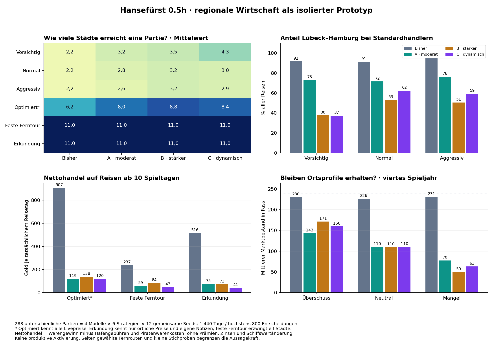

# Hansefürst 0.5h – Regionale Wirtschaft und attraktiver Fernhandel

25.10.2026 · Analyse und isolierte Prototypen · `analysis/phase05h-regional-economy`

## Ergebnis und Empfehlung

**Dauerhafte regionale Profile funktionieren technisch. Sie lösen allein noch nicht das Fernhandelsproblem.** Variante B bietet unter den drei Prototypen die stärksten gemessenen Fernmargen und reduziert die Dominanz Lübeck↔Hamburg am deutlichsten. Ich empfehle B als Grundlage für eine weitere ausdrücklich freizugebende Entscheidung und menschliche Spielproben, **keine produktive Aktivierung**. A bleibt der kleinere Vergleich; C bringt in dieser Parametrisierung zusätzliche Reaktion auf Versorgung, aber schwächeren Fernhandel.

Bei den drei Standardhändlern zusammen fällt Lübeck↔Hamburg von **92,46 % auf 47,02 %** unter B. Ihre mittlere Zahl erreichter Städte steigt von **2,17 auf 3,28**; trotzdem besucht keine dieser 36 B-Partien eine der sechs neuen Städte. Der neu untersuchte Erkundungshändler erreicht dagegen in **allen vier Modellen jeweils 12/12-mal sämtliche elf Städte**, auch ohne regionale Wirtschaft. Seine ausdrücklich eingebaute Bewertung neuer Information ist deshalb mindestens ebenso wichtig wie die Preisprofile. Ein wirtschaftlicher Anreiz für dauerhaft wiederkehrende Fernreisen ist damit noch nicht ausreichend belegt.

B senkt außerdem den Ertrag der festen Ferntour deutlich: auf Reisen ab zehn Spieltagen von 237 Gold auf 84 Gold je Reisetag. Es ist unter den Prototypen attraktiver als A/C, aber **keine absolute Fernhandelsverbesserung gegenüber der bisherigen sehr ertragreichen Zufallswirtschaft**. Eine wiederholte Pelz-/Tuchroute Nowgorod↔Brügge erzielt unter B in 69/72 geprüften Fahrten positives Netto. Die drei Verluste schließen einen in dieser Probe stets garantierten Gewinn aus; die hohe Zuverlässigkeit bleibt ein Balancerisiko.



## 1. Geprüfter Stand und unveränderte Vergleichsbasis

- Integrierte Entwicklungsbasis und tatsächlich getesteter produktiver Spielstand: `1b2b8cbf300786efba188f59979a51ec26c5e092` (Merge von 0.5g). Letzter Spielcode-Änderungscommit: `d624977baeb4d710a346ced8d5d06be44b67dfa1`.
- SHA-256 von `Hansefuerst_0_4.html`: `507191e59dc592cf4eef658ba27289eff21a04c181ef88d2d63a79c24c5af949`. Die Datei bleibt bytegleich; kein Prototyp wird im Browser-Spiel geladen.
- Tatsächlich ausgeführte Marktvarianten, Erkundungsstrategie und Hauptrunner: `d994013d7eb235538c2bba1f1a937173ccb1a98b`. Ihre Hashes stimmen nach dem Hauptlauf weiter mit dem Pilotmanifest überein. Zusätzliche Markt-/Routen-/Sicherheitsprüfungen, Auswertung und Grafik sind in `2d7e4337d9f12177765fb4a288168354aba4a9ab` gesichert.
- Gelesene Grundlagen: [elf spielbare Städte](2026-10-24_0.5d_elf-spielbare-staedte.md), [Wirtschaftsanalyse 0.5e](2026-10-24_0.5e_wirtschaftsanalyse.md), [Schiffverkauf 0.5f](2026-10-25_0.5f_schiffverkauf.md), [Hafenarbeit 0.5g](2026-10-25_0.5g_hafenarbeit.md), vorhandene Strategien, Ereignisabrechnung und Regressionen.
- Die historischen **1.500 Fälle aus 0.5e bleiben unverändert**. Sie wurden nicht als neue Simulation ausgegeben. 61 zuvor vorhandene Ergebnis-/Protokolldateien wurden byteweise gegen die integrierte Basis geprüft. Zusätzlich stimmen die 60 überlappenden aktuellen Kontrollfälle (fünf bestehende Handelsstrategien × zwölf Seeds) bei Anfang/Ende, Tagen, Handel, Kosten, Finanzen, Karriere, Endgrund und sämtlichen Ereignissen exakt mit ihren archivierten 0.5e-Fällen überein. Details: [evidence.json](../../tests/simulation/phase05h-20261025-02/evidence.json).

Die bisherige Wirtschaft verändert jeden Preis täglich mit 35 % Wahrscheinlichkeit zufällig: ab 9 Gold etwa ±6 %, darunter −1/0/+1, Untergrenze 4. Bestände verändern sich unabhängig um −6…+9 Fass, begrenzt auf 3–240. Der Mittelwert +1,5 führt unbesuchte Märkte nahe an den Bestandsdeckel. Kauf senkt Bestand, Verkauf erhöht ihn, ohne den sofortigen Stückpreis zu ändern. Preise berücksichtigen bisher weder Bestand noch Region. Sondergeschäfte setzen/ersetzen Preise zusätzlich; deren Ablauf bleibt erhalten.

**Einordnung des Vergleichs:** A/B/C verändern gemeinsam regionale Ziele, Bestandsausgleich und Rückführung der Preise. Der Vergleich isoliert deshalb nicht den alleinigen Beitrag eines einzelnen Parameters. Dass Gewinne insgesamt sinken, darf nicht ausschließlich der Regionalisierung zugeschrieben werden.

## 2. Wirtschaftliche Stadtprofile

Diese Profile sind nachvollziehbare Spielentwürfe, keine wissenschaftlich belegte Rekonstruktion mittelalterlicher Wirtschaft. Überschuss bedeutet tendenziell mehr Ware und niedrigeren Preis; Mangel bedeutet geringeren Bestand und höheren Preis. Neutrale Waren schwanken ebenfalls mit Bestand und Ereignissen. Ein Profil verspricht keinen aktuellen Preis und keinen Gewinn nach Ankunft.

| Stadt | Typischer Überschuss | Typischer Mangel | Neutrale Waren | Plausible Einordnung |
|---|---|---|---|---|
| Lübeck | Bier, Salz | Pelze | Getreide, Holz, Fisch, Tuch, Hansegras, Hanf, Pech, Eisenwaren | Umschlag, Brauwesen und Salzverteilung; Pelze als nördliche/östliche Importe. Keine Behauptung örtlicher Salzgewinnung. |
| Hamburg | Bier, Tuch | Holz, Pech | Getreide, Salz, Fisch, Hansegras, Hanf, Eisenwaren, Pelze | Elb-/Nordseeumschlag, Brauwesen und Textilverteilung; Holz/Pech für Schiffe. |
| Rostock | Getreide, Bier | Tuch, Eisenwaren | Holz, Salz, Fisch, Hansegras, Hanf, Pech, Pelze | Agrarisches Hinterland und Brauwesen, Bedarf an westlichen Fertigwaren. |
| Stralsund | Getreide, Fisch | Salz, Tuch | Bier, Holz, Hansegras, Hanf, Pech, Eisenwaren, Pelze | Küstenfischerei und agrarisches Hinterland; Salz zur Konservierung und Textilimporte. |
| Stettin | Holz, Hanf, Pech | Salz, Tuch | Getreide, Bier, Fisch, Hansegras, Eisenwaren, Pelze | Oderhinterland und Materialien für Schiffsausrüstung. |
| Danzig | Getreide, Holz | Tuch, Eisenwaren | Bier, Salz, Fisch, Hansegras, Hanf, Pech, Pelze | Weichselhinterland mit Getreide/Holz, westliche Fertigwaren als Import. |
| Bergen | Fisch | Getreide, Bier, Hanf | Holz, Salz, Tuch, Hansegras, Pech, Eisenwaren, Pelze | Fischhandel und nordische Versorgungsimporte; Fisch ist die bestehende Ware, keine neue Stockfischmechanik. |
| Visby | Holz, Pech | Getreide, Eisenwaren | Bier, Salz, Fisch, Tuch, Hansegras, Hanf, Pelze | Vereinfachtes Insel-/Ostseeumschlagprofil. Holz/Pech sind eine besonders vorläufige Designannahme. |
| Brügge | Tuch, Eisenwaren | Holz, Pelze | Getreide, Bier, Salz, Fisch, Hansegras, Hanf, Pech | Westlicher Tuch-/Fertigwarenumschlag, Rohstoffe und Luxusimporte. |
| Nowgorod | Pech, Pelze | Bier, Salz, Tuch | Getreide, Holz, Fisch, Hansegras, Hanf, Eisenwaren | Östliche Waldwaren und Pelze, westliche Versorgungsimporte. |
| Venlo | Bier, Hansegras | Fisch, Pelze | Getreide, Holz, Salz, Tuch, Hanf, Pech, Eisenwaren | Maasumschlag und Brauwesen. Hansegras ist ausdrücklich Spielatmosphäre, keine historische Kulturpflanzenbehauptung. |

**Hanf und Hansegras bleiben unterschiedliche Waren.** Venlo erhält im Prototyp eine wiederkehrende Hansegras-Tendenz, aber keinen Sonderauszahlungsmechanismus, festen Verkaufspreis oder Fernhandelsbonus. Alle vorhandenen Waren- und Stadtindizes bleiben unverändert.

## 3. Drei kleine, isoliert geladene Wirtschaftsvarianten

Die vorhandene Engine wird weiterverwendet. [regional-economy-prototype.js](../../tests/simulation/regional-economy-prototype.js) ersetzt in einem frischen Testkontext ausschließlich den täglichen Markt-Zellschritt der vorhandenen Funktion `advance`. Eine genaue Quelltextwache verweigert die Einbindung, wenn dieser Schritt nicht mehr passt. Kalender, Zinsen, Fristen, Sondergeschäfte, echte Käufe/Verkäufe, FIFO, Lager, Schiffe, Gebühren, Piraten, Hafenarbeit und Politik bleiben die tatsächlichen Spielregeln. Die unveränderte Kontrollgruppe ersetzt keinen Schritt. Es gibt keine zweite Reise-, Kredit- oder Handelsengine und keinen Produktivschalter.

| Parameter | A: moderat | B: stärker | C: dynamisch |
|---|---:|---:|---:|
| Regionaler Preisrichtwert gegenüber Basis | ±12 % | ±32 % | ±18 % |
| Zielbestand neutral | 110 | 110 | 110 |
| Zielbestand Überschuss / Mangel | 145 / 75 | 175 / 45 | 160 / 60 |
| Tägliche Rückführung Richtung Zielbestand | 0,025 | 0,035 | 0,025 |
| Rückführung zum Richtpreis je ausgelöstem Preisupdate | 0,015 | 0,030 | 0,025 |
| Stärke der Bestandsknappheit | 0,28 | 0,55 | 0,85 |
| Zusätzliche Angebotsreaktion auf Preisabweichung | keine | keine | Faktor 3, begrenzt auf ±2 Fass/Tag |

Für Profil `P = +1 / 0 / −1`, Basiswert `b`, Zielbestand `Z` und tatsächlichen Bestand `S` gilt:

`Zielpreis = b × begrenze(1 − regionale Stärke × P + Knappheitsstärke × (Z − S)/100; 0,45; 1,8)`.

Ein ausgelöstes Preisupdate kombiniert die bestehende symmetrische Zufallsbewegung mit der kleinen Rückführung zum Zielpreis und rundet anschließend; mindestens 4 Gold. Der tatsächliche Preis wird **nicht** auf 0,45–1,8 Basiswerte begrenzt, nur der Richtwert. Preise können durch Zufall und Ereignisse weiter darüber/darunter liegen.

Bestände erhalten einen zentrierten Zufallsschritt −7…+7 und den regionalen Ausgleich. C verstärkt zusätzlich die Versorgung bei hohen und reduziert sie bei niedrigen Preisen; anschließend wird gerundet und auf 3–240 begrenzt. Es bleibt exakt bei einer Auslöseziehung, gegebenenfalls einer Preisziehung und einer Bestandsziehung je Zelle. Eine kontrollierte 30-Tage-Prüfung bestätigt gleiche Ziehungsanzahl und nächsten Zufallswert. Ganze Partien behalten wegen anderer Entscheidungen/Reiseereignisse trotzdem nicht zwingend überall dieselben Zufallsschocks.

Handel wirkt **ab dem nächsten täglichen Marktupdate über den veränderten Bestand**. Es gibt keinen nachträglichen Aufschlag auf den gerade gekauften Fasspreis und keine sofortige gewinnbringende Rückverkaufsschleife. Die Reaktion ist bewusst verzögert; A reagiert bei kleinen Bestandsänderungen teilweise erst sehr schwach. Bei ausreichend gegensätzlichen Beständen kann sich schon der regionale Richtpreisvorteil umkehren. Dass reale Spieler die tatsächlichen Preise gezielt und dauerhaft umkehren könnten, wurde damit noch nicht allgemein bewiesen.

Alle Parameter wurden vor dem Hauptvergleich festgelegt und danach unverändert gelassen. Die Varianten benötigen keine neuen persistenten Felder; sie verwenden vorhandene Preise und Bestände.

## 4. Umfang und Reproduzierbarkeit

**288 verschiedene Modell-/Strategie-/Seed-Fälle**: vier Modelle × sechs Strategien × zwölf gemeinsame Seeds **10001–10012**. Einheitlicher echter Lübeck-Start, 5.000 Gold Bargeld, 9.960 Gold Buchvermögen, eine Kogge. Bis 1.440 Tage oder 800 Entscheidungen; die letzte Reise darf den Horizont überziehen. Tatsächlich reichen alle Fälle bis zum Tagesende, mit **1.440–1.467 Tagen**. Daher werden Gewinne je tatsächlich verstrichenem Tag und Reise ausgewiesen.

| Strategie | Information und Auswahl |
|---|---|
| Vorsichtig / Normal / Aggressiv | Bestehende unterschiedliche Reserven, Mengen und Zeitbewertung; nur örtlicher Markt und eigene frühere Preisnotizen. |
| Optimiert* | Bestehender Oracle: kennt alle aktuellen Märkte. Dieser Informationsvorteil ist für Menschen ohne Weiteres nicht verfügbar. Seine alte Auftragsroutenwahl bleibt nur teilweise validiert; tatsächliche Auszahlungen und Zähler sind geprüft. |
| Feste Ferntour | Vorhandene feste Wasserweg-Tour durch alle elf Städte; normale Mengen/Reserven und beobachtete Preise. Sie beweist Erreichbarkeit und Handel, keine freiwillige Zielwahl. |
| Erkundung | Neuer isolierter Planer: örtliche Preise, eigenes Preisbuch, Reisekosten/-dauer. Kein Zugriff auf fremde Märkte, Warenbasispreise oder Profilmatrix, keine feste Städterundreise. |

Der Erkundungshändler vergleicht normale bekannte Handelsmöglichkeiten mit dem **Nutzen neuer Information**: größte tatsächlich beobachtete Preisstreuung × 70 % Laderaum × 0,5 × begrenzt zunehmende Geduld (höchstens 3), abzüglich Gebühr, geteilt durch Reisedauer. Das ist eine dokumentierte Suchpräferenz und kein erwarteter sicherer Verkaufsgewinn. Auf Informationsfahrten kauft er keine Ware aufgrund erfundener Zielpreise. Ein feindlicher Markt-Proxy prüft 60 Planungsentscheidungen; die bestehenden normalen Planer werden außerdem vom bisherigen Beobachtungsaudit kontrolliert. Der Zielentscheid hängt von beobachteten Margen und Dauer ab, kann bei unbesuchten gleichbewerteten Häfen aber natürlich dieselben nächsten Orte bevorzugen.

Der erfolgreiche Pilot umfasst 24 Fälle mit 24 exakten vollständigen Replays. Diese Fälle wurden im Hauptlauf wiederverwendet und um 264 ergänzt. Einschließlich sechs früherer Kontrollfälle samt Wiederholung wurden **324 vollständige Engine-Ausführungen** vorgenommen, nicht 324 unabhängige Stichproben. Vier Variantenversuche brachen zuvor technisch früh ab; siehe Abschnitt 12. Keine 1.500er-/2.250er-Neuberechnung. Der ausdrücklich beauftragte begrenzte Umfang ersetzt hier den allgemeinen 1.500er-Hinweis aus `AGENTS.md`.

Zusätzlich, getrennt gezählt: **16 kontrollierte Sechsjahres-Marktverläufe** (4 Modelle × 2 Seeds × ohne/mit Handelsimpulsen), **36 kurze Wiederholroutenproben** mit **864 tatsächlichen Fahrten** und gezielte Mechanik-Fixtures. Diese sind keine weiteren vollständigen Strategiepartien. Historische Überlappungen sind keine zusätzlichen unabhängigen Beobachtungen. Zwölf Seeds pro Gruppe reichen für einen Pilotvergleich, nicht für belastbare seltene Risikoquoten oder eine abschließende Balancefreigabe. Simulierte Tage werden nicht in menschliche Spielstunden umgerechnet.

## 5. Städte und Routen

„Städte“ schließt den Start in Lübeck ein. „Neue Ankünfte“ zählt tatsächliche Reisen nach Danzig, Bergen, Visby, Brügge, Nowgorod oder Venlo. Routen sind gerichtete Stadtpaare; Mittelwerte je Partie. Lübeck↔Hamburg fasst beide Richtungen zusammen. Leere Erkundungsreisen bleiben im Nenner.

| Modell / Strategie | Städte Ø | alle elf / 12 | neue Ankünfte gesamt | Routen Ø | Lübeck↔Hamburg |
|---|---:|---:|---:|---:|---:|
| Bisher / Vorsichtig | 2,17 | 0 | 0 | 2,3 | 91,6 % |
| Bisher / Normal | 2,17 | 0 | 0 | 2,7 | 91,0 % |
| Bisher / Aggressiv | 2,17 | 0 | 0 | 2,7 | 94,8 % |
| Bisher / Optimiert* | 6,25 | 0 | 206 | 15,7 | 23,6 % |
| Bisher / Feste Ferntour | 11,00 | 12 | 822 | 12,0 | 8,6 % |
| Bisher / Erkundung | 11,00 | 12 | 408 | 26,6 | 19,6 % |
| A / Vorsichtig | 3,17 | 0 | 0 | 6,3 | 73,0 % |
| A / Normal | 2,83 | 0 | 0 | 5,2 | 71,6 % |
| A / Aggressiv | 2,58 | 0 | 0 | 4,3 | 76,3 % |
| A / Optimiert* | 8,00 | 0 | 333 | 30,9 | 16,4 % |
| A / Feste Ferntour | 11,00 | 12 | 817 | 12,0 | 8,7 % |
| A / Erkundung | 11,00 | 12 | 362 | 32,2 | 14,3 % |
| B / Vorsichtig | 3,50 | 0 | 0 | 8,2 | 37,7 % |
| B / Normal | 3,17 | 0 | 0 | 6,5 | 53,0 % |
| B / Aggressiv | 3,17 | 0 | 0 | 7,2 | 50,5 % |
| B / Optimiert* | 8,83 | 0 | 447 | 37,3 | 9,2 % |
| B / Feste Ferntour | 11,00 | 12 | 816 | 12,0 | 8,7 % |
| B / Erkundung | 11,00 | 12 | 408 | 34,2 | 7,0 % |
| C / Vorsichtig | 4,33 | 0 | 6 | 10,9 | 37,3 % |
| C / Normal | 3,00 | 0 | 0 | 5,7 | 62,4 % |
| C / Aggressiv | 2,92 | 0 | 0 | 5,8 | 59,4 % |
| C / Optimiert* | 8,42 | 0 | 265 | 34,5 | 12,9 % |
| C / Feste Ferntour | 11,00 | 12 | 816 | 12,0 | 8,7 % |
| C / Erkundung | 11,00 | 12 | 195 | 32,5 | 7,0 % |

Die Standardhändler unter B verteilen sich stärker auf das alte Netz. Beispiel Normal: Hamburg→Lübeck 1.477 Reisen, Lübeck→Hamburg 1.464, Lübeck→Rostock 811, Rostock→Lübeck 782. Vielfalt im alten Netz ist ein Fortschritt, aber noch keine Nutzung der ganzen Hansewelt. Unter C erreichen nur zwei vorsichtige Partien neue Städte: insgesamt drei Ankünfte in Danzig und drei in Visby. Normale und aggressive Händler erreichen unter keinem Modell eine neue Stadt.

**Auch der Erkundungshändler bleibt nach der Entdeckung häufig im kurzen Netz.** Unter B entfallen im ersten Jahr 139, im zweiten 184, im dritten 44 und im vierten nur 41 Ankünfte auf neue Städte. Im vierten Jahr sind das 41/1.162 = 3,53 % seiner Reisen. Alle elf einmal zu besuchen ist deshalb kein Nachweis dauerhaft attraktiven Fernhandels. Die überwiegenden Erträge des Erkundungshändlers kommen aus später ausgewählten bekannten Routen.

Ankünfte unter B, jeweils zwölf Partien je Strategie:

| Stadt | Normal | Optimiert* | Feste Ferntour | Erkundung |
|---|---:|---:|---:|---:|
| Lübeck | 2.286 | 779 | 267 | 564 |
| Hamburg | 1.805 | 350 | 141 | 367 |
| Rostock | 1.283 | 1.072 | 132 | 1.017 |
| Stralsund | 179 | 984 | 132 | 1.059 |
| Stettin | 0 | 531 | 132 | 474 |
| Danzig | 0 | 202 | 132 | 137 |
| Bergen | 0 | 1 | 139 | 24 |
| Visby | 0 | 123 | 132 | 125 |
| Brügge | 0 | 69 | 141 | 63 |
| Nowgorod | 0 | 0 | 132 | 15 |
| Venlo | 0 | 52 | 140 | 44 |

## 6. Handelsgewinn, Liquidität und Karriere

**Nettohandel** = tatsächlich realisierter Warengewinn minus Hafengebühren und Einkaufskosten geraubter Ware. Prämien, Zinsen, Reparaturen und Schiffsbuchwertänderungen sind darin nicht enthalten. Alle Verkäufe haben bekannte Einkaufskosten. Eine Fahrt erhält die nach der Ankunft ausgeführten Verkäufe; kein Gewinn wird anhand bloßer strategischer Prognosen gezählt. „Je Tag“ teilt durch tatsächlich verstrichene Tage. Endvermögen enthält weiterhin Buchwert, Gold ist verfügbare Liquidität.

| Modell / Strategie | Endvermögen Median | Gold Median | Netto/Reise | Netto/Tag | Eldermann / 12 |
|---|---:|---:|---:|---:|---:|
| Bisher / Vorsichtig | 741.171 | 737.730 | 1.588 | 532 | 12 |
| Bisher / Normal | 907.838 | 904.397 | 1.912 | 639 | 12 |
| Bisher / Aggressiv | 867.143 | 863.702 | 1.879 | 626 | 12 |
| Bisher / Optimiert* | 1.075.086 | 1.071.646 | 2.729 | 744 | 12 |
| Bisher / Feste Ferntour | 630.057 | 626.616 | 4.509 | 422 | 12 |
| Bisher / Erkundung | 1.519.580 | 1.516.139 | 4.220 | 949 | 12 |
| A / Vorsichtig | 242.840 | 239.399 | 513 | 167 | 12 |
| A / Normal | 322.692 | 319.251 | 697 | 222 | 12 |
| A / Aggressiv | 351.888 | 348.448 | 773 | 250 | 12 |
| A / Optimiert* | 417.575 | 414.134 | 1.100 | 287 | 12 |
| A / Feste Ferntour | 158.396 | 154.955 | 1.096 | 102 | 0 |
| A / Erkundung | 363.135 | 359.694 | 1.046 | 245 | 12 |
| B / Vorsichtig | 228.876 | 225.435 | 475 | 151 | 12 |
| B / Normal | 335.566 | 332.126 | 691 | 222 | 12 |
| B / Aggressiv | 423.116 | 419.676 | 938 | 285 | 12 |
| B / Optimiert* | 430.143 | 426.702 | 1.205 | 290 | 12 |
| B / Feste Ferntour | 167.819 | 164.334 | 1.177 | 109 | 1 |
| B / Erkundung | 329.772 | 326.332 | 979 | 220 | 12 |
| C / Vorsichtig | 193.547 | 190.106 | 414 | 131 | 11 |
| C / Normal | 332.844 | 329.403 | 702 | 222 | 12 |
| C / Aggressiv | 456.812 | 453.371 | 975 | 304 | 12 |
| C / Optimiert* | 409.340 | 405.900 | 1.035 | 272 | 12 |
| C / Feste Ferntour | 103.828 | 100.386 | 704 | 65 | 0 |
| C / Erkundung | 310.370 | 306.928 | 819 | 206 | 12 |

Keine der 288 Partien endet mit negativem Nettovermögen, finanzieller Reiseblockade oder Planerabbruch. Keine dieser Erfolgspolitiken nutzt Kredit, Reparatur, Schiffverkauf oder Hafenarbeit. Daraus folgt keine Aussage zur Häufigkeit menschlicher Fehler oder zur Sicherheit einer adversariellen Verluststrategie; dafür wurden die historischen 250 Stressfälle nicht erneut gespielt. Die separaten gezielten Rettungs-/Schiffverkaufsprüfungen bleiben maßgeblich.

Natürliche Lieferprämien entstehen nur beim Optimierer: Kontrolle **14 Aufträge / 13.860 Gold**, A **24 / 25.788**, B **36 / 36.636**, C **27 / 28.144**. Ereignisse, echte Herkunftsprüfungen und interne optimierte Zähler stimmen überein. Die Prämien sind im Endgold enthalten, aber nicht im ausgewiesenen Nettohandel. Zufällig mehr Aufträge sind keine nachgewiesene Verbesserung der gesamten Auftragsplanung.

Alle Strategien versuchen politische Beförderung. Eldermann insgesamt: Kontrolle **72/72**, A **60/72**, B **61/72**, C **59/72**. Unter A/C schafft die feste Ferntour innerhalb des Horizonts keinen Eldermann, unter B nur eine Partie (Tag 1.437). Unter C bleibt zusätzlich ein vorsichtiger Händler Rang 3. Das ist eine Auswirkung geringerer Wirtschaftserträge bei **unveränderten politischen Voraussetzungen**, kein politischer Codefehler. Erkundung erreicht in allen Modellen 12/12 Eldermann; seine Median-Tage betragen 333,5 / 739,5 / 860,5 / 868,5. Eine längere simulierte Karriere beweist weder mehr menschlichen Spielspaß noch mehr aktive Spielstunden.

### Fernreisen gesondert

Für diese Auswertung bedeutet „lange Reise“ **mindestens zehn tatsächlich benötigte Spieltage**. Das ist eine transparente Auswertungsgrenze, keine neue Spielregel; sie ist nicht identisch mit „Ankunft in einer neuen Stadt“. Alle langen Reisen, einschließlich leerer/negativer, sind enthalten. Optimierte selektive Fernreisen dürfen nicht als durchschnittlicher Ertrag einer erzwungenen Ferntour verkauft werden.

| Modell / Strategie | lange Reisen | Netto/Reise | Netto/Reisetag | Anteil negative lange Reisen |
|---|---:|---:|---:|---:|
| Bisher / Optimiert* | 88 | 14.020 | 907 | 0,0 % |
| Bisher / Feste Ferntour | 638 | 4.696 | 237 | 5,3 % |
| Bisher / Erkundung | 307 | 6.996 | 516 | 16,9 % |
| A / Optimiert* | 88 | 1.695 | 119 | 0,0 % |
| A / Feste Ferntour | 641 | 1.165 | 59 | 12,3 % |
| A / Erkundung | 184 | 1.220 | 75 | 30,4 % |
| B / Optimiert* | 157 | 1.900 | 138 | 0,0 % |
| B / Feste Ferntour | 640 | 1.661 | 84 | 8,8 % |
| B / Erkundung | 191 | 1.202 | 72 | 27,2 % |
| C / Optimiert* | 106 | 1.494 | 120 | 0,9 % |
| C / Feste Ferntour | 641 | 936 | 47 | 17,2 % |
| C / Erkundung | 162 | 704 | 41 | 38,9 % |

B hat die höchsten gemessenen langen Reisemargen unter den Prototypen beim Oracle und der festen Ferntour. Beim Erkundungshändler liegt A je langem Reisetag leicht vor B. Die Aussage „B bietet interessanteren Fernhandel“ ist daher eine **spielerische Abwägung aus Spezialisierung, Routendiversität und ausgewählten Fernmargen**, keine pauschale Überlegenheit bei jeder Kennzahl.

### Welche Waren tragen den Gewinn?

Anteile am gesamten realisierten Warengewinn unter B; alle elf Waren werden in jeder zusammengefassten Gruppe gehandelt. Ein kleiner Anteil bedeutet nicht, dass eine Ware nie gekauft wird. Hohe absolute Goldgewinne teurer Waren sind bei begrenztem Fass-Laderaum weiterhin begünstigt.

| Ware | Normal | Feste Ferntour | Erkundung |
|---|---:|---:|---:|
| Getreide | 1,8 % | 2,6 % | 1,9 % |
| Bier | 1,9 % | 4,8 % | 2,3 % |
| Holz | 2,2 % | 0,9 % | 1,6 % |
| Salz | 5,3 % | 4,8 % | 5,4 % |
| Fisch | 1,8 % | 1,8 % | 2,0 % |
| Tuch | 14,5 % | 11,0 % | 15,3 % |
| Hansegras | 19,4 % | 11,7 % | 16,8 % |
| Hanf | 4,1 % | 2,2 % | 3,5 % |
| Pech | 4,4 % | 2,0 % | 4,2 % |
| Eisenwaren | 16,6 % | 15,0 % | 19,1 % |
| Pelze | 27,8 % | 43,2 % | 27,9 % |

## 7. Bleiben regionale Unterschiede über Jahre bestehen?

Alle 121 Stadt-Waren-Kombinationen wurden während der vollständigen Partien täglich geprüft und in Jahresfenstern erfasst. In den Varianten A/B/C haben im vierten Jahr **alle 45 spezialisierten Zellen** im Gruppenmittel die erwartete Preisrichtung gegenüber neutralen Städten derselben Ware: Überschuss günstiger, Mangel teurer. Kontrolle: **20/45**. Das ist eine Aussage über Jahres-/Gruppenmittel, kein fester Preisvorteil an jedem Tag oder in jeder Partie.

Die zusätzlichen kontrollierten Marktverläufe verwenden zwei andere Seeds **60001/60002**, jeweils 2.160 Tage = sechs Spieljahre. Ohne Händler zeigen sie:

| Modell | Preisindex Jahr 1 | Jahr 4 | Jahr 6 | Bestand Ø Jahr 6 | Anteil am Bestandsdeckel Jahr 6 |
|---|---:|---:|---:|---:|---:|
| Bisher | 1,021 | 1,076 | 1,105 | 235,1 | 39,2 % |
| A | 1,020 | 1,002 | 1,010 | 110,3 | 0,0 % |
| B | 1,022 | 1,004 | 1,012 | 109,6 | 0,0 % |
| C | 1,021 | 1,001 | 1,008 | 110,6 | 0,0 % |

Preisindex 1 bedeutet den nach Warenbasispreisen normalisierten Mittelwert; jede der 121 Zellen zählt gleich. **Belegt:** In diesen Proben keine fortgesetzte allgemeine Auf-/Abwärtsbewegung der Prototypen, deutlich weniger Bestandsanhäufung und dauerhaft unterschiedliche Versorgungsniveaus. **Nicht belegt:** mathematische Driftfreiheit aller Seeds oder beliebig langer Partien. Es gibt weiterhin keinen harten oberen Preisdeckel. In den vollständigen Partien reicht der beobachtete Preisbereich Kontrolle/A/B/C von **4–983 / 9–287 / 4–243 / 4–231 Gold**; das sind täglich beobachtete Extremwerte, keine neuen Grenzregeln.

Leere Märkte können unmittelbar nach Aufkäufen entstehen, nie negative Bestände. Die tägliche Untergrenze 3 bleibt bestehen. Die 240er-Grenze gilt weiterhin für die tägliche Korrektur, nicht als Verbot eines höheren Bestands unmittelbar nach großem Verkauf. Eine unbegrenzte tägliche Lageranhäufung wurde nicht beobachtet; der tägliche Marktbestand bleibt konstruktiv begrenzt. Private Lagerbestände sind davon zu unterscheiden.

### Reaktion auf echte Handelsimpulse

In den kontrollierten Impulsproben werden an Tag 360 in jeder Zelle bis zu 20 Fass tatsächlich gekauft/eingelagert und an Tag 720 dieselben Waren ausgelagert/verkauft. Das Testschiff wird dafür als örtlicher Testakteur positioniert; dies ist **keine regulär erspielte Rundreise und kein Profitnachweis**. Geld, Waren und FIFO gehen durch echte Handels-/Lagerfunktionen. Kein fehlender Bestand wird künstlich als Ladung erzeugt. Der Vergleich ohne Impuls hat denselben Seed und dieselbe Ziehungsfolge.

30 Tage nach dem Kauf liegen die mittleren Preise gegenüber dem unbehandelten Vergleich um **0,289 / 0,826 / 1,149 Gold** höher (A/B/C). 30 Tage nach dem späteren Verkauf liegen sie um **0,223 / 0,802 / 1,157 Gold niedriger**. Kontrolle: jeweils exakt null Preiswirkung. Bei C zeigen 152/242 Zellenpaare nach dem Kauf höhere Preise, nach dem Verkauf 152/242 niedrigere. Die übrigen Zellen müssen wegen Rundung, Rückführung und zeitlicher Wirkung nicht reagieren. Diese Werte belegen Bestandsreaktion und Ausgleich, keine Garantie einer sichtbar starken Reaktion jeder einzelnen Fass-Transaktion.

## 8. Geldschleifen, Routinehandel und Venlo

Die kontrollierten unmittelbaren Rückverkäufe und Lagerzyklen ergeben **keinen zusätzlichen Goldgewinn, keine Warenvermehrung und keine manipulierten Herkunfts-/Einkaufskosten**. 484 Stadt-Waren-Kreise über alle vier Modelle und 9.680 Lagerbewegungen sind geprüft. Bestehende Auftrags-, Mischladungs-, FIFO-, Mengen-/Index- und Kreditprüfungen bestehen ebenfalls. Regelrechter Gewinn nach tatsächlicher Reise und Zeitablauf ist davon zu unterscheiden.

Eine zusätzliche Probe wiederholt drei bewusst festgelegte Zweistädterouten je Modell und drei Seeds **60011–60013**, je 24 Fahrten. Nach sechsjähriger Marktaufwärmung startet der Testakteur mit 5.000 Gold am jeweiligen Quellhafen; dieser Startort ist ein Fixture. Es wird mit tatsächlichen Gebühren, Zeit, Marktbewegung, Piraten und Verkäufen gehandelt. Kein Preis-Oracle und keine perfekte Warenauswahl: die zwei Waren je Strecke sind fest vorgegeben. Ein kompletter Karriere-/Strategielauf ist das nicht.

| Modell / feste Route | Netto/Fahrt Ø | negative Fahrten / 72 |
|---|---:|---:|
| Bisher / Venlo–Brügge | 187 | 38 |
| Bisher / Danzig–Bergen | 493 | 27 |
| Bisher / Nowgorod–Brügge | 1.459 | 48 |
| A / Venlo–Brügge | -18 | 40 |
| A / Danzig–Bergen | -133 | 48 |
| A / Nowgorod–Brügge | 436 | 31 |
| B / Venlo–Brügge | -202 | 56 |
| B / Danzig–Bergen | -68 | 48 |
| B / Nowgorod–Brügge | 2.591 | 3 |
| C / Venlo–Brügge | -204 | 66 |
| C / Danzig–Bergen | -174 | 46 |
| C / Nowgorod–Brügge | 505 | 27 |

Venlo→Brügge verwendet Hansegras, zurück Tuch. Die B-Probe verliert im Mittel 202 Gold je Fahrt; 56/72 Fahrten sind negativ. Somit erzeugt die untersuchte Venlo-Spezialisierung **keinen gemessenen automatischen Hansegras-Gewinn**. Das schließt gewinnbringende andere Mengen, Zeitpunkte, Kombinationen oder Routen nicht aus.

Nowgorod→Brügge verwendet Pelze, zurück Tuch. Unter B sind 69/72 Fahrten positiv, das Mittel 2.591 Gold/Fahrt. Die niedrigste Fahrt ist −1.086 Gold. Dies ist das stärkste offene Wiederholungsrisiko. Eine profitable wiederkehrende Handelsroute ist nicht automatisch ein technischer Exploit; bei dieser Zuverlässigkeit droht aber eine neue dominante Routine. Die Stichprobe beweist weder unbegrenzten Gewinn in allen Zuständen noch allgemeine Exploitfreiheit. Die harte Grenze „keine garantierte Schleife ohne Reise oder Zeit“ bleibt in den geprüften Fällen eingehalten.

## 9. Regionale Kenntnisse innerhalb der Spielwelt – nur Konzept

Keine neue Oberfläche wurde eingebaut. Ein sinnvoller Vorschlag für eine spätere Entscheidung:

- Hafenmeister oder Marktgespräch gibt qualitative Ortskunde, etwa „Nowgorod führt oft Waldwaren und Pelze; westliches Tuch wird gesucht“. Kein aktueller Fernpreis und keine Gewinnzusage.
- Händlergespräche und vorhandene Badehausgerüchte können einen konkreten, datierten Hinweis liefern. Alter, Entfernung und tatsächliche Erreichbarkeit bleiben sichtbar; keine stillschweigende Live-Abfrage aller Märkte.
- Das vorhandene Preisbuch hält tatsächlich besuchte Preise mit Datum fest. Ein kurzer Hinweis am bestehenden Markt könnte erklären, warum eigene Aufkäufe oder große Verkäufe die Versorgung beeinflussen.

Die beobachtete Erkundungspräferenz ist ein Forschungswerkzeug. Ob Menschen solche Hinweise nutzen und deshalb wirtschaftlich motiviert fernreisen, muss erst in echten Partien beobachtet werden. Ortskunde darf keine verpflichtende abstrakte Tabellenübersicht oder ein kostenloser Oracle werden. Die bekannten teilweise unerreichbaren kurzen Badehaus-Sonderfristen bleiben ein separates dokumentiertes Problem; sie wurden nicht verändert.

## 10. Bestehende Spielstände und faire spätere Einführung

**Jetzt:** Alte Spielstände bleiben unverändert nutzbar, weil der produktive Spielcode, das v6-Format, Migrationen und Katalogindizes unverändert bleiben. Der Prototyp verändert bei Installation keinen einzigen gespeicherten Wert. Geprüft sind unverändertes v6-Weiterladen/Serialisieren, erhaltenes `flags.harborWorkUsed=true` und die bestehenden Migrationen älterer Stände durch die aktuelle Regression. Kein neuer dauerhaft gespeicherter Wirtschaftsverlauf, Produktionszähler oder anderes Pflichtfeld wurde eingeführt.

**Falls später eine Variante freigegeben wird:** vorhandene Preise, Marktbestände, Schiffe, Ladung, Einkaufskosten, FIFO-Herkünfte, elf Lager, Bank und Schulden zunächst exakt übernehmen. Anschließend könnten die kleinen täglichen Rückführungen graduell wirken. Nicht sofort auf Zielpreise/Zielbestände setzen: das würde laufende Handelspläne und Ladungswerte abrupt verschieben. Auch eine sanfte Umstellung ändert zukünftige Verkaufserlöse und macht alte Preisnotizen weniger verlässlich. Das ist ein echtes Fairnessrisiko, kein durch Formatkompatibilität gelöstes Problem.

Die reine Formel benötigt weiterhin keine neuen Speicherfelder. Sollen alte Partien dagegen ausdrücklich zwischen alter Wirtschaft und neuer Variante wählen können, braucht es eine getrennt freizugebende Versions-/Auswahlkennzeichnung oder eine andere klare Produktentscheidung. Eine solche Migration oder dauerhafte Wahl wurde hier **nicht** aktiviert. Noch ungeprüft sind repräsentative laufende menschliche Partien mit großen Altladungen, hohen Schulden und sehr langen privaten Lagerhistorien unter dem neuen Verlauf.

## 11. Tatsächlich ausgeführte Prüfungen und Quellen

**16 aktuelle Befehle, alle Exitcode 0:**

```text
node tests/test-v04.cjs
node tests/phase1.cjs
node tests/telemetry.cjs
node tests/share.cjs
node tests/simulation/edges.cjs
node tests/simulation/warehouse-checks.cjs
node tests/simulation/warehouse-cities-checks.cjs
node tests/simulation/four-goods-checks.cjs
node tests/simulation/city-v6-migration-checks.cjs
node tests/simulation/eleven-cities-checks.cjs
node tests/simulation/eleven-cities-compat-checks.cjs
node tests/simulation/optimized-delivery-checks.cjs
node tests/simulation/price-rounding-checks.cjs
node tests/simulation/integration-checks.cjs
node tests/simulation/ship-sale-checks.cjs
node tests/simulation/harbor-work-checks.cjs
```

Zusätzlich ausgeführt:

- `regional-economy-checks.cjs`: zehn bestandene Mechanikgruppen, unter anderem Kontrollparität, Ziehungsanzahl, 484 Rückverkaufskreise, FIFO/Lager, Zinsen, v6, Untergrenze/endliche Preise über 720 Tage, Kaufimpuls und Informationsschutz. Ergebnis: [mechanism-checks.json](../../tests/simulation/phase05h-20261025-02/mechanism-checks.json).
- `regional-safety-checks.cjs`: in allen vier Modellen 18 unveränderte Regelkörper; tatsächliche einmalige Hafenarbeit mit genau 3 Tagen/20 Gold und dauerhafter Sperre; Markt-/Zinsparität zum normalen `advance(3)` im selben Modell; tatsächlicher Schniggenverkauf für 2.320 Gold, letztes Schiff geschützt. Ergebnis: [safety-checks.json](../../tests/simulation/phase05h-20261025-02/safety-checks.json).
- `phase05h-run.cjs --execute --pilot --directory tests/simulation/phase05h-20261025-02`, anschließend derselbe Befehl ohne `--pilot`: 24 Fälle + 24 Replays, dann 264 Ergänzungen/24 übersprungene bereits geprüfte Fälle. Ergebnisverzeichnis wird nur ausdrücklich angegeben; vorhandene Einzelfälle werden gelesen, nicht überschrieben. Die exakten Hashes sind im Manifest fixiert.
- `regional-market-trajectories.cjs /tmp/phase05h-market-trajectories.json`: 16 kontrollierte 2.160-Tage-Verläufe. `regional-route-probes.cjs tests/simulation/phase05h-20261025-02/route-probes.json`: 36 Wiederholrouten-Fixtures.
- `phase05h-analyse.py`, `phase05h-evidence.py`, `phase05h-figures.py`: ausschließlich lesende Nachauswertung/Visualisierung, keine Engine-Starts. Der Analyzer und die Grafik wurden mit einem neuen `/tmp/phase05h-summary.json` ausgeführt; die Zusammenfassung wurde anschließend verlustfrei komprimiert gesichert.

Die historischen Wächter `catalog-foundation-checks.cjs` und `city-preparation-checks.cjs` bleiben unverändert erhalten und wurden hier **nicht als aktuelle Laufzeittests ausgeführt oder als bestanden umgedeutet**. Sie erwarten den früheren Fünf-Städte-/Gesamtdateistand. Weitere historische Simulator-Quelltextprüfungen und alte Ergebnisse gelten weiterhin ausschließlich für ihren dokumentierten Stand. Keine umfangreiche Browserprüfung, weil Produktivcode und Bedienoberfläche unverändert bleiben; keine erneute Safari-Aussage.

Wichtigste maschinenlesbare Quellen:

- [Manifest und Quellhashes](../../tests/simulation/phase05h-20261025-02/manifest.json), [Pilotfreigabe](../../tests/simulation/phase05h-20261025-02/pilot-gate.json), [Hauptlaufabschluss](../../tests/simulation/phase05h-20261025-02/execution-complete.json), [Versuchsprotokoll](../../tests/simulation/phase05h-20261025-02/attempts.jsonl).
- 288 einzelne Rohdateien im selben Verzeichnis: `MODELL-STRATEGIE-SEED.json.gz`, jeweils vollständige Ereignisse, Finanzabrechnung, Start-/Endzustand und tägliche Marktstatistik/Jahresfenster. `control` bezeichnet die unveränderte Wirtschaft.
- [summary.json.gz](../../tests/simulation/phase05h-20261025-02/summary.json.gz): alle Gruppen-, Routen-, Waren-, Markt- und Fallkennzahlen sowie Einzeldatei-Prüfsummen.
- [market-trajectories.json.gz](../../tests/simulation/phase05h-20261025-02/market-trajectories.json.gz): alle 121 Zellen, Monatsstände und tägliche Jahresstatistiken über sechs Jahre, mit/ohne Impuls. [route-probes.json](../../tests/simulation/phase05h-20261025-02/route-probes.json): jede der 864 Fahrten.
- [evidence.json](../../tests/simulation/phase05h-20261025-02/evidence.json): historische exakte Kontrollvergleiche, jährliche Neuanläufe, Langzeit-/Impuls- und Wiederholroutenauswertung.
- [Regressionsausgaben](../../tests/simulation/phase05h-20261025-01/regressions.json), [Bestandsschutz und technische Prüfgrenzen](../../tests/simulation/phase05h-20261025-02/verification.json), [gesicherte Zwischenstände](2026-10-25_0.5h_fortschritt.md).

## 12. Fehler, Aussagegrenzen und offene Risiken

1. **Behobene Testeinbindung:** Ein Syntaxcheck fand vor Engine-Start eine überzählige Klammer. Beim ersten technischen Pilot gingen beim erneuten Kompilieren der Tagesfunktion lokale Prototypbindungen verloren. Vier Variantenversuche brachen mit `regionalMarketStep is not defined` ab; sechs Kontrollfälle samt Replays blieben gültig. Die Bindung wurde im isolierten Testbereich korrigiert. Alte Versuchsdateien unter `phase05h-20261025-01` bleiben erhalten; der korrigierte Pilot und Hauptlauf unter `...-02` bestehen. Keine Parameter-/Produktivänderung zur Fehlerumgehung.
2. **Behobene zusätzliche Fixtures:** Der Rettungsvergleich setzte zuerst nur JSON zurück und verglich danach andere Zufallszustände. Jetzt verwenden beide Seiten unabhängige Kontexte mit gleichem Seed. Die Schiffverkaufs-Fixture las zunächst `quote.revenue` statt `quote.price`; 2.320 Gold bleiben unverändert erwartet. Danach bestehen alle vier Modelle. Diese Fehler waren Testaufbaufehler, keine nachgewiesenen Spielbugs.
3. **Balance:** B kann eine neue sehr zuverlässige Pelz-/Tuchroutine fördern. Alle Varianten senken bisherige Erträge stark; die Ferntour erreicht meist keinen Eldermann. Der passende Gewinn je Tag/Entscheidung und gewünschte Aufstieg sind offen. Keine Preis-/Gebühren-/Politikkorrektur wurde nachgeschoben.
4. **Erkundung:** Ohne Suchpräferenz kommen neue Städte fast nicht vor. Auch der erfolgreiche Explorer kehrt später überwiegend ins kurze Netz zurück. Qualitative Hinweise und menschliches Verhalten wurden nur konzipiert, nicht als UI oder Menschentest bewiesen.
5. **Langzeit/Exploits:** Zwei Sechsjahres-Seeds und 36 kurze Routen-Fixtures sind begrenzt. Keine Garantie gegen alle Strategien, sehr große Flotten, Lagerketten, seltene Preisspitzen oder beliebig lange Verläufe. Es wurde keine unbegrenzte Optimierung oder Suche nach allen Arbitrageketten ausgeführt.
6. **Simulation:** Der Oracle kennt fremde Livepreise; die feste Tour erzwingt Ziele; der Explorer erhält eine bewusste Informationspräferenz. Diese Eigenschaften sind keine menschlichen Verhaltensdaten. Die ältere teilweise validierte Quest-KI und der im Bericht 0.5e dokumentierte historische einzelne Workerabbruch werden nicht durch diese Runde rückwirkend als gelöst erklärt.
7. **Spielstände:** Format-/Indexschutz ist belegt; faire wirtschaftliche Umstellung realer laufender Partien ist noch nicht vollständig geprüft. Keine Migration und kein produktiver Wirtschaftsmodus aktiviert.

## 13. Entscheidungen des Grünen Eldermanns

- Soll B als nächster **isolierter** Entscheidungsstand weiter betrachtet werden, oder soll die kleinere Wirkung von A Vorrang haben? C bietet in dieser Form keinen ausreichenden Fernhandelsmehrwert.
- Soll Fernhandel primär je Spieltag, je Reiseentscheidung oder durch strategische Abwechslung lohnen? Das beeinflusst die Bewertung der gemessenen niedrigeren Tageserträge.
- Wie verlässlich dürfen wiederholbare Pelz-/Tuchrouten sein? Muss die 69/72-Routine vor jeder produktiven Entscheidung stärker untersucht werden?
- Welche qualitativen Hinweise sollen Spieler ohne Preis-Oracle erhalten, und welche menschlichen Probepartien sollen tatsächliche Erkundung und Motivation prüfen?
- Sollen alte Partien ihre Wirtschaft behalten oder später ausdrücklich und graduell umgestellt werden?

**Fazit:** Elf Städte können mit wenigen Parametern erkennbare langfristige Versorgungsprofile behalten, ohne neue Produktionsbetriebe oder Speicherfelder. B ist der deutlichste Ausgangspunkt für weitere Entscheidungen, erfüllt aber noch keine abschließende Freigabe für langfristig spannenden Fernhandel. Produktiv bleibt die bisherige Wirtschaft unverändert. Keine Folgephase begonnen.

## GitHub-Übergabe

- [Zwischenstand 1: Wirtschaft, Profile, Versuchsplan](https://github.com/psonnen-lgtm/Hansef-rst/commit/c93210f)
- [Zwischenstand 2: Prototypen, Pilot, technische Prüfungen](https://github.com/psonnen-lgtm/Hansef-rst/commit/d994013d7eb235538c2bba1f1a937173ccb1a98b)
- [Zwischenstand 3: Vergleich, Rohdaten, Empfehlung](https://github.com/psonnen-lgtm/Hansef-rst/commit/2d7e4337d9f12177765fb4a288168354aba4a9ab)
- [Arbeitszweig](https://github.com/psonnen-lgtm/Hansef-rst/tree/analysis/phase05h-regional-economy)
- [Direkter Vergleich gegen development/v04-foundation](https://github.com/psonnen-lgtm/Hansef-rst/compare/development/v04-foundation...analysis/phase05h-regional-economy)

Keine eigenständige Zusammenführung. Der Bericht enthält keine produktive Aktivierung einer Variante.
