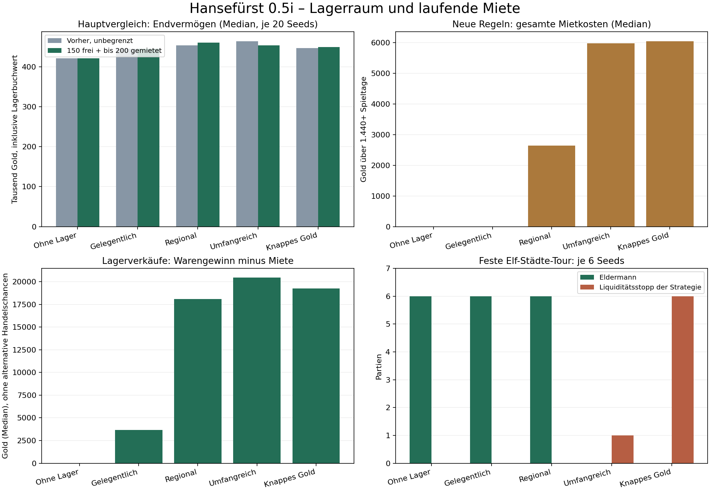

# Hansefürst 0.5i – Lagerkapazitäten und Lagerkosten

**Datum:** 25. Oktober 2026 · **Status:** auf separatem Arbeitszweig spielbar, nicht zusammengeführt oder als Veröffentlichung freigegeben.

**Ausgangspunkt:** `a660d79e0986d547ded5fadaa879a1d3102fa8d7` (integrierte Phase 0.5h.3), vor Beginn ausdrücklich von GitHub abgerufen. **Arbeitszweig:** `feature/phase05i-warehouse-capacity`.

**Tatsächlich getesteter Spielcode:** [`ca2c36e859837a6668bf82e9da8abb1978f8bc10`](https://github.com/psonnen-lgtm/Hansef-rst/commit/ca2c36e859837a6668bf82e9da8abb1978f8bc10). HTML-SHA256: `7e85ac510654e3aec8b41328b3a508cdc3030eac8b4ab2981e40f30b1efc2a19`. Der Spielcode wurde vor Hauptvergleich und Browserabnahme veröffentlicht und danach nicht verändert. Speicherversion **8**, regionale Wirtschaftsversion weiterhin **1**, Lagerversion **1**.

## Ergebnis in verständlichen Worten

Jede der elf Städte bietet jetzt **150 Fass kostenlos**. Im bestehenden Lagerhaus können zwei zusätzliche Stufen zu je **100 Fass für 1 Gold pro Spieltag** gemietet werden. Höchstens 350 Fass örtliche Kapazität, alle Waren gleich groß; Schiffsladung zählt nicht mit. Die Oberfläche zeigt belegte und freie Fläche, Zusatzraum sowie örtliche und gesamte Tagesmiete. Es gibt keine neue Verwaltungsseite.

Alte volle Lager bleiben vollständig erhalten. Die Migration ergänzt nur neue Lager-Metadaten und die Versionsnummer; sie verändert keine bestehenden Wirtschaftswerte. Der Hauptvergleich zeigt sinnvolle Lagergewinne nach Miete, zugleich Verlustverkäufe und Probleme bei zu geringer Bargeldreserve. Die kostenlose kleine Lagerstrategie und der Händler ohne Lager bleiben gegenüber dem Ausgangsspiel exakt unverändert.

**Zur fachlichen Entscheidung bleibt der Zahlungsstopp:** Ohne ausreichendes Bargeld endet die Zusatzfläche ohne neue Schulden. Vorhandene Überschüsse dürfen anschließend mietfrei liegen bleiben, nehmen aber keine neue Ware an. Das schützt Waren und verhindert unbegrenzt wachsende Bestände, ermöglicht jedoch eine bewusste Mietvermeidung. Dieser Zielkonflikt wird nicht als gelöster Exploitschutz ausgegeben. Vor einer Zusammenführung sollte ausdrücklich entschieden werden, ob diese einfache Regel gewünscht ist. Es wurden weder eine neue Schuldenwirtschaft noch Warenvernichtung eingeführt.

## 1. Tatsächliche Lagerregeln

| Regel | Umsetzung |
|---|---|
| Kostenlos | 150 Fass **je Stadt**, nicht ein gemeinsamer Vorrat |
| Zusatzfläche | 0, 100 oder 200 Fass je Stadt |
| Tagesmiete | 0, 1 oder 2 Gold je Stadt; nur angemietete Fläche |
| Neue reguläre Obergrenze | 350 Fass je Stadt, 3.850 über alle elf Städte |
| Waren | Alle elf Waren brauchen je Fass gleich viel Platz |
| Schiffsladung | Verbraucht ausschließlich Schiffskapazität |
| Umladen | Kostenlos, ohne Zeitfortschritt, Verkauf oder Auftragserfüllung |
| Einlagern | Nur positive ganze Mengen innerhalb der **gesamten** örtlichen Kapazität |
| Auslagern | Auch bei Überfüllung und Zahlungsstopp; örtliches Schiff mit freiem Laderaum erforderlich |
| Verkleinern | Nur, wenn die Waren in die gewünschte kleinere Fläche passen |
| Lagerwert | Bestehender Anschaffungsbuchwert, keine Bewertung zu steigenden Marktpreisen |

Die vorhandenen `warehouses` mit Mengen, gewichteten Einkaufskosten, Buchkosten und FIFO-Herkunft bleiben die einzige Warenverwaltung. Kapazitätsdaten sind getrennte Metadaten. Stadt- und Warenreihenfolgen wurden nicht geändert. Es gibt keine neuen Preise, Produktionsraten, Waren, Schiffe, Reisezeiten, Hafengebühren oder politischen Vorteile.

### Miete verständlich abgerechnet

Ein Miettag wird im Voraus bezahlt. Bei Beginn einer Stufe werden sofort 1 Gold fällig; zwei Stufen kosten sofort 2 Gold. An jeder folgenden Spieltagsgrenze wird bei ausreichendem Bargeld der nächste Tag bezahlt – auch während einer Reise und unabhängig vom Aufenthaltsort.

Beispiel: Eine Stufe beginnen und danach 17 Tage reisen kostet insgesamt **18 Gold**: 1 Gold beim Beginn, 17 weitere Tagesverlängerungen. Die letzte Zahlung deckt den folgenden Miettag. Eine dauerhafte Stufe kostet 360 Gold je 360-Tage-Spieljahr; beide Stufen 720. Zwei Stufen in allen Städten kosten zusammen 22 Gold täglich beziehungsweise 7.920 je vollem Spieljahr. Das ist optional; ein ungemietetes Lager kostet immer null.

Beim Wechsel von einer auf zwei Stufen wird nur die zusätzliche Stufe für den verbleibenden Miettag bezahlt. Der Termin der nächsten Verlängerung bleibt gleich. Verkleinern und Kündigen erstatten keine bereits bezahlten Tagesanteile und verlängern die Frist nicht. Wiederholtes Öffnen, dieselbe Stufe erneut wählen, Speichern, Laden, Import oder Hafenwechsel erzeugen keine zusätzliche Miete. Ohne vergehende Tage gibt es keine automatische Verlängerung.

## 2. Fehlendes Gold, Schulden und Rettungswege

Reicht das **Bargeld** für die nächste örtliche Tagesmiete nicht, wird keine Teilzahlung eingezogen. Die Anmietung endet, die kostenlose Kapazität gilt wieder. Alle Waren und FIFO-Aufzeichnungen bleiben erhalten. Über der Grenze ist Einlagern gesperrt; Auslagern und regulärer Verkauf bleiben möglich. Der Spieler erhält eine Meldung. Es entstehen keine Mietrückstände, Zinsen oder automatische Kredite. Bankguthaben und bestehende Bankkredite werden nicht für Miete angefasst; ihre bisherigen Zinsen laufen unverändert weiter.

Bei mehreren Mietlagern wird täglich in stabiler Stadtindex-Reihenfolge abgerechnet (Lübeck bis Venlo). Knappes Bargeld kann daher frühere Städte noch verlängern und spätere beenden. Diese Priorität ist berechenbar, aber keine individuell wählbare Zahlungsrangfolge.

**Bestandsgrenze und verbleibende Mietvermeidung:** Eine neue Einlagerung überschreitet niemals 350 Fass je Stadt. Liegen dort alte größere Mengen, darf kein zusätzliches Fass hinein. Damit lässt sich auch über wiederholte Anmietung und Zahlungsstopps kein beliebig großes neues Lager ansammeln. Trotzdem kann ein Spieler Zusatzraum füllen und danach durch fehlendes Bargeld – etwa bei vorhandenem Bankguthaben – eine mietfreie Lagerüberschreitung erhalten. Die Waren können dann zeitlich unbegrenzt liegen bleiben. Genau dieses Verhalten ist im gezielten Zahlungsfall nachgewiesen; es ist **keine Vermutung** und keine rückwirkend erhobene Gebühr.

Als Alternative müssten fortlaufende Rückstände mit Tilgung/Bonitätsfolgen oder eine andere ausdrücklich freigegebene Behandlung entworfen werden. Das wäre eine zusätzliche Wirtschaftsentscheidung und wurde zurückgestellt. Eine Bestätigung der einfachen Variante lag bei Erstellung dieses Berichts nicht vor; sie ist die im Chat offengelegte Arbeitsannahme für diesen prüfbaren Zweig.

Die einmalige Hafenarbeit behält ihre Bedingungen und ihren verwendeten Marker. Örtliche verwertbare Lagerware verhindert weiterhin die Arbeit als ersten Rettungsschritt. Ein gestoppter Mietvertrag zieht den Arbeitslohn nicht nachträglich ein. Zusätzliche örtliche Schiffe bleiben verkäuflich; das letzte Schiff und die letzte örtliche Abreisemöglichkeit bleiben geschützt. Die Miete reserviert kein Reisegeld: Eine zu knappe Strategie kann ihre Liquidität verbrauchen und muss reguläre Hilfen nutzen.

## 3. Schutz alter Spielstände und Speicherfehler

V7 → V8 ergänzt ausschließlich `v=8` und `storage={version:1,rentals:[…]}` mit elf zunächst mietfreien Einträgen `{blocks:0,until:0}`. Wirtschaftsversion 1 bleibt erhalten. Gold, Bank, Kredite, Schiffe, Rang, Aufträge, Preisbuch, Nachrichten, Hafenarbeitsmarker und sämtliche bestehenden Lagerfelder bleiben unverändert. Keine rückwirkende Miete, keine automatische Umschichtung und kein Preis-/Bestandsreset.

Die ausdrückliche neue Speicherversion ist nötig: Ein V7-Client darf die Kapazitäts- und Mietdaten nicht still ignorieren. Ein solcher Client lehnt V8 ab und lässt die gespeicherte Datei stehen. **Alte Clients weiterzuverwenden ist dennoch nicht sicher:** Deren manuelle Neustartfunktion liegt außerhalb dieser Änderung. Für die neue Partie die aktuelle Version verwenden und wichtige Originale zusätzlich als Datei exportieren.

Vor Aktivierung oder Import eines alten Standes wird dessen Rohtext bytegenau unter einem neuen `…-storage-v8-startup-backup` beziehungsweise `…-storage-v8-import-backup` gesichert. Vorhandene andere Originale werden nicht überschrieben; bei Kollision werden nummerierte Plätze genutzt. Readback prüft die Sicherung. Erst danach wird die übernommene Partie dauerhaft geschrieben und aktiviert. Ein fehlgeschlagener Backup- oder Zielschreibvorgang lässt den bisherigen aktiven Stand erhalten. Ein Neustart nach fehlgeschlagenem Laden benötigt Bestätigung und eine erfolgreiche Originalsicherung. Unbekannte Versionen und ungültige Mietfristen werden abgelehnt.

Mietänderungen werden an einer Kopie validiert und gespeichert, bevor der neue Zustand aktiv wird. Umladen wird bei einem Schreibfehler vollständig zurückgesetzt. Mehrfache oder inzwischen veraltete Mietbestätigungen können keine zweite Zahlung auslösen. Größenwechsel ohne Fristverlängerung sind ausdrücklich geprüft.

**Grenze:** Der allgemeine Tages-/Reisefortschritt verwendet weiterhin die bestehende Autospeicherung mit Fehlermeldung. Er wurde nicht in eine neue transaktionale Speicherarchitektur umgebaut. Nach allgemeinem Speicherfehler muss die noch aktive Partie exportiert werden; beim Neuladen kann sonst der zuletzt erfolgreich gespeicherte Gesamtfortschritt zurückkehren. Eine Garantie gegen Geräteausfall oder manuell manipulierte Dateien wird nicht behauptet.

## 4. Variantenvergleich vor der produktiven Auswahl

Pilot: fünf Lagerstrategien × zwei Seeds (71001–71002) × sechs Kombinationen. Kostenlos 100/150/200 Fass, Zusatzstufe jeweils 100 Fass, 1 oder 2 Gold pro Tag. Regulärer Beginn in Lübeck mit 5.000 Gold und einer Kogge, 1.440 Spieltage oder höchstens 800 Entscheidungen. Die letzte Reise darf über das Zeitlimit hinauslaufen.

| Freie Fass | Gold/Stufe/Tag | Endvermögen Median | Miete insgesamt (10 Partien) | Eldermann |
|---:|---:|---:|---:|---:|
| 100 | 1 | 425.743 | 29.952 | 10/10 |
| 100 | 2 | 435.236 | 71.044 | 10/10 |
| 150 | 1 | 434.746 | 26.184 | 10/10 |
| 150 | 2 | 425.743 | 50.730 | 10/10 |
| 200 | 1 | 425.743 | 20.331 | 10/10 |
| 200 | 2 | 433.624 | 42.766 | 10/10 |


Jede Tabellenzeile umfasst nur zehn unterschiedliche Strategien/Seeds. Diese Mediane sind **kein statistischer Beweis eines besten Mietpreises**. 150 kostenlose Fass erlauben einen vollständigen Koggeninhalt plus 60 Fass Reserve ohne Miete. 100 würde früher begrenzen; 200 lässt noch mehr Bevorratung kostenlos. 1 Gold je Zusatzstufe ist die vorsichtige Auswahl, ohne größeren Handel durch 2 Gold täglich stärker zu belasten. Die beschlossenen R1-Parameter bleiben unverändert.

Der erste Testprototyp setzte beim Verkleinern die Mietfrist neu. Das wurde im Review erkannt, korrigiert und durch einen eigenen Grenztest abgesichert. Beide vollständigen 60er-Serien sind erhalten. In diesen konkreten Partien wurde der fehlerhafte Größenwechsel nicht ausgelöst; wirtschaftliche Ergebnisse beider Serien sind gleich. Die ersten Daten allein beweisen die korrigierte Fristregel nicht. Der aktuelle Spielcode verwendet die geprüfte fristerhaltende Variante.

## 5. Umfang, Wiederholbarkeit und Quellen

| Serie | Gesicherte Partiereihen | Zusätzliche exakte Replays |
|---|---:|---:|
| Variantenpilot vor Fristkorrektur | 60 | 0 |
| Variantenpilot nach Fristkorrektur | 60 | 0 |
| Hauptvergleich: vorher/jetzt × fünf Strategien × 20 Seeds | 200 | 10 |
| Ergänzende Elf-Städte-Tour: vorher/jetzt × fünf Strategien × sechs Seeds | 60 | 4 |
| **Gesamt** | **380** | **14** |

**394 vollständige Engine-Ausführungen**, darin 260 Haupt-/Fernvergleichsfälle und ein wiederholter 60-Fälle-Variantenvergleich. Bei 367 der 380 gesicherten Partiereihen wurde der Zeithorizont erreicht; 13 endeten regulär am ausdrücklich protokollierten Liquiditätsstopp der Teststrategie. Die 14 Replays werden nicht als zusätzliche unabhängige Ergebnisse gezählt. Kein technischer Workerabbruch. Einzelne Mechanik-, Migrations- und Rettungsfälle zählen **nicht** als vollständige Partien. Keine 1.500er-Simulation; die ausdrückliche Grenze dieses Auftrags geht der allgemeinen Zahl in AGENTS.md vor.

Der Hauptvergleich verwendet Seeds 72001–72020, die Elf-Städte-Ergänzung 74001–74006. Alle beginnen regulär in Lübeck mit 5.000 Gold, Kogge und 9.960 Gold Buchvermögen. Ziel 1.440 Spieltage / maximal 800 Entscheidungen, keine vorzeitige Beendigung beim Eldermann. Hauptläufe erreichen 1.440–1.445 Tage; die feste Tour bis 1.462. Frühe Liquiditätsstopps liegen zwischen Tag 123 und 446. Unterschiedliche Laufzeiten werden bei Schlussfolgerungen nicht gleichgesetzt. Aus Spieltagen werden keine menschlichen Spielstunden abgeleitet.

Beide Vergleichsgruppen führen echten Spielcode aus: Ausgangs-HTML aus Git-Commit `a660d79` und neues HTML aus `ca2c36e`. Der bestehende Headless-Adapter verwendet Mulberry32-Seeds. Es gibt keine zweite produktive Lagerwirtschaft. Der Testprototyp diente nur der vorgelagerten Variantenwahl. `warehouse-strategies.js` trifft Entscheidungen anhand örtlicher Preise/Bestände, eigener Buchkosten und des Preisbuchs; keine Fernpreis-Abfrage oder Zukunftskurse. Die fünf Teststrategien sind nachvollziehbare künstliche Verhaltensweisen, keine Aussage über menschliches Spielgefühl.

Die kleine Strategie zielt auf 60 Fass; regionale Bevorratung auf 220; umfangreiche und liquiditätsarme auf 400, im neuen Spiel effektiv höchstens 350. Kauf nur bei örtlichem Überschuss (mindestens 140) und Preis höchstens 85 % des Warenbasispreises. Verkauf ab 18 % über Buchkosten oder nach 90/180/360/720 Tagen; die knappe Strategie reserviert nur 6 Gold und investiert bis 96 % ihres Bargelds. Der reguläre Händler reserviert wesentlich mehr. Regionalität meint hier eine **örtliche Bestandsentscheidung**, keine allwissende Standortoptimierung. Umladen und Käufe erfolgen über die echten Spielfunktionen.

Für jede Partie wird die Bargeldbilanz mit tatsächlichen Kauf-, Verkaufs-, Hafen- und Mietereignissen abgeglichen. Interne Strategiezähler übergehen zum Teil die vom Lagerplaner ausgeführten Verkäufe; deshalb sind **Spielereignisse** maßgeblich. Die Auswertung ordnet unmittelbare Verkäufe nach Auslagerung deren tatsächlichem gewichteten Warengewinn zu und zieht sämtliche Mieten ab. Das enthält keine geschätzten Zukunftsgewinne. Verbleibende Vorräte zählen zum Anschaffungsbuchwert, nicht als bereits realisierter Gewinn.

Reproduktionsquellen im Ergebnisordner [`phase05i-20261025-01`](../../tests/simulation/phase05i-20261025-01/):

- [`pilot.json.gz`](../../tests/simulation/phase05i-20261025-01/pilot.json.gz), [`candidate-attempt1.js`](../../tests/simulation/phase05i-20261025-01/candidate-attempt1.js) und [`pilot-revised.json.gz`](../../tests/simulation/phase05i-20261025-01/pilot-revised.json.gz): Varianten und offener erster Fristfehler.
- [`main/manifest.json`](../../tests/simulation/phase05i-20261025-01/main/manifest.json) und [`tour/manifest.json`](../../tests/simulation/phase05i-20261025-01/tour/manifest.json): Codehashes, Seeds, Strategien, Horizonte und Pilotfreigaben; je eine komprimierte Rohdatei pro Fall mit Ereignissen und Endzustand.
- [`summary.json`](../../tests/simulation/phase05i-20261025-01/summary.json), [`groups.csv`](../../tests/simulation/phase05i-20261025-01/groups.csv), [`verification.json`](../../tests/simulation/phase05i-20261025-01/verification.json): Kennzahlen, Zählung und Unverändertheitsbelege.
- Treiber: [`phase05i-pilot.cjs`](../../tests/simulation/phase05i-pilot.cjs), [`phase05i-run.cjs`](../../tests/simulation/phase05i-run.cjs), [`phase05i-tour-run.cjs`](../../tests/simulation/phase05i-tour-run.cjs). Importieren startet keine Wirtschaftssimulation; Ausführung und neuer Ausgabeordner müssen ausdrücklich angegeben werden.
- Die 909 bereits am Ausgangsstand vorhandenen Ergebnis-/Protokoll-/CSV-Dateien wurden über ihre Git-Blob-IDs bytegleich bestätigt. Alte Daten wurden nicht überschrieben.

## 6. Ergebnisse des 200er-Hauptvergleichs

Je Tabellenzeile 20 neue Partien pro Version, alle über den vollen Horizont. Beträge in Gold; Vermögen enthält Schiff und verbliebene Vorräte zu Buchwerten. „Lagergewinn nach Miete“ ist der tatsächliche Warengewinn der Lagerverkäufe abzüglich aller Mieten, **ohne** entgangene andere Handelschancen. Er ist kein zusätzlich zu addierender Vermögensbetrag.

| Strategie | Vermögen vorher | Vermögen jetzt | Bargeld jetzt | Miete jetzt | Lagergewinn nach Miete | Maximale örtliche Fass |
|---|---:|---:|---:|---:|---:|---:|
| Ohne Lager | 420.726 | 420.726 | 417.285 | 0 | 0 | 0 |
| Gelegentlich | 445.398 | 445.398 | 438.890 | 0 | 3.678 | 60 |
| Regional | 453.299 | 460.107 | 445.482 | 2.644 | 18.083 | 220 |
| Umfangreich | 464.155 | 453.448 | 432.202 | 5.975 | 20.433 | 350 |
| Knappes Gold | 446.443 | 449.422 | 428.745 | 6.051 | 19.241 | 350 |


Alle 200 Partien erreichen Eldermann, ohne Reise- oder Kreditblockade; keine Bankkredite oder Reparaturkäufe in diesen Richtlinien. Die 100 neuen Fälle haben null Zahlungsstopps. Ein niedrigerer Median des Eldermann-Zeitpunkts ist ein Ergebnis dieser automatischen Richtlinie, kein Versprechen einer menschlichen Spielzeit.

Die 40 gepaarten Fälle ohne Lager beziehungsweise mit maximal 60 Fass zeigen nach Entfernung ausschließlich der neuen Speicher-Metadaten **identische Endzustände, Ereignisse, Strategieresultate und nächste Zufallszahl**. Kleine Händler werden ohne freiwillige Anmietung nicht belastet. Mietfunktionen selbst verbrauchen keine Zufallszahlen. Veränderte Goldreserven können bei größeren Strategien später zu anderen Handels- und Wahlentscheidungen und damit unterschiedlichen weiteren Pfaden führen.

**Gruppenmediane nicht mit gepaarten Wirkungen verwechseln:** Regionale Bevorratung hat zwar einen höheren neuen Gruppenmedian, endet gegenüber der alten Variante jedoch in 16 von 20 gleichen Seeds schlechter; Median der gepaarten Differenz −3.255 Gold. Umfangreiche Bevorratung: 11 besser, neun schlechter, gepaarter Median +1.126. Knappe Bevorratung: zwölf besser, acht schlechter, +9.368. Die Grenzen ändern neben Mietausgaben auch Kaufmengen und Folgeentscheidungen; das ist kein isolierter Zinseffekt.

Gegenüber **ohne Lager im neuen Spiel** gewinnt die regionale Richtlinie 13 von 20 gepaarten Fällen (+15.024 Gold Median), umfangreiche zwölf (+16.711), knappe 14 (+20.695). Gelegentliche Bevorratung schlägt den lagerlosen Händler nur neunmal und liegt gepaart im Median 4.225 Gold zurück, obwohl der Gruppenmedian höher ist. Eine profitable Lagertransaktion bedeutet somit nicht automatisch die beste Gesamtstrategie.

Im neuen Hauptvergleich sind **2.695 einzelne Lagerverkäufe verlustreich**. Regionale Bevorratung: 1.181 von 3.056; umfangreiche 839 von 2.611. Der gesamte direkte Lagergewinn nach Miete bleibt in allen 20 Seeds dieser Richtlinien positiv. Das belegt eine interessante Option in diesen Verläufen, jedoch keine risikolose Geldquelle. Die jährlichen Mietkosten entstehen auch während unproduktiver Wartezeiten. Nicht verkaufte Vorräte sind gebundenes Kapital.



## 7. Zusätzlicher Fernhandelstest und Liquiditätsstopps

Die erste Auswertung zeigte **null Reisen ab 20 Tagen** im Hauptvergleich. Daher wurde die Prüfung um 60 neue Partien ergänzt: feste Route durch alle elf Städte, gleiche örtliche Handels- und Lagerlogik, sechs Seeds je Strategie/Version. Der Planer erhält jeweils nur den nächsten Hafen dieser Route. Dies ist eine bewusst erzwungene Fernhandelskontrolle, kein Beweis, dass normale Spieler diese Route wählen oder dass sie optimal ist. Die aktuelle Gruppe enthält **676 tatsächliche Fahrten ab 20 Tagen**.

| Strategie | Eldermann vorher/jetzt | Strategie-Stopps vorher/jetzt | Vermögen jetzt (Median) | Miete jetzt (Median) | Laufzeit jetzt (Tage) |
|---|---:|---:|---:|---:|---:|
| Ohne Lager | 6/6 → 6/6 | 0/6 → 0/6 | 207.706 | 0 | 1442–1462 |
| Gelegentlich | 6/6 → 6/6 | 0/6 → 0/6 | 225.494 | 0 | 1442–1462 |
| Regional | 6/6 → 6/6 | 0/6 → 0/6 | 224.593 | 6.764 | 1442–1462 |
| Umfangreich | 1/6 → 0/6 | 0/6 → 1/6 | 149.160 | 7.414 | 446–1455 |
| Knappes Gold | 0/6 → 0/6 | 6/6 → 6/6 | 9.724 | 8 | 126–137 |


Die Tabellen-Endvermögen sind hier **beschreibend, kein gleich langer Strategiewettbewerb**: Alle knappen Strategien beenden ihren Ablauf bereits zwischen Tag 123 und 137; eine neue umfangreiche Strategie stoppt an Tag 446. Sie dürfen nicht anhand ihres Endvermögens gegen über 1.440 Tage laufende Strategien abgewertet oder als allgemeine Insolvenzquote ausgegeben werden.

Ohne Zusatzlager und mit gelegentlicher Bevorratung bleiben die Fernhandelsergebnisse unverändert. Regionale Bevorratung erreicht in beiden Versionen in allen sechs Seeds Eldermann. Ihr neuer Median des direkten Lagergewinns nach Miete beträgt rund **29.139 Gold**, bei **6.764 Gold Miete**; der Endvermögensmedian sinkt von 232.445 auf 224.593 Gold. Miete kann damit einen Teil des Fernhandelsvorteils aufzehren, zerstört ihn in diesen regionalen Fällen aber nicht. Umfangreiche Vorratshaltung ist deutlich anfälliger; die Mietkosten sind eine echte Abwägung und keine kosmetische Zahlung.

**13 Liquiditätsstopps sind gesichert:** sechs knappe alte, sechs knappe neue sowie eine umfangreiche neue Strategie. Nur die umfangreiche neue Partie enthält einen automatischen Zahlungsstopp des Mietlagers. Alle betroffenen Endstände behalten positives Buchvermögen und ungenutzte reguläre Kreditfähigkeit. Die Teststrategien nehmen grundsätzlich keine Kredite auf.

An allen 13 **gespeicherten** Endpunkten wurden anschließend in einzelnen Mechanikfällen regulärer Kredit für das fehlende Reisegeld und eine tatsächliche weitere Reise über die Spielfunktionen ausgeführt. Alle bestanden ([Nachweis](../../tests/simulation/phase05i-20261025-01/liquidity-checks.json)). Das ist kein neuer vollständiger Durchlauf und beweist keine dauerhafte Erholung bis zum Eldermann. Es zeigt, dass diese Stopps **keine nachgewiesenen unumkehrbaren wirtschaftlichen Sackgassen** sind. Die allgemeine Behauptung „Lagerung kann nie eine Sackgasse auslösen“ wäre mit dieser Stichprobe nicht belegbar.

## 8. Technische Schutzprüfungen

**Neu bestanden: 17 gezielte Prüfgruppen** in [`capacity-checks-acceptance.json`](../../tests/simulation/phase05i-20261025-01/capacity-checks-acceptance.json). Darunter:

- Exakte Kapazitätsgrenze und ein Fass darüber in allen **121 Stadt-Waren-Kombinationen**, gemischte Bestände, erlaubte Auslagerung und unveränderte FIFO-/Buchdaten.
- Mietbeginn, Verkleinern, Kündigung, 17 vergehende Tage, mehrere örtliche Verträge, Jahresgrenze, unveränderte Zufallsfolge und keine doppelte Belastung durch Öffnen/Laden.
- Zu wenig Bargeld bei bestehenden Krediten und Bankguthaben; keine neue Schuld, keine Warenverwertung, erhaltene Auslagerung; einmalige Hafenarbeit und letzter Schiffsschutz.
- Originalbackup-Kollisionen, fehlgeschlagene Sicherung/Zielschreibung, echte FileReader-Importfunktion, Import/Export-Rundlauf, wiederholte Migration, ungültige Versionen und Mietfristen, Speichern fehlgeschlagener Umladung/Mietänderung.
- Unveränderte vollständige Funktionskörper von **17 bestehenden Wirtschafts-/Reisefunktionen**, sechs Katalog-/Parameterobjekte einschließlich R1 sowie drei Seeds über je 400 Tage ohne Miete mit exaktem ursprünglichen Zustand und RNG.
- 121 unmittelbare Kauf–Einlagerung–Auslagerung–Verkauf-Kreise ohne Goldgewinn; lokale und unbekannte Herkunft kann weiter keine Lieferprämie erzeugen. Die vorhandenen Lieferregressionen sichern zusätzlich fremde Herkunft, Ablauf und Einmalzahlung.

**Altbestandsschutz:** Ein künstlicher V7-Spielstand mit **121.121 Fass**, zwei historische V7-Endstände und **274 historische V6-Endstände** wurden unverändert übernommen. Die breite V6-Prüfung umfasst Speichern/Laden und einen Folgetag, keine Neuausführung der alten Strategien. Marker, Ladung, Schiffe, örtliche Warenherkunft und Buchkosten bleiben erhalten. Vollständige Altdatenprojektionen sind exakt, nicht nur Stichproben einzelner Goldwerte.

**16 bestehende Regressionsbefehle bestanden** auf dem getesteten Spielcode ([vollständige Ausgaben](../../tests/simulation/phase05i-20261025-01/regressions-reviewed.json)):

```text
node tests/test-v04.cjs
node tests/phase1.cjs
node tests/telemetry.cjs
node tests/share.cjs
node tests/simulation/edges.cjs
node tests/simulation/warehouse-checks.cjs
node tests/simulation/warehouse-cities-checks.cjs
node tests/simulation/four-goods-checks.cjs
node tests/simulation/city-v6-migration-checks.cjs
node tests/simulation/eleven-cities-checks.cjs
node tests/simulation/eleven-cities-compat-checks.cjs
node tests/simulation/optimized-delivery-checks.cjs
node tests/simulation/price-rounding-checks.cjs
node tests/simulation/integration-checks.cjs
node tests/simulation/ship-sale-checks.cjs
node tests/simulation/harbor-work-checks.cjs
```

Die ersten Fehlläufe sind unter `regressions-attempt1.json` und `regressions-attempt2.json` aufbewahrt. Tatsächliche Anpassungen: V8 statt V7 als erwarteter aktueller Export; synthetische V3/V4/V5-Stände und exakte Altprojektionen entfernen zusätzlich ausschließlich neue `storage`-Metadaten; der historische Quellvergleich der Tagesfunktion normalisiert nur den bewusst eingefügten Mietaufruf. Warenherkunfts-, Preisuntergrenzen-, Zins-, Hafen-, Kredit-, Schiffs- und politische Schutzprüfungen bleiben aktiv. Die alten Fünf-Städte-Ganzdatei-Snapshots und der archivbezogene 0.5h.3-Aktivierungsprüfer sind keine behaupteten aktuellen Abnahmen; ihre damaligen Ergebnisse bleiben historisch erhalten. Aktuelle R1-/Katalog-/RNG-Erhaltung ist separat streng geprüft.

## 9. Tatsächliche Browserabnahme

**Chromium 154.0.8037.57 / Playwright**, 390 × 844, 820 × 1180 und 1280 × 900. Alle drei Oberflächen und fünf zusätzliche Sicherungs-/Zahlungsgruppen bestanden; keine JavaScript-Fehler und keine fehlgeschlagenen Ressourcen ([Browsernachweis](../../tests/simulation/phase05i-20261025-01/browser.json)). Keine Safari- oder physischen iPhone-/iPad-Gerätetests.

Tatsächlich bedient wurden vorhandenes Lagerhaus, Mietschaltflächen, Handel, Ein- und Auslagerung, Verkleinerungsversuch, Seekarte und Reisebestätigung, Export als heruntergeladene Datei und Import über das echte Datei-Eingabefeld. Eine Reise belastete die Miete des zurückgelassenen Lagers exakt pro Spieltag. Übernahme eines alten 270-Fass-Lagers erhielt sämtliche Ausgangsfelder und dessen Originalkopie. Wiederholtes Laden erzeugte keine Gebühr. Der reale Speicher wurde gezielt beim Backup, Zielschreiben, Mietwechsel und Umladen scheitern gelassen. Auch die alte V7-Seite wurde tatsächlich geladen und wies V8 ohne Abschneiden der Daten zurück.

Der erste Browserdurchgang bestand bereits die drei Größen, scheiterte aber anschließend im **Testaufbau**: Das Mengenfeld wurde ohne geöffnete Marktansicht angesprochen. Der Test öffnet nun die Ansicht vor dem Zugriff. Zweiter Durchgang vollständig bestanden; erster Fehler ist als `browser-attempt1.log` erhalten. Kein Spielcode wurde deswegen geändert.

Echte, visuell gesichtete Screenshots der im Browser geöffneten Lagersteuerung:

- [390 × 844, mobile Lagersteuerung](2026-10-25_0.5i_lager-390.png)
- [820 × 1180, Tablet-Lagersteuerung](2026-10-25_0.5i_lager-820.png)
- [1280 × 900, Desktop-Lagersteuerung](2026-10-25_0.5i_lager-1280.png)

Die Bilder sind Ausschnitte des tatsächlich gerenderten Lagerpanels, keine nachgebauten UI-Motive. Die Texte bleiben lesbar, Schaltflächen umbrechen mobil; kein horizontaler Seitenüberlauf. Größere Warenlisten nutzen den vorhandenen Dialog und dessen Scrollen.

## 10. Erkenntnisse, Risiken und Empfehlung

**Durch neue Daten belegt:** Lagerraum und Miete sind tatsächlich spielbar integriert. Freie Kapazität reicht für kleine Händler; ohne Nutzung bleibt das alte Spiel exakt erhalten. Gezielte Bevorratung kann nach Miete Gewinne bringen, aber einzelne Verluste und gebundenes Kapital gehören dazu. Fernhandelsmiete und zu geringe Bargeldreserven sind relevant. Alte volle Bestände bleiben ungekürzt; neue Einlagerung kann die Grenze nicht überschreiten. Historische Daten bleiben unverändert.

**Historisch übernommen:** Die umfangreichen wirtschaftlichen Aussagen aus 0.5h.3 wurden nicht pauschal neu bewiesen. Deren R1-Funktionen und Parameter sind hier exakt unverändert, die früheren Rohdaten bleiben Quellen für die damaligen Fragestellungen. Der aktuelle Auftrag umfasst keine neue 1.500er-Wirtschaftssimulation und keine Überarbeitung der Handelsstrategien im Spiel.

**Offen beziehungsweise ungeprüft:**

1. Fachliche Freigabe der mietfreien, gesperrten Restbestände nach Zahlungsstopp. Das ist ein nachvollziehbarer Bestandsschutz, zugleich ein bekannter Weg zur Mietvermeidung. Rückstandsschulden, Zwangsverkauf und Warenlöschung wurden bewusst nicht eingeführt.
2. Die Parameter 150/100/1 sind eine vorsichtige Testauswahl, keine abschließende Balanceentscheidung oder menschliche Spielspaßmessung. 20 Seeds je Hauptgruppe und sechs je Fernkontrolle sind begrenzt.
3. Große Lager in mehreren Städten können die Bargeldreserve aufbrauchen. Die knappe Strategie versagt schon ohne neue Miete. Die 13 einteiligen Kredit-Rettungsproben beweisen keine langfristig erfolgreiche Karriere nach dem Stopp.
4. Es gibt keinen Beweis, dass jede Lagerstrategie, jede Handelsroute oder eine unbegrenzte Zahl von Spieljahren sicher/profitabel ist. Neue Schiffbau-/Gesellschaftsmechaniken wurden nicht vorweggenommen.
5. Keine Prüfung auf Safari oder echten Apple-Geräten; keine neue allgemeine Transaktions-, Mehrtab- oder Cloud-Speicherarchitektur. Parallel geöffnete alte Clients und manuelle Dateimanipulation liegen außerhalb der Abnahme.

**Empfehlung vor Zusammenführung:** Die konkrete Mietstopp-Regel anhand dieses Berichts entscheiden. Bei Zustimmung ist das getestete Modell ein kleiner, technisch geprüfter Einstieg. Falls mietfreie Restbestände unerwünscht sind, den kritischen Teil zur separaten Regelentscheidung zurückstellen; keine Schuldenlogik nachträglich still ergänzen. Für menschliches Probespielen zunächst kostenlose/gelegentliche und regionale Lagerhaltung vergleichen, Gebühren und Liquidität beobachten. Kein eigenständiger Start einer Folgephase oder weiterer Simulationen.

**Fazit zur Spielbarkeit:** Die Mechanik ist auf diesem Zweig bedienbar und technisch abgesichert. Lagerung ist eine zusätzliche wirtschaftliche Option mit Kosten und Risiken; große Vorräte garantieren weder höheren Gewinn noch politischen Aufstieg. Die offene Mietvermeidung ist eine fachliche Freigabefrage, keine verschwiegene technische Vollständigkeitsbehauptung.

## GitHub-Sicherung

- [Zwischenstand 1 – Analyse und Variantenpilot `dbf7f86`](https://github.com/psonnen-lgtm/Hansef-rst/commit/dbf7f86)
- [Zwischenstand 2 – Spielcode und Schutzprüfungen `ca2c36e859837a6668bf82e9da8abb1978f8bc10`](https://github.com/psonnen-lgtm/Hansef-rst/commit/ca2c36e859837a6668bf82e9da8abb1978f8bc10)
- [Zwischenstand 3 – vollständige Rohdaten, Browsernachweise, Grafik und Bericht `246e885aa425cb3122cae719ab480aeb69a66925`](https://github.com/psonnen-lgtm/Hansef-rst/commit/246e885aa425cb3122cae719ab480aeb69a66925). Die ID wird erst in diesem nachfolgenden Dokumentationsstand ergänzt; keine selbstreferenzielle Commit-ID.
- [Direkter Vergleich gegen development/v04-foundation](https://github.com/psonnen-lgtm/Hansef-rst/compare/development/v04-foundation...feature/phase05i-warehouse-capacity)
- Die Erstellung eines Entwurfs-PR gegen `development/v04-foundation` wurde nach Veröffentlichung des vollständigen Berichts tatsächlich versucht. `gh pr create` scheiterte mit `Post "https://api.github.com/graphql": Forbidden`. Es wurde kein PR angelegt. Der direkte Vergleich bleibt nutzbar; der Zweig und alle drei Zwischenstände wurden erfolgreich gepusht.
- Keine eigenständige Zusammenführung nach `development/v04-foundation` oder `main`, keine Bereitstellung als neue Live-Version. Der Entwicklungszweig wurde zum Abschluss erneut gelesen und steht weiterhin auf `a660d79e0986d547ded5fadaa879a1d3102fa8d7`.
