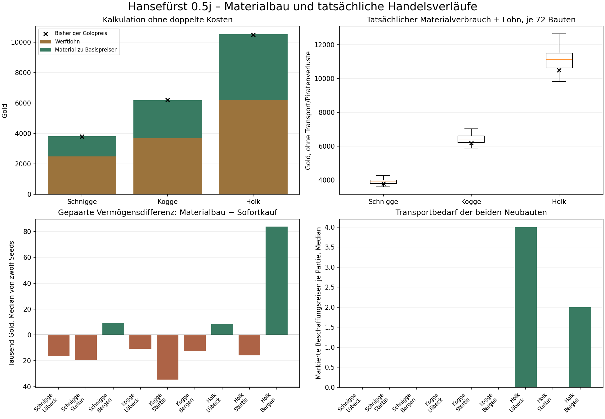

# Hansefürst 0.5j – Materialabhängiger Schiffbau

Stand: 25.10.2026. Arbeitszweig: `feature/phase05j-material-shipbuilding`. Integrationsziel: `development/v04-foundation`; keine automatische Zusammenführung.

## Ergebnis und Herkunft der Nachweise

Schnigge, Kogge und Holk können mit örtlichen Materialien und vorausbezahltem Werftlohn gebaut werden. Ein bestätigter Auftrag dauert echte Spieltage; das fertige Schiff liegt in der beauftragten Werftstadt. Handel und Reisen bleiben währenddessen möglich. Alle drei Typen wurden technisch und in vollständigen Wirtschaftspartien tatsächlich gebaut.

Die Wiederaufnahme hat vorhandene Ergebnisse erhalten: **240 unterschiedliche vollständige Fälle und 20 exakte Pilot-Replays, insgesamt 260 vollständige Ausführungen. Bei der Fortsetzung wurden null vollständige Partien neu berechnet.** Frühere 1.500er- und 0.5h-/0.5i-Serien wurden nicht erneut gestartet. Der begrenzte Umfang folgt dem ausdrücklichen Auftrag und geht der allgemeinen 1.500er-Vorgabe in `AGENTS.md` vor.

| Zweck | Vollständiger Commit des Spielcodes |
|---|---|
| Unveränderte Vergleichsbasis, alter Sofortkauf | `e382c0f8653eabcfa8d37986e251bd2748ed4b46` |
| Materialbau im vollständigen Hauptvergleich | `ca7f971b3a653e848c1c58dc8d4064ed531eda61` |
| Finaler Spielcode mit Kennungskorrektur, danach technisch und im Browser geprüft | `330a0d83b437f67607748d9f3e0c52618ee2b1c2` |

Finale HTML-Prüfsumme: `169d87504293b52048fe74a0c7456fa464e027951bf8222814f2f7609bb777c9` (SHA-256). Spätere Berichts-/Nachweiscommits ändern diesen Spielcode nicht. Zwischenstände stehen im [Fortschrittsbericht](2026-10-25_0.5j_fortschritt.md), endgültige Zuordnung und Prüfzahlen in [verification.json](../../tests/simulation/phase05j-20261025-01/verification.json).

Die 240 Hauptfälle lagen bei der Fortsetzung vollständig lokal vor. Pilotprotokoll: 20 berechnete Fälle; Hauptprotokoll: 220 weitere berechnet, 20 fertige übernommen, null Fehler. [Inventur](../../tests/simulation/phase05j-20261025-01/resume-inventory.json) und [Wiederaufnahmeprüfung](../../tests/simulation/phase05j-20261025-01/resume-audit.json) sichern die unverändert übernommenen Dateien. Das ist eine Auswertung gesicherter Daten, keine Wiederholung oder behauptete Wiederherstellung fehlender Ergebnisse.

## Festgelegte Baupläne

| Schiff | Holz | Hanf | Pech | Eisenwaren | Gesamtfass | Werftlohn | Bauzeit |
|---|---:|---:|---:|---:|---:|---:|---:|
| Schnigge | 24 | 8 | 6 | 6 | 44 | 2.500 G | 20 Tage |
| Kogge | 44 | 14 | 12 | 12 | 82 | 3.700 G | 35 Tage |
| Holk | 75 | 24 | 20 | 22 | 141 | 6.200 G | 55 Tage |

Zu bisherigen Basispreisen ergeben Material plus Lohn 3.812 / 6.184 / 10.537 G. Zum Vergleich: alter Sofortkauf 3.800 / 6.200 / 10.500 G. Der alte volle Goldpreis wird also nicht zusätzlich zu den Materialien verlangt. Materialpreise schwanken weiterhin nach unveränderter R1-Wirtschaft; der Werftlohn ist fest.

Vor der Umsetzung wurden drei Varianten verglichen: A mit weniger Material, mehr Lohn und 14/24/40 Tagen; B wie oben; C mit mehr Material und 28/45/75 Tagen. **891 Angebots-/Verfügbarkeitsfälle** = drei Markt-Seeds × drei Jahresstände × elf Städte × drei Typen × drei Varianten. Diese Marktproben sind keine vollständigen Handelspartien und keine ausgeführten Materialkäufe.

Bei B lagen die mittleren Standortangebote (Median über 99 Fälle je Typ) bei 3.872 / 6.320 / 10.816 G einschließlich Lohn. Der örtliche Marktbestand reichte in 91/80/67 von 99 Fällen unmittelbar für den jeweiligen Bauplan. B wurde vor dem Hauptvergleich ausgewählt: nahe bisherigen Grundkosten, nachvollziehbarer Materialbedarf, selbst der Holk passt mit 141 Fass grundsätzlich ins freie 150-Fass-Lager. Andere bereits eingelagerte Waren können trotzdem Platz beanspruchen. C braucht für den Holk 190 Fass und würde häufiger Zusatzmiete erzwingen.

Weitere **36 kontrollierte Beschaffungs-/Bau-/Verkaufs-Fixtures** bestätigten später alle drei Varianten: drei Varianten × drei Typen × zwei Seeds × zwei Werften. Dabei wurden nach 360 Markttagen die vorhandene Kogge in Stettin/Bergen angesetzt und 20.000 G bereitgestellt. Käufe, Lagerung, nötige Fahrten, Bauzeit und Verkauf laufen über tatsächliche Spielregeln; alle 36 schließen ab und verlieren beim Bau/Verkauf Geld. Das sind künstlich finanzierte Mechanikproben, keine zusätzlichen vollständigen Karrieren und kein Nachweis eines regulären Starts mit 5.000 G. Nur B ist im Spiel aktiviert. Quellen: [Variantenangebote](../../tests/simulation/phase05j-20261025-01/variants.json.gz), [36 Ausführungsproben](../../tests/simulation/phase05j-20261025-01/variant-fixtures.json.gz).

## Ablauf im Spiel

1. Baumaterial selbst kaufen und zur gewünschten Werft bringen. Verfügbar sind nur eigene Schiffe in dieser Stadt und das dortige eigene Lager. Entfernte Lager und Schiffe zählen nicht.
2. Die vorhandene Hafen-/Werftansicht zeigt Materialzeichen, benötigte/verfügbare Mengen, Werftlohn und Dauer. Bei fehlenden Voraussetzungen bleibt der Auftrag gesperrt.
3. Die Bestätigung nennt Stadt, alle Materialien, Lohn, Bauzeit und den nicht abbrechbaren Charakter. Material und Lohn werden genau einmal gemeinsam verbucht und der Auftrag gespeichert. Kein automatischer Kredit, kein späterer Materialabruf und keine Nachforderung.
4. Zuerst wird örtliche Schiffsladung verbraucht, das ausgewählte Schiff zuerst, danach das örtliche Lager. FIFO-Herkunftsreste und Einkaufskosten bleiben korrekt; Verbrauch ist kein Verkauf und erfüllt keine Lieferaufträge.
5. Weiter handeln oder reisen, alternativ in der Werft jeweils bis zu sieben Tage warten. Dabei laufen Märkte, Zinsen, Mieten und Auftragsfristen regulär weiter. Eine vorher geplante Reise muss nach dem Warten neu geplant werden.
6. Am Fälligkeitstag entsteht genau ein fertiges, unbeladenes Schiff in der ursprünglichen Werftstadt. Es wird weder zum Spieler teleportiert noch automatisch in den aktiven Konvoi aufgenommen. Für seine Nutzung muss es dort abgeholt werden.

Es gibt **einen laufenden Bauauftrag insgesamt**, auch über mehrere Städte hinweg. Ein Flottenplatz wird vorab reserviert; maximal 500 fertige Schiffe einschließlich reserviertem Neubau. Bestehende aktive Auswahl, Schiffsreferenzen und Konvois bleiben bei einer Fertigstellung während der Reise erhalten.

Offene Mietrückstände sperren einen neuen Auftrag in allen Werften. Das ist die gewählte vorsichtige Absicherung gegen einen indirekten Umweg über Werftverbrauch. Keine automatische Schuldentilgung: regulärer Verkauf, Auslagerung und die bestehende örtliche Mietschuldentilgung bleiben möglich. Eine großzügigere Sonderregel für bereits vorhandenes Material wurde bewusst nicht eingeführt.

Ein angefangener Bau zählt im Buchvermögen höchstens mit bezahltem Lohn plus verbrauchtem Materialbuchwert und höchstens mit dem bisherigen Buchwert des fertigen neuen Schiffs. Dadurch verschwindet die Investition während der Bauzeit nicht vollständig aus dem Vermögen und erzeugt beim Baubeginn keinen künstlichen Gewinn. Diese begrenzte Ergänzung ist ausdrücklich Teil der Umsetzung; die bisherigen Kredit- und Aufstiegsformeln selbst bleiben erhalten. Buchvermögen ist kein verfügbarer Verkaufserlös.

## Spielstände, Speichersicherheit und gefundene Fehler

**Speicherversion V10, Werftversion 1.** Alte fertige Schiffe behalten ihre Bedeutung und benötigen keine nachträglichen Materialien. Stadt-/Warenindizes, Bank, Ladung, Einkaufskosten, Warenherkünfte, Lager, vorausbezahlte Mieten, Mietschulden und Hafenarbeitsmarker werden übernommen.

Vor einer notwendigen Umstellung wird der unveränderte Originaltext in einer getrennten V10-Werftsicherung gespeichert und zurückgelesen. Frühere Originalbackups werden nicht überschrieben; Kollisionen erhalten getrennte Sicherungen. Fehler bei Originalbackup oder Zielspeicherung stoppen die Übernahme. Der Browsernachweis enthält echte FileReader-Importe und heruntergeladene Exporte mit offenem Bauauftrag.

Baubeginn aktiviert den neuen Zustand erst nach erfolgreichem Schreiben. Bei einem gescheiterten Beginn bleiben Geld und Material erhalten. Bei gescheiterter Übergabe bleibt der fällige Auftrag bestehen; erneutes Öffnen der Werft versucht die Übergabe ohne zusätzliche Tage genau einmal erneut. Gepuffertes Warten und die bestehende einmalige Hafenarbeit speichern gemeinsame Ergebnisse, ohne einen Neubau vorzeitig einzeln zu persistieren. Die Prüfungen betreffen diese Vorgänge; sie sind keine allgemeine Neuentwicklung aller alten Autosave-Aktionen.

In der Abschlussprüfung wurde ein echter Fehler gefunden: `max(aktuell vorhandene Schiffskennungen)+1` konnte nach Verkauf des bisherigen Neubaus dieselbe Kennung erneut vergeben. [Drei kurze Bau-/Verkaufskreise](../../tests/simulation/phase05j-20261025-01/identity-before-fix.json) belegen den alten Zustand. Die Korrektur speichert die höchste reservierte Kennung in `shipyard.lastShipId` und zählt dauerhaft weiter. Fünf aufeinanderfolgende Bau-/Verkaufskennungen bleiben nun eindeutig. Zwischenstände des frühen V10 ohne dieses Feld erhalten es mit Originalbackup, einschließlich offener Aufträge. Bereits früher gelöschte historische Kennungen lassen sich aus einem solchen alten Zwischenstand nicht vollständig rekonstruieren; der neue Zähler verhindert die weitere Wiederverwendung ab seiner Übernahme.

Die Hauptpartien behielten alle Neubauten und verkauften keine Schiffe; der gefundene Verkaufsfall tritt dort nicht auf. Nach der Korrektur wurden alle 240 vorhandenen Hauptendstände nur geladen/migriert, ohne Tagesfortschritt oder neue Strategieausführung. Alle Wirtschaftsfelder bleiben identisch. **Keine vollständige wirtschaftliche Wiederholungsreihe auf dem Kennungsfix behauptet:** vollständige Zahlen stammen weiter aus `ca7f971`, finale Technik-/Browsernachweise aus `330a0d8`.

Weitere während der Entwicklung korrigierte Erstfehler: ein Detailfeld `type` überschrieb im Headless-Ereignisadapter den Ereignisnamen; neue Werftereignisse verwenden `shipType`. Ein Test verglich zunächst VM-Array-Prototypen statt normalisierter Daten. Ein vorhandener Neustart-Fehlertest zielte noch auf das ältere V9- statt das neue V10-Originalbackup. Erstprotokolle bleiben erhalten; diese Versuche werden nicht als erfolgreiche Abnahme gezählt.

260 frühere gespeicherte Endstände wurden auf dem finalen Code ausschließlich gelesen/migriert, mit erhaltenen Wirtschaftsdaten und aktiven Mietfristen. **1.207 historische Ergebnis-/Protokolldateien sind bytegleich zur Ausgangsbasis.** Kein altes Ergebnis wurde überschrieben. Ein alter V9-Spielclient lehnt V10 sicher ab; Rückwärtsladen in die alte Spielversion wird nicht zugesagt.

## Hauptvergleich: Umfang und faire Einordnung

**216 Bau-Vergleichsfälle:** drei Typen × drei Werften (Lübeck, Stettin, Bergen) × zwei Modelle × zwölf Seeds 82001–82012. Dazu **24 Nichtbau-Kontrollen**: zwei Codes × zwölf Seeds. Zusammen 240 unterschiedliche Fälle. Die ersten 20 wurden exakt wiederholt und danach im Hauptlauf übernommen: insgesamt 260 vollständige Ausführungen, keine weiteren bei der Wiederaufnahme.

Jede Partie beginnt regulär in Lübeck mit 5.000 G und einer Kogge. Die Vergleichsbasis verwendet den tatsächlichen alten Sofortkauf; B verwendet echte Materialbeschaffung, Lagertransfers, Bau und Abholung. Beide Richtlinien streben höchstens zwei Zusatzschiffe desselben Typs an, handeln mit einem normalen örtlichen Preisbuch und begrenzen die Beladung auf 70 % der gesamten Flottenkapazität. Keine allwissenden Fernpreise. Die B-Richtlinie hält vor dem Beschaffungsbeginn rechnerisch 2.000 G Reserve plus Lohn und einen Materialpuffer bereit. Das ist vorsichtige Teststeuerung, keine automatische Reservepflicht im Spiel.

Der Horizont beträgt 1.440 Spieltage, höchstens 800 Entscheidungen; eine bereits begonnene letzte Reise darf enden. Tatsächlich **1.440–1.455 Tage**, alle 240 Fälle am Zeithorizont, kein technischer Abbruch. Vermögensraten je Tag sind in den Rohkennzahlen vorhanden; die nachstehenden Endwerte gelten für diese geringfügig unterschiedlichen Endtage. Aus Spieltagen werden keine menschlichen Spielstunden abgeleitet.

Gleiche Seeds sind gepaarte Ausgangsbedingungen. Unterschiedliche Reisen und der alte sofortige Schiffskonstruktor können anschließend unterschiedliche Zufallsfolgen bewirken. Die Vergleiche zeigen die komplette Richtlinie einschließlich ihrer Entscheidungen, keinen isolierten universellen Kausaleffekt eines einzelnen Baupreises. Dagegen stimmen alle zwölf Nichtbau-Paare in Wirtschaftszustand, Ereignissen und nächster Zufallszahl exakt überein, wenn die neue Werftmetadaten-/Speicherversion ausgeblendet wird.

## Tatsächliche Kosten, Beschaffung und Abholung

Je Typ wurden **72 Schiffe** materialabhängig gebaut, insgesamt 216. Die Ereignisse belegen den Verbrauch von 10.296 Fass Holz, 3.312 Hanf, 2.736 Pech und 2.880 Eisenwaren. Verbrannte Mengen, FIFO-Lose und tatsächliche gewichtete Einkaufskosten stehen in den Bauereignissen.

| Typ | Material zu tatsächlichen Einkaufskosten plus Lohn: Minimum / Median / Maximum |
|---|---:|
| Schnigge | 3.614 / 3.896 / 4.270 G |
| Kogge | 5.894 / 6.379 / 7.042 G |
| Holk | 9.826 / 11.137 / 12.651 G |

Diese Spalte enthält die **verbrauchten** Einkaufskosten, keine aktuellen Marktangebote. Sie enthält weder auf See verlorene Beschaffungsware noch Fahrtgebühren. Eine ergänzende Kostenkennzahl addiert Gebühren der ausdrücklich als Beschaffung markierten Fahrten und Einkaufskosten der dort protokollierten Piratenverluste; auch sie enthält nicht jede allgemeine Werftanfahrt/Abholung oder entgangene Handelsgelegenheit. Sie ist deshalb keine vollständige Lebenszykluskalkulation. Pro Werftgruppe liegt ihr Median pro Schiff bei 3.828–3.960 G für Schniggen, 6.254,5–6.489 G für Koggen und 10.774,25–11.275,25 G für Holke; die Berechnung und alle neun Gruppen stehen in `summary.json`.

| Typ / Werft | Markierte Beschaffungsfahrten je Partie, Median | Aktive Beschaffung je Auftrag, Median | Fertig bis erste Abfahrt des Neubaus, Median |
|---|---:|---:|---:|
| Schnigge / Lübeck | 0 | 0 Tage | 4 Tage |
| Schnigge / Stettin | 0 | 0 Tage | 6 Tage |
| Schnigge / Bergen | 0 | 0 Tage | 13 Tage |
| Kogge / Lübeck | 0 | 0 Tage | 1 Tag |
| Kogge / Stettin | 0 | 0 Tage | 5 Tage |
| Kogge / Bergen | 0 | 0 Tage | 13 Tage |
| Holk / Lübeck | 4 | 8 Tage | 4 Tage |
| Holk / Stettin | 0 | 0 Tage | 7 Tage |
| Holk / Bergen | 2 | 30 Tage | 18 Tage |

Null Tage bedeuten, dass nach Erreichen der Werft und der Finanzierung örtlicher Einkauf/Lagerung am selben Spieltag genügten; vorheriges Ansparen und die Werftanfahrt sind darin nicht enthalten. Längste aktive Beschaffung: 42 Tage beim Holk in Bergen. Alle 216 Übergaben erfolgten exakt am planmäßigen Fälligkeitstag; zusätzliche Zeit bis zur ersten Abfahrt zeigt Abholung/Einsatzplanung, keine verlängerte Bauzeit. Der letzte Wert ist aus der ersten tatsächlichen Reise des jeweiligen Neubaus abzüglich dessen Reisedauer und Fälligkeit berechnet.

216 Neubauten segelten; **180 wurden einzeln mit tatsächlich gekaufter Fracht beladen**. 36 zweite Schniggen fuhren leer mit: bei 70 % von 200 Fass passen 140 Fass schon in Anfangskogge plus erste Schnigge (145 Fass). Trotzdem berücksichtigt die Strategie die Gesamtflotte bei Kapazität/Planung und bezahlt ihre Konvoigebühren. Diese Grenze darf nicht als optimale Nutzung jedes Zusatzschiffs ausgegeben werden.

## Wirtschaft, Liquidität und Aufstieg

Je Tabellenzeile zwölf B-Partien. Alle Werte sind Mediane; Handelsgewinn ist realisierter Warengewinn aus Verkäufen, **vor** allgemeinen Fahrt-/Werftkosten. Vermögen ist Buchvermögen, Liquidität ausschließlich Bargeld.

| Typ / Werft | Endvermögen | Bargeld | Realisierter Handelsgewinn | Eldermann nach Tagen |
|---|---:|---:|---:|---:|
| Schnigge / Lübeck | 633.147 G | 625.488 G | 636.862 G | 472 |
| Schnigge / Stettin | 618.704 G | 611.045 G | 621.317,5 G | 457,5 |
| Schnigge / Bergen | 484.210 G | 476.551 G | 485.989 G | 615 |
| Kogge / Lübeck | 748.460 G | 738.137 G | 757.472 G | 427,5 |
| Kogge / Stettin | 701.414,5 G | 691.091,5 G | 706.849 G | 455 |
| Kogge / Bergen | 537.986,5 G | 527.663,5 G | 541.260,5 G | 527,5 |
| Holk / Lübeck | 682.159,5 G | 667.063,5 G | 694.785,5 G | 463 |
| Holk / Stettin | 667.826 G | 652.730 G | 677.480 G | 464,5 |
| Holk / Bergen | 546.234 G | 531.138 G | 554.011 G | 562 |

Alle 108 B-Baurichtlinien enden mit drei Schiffen, zwei fertigen Neubauten und Eldermann, ohne protokollierte finanzielle Reiseblockade oder Beschaffungstimeout. Auch sämtliche Kontrollfälle erreichen Eldermann. In allen 240 Fällen: keine Bankanlage, kein Bankkredit, keine Lagermiete, keine Mietrückstände. Deshalb belegen diese vollständigen Partien **keinen** Belastungstest verschuldeter großer Lager. Schulden, Zinsen und Hafenarbeit sind separat technisch abgesichert.

Nichtbau-Kontrolle: identischer Median beider Codes, Vermögen 413.612 G, Bargeld 410.171 G, Eldermann nach 702,5 Tagen, eine Kogge. Mehr Flotte hilft dieser Handelsrichtlinie; daraus folgt keine Garantie für beliebige Spielerentscheidungen.

Die gepaarten Vermögensdifferenzen B minus alter Sofortkauf schwanken. Mediane je Typ über Lübeck/Stettin/Bergen: Schnigge **−16.605 / −19.759 / +9.091,5 G**, Kogge **−10.739,5 / −34.570,5 / −12.739 G**, Holk **+8.206 / −15.754,5 / +83.788,5 G**. Das sind Mediane der zwölf Seed-Differenzen, nicht Differenzen zweier Gruppenmediane. Kein allgemeiner Vorteil jeder Materialwerft und kein Beweis, dass Bergen grundsätzlich besser wäre. Zwölf Seeds und eine bewusst einfache, nicht optimierte Richtlinie begrenzen die Aussage.

Alle 240 Kassenbücher wurden bei der Wiederaufnahme erneut aus gespeicherten Ereignissen nachgerechnet: Anfangsgold plus Verkaufserlöse minus Einkäufe, Reisegebühren, Mieten und Werftlohn beziehungsweise alten Kaufpreis ergibt exakt das Endbargeld. Details: [groups.csv](../../tests/simulation/phase05j-20261025-01/groups.csv), [summary.json](../../tests/simulation/phase05j-20261025-01/summary.json), [zusätzliche Ereignisauswertung](../../tests/simulation/phase05j-20261025-01/economy-details.json).

## Bau-/Verkaufsschleifen

Die unveränderte Verkaufsformel zahlt bei 100 % Zustand höchstens **2.320 / 3.280 / 5.000 G**. Bereits die Werftlöhne liegen um **180 / 420 / 1.200 G** darüber. Selbst kostenlose Materialien, gebührenfreier Transport und keine laufenden Kosten erlauben damit keinen positiven Bargeldkreis aus sofortigem Neubau und Verkauf. Beschaffungs- und Zeitkosten verschlechtern ihn weiter.

15 gezielte kostenlose Materialkreise (fünf je Typ) verlieren insgesamt 900 / 2.100 / 6.000 G. Die 36 finanzierten Beschaffungsproben verlieren ebenfalls alle Geld. Geschütztes letztes Schiff, örtliche Verkaufsbedingungen und unveränderte Formel bleiben erhalten. Ein höherer Buchwert des fertigen Schiffs ist keine auszahlbare Gewinnschleife. Keine Änderung von Verkaufspreisen, R1, Lagerpreisen, Reisezeiten, politischen Voraussetzungen oder Bankregeln vorgenommen.

## Tatsächlich ausgeführte Prüfungen

Die folgenden Befehle sind Nachweise, keine Aufforderung zur erneuten Hauptsimulation. Ergebnisdateien werden durch Prüfskripte mit `wx`/`x` vor Überschreiben geschützt; für eine bewusst spätere neue Prüfung wäre ein neuer Ausgabename erforderlich.

| Prüfung | Tatsächlicher Stand / Ergebnis |
|---|---|
| `node tests/simulation/shipbuilding-checks.cjs tests/simulation/phase05j-20261025-01/technical-release.json` | Finaler Code: 21 Gruppen bestanden |
| `node tests/test-v04.cjs`, `node tests/phase1.cjs` | Finaler Code: 19 Basis- und 18 Handels-/Herkunfts-/Zinsregressionen bestanden; Protokoll `regressions-final.json` |
| `HANSE_BROWSER_BASE=http://127.0.0.1:8793 node tests/simulation/shipbuilding-browser-checks.cjs tests/simulation/phase05j-20261025-01/browser-final.json` | Finaler Code: sechs Gruppen, drei Größen, null JS-/Ressourcenfehler |
| `node tests/simulation/shipbuilding-history-checks.cjs tests/simulation/phase05j-20261025-01/history-final.json` | Finaler Code: 260 alte Endstände übernommen, 1.207 frühere Dateien bytegleich; keine Strategie ausgeführt |
| `node tests/simulation/shipbuilding-resume-checks.cjs tests/simulation/phase05j-20261025-01/resume-audit.json` | Inventur/Manifest bestätigt; 240 neue Endstände ohne Fortschritt übernommen; gespeicherte 20 Replays bestätigt |
| `python tests/simulation/phase05j-final-details.py` | Nur gespeicherte Ereignisse: 240 Kassenbücher, Mengen und Beschaffungs-/Abholzeiten geprüft |

21 Fokusgruppen umfassen alle drei Typen, genaue Mengen/Lohn, fehlende/entfernte Ressourcen, FIFO und unbekannte Kosten, keine Lieferprämien, Mietschuldensperre, übergroße Altbestände, Fälligkeit/einmalige Übergabe, Reise-/Konvoireferenzen, Fehlerspeicherung, Abbruch der Bestätigung, Reentranz und veraltete Angebote, atomisches Warten, einmalige gepufferte Hafenarbeit, reservierten Flottenplatz, Originalbackups, echte Importe, ungültige Daten, Verlustkreise, konservatives Bauvermögen, geschützte Wirtschaftsfunktionen, Zufallsfolgen ohne Auftrag, echte alte Mietschulden und die Kennungskorrektur.

Schon vor der Unterbrechung bestanden auf dem Hauptvergleichscode acht vorhandene Programme: `test-v04.cjs`, `phase1.cjs`, `telemetry.cjs`, `share.cjs`, `warehouse-checks.cjs`, `warehouse-cities-checks.cjs`, `warehouse-capacity-checks.cjs` (17 Gruppen), `warehouse-arrears-checks.cjs` (19 Gruppen). Diese werden als frühere Nachweise übernommen, nicht alle unnötig wiederholt. [Gesichertes Protokoll](../../tests/simulation/phase05j-20261025-01/regressions.json). Angepasst wurden Versionserwartungen/synthetische Altstände, der zusätzliche Bauvermögensterm beim Quellvergleich und der neue Backup-Zielname; keine wesentlichen Schutzprüfungen abgeschwächt. 16 geschützte Funktionsvergleiche und zwei 100-Tage-Pfade mit gleicher Zufallsfolge bestehen im finalen Fokustest.

Chromium 154.0.8037.57 prüfte 390×844, 820×1180 und 1280×900 mit tatsächlichen Klicks, Käufen, örtlichem Lagermaterial, Bestätigung, wiederholtem Öffnen, 7+7+6 Tagen Baufortschritt, Übergabe und Speichern/Laden. Kontrollierte Schreibfehler prüfen verlorenen Beginn, zurückgerolltes Warten, fällige Übergabe mit sicherem Wiederanlauf sowie Original-/Zielbackupfehler. Erster finaler Startversuch: `ERR_EMPTY_RESPONSE` des liegengebliebenen lokalen HTTP-Servers, im [Fehlerlog](../../tests/simulation/phase05j-20261025-01/browser-final-startup-failure.log) erhalten. Frischer Server: vollständig erfolgreich. Keine Safari- oder physische iPhone-/iPad-Prüfung behauptet.

Echte Ausschnitte der vorhandenen Werft: [Bauplan mobil](2026-10-25_0.5j_bauplan-390.png), [Tablet](2026-10-25_0.5j_bauplan-820.png), [PC](2026-10-25_0.5j_bauplan-1280.png), [Auftrag mobil](2026-10-25_0.5j_bauauftrag-390.png), [Tablet](2026-10-25_0.5j_bauauftrag-820.png), [PC](2026-10-25_0.5j_bauauftrag-1280.png). Kein Tabellenmenü und keine komplette grafische Umgestaltung hinzugefügt. Zwei Ausschnitte wurden zusätzlich visuell auf Lesbarkeit angesehen.

## Quellen, Grenzen und Fazit

Produktionsregeln stehen in `Hansefuerst_0_4.html`; die identische Regelkopie `tests/simulation/shipbuilding-rules.js` wird durch den Fokustest abgeglichen. Der neue Controller ist `shipbuilding-strategy.js`; `phase05j-run.cjs` enthält Grenzen, tatsächliche Funktionsaufrufe, Seed-Replays und Kassenbuchprüfung. [Manifest](../../tests/simulation/phase05j-20261025-01/main/manifest.json), [Pilot-Freigabe](../../tests/simulation/phase05j-20261025-01/main/pilot-gate.json) und [240 Rohfälle](../../tests/simulation/phase05j-20261025-01/main/) nennen Parameter und Quellprüfsummen. `phase05j-analyse.py`, `phase05j-final-details.py` und `phase05j-figures.py` lesen nur gesicherte Daten. `SHA256SUMS` im Ergebnisordner sichert die neuen Nachweise und relevanten Quellen; historische Quelldateien wurden nicht verändert.

**Nachgewiesen:** alle drei Baupläne spielbar, lokaler einmaliger Verbrauch ohne Auftragsprämien, tatsächliche Tagesfristen/Übergabe, sichere geprüfte Migration, negative unmittelbare Bau-/Verkaufskreise, keine wirtschaftlichen Stopps in den gewählten Hauptpartien. R1-Preisformeln und bestehende Finanz-/Verkaufsregeln bleiben erhalten.

**Begründete Einordnung:** Die ausgewählte Material-/Lohnmischung liegt insgesamt nahe alten Baukosten, macht größere Werften und Beschaffung aber spürbar. Holke benötigen besonders in Bergen zusätzliche Vorbereitung. Das bedeutet mehr Planung, nicht nachgewiesene allgemeine Unspielbarkeit.

**Offen beziehungsweise nicht geprüft:** optimale Flottennutzung, vielfältige menschliche Fehlentscheidungen, umfassende verschuldete Lagerkarrieren, seltene Seed-Effekte und echte Apple-Browser/Hardware. Ein Auftrag weltweit und kein Abbruch sind bewusste Grenzen. Wer ohne Bargeldreserve bestellt, kann weiterhin normale Reise-/Mietprobleme erzeugen; die Werft nimmt dafür keinen Kredit auf. 36 zweite Schniggen wurden im Controller leer mitgeführt. Die endgültige Kennungskorrektur erhielt gezielte finale Prüfungen und alle gespeicherten Endstände, aber keine weiteren vollständigen Wirtschaftsläufe. Historisch schon gelöschte Kennungen früher V10-Zwischenstände sind nicht vollständig rekonstruierbar. Keine unbelegte menschliche Spieldauer und keine Freigabe aller denkbaren Wirtschaftsstrategien abgeleitet.

**Fazit:** Der materialabhängige Schiffbau ist auf diesem Arbeitszweig technisch abgeschlossen und in den begrenzten regulären Wirtschaftspartien tragfähig. Alle drei Schiffstypen funktionieren; die Daten rechtfertigen keine zusätzliche Balancekorrektur. Offene Grenzen sind dokumentiert. Keine Zusammenführung und keine Folgephase begonnen.

## GitHub-Übergabe

Neue veröffentlichte Zwischenstände der Fortsetzung:

- [330a0d83b437f67607748d9f3e0c52618ee2b1c2](https://github.com/psonnen-lgtm/Hansef-rst/commit/330a0d83b437f67607748d9f3e0c52618ee2b1c2): vorhandene Ergebnisse sofort gesichert und Schiffskennungsvergabe korrigiert.
- [ea932410ece6189b4529636048db07fbe8870564](https://github.com/psonnen-lgtm/Hansef-rst/commit/ea932410ece6189b4529636048db07fbe8870564): tatsächliche finale Technik-/Browserabnahme und lesende Datenprüfungen.
- [17748b1a01b07398f31595087d0e032838361e75](https://github.com/psonnen-lgtm/Hansef-rst/commit/17748b1a01b07398f31595087d0e032838361e75): Abschlussbericht, Index und 291 SHA-256-Einträge.

`gh pr create --repo psonnen-lgtm/Hansef-rst --base development/v04-foundation --head feature/phase05j-material-shipbuilding --draft` mit vorbereiteter Beschreibung wurde tatsächlich versucht. GitHub antwortete `Post "https://api.github.com/graphql": Forbidden`; daher keine erfolgreiche PR-Erstellung behauptet. Git-Push funktioniert, die genannten Commits sind veröffentlicht.

[Direkter Vergleich und PR-Vorbereitung gegen development/v04-foundation](https://github.com/psonnen-lgtm/Hansef-rst/compare/development/v04-foundation...feature/phase05j-material-shipbuilding?expand=1). Der Entwicklungszweig wurde abschließend erneut per `git ls-remote` bei `e382c0f8653eabcfa8d37986e251bd2748ed4b46` bestätigt. Keine Zusammenführung vorgenommen.
