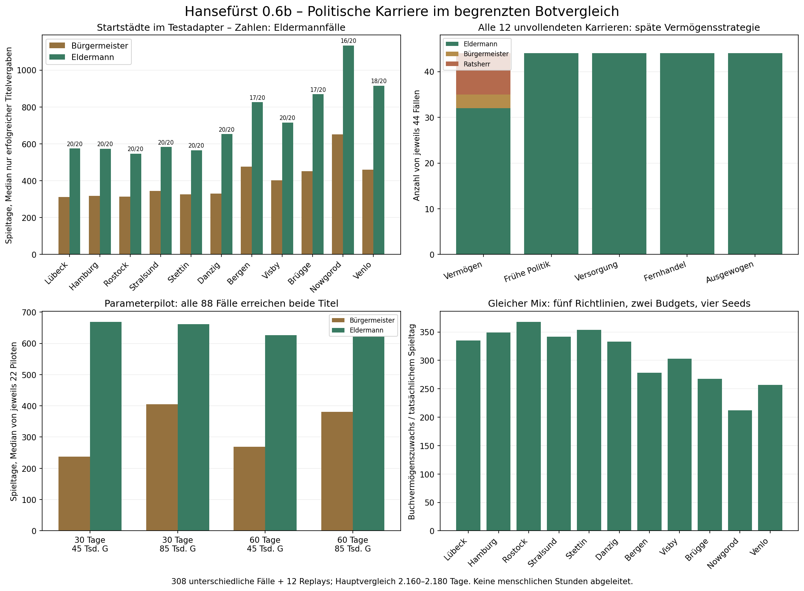

# Hansefürst 0.6b – Politisches Karrieresystem

25.10.2026 · Arbeitszweig **feature/phase06b-politics-career** · Zielzweig **development/v04-foundation**

## 1. Ergebnis und Versionszuordnung

**Die politische Karriere ist im Spiel implementiert:** ausdrückliche Bürger-/Ratsbriefe, zwei Rivalenkreise je Stadt, öffentliche Mehrheiten, ein örtliches Bürgermeisteramt mit Pflichten, auswärtige Fürsprecher und Hanseversammlung. Die fünf Rangnamen bleiben. Der alte 18-%-Wahlwürfel entfällt; Vermögen/Ansehen allein verleihen die höchsten Titel nicht mehr.

**308 unterschiedliche vollständige Vergleichsfälle plus zwölf exakte Replays = 320 vollständige Ausführungen.** Davon 88 Parameterpiloten und 220 Hauptfälle. In der Hauptserie erreichen 211 Bürgermeister und 208 Eldermann; zwölf vermögensorientierte Verläufe bleiben am festen Zeithorizont darunter. Keine finanzielle Reiseblockade und kein technischer Hauptserienabbruch. Diese Zahlen sind Botbefunde, keine allgemeinen Spielerwahrscheinlichkeiten oder menschlichen Spielstunden.

| Zweck | Veröffentlichter Spielcode |
|---|---|
| Abgerufene integrierte Grundlage | eef7eb3ebbe9abd5e68936496ea6d19dc17813ab |
| Parameterpilot, tatsächliche Funktionen | d0d4ff697ab21034a5aafe5120ad0d7f76ce6fe9 |
| Hauptserie mit ausgewählten Parametern | e5dd699fede2d5db156027e355bbadbff3de110c |
| Breite finale Darstellungs-/Browserprüfung | 4b8cc100d4e8e1ee0cd1e33549ca966617048a02 |
| **Endgültiger Spielcode, danach technische und gezielte Browserprüfung** | **6d1399c8f974f3b51835fc28f73928620dbb20cc** |

Endgültige HTML-SHA-256: **778bcbaf6b1c2cc98bd69b7cd52fd2bbfbcb1fdc9b5c158448f6c907fd7bb85c**. Spielcode vor Abschlussbericht veröffentlicht; keine selbstreferenzielle Commit-ID. Controllerstand: 76019689bcd2c578b325863816ee4b6e823e3055. [Prüfnachweis](../../tests/simulation/phase06b-20261025-01/verification-release.json), [Zwischenstände einschließlich Fehlern](2026-10-25_0.6b_fortschritt.md).

Nach den Vollserien änderten sich Darstellung/Textformat und ein gezielter Schutz späterer Amtszeiten nach dem Eldermann. Kein Markt-/Wirtschaftsparameter wurde nachträglich geändert. Der Schutz betrifft einen Ablauf, der in keinem der 308 gespeicherten Vergleichsfälle vorkommt; Quelle und Ereignisse wurden dafür geprüft. Keine vollständige Serie wiederholt.

## 2. Die fünf Ränge im tatsächlichen Spiel

| Rang | Bedingung |
|---|---|
| Kaufmann | Bestehender Anfangsrang |
| Fernkaufmann | Weiterhin 18.000 G allgemeines Buchvermögen, Antrag im Rathaus |
| Ratsherr | Weiterhin 45.000 G allgemeines Buchvermögen und 25 Ansehen |
| Bürgermeister | Ratsherr, 45.000 G **politisches** Vermögen, 55 Ansehen, keine Mietrückstände, örtliche Dienste und zugesagte Ratsmehrheit |
| Eldermann | 180.000 G politisches Vermögen, 90 Ansehen, keine Mietrückstände, bewährtes Amt und überregionale Nachweise |

Anträge erfolgen ausdrücklich im Rathaus. Kein automatischer Titel bei einer Geldänderung. Für die ersten beiden Aufstiege bleibt die bisherige Vermögensbetrachtung erhalten; die neue politische Verbindlichkeitsprüfung gilt für Bürgermeister/Eldermann.

Das bestehende globale Ansehen bleibt bestehen: Handel, Ankünfte, normale Aufträge und Spenden funktionieren weiter. Leerkaufen und sofortiges Zurückverkaufen zum unveränderten Preis erzeugt keinen Gewinn und keinen politischen Beleg. Eine Ankunft oder Spende ist ebenfalls kein örtlicher Dienst. Alte globale Abschluss-/Besuchszähler werden nicht in politische Vergangenheit umgedeutet.

## 3. Leistungsbuch und echte politische Aufgaben

Nur ausdrücklich angenommene politische Briefe schaffen neue Urkunden. Zwei örtliche Arten sind umgesetzt:

1. **Versorgung der Bürgerschaft:** sechs bis acht Fass einer örtlichen Bedarfsware im tatsächlichen Handel dieser Stadt verkaufen. Nur nachweislich in einer anderen Stadt gekaufte Ware zählt; unbekannte Herkunft und örtlicher Rückkauf zählen nicht. Vorhandene FIFO-/Herkunftsprüfung wird wiederverwendet. Auslagern zuvor gekaufter fremder Ware ist zulässig, aber erst der anschließende echte Verkauf erfüllt den Brief.
2. **Ratsvereinbarung:** zu einem benannten Partnerhafen reisen, dort im Rathaus persönlich vorsprechen und anschließend im Ausgangsrathaus Bericht erstatten. Der Partner wechselt nach Ratsabschnitt zwischen drei nahen öffentlich bekannten Verbindungen. Einfaches Anlegen, Öffnen oder Akzeptieren genügt nicht.

Je Stadt, Art und Abschnitt gibt es höchstens einen angenommenen Brief, also normalerweise höchstens **zwei örtliche Dienste je 60-Tage-Abschnitt**. Die eindeutige Kennung verbindet Art, Stadt und Abschnitt. Frist beim aktuellen Standard: 180 Spieltage, mit Kalendergrenzschutz. Pro Stadt/Art höchstens ein laufender Brief, insgesamt höchstens 22. Angebote richten sich nach den bestehenden Bedarfsprofilen, nicht nach selbst erzeugter Marktknappheit.

Keine Abbruch-/Neuangebotsfarm: im gleichen Abschnitt bleibt die Vergabe verbraucht, auch bei Ablauf. Später sind neue Angebote möglich; bereits erbrachte Dienste bleiben. Erneutes Öffnen, Laden oder Importieren vergibt nichts neu. Getrennte Teilverkäufe werden wie bei den bisherigen Lieferregeln nicht zu einer vollen Lieferung aufaddiert.

Gezählt wird der Ausgabe-/Annahmeabschnitt des datierten Briefs; das tatsächliche Abschlussdatum steht zusätzlich in der Urkunde. Fristgerechte Abschlüsse dürfen also in einem späteren Abschnitt stattfinden. Auch die Amtsbewährung verwendet diese Auftragsabschnitte, berücksichtigt aber ausschließlich nach der Wahl neu erfasste Belege. Ein vor der Wahl angenommener, erst danach gehaltener Vertrag kann mitzählen.

**Kein zusätzlicher Goldbonus für politische Briefe.** Die Ware bringt den normalen Verkaufserlös. Ein unabhängig angenommener gewöhnlicher Handelsauftrag zahlt seine bisherige Prämie weiterhin, wenn dieselbe Lieferung ihn regelgerecht erfüllt. Daraus entsteht nur ein politischer Beleg. Das normale Abschlussfeld bleibt vom politischen Leistungsbuch getrennt.

Der neue Warenverkauf wird mit einem möglichen politischen Beleg gemeinsam gespeichert: Scheitert das Schreiben, bleiben Waren, Gold, normale Auftragsprämie und politisches Leistungsbuch gemeinsam unverändert. Ereignisse/Schnappschüsse werden erst nach erfolgreicher politischer Speicherung veröffentlicht.

## 4. Rivalen, Unterstützung und Bürgermeisterwahl

Jede Stadt hat zwei benannte fiktive Kaufmannskreise. Interessen und Haltung stehen als Personen-/Briefkarten im bestehenden Rathaus; keine simulierten Konkurrenzflotten.

Vier nachvollziehbare Zusagen tragen die Kandidatur:

- Bürgerschaft: zwei Versorgungsdienste.
- Erster Rivalenkreis: drei Versorgungsdienste.
- Zweiter Rivalenkreis: zwei gehaltene Ratsvereinbarungen.
- Stadtrat: sechs örtliche Dienste aus drei Abschnitten und beiden Arten.

Die einzige abgeleitete Ratsunterstützung folgt dem 0.6a-Modell: Wirtschaftsgrundlage höchstens 10, vorhandenes Ansehen höchstens 15, Dienste höchstens 40, vier Zusagen höchstens 20, gehaltene Vereinbarungen höchstens 15. Es werden keine fünf zusätzlichen Punktestände gespeichert oder als ständige Leisten gezeigt. Einzelheiten stehen auf Wunsch im aufklappbaren Leistungsbuch.

Zusätzlich zur örtlichen Mehrheit gelten immer sechs Dienste, drei Abschnitte und zwei Arten. Geld/Ansehen können zusammen höchstens 25 beitragen und ersetzen diese Bedingungen nicht. Politische Fremdleistungen in einer anderen Stadt werden nicht automatisch lokale Verdienste.

Vor Bestätigung zeigt das Rathaus fehlende Voraussetzungen, zugesagte Unterstützer, nötige Mehrheit und nächste Wahlmöglichkeit. Kein Zufallswurf. Reicht die Unterstützung bei einem zulässigen Antrag nicht, bleibt eine begründete Niederlage mit unveränderten Verdiensten. Neuer Antrag nach 60 Spieltagen; auch ein Sieg setzt die örtliche Wiederholsperre. Es gibt keine Kandidaturgebühr. Öffnen/Laden erzeugt keinen neuen Wahlausgang.

## 5. Alle elf tatsächlichen Stadtprofile

Die bisherigen 0.6a-Profile wurden übernommen. Versorgung nutzt die schon vorhandenen R1-Bedarfswaren; weder regionale Preise noch Warenflüsse wurden geändert.

| Stadt | Zwei Rivalenkreise | Typische politische Versorgung | Unterstützung nötig |
|---|---|---|---:|
| Lübeck | Alte Ratsfamilien; Fernhandelsbund | Fisch, Pelze | 80 |
| Hamburg | Tuchhändlerkreis; Hafengilde | Holz, Pech | 76 |
| Rostock | Brauergilde; Speicherkaufleute | Tuch, Eisenwaren | 68 |
| Stralsund | Fischhändlerbund; alter Hafenrat | Salz, Tuch | 65 |
| Stettin | Holzhändlerkreis; Werftzunft | Salz, Tuch | 67 |
| Danzig | Getreidespeicherfamilien; Fernhändlerkreis | Tuch, Eisenwaren | 74 |
| Bergen | Fischhändler; Versorgungsrat | Getreide, Bier, Hanf | 62 |
| Visby | Inselkaufleute; Umschlaghändler | Getreide, Eisenwaren | 70 |
| Brügge | Tuchgilden; Zwinhandelshaus | Holz, Pelze | 78 |
| Nowgorod | Waldwarenhändler; örtliche Handelsvermittler | Bier, Salz, Tuch | 64 |
| Venlo | Maaskaufleute; kleiner Stadtrat | Fisch, Pelze | 60 |

Die konkrete Ware rotiert mit dem Abschnitt; Mengen sind 6/7/8 Fass nach Stadt. Auch Interessen wie Versorgung, Vermittlung, Handwerk oder Binnenabsprachen werden im Rathaus angezeigt. Bürgermeister ist eine einheitliche Spielrolle, keine hier recherchierte historische Verfassungsaussage.

Lübeck ist wirtschaftlich gut angeschlossen und politisch anspruchsvoll. Venlo hat geringere Konkurrenz, aber längere wirtschaftliche Wege; ebenso erhalten Bergen und Nowgorod niedrigere lokale politische Hürden. **Das gleicht den wirtschaftlichen Startnachteil noch nicht vollständig aus**, siehe Ergebnisse. Es wurde keine Stadt durch eine unerreichbare Regel ausgeschlossen; alle elf bestehen tatsächliche kontrollierte Leistungswege und erfolgreiche reguläre Karrieren.

Die freie Startstadtwahl bleibt unimplementiert. Das echte Spiel startet weiterhin wie bisher in Lübeck; die elf Vergleichsstarts existieren nur im Testadapter.

## 6. Amtsführung, Ende, Wechsel und Vorteile

Ein aktives Bürgermeisteramt speichert Stadt, Beginn, Ende und den Beginn der während dieses Amts zu erbringenden Dienste. Stadtwechsel per Schiff überträgt das Amt nicht. Amtszeit: **360 Spieltage**.

Bewährung verlangt zwei **nach der Wahl** erbrachte örtliche Dienste aus zwei unterschiedlichen Abschnitten, darunter eine Ratsvereinbarung. Vor der Wahl gesammelte Urkunden ersetzen diese Pflichten nicht. Amt kann ausdrücklich niedergelegt werden und endet am Ablaufdatum. Erwerbener Rang und frühere Verdienste bleiben; fehlende Bewährung erzeugt keinen erfundenen Amtsnachweis.

Für ein anderes Bürgermeisteramt muss das bisherige aktiv beendet und die andere Stadt regulär überzeugt werden. Nie zwei gleichzeitige Bürgermeisterämter. Der erste bewährte Amtsnachweis jeder Stadt bleibt als dauerhafter Karrierebeleg erhalten, auch nach späteren Amtszeiten.

**Aktivierte Vorteile sind ausschließlich politisch:** Zugang zu Hanseverträgen und auswärtigen Fürsprechern. Nach bewährter Amtsführung bleiben diese persönlichen politischen Kontakte erreichbar; das ist kein fortbestehender lokaler Geldrabatt. Keine Preis-, Hafen-, Bank-, Lager- oder Schiffbauvergünstigung, keine neue Goldzahlung bei Amtsantritt. Die wirtschaftlichen Varianten aus 0.6a wurden nicht aktiviert.

## 7. Der tatsächliche Weg zum Eldermann

Die Hanseversammlung verlangt gemeinsam:

1. 180.000 G politisches Vermögen, 90 Ansehen, keine offenen Mietrückstände.
2. Ein wirklich ausgeübtes, bewährtes Bürgermeisteramt mit den genannten Pflichten.
3. Heimatsiegel aus diesem Amt und drei ausdrückliche auswärtige Fürsprecher, also mindestens vier Städte.
4. Mindestens zwei Handelsräume: West (Brügge/Venlo), Kernnetz (Lübeck bis Danzig), Nord (Bergen/Visby), Ost (Nowgorod).
5. Einen gehaltenen Hansevertrag: in zwei bereits unterstützenden auswärtigen Städten persönlich verhandeln, insgesamt zwei Handelsräume einschließlich Heimat abdecken und in die Heimat zurückkehren. Frist 720 Tage; keine zusätzliche Goldprämie.

Ein auswärtiger Rat gibt sein Siegel erst nach einer tatsächlichen Vorsprache, wenn örtlich Versorgung und Ratsvereinbarung belegt sind und der Zugang über das Amt beziehungsweise die bewährte Amtsführung besteht. Ein bloßer Stadtbesuch reicht nicht. Nicht alle elf Städte sind Pflicht.

Der Hansebrief zeigt sowohl erfüllte als auch fehlende Grundlagen, Heimatsiegel/Fürsprecher, Handelsräume, Wirtschaft, Schuldenfreiheit und Vertragsurkunde. Die finale Wahl ist deterministisch. Beim Titel wird ein noch aktives Bürgermeisteramt geschlossen; der erworbene Eldermann-Titel beendet das Spiel nicht. Weiterhandel wurde im Browser tatsächlich ausgeführt, spätere erneute örtliche Amtsführung gesondert geprüft.

## 8. Politisches Vermögen und Spielstandübernahme

**Politisches Vermögen = bisheriges Buchvermögen − alle offenen Lager-Mietschulden.** Bankkredite sind bereits im bisherigen Wert berücksichtigt, kein doppelter Abzug. Allgemeine Buchvermögensanzeige und Kreditgrenzen bleiben unverändert.

Reguläre Tilgung erzeugt keinen politischen Vermögenssprung: beispielsweise vor Zahlung 85.000 − 5.000 = 80.000, danach 80.000 − 0 = 80.000. Laufende Bauten behalten die bestehende konservative Bewertung. Kein doppeltes Addieren ihrer bereits verbrauchten Materialien, keine neue Bauverbindlichkeit. Spätere Mietschulden sperren neue Bürgermeister-/Eldermannkandidaturen, aberkennen keine erworbenen Titel.

**V11 / Politikversion 1.** Gültige V10-Werte werden vollständig übernommen: Ränge, Ansehen, Vermögen, Bank/Kredite, Mietschulden/-kapazitäten, Flotte, Waren/FIFO, laufende Bauten, Aufträge, Chronik, Hafenarbeitsmarker und Handelsinformationen. Politisches Leistungsbuch ist zunächst leer.

Alte Bürgermeister behalten Rang 3; keine Amtsstadt wird aus dem Aufenthaltsort erfunden. Das Rathaus erklärt die Übergangsregel: konkrete neue Amtsrechte erst nach örtlicher Kandidatur und echten Diensten. Alte Eldermänner behalten Rang 4 und müssen nicht erneut kandidieren.

Vor der Umstellung wird der Originaltext unverändert in einer getrennten Politik-V11-Sicherung gespeichert und zurückgelesen. Frühere Originalbackups bleiben erhalten; Kollisionen bekommen eigene Suffixe. Fehler bei Backup oder Ziel verhindern die Aktivierung des migrierten Zustands. Entsprechende Sicherungen gelten auch beim Import. Speichern/Importieren bestehender V11-Daten erhält Belege, Briefe, Amtszeiten und Regeln; kein Mischen mehrerer Dateien zu zusätzlichen Verdiensten.

Nur vorher bereits ungültige optionale Altwerte werden normalisiert: negativer/ungültiger Abschlusszähler, Besuchszähler oder Wahlzeitstempel. Original bleibt im Backup. Es wird keine politische Vergangenheit daraus abgeleitet. Normale gültige Felder blieben in den historischen Vergleichen exakt erhalten.

Die gewählten Abschnitts-/Vermögensregeln werden je Partie gespeichert. Bereits gesicherte V11-Probeparteien mit 30 Tagen oder 85.000 G behalten ihre Regeln; neue Partien/V10-Erstübernahmen verwenden 60/45.000. Kein Abschnittsverschieben vorhandener Urkunden. Alte V10-Clients lehnen V11 sicher ab. Lokale Dateien sind keine gegen absichtliche vollständige Bearbeitung gesicherte Serverbuchhaltung.

## 9. Parameterauswahl vor der Hauptserie

88 vollständige Piloten: vier Kombinationen aus 30/60 Tagen und 45.000/85.000 G, elf Teststädte, frühe Politik/ausgewogen, gemeinsamer Seed 90001, jeweils 5.000 G und Kogge. Zwölf vorher bestimmte Fälle wurden vollständig exakt wiederholt: alle vier Kombinationen, frühe Politik, Lübeck/Bergen/Venlo.

| Ratsabschnitt / Vermögen | Fälle | Bürgermeister/Eldermann | Bürgermeister, Median Tage | Eldermann, Median Tage | Dienste, Median |
|---|---:|---:|---:|---:|---:|
| 30 / 45.000 | 22 | 22 / 22 | 237,5 | 669 | 16,5 |
| 30 / 85.000 | 22 | 22 / 22 | 405 | 661 | 22,5 |
| **60 / 45.000, gewählt** | 22 | 22 / 22 | 269 | 626 | 16 |
| 60 / 85.000 | 22 | 22 / 22 | 381 | 621 | 19 |

Keine technische oder finanzielle Pilotblockade. 45.000 erleichtert politischen Zugang; 60 Tage lassen mehr tatsächliches Wirtschaftsspiel zwischen begrenzten Angeboten. Die hier verwendeten frühen Controller wiederholten bei 85.000 häufiger Briefe, während sie weiter Vermögen aufbauten. Das war ihr Verhalten, keine vom Spiel verlangte Pflichtzahl.

Die Wahl folgte Erreichbarkeit, früherem Zugang und begrenzter Wiederholung, nicht einem behaupteten allgemein besten Endvermögen. Ein Seed/zwei Richtlinien sind begrenzt. Andere Entscheidungen verändern Marktbesuche und spätere Zufallsfolgen; 60 statt 30 bedeutet deshalb nicht automatisch doppelte Karrieredauer. [Gesicherte Auswahl](../../tests/simulation/phase06b-20261025-01/parameter-choice.json).

## 10. Kontrollierter wirtschaftlich-politischer Hauptvergleich

**220 neue Hauptfälle:** fünf Richtlinien × elf Startorte × vier Seeds 91001–91004. Seeds 91001/2 starten mit 5.000 G, 91003/4 mit 2.500 G, jeweils gesunde Kogge, Rang 0 und Ansehen 0. Andere Orte/Budgets werden nur vor Beginn im Testadapter gesetzt; danach keine eingesetzten Urkunden, Vorräte, kostenlosen Kredite oder verdeckten Zeitsprünge. Preisentscheidungen nutzen örtlichen Markt, eigenes Handelsbuch und öffentlich bekannte Wege.

Richtlinien: vermögensorientiert (beginnt Politik erst ab eigener 250.000-G-Zielmarke), frühe Politik, Versorgung, Fernhandel und ausgewogen. Sie wählen ausdrücklich echte Ratsbriefe, kaufen/transportieren/verkaufen, sprechen vor, kandidieren und erfüllen das Amt. Zwischen Abschnitten handeln/reisen sie weiter. Keine künstliche Anerkennung alter Bot-Handelszähler.

Horizont 2.160 Spieltage beziehungsweise 1.200 Entscheidungen; letzte begonnene Fahrt samt Abschluss darf enden. Tatsächlich alle 220 am Tageshorizont, **2.160–2.180 Tage**. Nicht beim Eldermann abgebrochen: anschließend gewöhnlich weitergehandelt. Titelzeiten sind davon getrennt, höchstens 2.163 Tage einschließlich erlaubtem letzten Ankunftsabschluss.

### Ergebnisse je Spielweise

Je 44 Fälle. Zeitmediane beziehen sich nur auf tatsächlich erfolgreiche Titelvergaben. Endvermögen ist Buchvermögen; Bargeld ist echte Liquidität.

| Richtlinie | Bürgermeister / Eldermann | Bürgermeister Tage | Eldermann Tage | Endvermögen Median | Bargeld Median |
|---|---:|---:|---:|---:|---:|
| Vermögensorientiert | 35 / 32 | 1.090 | 1.262 | 572.976 G | 569.535 G |
| Frühe lokale Politik | 44 / 44 | 189,5 | 579 | 739.125,5 G | 735.684,5 G |
| Versorgung | 44 / 44 | 331 | 610,5 | 730.834 G | 727.393 G |
| Fernhandel | 44 / 44 | 525,5 | 1.067 | 631.559 G | 628.118 G |
| Ausgewogen | 44 / 44 | 330 | 626 | 703.478,5 G | 700.037,5 G |

Realisierter Warengewinn vor Fahrt-/allgemeinen Kosten, Median in derselben Reihenfolge: **573.585 / 740.240 / 733.158,5 / 630.719,5 / 705.521,5 G**. Er kommt aus tatsächlichen Verkäufen, nicht aus politischen Bonuszahlungen. Die Unterschiede verbinden Handelsroute, Informationsstand, politische Priorität und veränderte spätere Zufallsfolgen; kein isolierter Kausalbeweis, dass Amtszugang Geld druckt.

208 erfolgreiche neue Eldermänner benötigen bis zur Titelvergabe **78–438 tatsächliche Fahrten, Median 124**, sowie **15–22 örtliche Dienste, Median 16**, und einen Hansevertrag. Mindestens vier Städte besucht. Das sind belegte Aktionen, keine menschlichen Spielstunden. [Ereigniszählung vor dem Titel](../../tests/simulation/phase06b-20261025-01/activity-at-title.json).

### Die zwölf nicht abgeschlossenen Karrieren

Alle zwölf gehören zur vermögensorientierten Richtlinie. Neun enden als Ratsherr mit null angenommenen politischen Briefen: sie erreichen ihre selbst gesetzte Startmarke 250.000 G nicht. Ihre Endvermögen von rund 173.486–239.952 G liegen trotzdem weit über der tatsächlichen Bürgermeistergrundlage. Das Spiel hätte politische Aufgaben erlaubt; die Richtlinie begann sie nicht.

Drei werden erst an Tag **2.057, 2.082 beziehungsweise 2.116** Bürgermeister und beenden den Vergleich ohne bewährtes Amt/auswärtige Unterstützung/Hansevertrag. Keine finanzielle Blockade; die ausstehende spätere Vollendung wurde nicht durch Verlängern nachgetestet. Das ist ein echter Zielkonflikt einer sehr späten politischen Priorität, kein Beleg eines unerreichbaren Amts.

Insgesamt 211 Bürgermeister, 208 Eldermann, drei Rang 3, neun Rang 2. Kein Rang 0/1 am Ende. Reichtum allein genügt sichtbar nicht.

## 11. Startorte, Einkommen und offene Stadtbalance

Je Stadt gleicher Mix aus fünf Richtlinien, vier Seeds und zwei Budgets, insgesamt 20 Fälle. Auch hier nur Mediane erfolgreicher Titel; gerade bei Nowgorod/Brügge ist das keine Dauerangabe für alle 20.

| Teststart | Bürgermeister / Eldermann | Bürgermeister Tage | Eldermann Tage | Endvermögen Median |
|---|---:|---:|---:|---:|
| Lübeck | 20 / 20 | 312 | 574,5 | 731.193 G |
| Hamburg | 20 / 20 | 317,5 | 574 | 762.620,5 G |
| Rostock | 20 / 20 | 313 | 546,5 | 804.553 G |
| Stralsund | 20 / 20 | 344 | 583 | 748.285,5 G |
| Stettin | 20 / 20 | 326 | 565 | 774.579,5 G |
| Danzig | 20 / 20 | 330 | 653 | 728.166,5 G |
| Bergen | 17 / 17 | 476 | 826 | 608.920,5 G |
| Visby | 20 / 20 | 402,5 | 716 | 665.154 G |
| Brügge | 19 / 17 | 451 | 869 | 586.815,5 G |
| Nowgorod | 16 / 16 | 651,5 | 1.133,5 | 467.757 G |
| Venlo | 19 / 18 | 459 | 915,5 | 564.478 G |

**Lübeck/Venlo-Ziel nur teilweise erreicht:** Venlo braucht weniger Ratsunterstützung, wirtschaftliche Wege bleiben aber länger. Die frühere politische Chance kompensiert den absoluten Startnachteil in diesen Daten nicht vollständig. Bergen und Nowgorod bleiben ebenfalls langsamer. Keine Stadt ist politisch ausgeschlossen; alle vier aktiver politischen Richtlinien erreichen von jedem Ort Eldermann. Keine nachträglichen Geldvorteile oder Marktänderungen eingeführt, um die Tabelle künstlich anzugleichen.

Rostock liegt in diesem begrenzten Mix bei Endvermögen und Eldermannzeit vor Lübeck. Das ist ein weiterer Balancehinweis für die spätere freie Startstadtwahl, kein Beweis eines garantiert besten Ortes. Die politischen Ergebnisse rechtfertigen keine ungefragte Änderung der R1-Wirtschaft.

Mediane des Buchvermögenszuwachses pro tatsächlich gespieltem Tag liegen etwa bei 335 G in Lübeck, 278 Bergen, 212 Nowgorod und 257 Venlo. Das ist keine Rendite pro menschlicher Stunde.

Budgets: 2.500 G ergibt 105/110 Eldermann, 5.000 G ergibt 103/110; jeweils null Finanzblockaden. **Kein Vorteil geringeren Startgelds daraus abgeleitet:** Budgets hängen an verschiedenen Seeds, zwei je Budget, kein gepaarter isolierter Kapitalvergleich.

Alle 220 bleiben liquide; geringstes Endbargeld 170.045 G. In Pilot und Hauptserie keine Bankanlage, Bankkredite oder Mietrückstände; die Controller bauen keine Zusatzschiffe/Lager. Diese Vollserie ersetzt daher keinen verschuldeten Lager-/Werftbelastungstest. Solche Wechselwirkungen wurden gezielt technisch und bei Migrationen geprüft.

Alle 308 gespeicherten Kassenbücher schließen: Anfangsgold plus Verkäufe minus Einkäufe/Reisegebühren, gegebenenfalls plus einmaliger Hafenarbeit, ergibt Endbargeld. Jeder politische Beleg hat ein tatsächlich protokolliertes Dienstereignis. Zwei frühpolitische Briefe liefen ab, rekonstruiert aus angenommenen Briefen ohne Abschluss und ohne aktiven Endbestand; keine künstlichen Ersatzbelege vergeben.

Gleiche Seeds sind gepaarte Ausgangsbedingungen, keine identischen späteren Welten nach unterschiedlichen Entscheidungen. Vier Seeds je Richtlinie/Stadt sind eine begrenzte Stichprobe. Kein direkter Renditevergleich gegen alte 0.5j-Endwerte: anderer Horizont, andere Richtlinien/Budgets. Alte Serien wurden nicht neu berechnet.

## 12. Technische Prüfungen und Fehlerbehandlung

Auf endgültigem Spielcode **6d1399c8…** bestehen:

- **22 Fokusgruppen:** alle fünf Ränge, elf Profile/22 Rivalenkreise, echte Herkunft und Teilmengen/Ablauf, Einmalbelege, politische Waren-/Prämienatomarität, Reentranz/stale Angebote/Schreibfehler, vorhersehbare Niederlage, Amtsort/Pflichten/Ende/Wechsel, Hansebedingungen/Weiterhandel, Mietschuldprüfung, V10-Titel und offene Bauten, Backups/Import/Kollisionen, ungültige Daten, unveränderte Wirtschaftsquellen und Zufallsfolge.
- **Gemeinsame Integrationsprüfung:** echte Materialkäufe, laufender Schniggenbau, fälliges Amtsende und einmalige Hafenarbeit. Drei Tage werden mit Schiff, Amtsende, 20 G und Einmalmarker als ein vollständiger Aktionszustand gespeichert; keine Zwischenpersistenz oder politische Materialverbrauchsprämie.
- **Nach-Titel-Prüfung:** als Eldermann erneut Bürgermeister derselben Stadt, echte neue Pflichten, freiwilliges beziehungsweise passives Ende und weiterhin ladbarer V11-Spielstand. Erster bewährter Amtsnachweis/Titel bleiben.

[22 Gruppen](../../tests/simulation/phase06b-20261025-01/technical-release.json), [Nebenläufigkeit](../../tests/simulation/phase06b-20261025-01/concurrency-final.json), [Nach-Titel-Nachweis](../../tests/simulation/phase06b-20261025-01/post-title-final.json).

Acht vorhandene Programme bestanden auf dem vorherigen Darstellungscode d6d879f30f4ad6774c8e364253830ea803a764be: test-v04, phase1, telemetry, share, warehouse-checks, warehouse-cities-checks, warehouse-capacity-checks (17 Gruppen), warehouse-arrears-checks (19 Gruppen). [Protokoll](../../tests/simulation/phase06b-20261025-01/regressions-final.json). Ihre Wirtschafts-/Migrationsfunktionen bleiben im Endcode gleich; neue Amtsverhalten prüfen die genannten Fokusgruppen.

Bestehende Tests wurden eng angepasst: V11-Erwartung/Zukunftsversion 12, Entfernen neuer Politikmetadaten beim absichtlichen Bau alter Fixtureformate, neue Originalbackup-Adresse und separate politische statt alter promote-Textprüfung. Quellschutz ersetzt den bewusst geänderten Karrierecode durch Warenbuchwertschutz; neue positive/negative Karriereprüfungen treten hinzu. Nur zwei ausdrückliche Handelshooks werden im Vergleich herausnormalisiert. R1, Preise, Bank, Buchwerte, Lager, Verkauf, Reisen und Werftformeln bleiben geschützt.

**500 frühere Endstände** aus Lager- und Schiffbauserien wurden auf dem damaligen Darstellungsstand nur geladen, mit der bisherigen V10-Übernahme verglichen und durch V11 geführt; keine Spiele fortgesetzt. **1.486 historische Ergebnis-/Protokolldateien bytegleich**. Die spätere Korrektur verändert keine Migrationsfunktion. [Quelle/Dateiliste](../../tests/simulation/phase06b-20261025-01/historical-files.json).

### Tatsächlich gefundene Fehler

1. Erste neue Aufgabenliste war verschachtelt: vier Worker bekamen Arrays statt Einzelobjekten und brachen vor dem ersten Spielschritt ab. Null vollständige Fälle. Liste korrigiert, vor Start auf 88/220 eindeutige Aufgaben geprüft. [Erstversuch](../../tests/simulation/phase06b-20261025-01/pilot-runner-attempt1/).
2. Bestehende Hafenarbeit akzeptierte nur V10. Sicherheitsfilter auf V11 angepasst, ihre Regeln blieben unverändert. Erstregressionsfehler und korrigierte Programme bleiben erhalten.
3. Nach Wahl von 60 Tagen erwartete ein Fixture sieben Fass Tuch bei nur fünf vorhandenem Marktbestand. Das Spiel verweigerte korrekt den Überkauf. Technischer Helfer beschafft fehlende Ware nun wirklich in weiteren Häfen. Hauptcontroller tat das bereits mengenbegrenzt. Die Hauptserie war versehentlich vor Auswertung dieses Fixturefehlers gestartet; kein Gameplayfix und keine Wiederholung abgeschlossener Fälle nötig.
4. Nach Eldermann konnte ein zweites bewährtes Amt den ersten Nachweis überschreiben. Freiwilliges Ende wurde abgelehnt, passives Ende erzeugte einen später ungültigen Spielstand. **Korrigiert: erster bewährter Nachweis bleibt erhalten.** [Vorher](../../tests/simulation/phase06b-20261025-01/post-title-before.json), [nachher](../../tests/simulation/phase06b-20261025-01/post-title-final.json). Keine allgemeine Rekonstruktion bereits ungültiger Probe-Dateien behauptet.

Die Daten enthalten höchstens ein bewährtes Amtsende je Stadt; der letzte Fehler betrifft keinen der 308 Vollfälle. Quellenvergleich prüft 162 globale Funktionen unverändert beziehungsweise ausschließlich hinsichtlich Textformat und des dokumentierten Guards. Alle Regelkonstanten/Entscheidungskriterien bleiben; der Guard erhält außerhalb der Vergleichsabläufe einen früheren Nachweis. [Quellen- und Fallprüfung](../../tests/simulation/phase06b-20261025-01/ui-and-tenure-preservation.json). Keine vollen Wiederholungen nach der Korrektur.

## 13. Tatsächliche Browserabnahme

Chromium **154.0.8037.57**, Playwright, Größen **390×844, 820×1180, 1280×900**. Keine Safari-/physischen Apple-Tests.

Auf 4b8cc100… sechs breite Gruppen erfolgreich: Rathaus/Rivalenmotive, Kandidatur, Amtsführung, angenommene Ratsbriefe, tatsächliche Marktknöpfe/Käufe/Verkäufe, Vorsprache/Rückkehr, einmalige Urkunden, Hanseversammlung und Weiterhandel. Fahrten laufen über die echten Spielmethoden im Browser. Echte heruntergeladene V11-Exporte mit offenem Amt/Brief, wiederholte FileReader-Importe, V10 mit offenem Bau, Originalbackup und kontrollierte Schreibfehler geprüft. Alter V10-Client lehnt V11 ohne Datenabschneiden ab. Keine JavaScript-/Ressourcenfehler oder horizontaler Seitenüberlauf.

Die UI-Fixtures wurden bewusst hoch finanziert und durch echte Spielaktionen vorbereitet, mit kontrollierten Reisen. Sie sind keine regulären Karrieren oder menschlichen Spieltests. Neun aktuelle echte Ausschnitte: [Ratskammer mobil](2026-10-25_0.6b_ratskammer-390.png), [Tablet](2026-10-25_0.6b_ratskammer-820.png), [PC](2026-10-25_0.6b_ratskammer-1280.png); [Bürgermeister mobil](2026-10-25_0.6b_buergermeister-390.png), [Tablet](2026-10-25_0.6b_buergermeister-820.png), [PC](2026-10-25_0.6b_buergermeister-1280.png); [Hanseversammlung mobil](2026-10-25_0.6b_hanseversammlung-390.png), [Tablet](2026-10-25_0.6b_hanseversammlung-820.png), [PC](2026-10-25_0.6b_hanseversammlung-1280.png).

Nach visueller Prüfung wurden erfüllte Hansegrundlagen ausdrücklich ergänzt; erste Bilder/Protokolle bleiben archiviert. Brief-/Siegeloptik und bestehende Rathausgrafik statt Tabellenverwaltung oder zusätzlicher dauerhafter Zahlenleisten, keine neue Pixelproduktion.

**Nach letztem Nachweis-Guard auf 6d1399c8… zusätzlich echte gezielte Chromium-Prüfung bei 390×844:** erneutes Bürgermeisteramt nach Eldermann, tatsächlicher Knopf zum Niederlegen, passives Amtsende und Neuladen, erster Amtsnachweis/Titel erhalten. Die Darstellung war dabei unverändert. [Breite Abnahme](../../tests/simulation/phase06b-20261025-01/browser-final.json), [gezielte Endcodeprüfung](../../tests/simulation/phase06b-20261025-01/browser-post-title.json).

## 14. Reproduzierbarkeit und Umfang

Quellen: [Spieldatei](../../Hansefuerst_0_4.html), [identische getestete Politik-Regelkopie](../../tests/simulation/politics-rules.js), [fünf tatsächliche Controller](../../tests/simulation/politics-strategy.js), [Runner](../../tests/simulation/phase06b-run.cjs). Die Regelkopie ist im HTML enthalten und wird im Test auf Gleichheit geprüft; kein paralleles vereinfachtes Wirtschaftsmodell.

Ausgeführte Kommandoformen, **keine Aufforderung zur erneuten Serie**:

~~~text
node tests/simulation/politics-checks.cjs <neuer Ergebnisname>
node tests/simulation/politics-concurrency-check.cjs <neuer Ergebnisname>
node tests/simulation/politics-post-title-check.cjs <neuer Ergebnisname>
node tests/simulation/phase06b-run.cjs --pilot <leerer Pilotordner>
node tests/simulation/phase06b-run.cjs --main <leerer Hauptordner> 60 45000
node tests/simulation/phase06b-evidence.cjs
node tests/simulation/phase06b-evidence.cjs --ui-only
node tests/simulation/politics-browser-checks.cjs <neuer Ergebnisname>
node tests/simulation/politics-browser-post-title.cjs <neuer Ergebnisname>
python tests/simulation/phase06b-title-activity.py
python tests/simulation/phase06b-figures.py
~~~

Bitgetreue historische Reproduktion benötigt den zugeordneten Spiel-/Controllerstand und neue Ausgabepfade. Manifest schützt Quelle/Parameter, Ergebnisdateien schreiben nicht über vorhandene Dateien. Der Pilot lässt sich mit Stand 76019689… einschließlich damaligem d0d4ff69…-Spiel reproduzieren; die Hauptquelle e5dd699… enthält denselben Controller und gewählte Standardwerte. Finale Quellenänderungen werden ausdrücklich nicht als ursprüngliche Vollsimulation ausgegeben.

[Pilotmanifest](../../tests/simulation/phase06b-20261025-01/pilot/manifest.json), [Pilotabschluss](../../tests/simulation/phase06b-20261025-01/pilot/completion.json), [Hauptmanifest](../../tests/simulation/phase06b-20261025-01/main/manifest.json), [Hauptabschluss](../../tests/simulation/phase06b-20261025-01/main/completion.json), [Kennzahlen/Einzelfälle](../../tests/simulation/phase06b-20261025-01/summary.json), [Städtetabelle](../../tests/simulation/phase06b-20261025-01/cities.csv).

Gezählt: 308 unterschiedliche reguläre Vergleichsfälle, zwölf exakte Pilot-Replays, **320 vollständige Ausführungen**. Keine Hauptreplays zusätzlich. Separat: vier anfängliche technische Startabbrüche, sechs kurze 120-Tage-Controllerproben, technische/UI-Fixtures, reine Quellen-/Archivprüfungen. Keine pauschale 1.500er-Serie; der ausdrückliche Auftragsrahmen geht der allgemeinen AGENTS-Vorgabe vor. Frühere 1.500er-/R1-/Lager-/Schiffbauserien wurden nicht wiederholt.

## 15. Offene Risiken und Fazit

- **Stadtausgleich offen:** geringere Konkurrenz kompensiert Venlo/Bergen/Nowgorod wirtschaftlich noch nicht vollständig. Keine automatische Folgebalance oder ungefragten Geldprivilegien.
- **Wiederholung bleibt:** Versorgung und Botenvereinbarungen sind klar planbar, aber noch keine vielfältigen politischen Interessenkonflikte. Keine geheime politische KI oder gesellschaftlichen Veranstaltungen behauptet.
- **Abschnittsauslegung:** Ausgabeabschnitte der Briefe zählen, nicht ausschließlich die Abschnitte ihrer späteren Erledigung. Zeitlich gebündelte fristgerechte Abschlüsse sind erlaubt. Eine strengere Bewährung nach unterschiedlichen Abschlussabschnitten wäre eine zusätzliche Regelentscheidung; gezieltes Aufstauen von Briefen war keine eigene Vollserienstrategie.
- **20–30 Stunden unbelegt:** 78–438 Botfahrten und Kalenderdaten sind keine menschliche Spielzeit. Dafür echte längere Spielsessions mit freiwilliger aktiver Zeitmessung und Verständnis-/Spaßrückmeldung nötig.
- **Begrenzte Vollprobe:** vier Hauptseeds, zwei gekoppelte Budgets, einfache Richtlinien; Schulden-/Mehrschiff-/Lagerbelastungen dort nicht aktiv. Gezielte Prüfungen ersetzen keinen vollständigen menschlichen Langzeittest.
- **Technische Grenzen:** V11 behält höchstens 8.192 politische Urkunden samt reservierten laufenden Einträgen; danach keine neuen Briefe, vorhandene Belege bleiben. Chronik ist keine vollständige Ereignishistorie. Speicherausfall wird abgefangen beziehungsweise gemeldet; keine allgemeine Neuentwicklung aller alten Autosave-Aktionen.

Entscheidungen für eine spätere Runde: Stadtkompensation ohne übermächtige Privilegien, Abwechslung politischer Aufgaben, künftige Amtsinhalte und menschliche Zielzeitvalidierung. Keine dieser Folgeaufgaben wurde begonnen.

**Fazit:** Bürgermeister und Eldermann sind jetzt nachvollziehbare politische Leistungen, keine bloße Fortsetzung der Geld-/Ansehensleiter. Alle elf Orte sind erreichbar, alte Titel und Wirtschaftsdaten geschützt. Der begrenzte Vergleich zeigt mehrere funktionierende Wege und einen klaren Zielkonflikt sehr später Politik. Technische Grundlage umgesetzt; langfristige Motivation und vollständiger wirtschaftlich-politischer Stadtausgleich bleiben offen.

## 16. GitHub-Sicherung

Mindestens drei verlangte Zwischenstände veröffentlicht, darüber hinaus laufend gesichert:

- [7115f7f5013c85e42a7a9afb218378817955d76b](https://github.com/psonnen-lgtm/Hansef-rst/commit/7115f7f5013c85e42a7a9afb218378817955d76b): Detailplan/Migration/Prüfbudget.
- [94ef2e941329916b1307434ef99b650d3905b347](https://github.com/psonnen-lgtm/Hansef-rst/commit/94ef2e941329916b1307434ef99b650d3905b347): politischer Kern und Schutzprüfungen.
- [e5dd699fede2d5db156027e355bbadbff3de110c](https://github.com/psonnen-lgtm/Hansef-rst/commit/e5dd699fede2d5db156027e355bbadbff3de110c): Parameterwahl vor Hauptserie.
- [98acdd936e6eb77cc19b97c2d6747b8e39083d18](https://github.com/psonnen-lgtm/Hansef-rst/commit/98acdd936e6eb77cc19b97c2d6747b8e39083d18): vollständige 308 Vergleichsfälle gesichert.
- [6d1399c8f974f3b51835fc28f73928620dbb20cc](https://github.com/psonnen-lgtm/Hansef-rst/commit/6d1399c8f974f3b51835fc28f73928620dbb20cc): letzter Spielcode mit erhaltenem ersten Amtsnachweis.

[Direkter Bericht auf dem Arbeitszweig](https://github.com/psonnen-lgtm/Hansef-rst/blob/feature/phase06b-politics-career/docs/entwicklungsberichte/2026-10-25_0.6b_politik_karriere_implementierung.md). Keine eigenständige Zusammenführung nach development oder main. Keine Folgephase begonnen.
