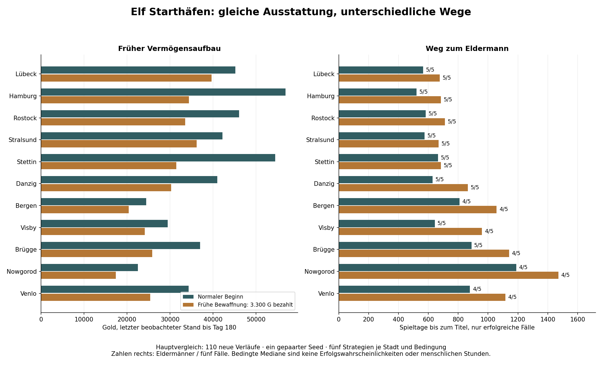

# Hansefürst 0.6c – Vier Kaufleute, elf Starthäfen

25. Oktober 2026 · Arbeitszweig `feature/phase06c-start-city-merchants`.

Ausgangspunkt: **c60e8760850a226e514b53ac0ed45f5d9ab0f51c**, integrierte Phase 0.6b auf `development/v04-foundation`. Endgültiger Spielcode: **fc241b5196439cc3577675951be8b3ff2df42169**, zuerst veröffentlicht und anschließend gezielt geprüft. SHA-256 der Spieldatei: `fdc662deb06ab65de63fd113f1487a43ab4e12fe6bcbfef84771d19501bf9255`.

## 1. Ergebnis und Grenzen

Alle vier Figuren können in jeder der elf Städte beginnen. Kaufmannsbuch, Hafenbriefe, vorhandene Hansekarte und große Auswahlknöpfe ersetzen den bisherigen festen Lübecker Beginn. Die laufende Partie wird erst nach bestätigter Auswahl und erfolgreicher Speicherung ersetzt. Startstadt, aktueller Aufenthaltsort und Bürgermeisterstadt sind ausdrücklich verschiedene Angaben.

Die technische Umsetzung ist geprüft. Der wirtschaftlich-politische Gesamtausgleich der Städte ist dagegen **nicht abgeschlossen**. Nowgorod bleibt in dieser Stichprobe besonders langsam; Bergen, Venlo und Brügge haben ebenfalls längere Wege. Alle elf Städte erlauben mit den vier aktiv politisch handelnden Richtlinien den Eldermann-Aufstieg, auch nach der geprüften schlechten Anfangsentscheidung. Das ist ein begrenzter Nachweis spielbarer Wege, keine Garantie für beliebige Entscheidungen oder menschliche Langzeitmotivation.

**132 neue unterschiedliche Vergleichsfälle**, vier exakte Pilotwiederholungen, **136 vollständige Ausführungen**. Frühere 0.6b-Partien und alte 1.500er-Serien wurden nicht neu berechnet. Historische Dateien bleiben erhalten. Keine Wirtschaftsparameter oder politischen Grundvoraussetzungen geändert; keine wirtschaftlichen Amtsprivilegien aktiviert.

## 2. Figuren und gleiche Ausstattung

| Auswahl im Kaufmannsbuch | Stabile gespeicherte Kennung |
|---|---|
| Ulf der Grüne Eldermann | `Ulf` |
| Anders der Hansegras-Baron | `Anders` |
| Franziskus der Grünfinger | `Franziskus` |
| Micha von Hopfenbrück | `Micha` |

Die ursprünglichen Kennungen `Ulf` und `Anders` bleiben erhalten. Der frei eingegebene Rufname wird weiterhin getrennt in `name` gespeichert. Bestehende eigene Namen und auch abweichende historische Profilkennungen werden nicht umbenannt. Neue Rufnamen dürfen bis zu 40 Zeichen enthalten; längere alte Namen werden dadurch nicht abgeschnitten. Keine Accounts, kein gemeinsamer Onlinespielstand.

Die Beinamen sind humorvolle Figurenbeschreibungen. **Auch Ulf beginnt mit Rang Kaufmann, nicht als Eldermann.** Alle 44 Kombinationen besitzen:

- 5.000 Gold, Bank und Kredit jeweils null, Ansehen null und Rang null.
- Eine Kogge mit 90 Fass Kapazität, Zustand 100, ohne Bewaffnung oder Ladung; tatsächlich im gewählten Hafen.
- Elf leere Lagerhäuser, je 150 Fass kostenlose Grundkapazität; keine Zusatzmiete oder Mietschulden.
- Keine politischen Urkunden, Ämter, Fürsprecher oder erfundene Karriere.
- Dieselben Weltmärkte bei gleichem Seed und dieselbe nächste Zufallszahl. Beobachtet wird nur der gewählte örtliche Markt, keine kostenlose Fernpreisinformation.

Die tatsächliche vorherige Ausstattung entsprach bereits diesen Vorgaben. Der unveränderte Konstruktor `fresh` bleibt bestehen. Der neue `newMerchantGame` verwendet ihn und ergänzt nur den gewählten Ort, den Schiffsort, die örtliche Erstbeobachtung, Begrüßung und Startangabe. Keine zusätzliche Zufallsziehung für Figur oder Hafen.

## 3. Elf frei wählbare Häfen

| Stadt | Kurzer Hafenbrief vor der Wahl |
|---|---|
| Lübeck | Kurze Küstenwege und viele Nachbarhäfen; mächtige Kaufmannsfamilien im Rat. |
| Hamburg | Elbe, West- und Ostseeverbindungen; Interessen von Reedern und Handwerk. |
| Rostock | Getreide, Bier und Warnowhandel; Bürger und Schiffer achten auf Versorgung. |
| Stralsund | Küstenwege, Fisch, Hanf und Pech; Zusagen an die Bürgerschaft zählen. |
| Stettin | Oderhafen und Holzhandel; Holzhändler und Werftzunft erwarten Ausgleich. |
| Danzig | Getreide, Holz und Speicher; Ausfuhr trifft auf örtlichen Versorgungsbedarf. |
| Bergen | Fischhandel und nördliche Versorgungswege; kleinerer Rat, längere Reisen. |
| Visby | Gotländischer Umschlagplatz; Versorgung und Vermittlung zwischen Ostseeküsten. |
| Brügge | Tuchgilden und Zwinhandel; längere Verbindungen und selbstbewusster Rat. |
| Nowgorod | Pelze und Waldwaren am langen Binnenweg; verlässliche Handelsabsprachen. |
| Venlo | Maas und längere Verbindungen; anspruchsvoller Handelsbeginn, geringere Ratskonkurrenz. |

Die Hinweise versprechen weder feste Gewinne noch eine endgültige Schwierigkeitsstufe. Lübecks allgemeine Stadtbeschreibung nennt die Stadt nicht mehr unabhängig von der Auswahl „Heimathafen“.

## 4. Bedienung und sicherer Neustart

Vier beschriftete Kaufmannsblätter mit nativen Auswahlfeldern, ein Rufname, die vorhandene schematische Karte und elf große Hafenknöpfe bilden den Spielbeginn. Ein ausgewählter Hafen erhält einen eigenen Brief; ein klarer Beginnknopf startet die Partie. Die Karte ist auf schmalen Bildschirmen seitlich verschiebbar; alle Orte bleiben zusätzlich über beschriftete Knöpfe erreichbar. Keine neuen Pixelgrafiken und keine neue Tabellenverwaltung.

Im bisherigen Ablauf löschte `resetGame` die Hauptpartie bereits vor der Auswahl. Nun öffnet es nur den Entwurf. Öffnen, Umwählen und Wiederöffnen erzeugen keine Waren, Leistungen, Speicheränderungen oder Zufallsziehungen. Bei laufender Partie führen Zurückknopf oder Schließen zur unveränderten Partie zurück. Ohne geladene Partie bleibt das Startbuch beim Abbruch geöffnet; ein direkter Importknopf bietet den sicheren Weg zu einer vorhandenen Sicherung.

Vor einem Ersatz prüft der Code den ursprünglichen Speicherinhalt und die geladene Partie erneut. Abgelehnte Bestätigung, ungültiger Hafen, unbekannte Figur, Reentranz oder festgestellte zwischenzeitliche Änderung verhindern den Ersatz. Vorhandene Originale werden kollisionssicher kopiert; erst danach wird der vollständig validierte neue Zustand gespeichert und aktiviert. Bei Backup- oder Zielschreibfehler bleiben bisherige Partie und Hauptdatei erhalten. Ein gescheiterter tatsächlicher Startversuch kann native Zufallszahlen zur Konstruktion verbrauchen; die reine Auswahl tut dies nicht. Keine allgemeine Sperre gegen gleichzeitig schreibende Browser-Tabs behauptet.

Ein zusätzlich nachgewiesener Altfehler wurde gezielt behoben: Bei nicht ladbarer gespeicherter Datei und leerem Arbeitsspeicher überschrieb ein Dateiimport bisher das Original ohne Kopie. Auch dieses Original wird jetzt vor dem Import gesichert. [Vorher-Nachweis](../../tests/simulation/phase06c-20261025-01/unloaded-import-before.json), [gezielte Fehlerprüfungen](../../tests/simulation/phase06c-20261025-01/technical-release.json).

## 5. V11 und Schutz alter Partien

Eine neue Haupt-Speicherversion ist nicht erforderlich. Neue Partien erhalten das optionale Feld:

```json
"beginning": { "version": 1, "city": 9, "merchant": "Micha" }
```

`city` verwendet die unveränderten elf Stadtindizes; `merchant` stimmt mit der ausgewählten Figurenkennung überein. Das Feld besitzt eine eigene Version und wird streng geprüft. Es verschiebt weder bestehende Indizes noch politische Felder.

**Fehlt `beginning`, bleibt der historische Starthafen unbekannt.** Er wird weder aus aktuellem Hafen, Schiffsort noch Amtsstadt geraten. Bestehende V11-Partien bleiben beim Laden und erneuten Speichern vollständig gleich. Ältere Formate durchlaufen die vorhandenen Übernahmen mit Originalkopien; sie erhalten keine erfundene Starturkunde. Erhalten bleiben insbesondere Gold, Bank, Kredit, Ladung/FIFO, Flottenorte, Lager/Mietschulden, offene Bauaufträge, Ansehen/Titel, politische Briefe und Urkunden, Amtszeiten, Hanseverträge, Hafenarbeitsmarker, Chronik und Preisbuch.

Geprüft: altes `version:1`-Format sowie V3 bis V11, ursprüngliche persönliche Profile und eigene Profilkennungen. Zusätzlich 308 gesicherte politische V11-Endstände und 500 ältere Lager-/Werftendstände nur geladen und mit der bisherigen Übernahme verglichen. Keine Karriere dabei fortgesetzt.

Die bereits vorhandene kollisionssichere politische Backupfunktion sichert auch bestätigte Neustarts; deren Schlüssel enthalten weiterhin `politics-v11-startup-backup`, bei Importen `politics-v11-import-backup`. Frühere Kopien bleiben erhalten; bei Kollisionen entstehen nummerierte Kopien. Nach 100 belegten unterschiedlichen Kopien blockiert die Funktion den Ersatz sicher. Lokale Kopien sind keine externe Datensicherung; der normale Dateiexport bleibt wichtig.

Im bestehenden Kontor zeigt das Kaufmannsbuch nun Rufname/Figur, überlieferten oder unbekannten Startort, Aufenthaltsort und aktives Bürgermeisteramt. Reisen ändern nur den Aufenthalt. Eine frei gewählte Startstadt schenkt weder ein Amt noch ein politisches Heimatsiegel: Für die Hanse zählt weiterhin das tatsächlich erworbene und bewährte Bürgermeistermandat. Elf Pilotfälle erwarben dieses ausdrücklich in einer anderen Stadt.

## 6. Vergleichsaufbau und tatsächliche Fallzahlen

| Gruppe | Unterschiedliche Fälle | Exakte Wiederholungen | Zweck |
|---|---:|---:|---|
| Pilot, Seed 93001 | 22 | 4 | Elf lokale Frühpolitiker; elf ausgewogene Karrieren mit nächster anderer Stadt als Amtsziel. |
| Hauptvergleich, Seed 93002 | 110 | 0 | Elf Starthäfen × fünf Richtlinien × zwei Anfangsentscheidungen. |
| Neu insgesamt | **132** | **4** | **136 vollständige Ausführungen**. |

Vier Pilotwiederholungen: örtliche Frühpolitiker in Lübeck, Bergen, Nowgorod und Venlo; vollständige Ergebnisse einschließlich nächster Zufallszahl identisch. Alle 22 Piloten erreichten Bürgermeister und Eldermann, ohne technische Fehler oder finanzielle Blockade. Die elf abweichenden Amtsziele wurden tatsächlich erreicht. Weil dabei auch die Richtlinie wechselt, ist dies kein isolierter Wirksamkeitsvergleich eines Amtsstadtwechsels.

Der Umfang wurde **vorab** begrenzt: Die 220 vorhandenen 0.6b-Hauptfälle untersuchen bereits dieselben Wirtschaft-/Politikregeln und ergänzen die neue Probe historisch. Deshalb keine pauschalen weiteren 200–400 nahezu gleichartigen Läufe. Neu sind der produktive Startkonstruktor, faire gleiche Ausstattung, gepaarte Bedingungen, echte Frühaufrüstung und ausdrücklich abweichende Amtsorte. [Vorabplan](2026-10-25_0.6c_fortschritt.md).

Beide Hauptbedingungen beginnen tatsächlich mit 5.000 Gold. „Frühe Bewaffnung“ kauft danach über `armShip` drei Stufen für 550 + 1.100 + 1.650 = **3.300 Gold**. Danach bleiben 1.700 Gold, Bewaffnung 3 und 60 statt 90 Fass Laderaum. Keine künstliche Goldkorrektur oder geschenkte Ausstattung. Das Szenario hat zugleich mehr Schutz; Unterschiede sind daher **kein reiner Kapitaleffekt**. Das anfängliche Buchvermögen beträgt regulär 9.960 G, nach der Aufrüstung 6.660 G nach unveränderter Bewertung.

Fünf Richtlinien aus 0.6b: vermögensorientierter Handel, frühe lokale Politik, Versorgung, Fernhandel, ausgewogener Kaufmann. Tatsächliche Spielmethoden für Handel, Reisen, Ratsbriefe, Wahl und Hanseversammlung; keine zweite Wirtschaftsengine, injizierten Verdienste oder heimlichen Fernpreise. Das Testprogramm verwendet dieselbe Startfunktion wie der produktive Dialog; die Auswahlen selbst wurden zusätzlich im Browser geprüft. Eine Figur genügt für die Karrieren, weil die mechanische Gleichheit aller 44 Kombinationen gesondert nachgewiesen ist.

Horizont: 2.160 Spieltage, höchstens 1.200 Entscheidungen. Die letzte begonnene Reise darf enden; tatsächlich 2.160–2.171 Tage, 118–669 Reisen je Fall. „Vollständig“ bedeutet bis zur gespeicherten Endbedingung; nicht jede Karriere erreicht dabei den höchsten Titel. Nach Eldermann wird weiter gehandelt. Ein Hauptseed und ein Pilotseed sind eine begrenzte Stichprobe; gleiche Anfangsseeds ergeben bei anderen Entscheidungen nicht dieselbe spätere Zufallsfolge. Keine Umrechnung in menschliche Stunden.

## 7. Hauptvergleich: Wirtschaft und Politik

| Kennzahl | Normaler Beginn, 55 Fälle | Frühe Bewaffnung, 55 Fälle |
|---|---:|---:|
| Bürgermeister erreicht | 53 | 51 |
| Eldermann erreicht | 52 | 50 |
| Finanzielle Reiseblockaden / technische Fallabbrüche | 0 / 0 | 0 / 0 |
| Bürgermeistertag, Median erfolgreicher Fälle | 390 | 468 |
| Eldermanntag, Median erfolgreicher Fälle | 808,5 | 1.033,5 |
| Endvermögen, Median | 673.237 G | 471.371 G |
| Endliquidität, Median | 669.796 G | 467.930 G |
| Realisierter Handelsgewinn, Median | 673.529 G | 469.611 G |
| Hafengebühren, Median | 2.838 G | 2.754 G |
| Örtliche politische Dienste, Median | 16 | 16 |
| Politische Fürsprecher/Stadtsiegel im gespeicherten Feld, Median | 4 | 4 |
| Tatsächlich besuchte Städte, Median | 6 | 6 |

Handelsgewinn ist Verkaufserlös abzüglich Einkaufskosten der verkauften Ware, **vor** Reisegebühren/Aufrüstung und Verlusten unverkaufter Ware. Endvermögen ist Buchvermögen einschließlich Schiff, nicht zusätzlich verdientes Bargeld. Jede einzelne Kasse wurde aus tatsächlichen Kauf-/Verkaufs-, Reise-, Bewaffnungs- und Hafenarbeitsereignissen geschlossen. Keine offenen Bankkredite, Mietschulden oder Mehrschiffflotten in diesen Bots; solche Mechaniken sind technisch, nicht durch neue Vollkarrieren geprüft.

Bei den 55 gepaarten Stadt-/Richtlinienvergleichen liegt der Median der Vermögensdifferenz bei **−154.312 G** nach früher Bewaffnung; nur ein Paar endet trotzdem vermögender. Unter beidseitig erfolgreichen Paaren verzögert sich das Bürgermeisteramt im Median um 93 und Eldermann um 242 Tage. Diese Paarmediane unterscheiden sich bewusst von der Differenz der beiden Gruppenmediane.

## 8. Vergleich der elf Starthäfen

Je Stadt fünf normale und fünf früh bewaffnete Hauptfälle, jeweils fünf verschiedene Richtlinien. Titelzeiten sind **Mediane nur der erfolgreichen Fälle**; die daneben genannten Anzahlen gehören zur Bewertung.

| Starthafen | Erster Verkauf, normal: Median Tag | Bürgermeister normal: Anzahl / Tag | Eldermann normal: Anzahl / Tag | Eldermann frühe Bewaffnung: Anzahl / Tag |
|---|---:|---:|---:|---:|
| Lübeck | 4 | 5/5 · 312 | 5/5 · 566 | 5/5 · 676 |
| Hamburg | 4 | 5/5 · 254 | 5/5 · 522 | 5/5 · 685 |
| Rostock | 4 | 5/5 · 314 | 5/5 · 583 | 5/5 · 711 |
| Stralsund | 4 | 5/5 · 312 | 5/5 · 575 | 5/5 · 669 |
| Stettin | 4 | 5/5 · 316 | 5/5 · 665 | 5/5 · 684 |
| Danzig | 8 | 5/5 · 332 | 5/5 · 629 | 5/5 · 865 |
| Bergen | 20 | 5/5 · 517 | 4/5 · 808,5 | 4/5 · 1.057,5 |
| Visby | 10 | 5/5 · 396 | 5/5 · 643 | 4/5 · 959,5 |
| Brügge | 14 | 5/5 · 390 | 5/5 · 889 | 4/5 · 1.141 |
| Nowgorod | 30 | 4/5 · 662,5 | 4/5 · 1.188,5 | 4/5 · 1.470,5 |
| Venlo | 14 | 4/5 · 392 | 4/5 · 879 | 4/5 · 1.116,5 |

Der erste Verkauf ist ein tatsächliches Botereignis, keine vorgeschriebene Wartefrist und kein Nachweis optimalen Handels. Örtliche politische Briefe sind schon beim Beginn zugänglich; die Richtlinien warten aus eigener Finanzplanung. Bei früher Politik entstehen die ersten Dienste beispielsweise an Tag 16 in Lübeck/Hamburg, Tag 70 in Venlo, Tag 101 in Nowgorod und Tag 110 in Bergen.

Der frühe Vermögensaufbau bestätigt die Routennachteile. Letzter beobachteter Stand bis Tag 180, normaler Beginn: Median Hamburg etwa 56.848 G, Lübeck 45.178 G, Bergen 24.462 G, Nowgorod 22.551 G, Venlo 34.307 G. Das sind Aktionsbeobachtungen vor der Grenze, keine interpolierten exakten Tagesstände. Auch Rostock und Stettin sind in dieser Probe wirtschaftlich stark. Keine Stadt wird deshalb als garantiert optimal bezeichnet.



Die bekannten 0.6b-Mediane (Lübeck ungefähr 575, Bergen 826, Venlo 916, Nowgorod 1.134 Tage) bleiben als historischer Hinweis erhalten. Neue normale Werte zeigen dieselbe grobe Richtung. **Kein direkter Vorher-/Nachher-Balanceeffekt:** anderes Seed-/Budgetgemisch und andere Proben; Wirtschafts-/Politikregeln wurden nicht angepasst.

## 9. Unterschiedliche politische Wege und unvollständige Karrieren

| Richtlinie | Eldermann normal | Eldermann frühe Bewaffnung | Bürgermeistertag normal, Median | Eldermanntag normal / frühe Bewaffnung, Median |
|---|---:|---:|---:|---:|
| Vermögensorientiert | 8/11 | 6/11 | 1.152 | 1.333,5 / 1.554 |
| Frühe lokale Politik | 11/11 | 11/11 | 190 | 578 / 672 |
| Versorgung | 11/11 | 11/11 | 332 | 638 / 865 |
| Fernhandel | 11/11 | 11/11 | 458 | 1.071 / 1.477 |
| Ausgewogen | 11/11 | 11/11 | 324 | 617 / 793 |

Frühe Politik verlangt weiterhin echtes Vermögen, Rang, Ansehen und Dienste. Ein örtliches Amt ermöglicht danach politische Kontakte, Amtsbewährung, auswärtige Fürsprecher und die Hansevereinbarung. **Es zahlt kein Geld und verändert keine Handelsmarge.** Wirtschaftlich schwierige Städte holen deshalb durch bloße Titelvergabe nicht automatisch auf. Beispiel frühe lokale Politik, normal: Bürgermeister Lübeck Tag 132, Bergen 254, Venlo 315 und Nowgorod 426. Geringere Ratskonkurrenz mildert den Weg, beseitigt lange Reisen nicht.

Alle acht unvollständigen Hauptfälle sind vermögensorientiert. Diese Richtlinie beginnt erst ab 250.000 G mit Politik:

- Fünf erreichen ihre eigene hohe Einstiegsschwelle nicht und beginnen keine Dienste: frühe Bewaffnung in Bergen, Brügge, Venlo und Nowgorod sowie normal in Nowgorod.
- Venlo normal beginnt erst Tag 2.009 mit Briefen und endet mit vier Diensten als Ratsherr.
- Bergen normal wird erst Tag 2.104 Bürgermeister; Amtsbewährung und Hanseweg fehlen am Ende noch.
- Visby früh bewaffnet wird Tag 2.006 Bürgermeister und bewährt das Amt, hat aber noch nicht die erforderlichen auswärtigen Siegel und den Hansevertrag.

Das sind keine nachgewiesenen dauerhaften Sackgassen. Es gibt keine Fortsetzungsprüfung über den Horizont hinaus. Die niedrigste Endliquidität der Hauptfälle liegt bei 123.889 G; fehlende Titel bedeuten hier überwiegend zu späte Politik, nicht Zahlungsunfähigkeit. [Gespeicherte Endlagen mit tatsächlichen Ablehnungsgründen](../../tests/simulation/phase06c-20261025-01/incomplete-diagnostics.json).

## 10. Denkbare Bürgermeistervorteile – nur Bewertung

**Produktiv bleibt alles unverändert.** Die vorhandenen politischen Zugangsrechte bestehen; es gibt keine neuen Goldzahlungen, Rabatte, Miet-, Bank-, Werft- oder Hafengebührenvorteile. Keine automatische Angleichung der Städte.

| Später denkbare Variante | Möglicher Nutzen | Grenze und erforderliche Entscheidung |
|---|---|---|
| Kleine gedeckelte örtliche Verwaltungsvergünstigung | Verständlicher kleiner Amtsnutzen. | Selbst 20 G je 60 Tage wären höchstens 120 G in einer 360-Tage-Amtszeit: viel kleiner als beobachtete Vermögensunterschiede. Kein Ausgleich langer Routen; kein sinnvoller alleiniger Hebel. Art und Obergrenze müssten freigegeben werden. |
| Begrenzte Auswahl eines örtlichen Lieferangebots | Könnte unnötige Umwege reduzieren und das Amt erlebbarer machen. | Keine zusätzlichen garantierten Prämien oder beliebiges Neuwürfeln. Auswahlhäufigkeit, Herkunft, Frist, Mengen und gemeinsames Prämienbudget müssten zuerst konkret festgelegt und geprüft werden. |
| Politischer Hinweis auf eine befristete Handelsgelegenheit | Planungshilfe auf langen Wegen statt bloßer Geldgeschenke. | Nur nachvollziehbare, datierte Information; kein allwissendes Fernpreisangebot oder garantierter Gewinn. Informationsquelle, Ablauf und Beschränkung auf ein aktives Amt offen. |

**Bewertung:** Alle Städte bieten ohne neue Privilegien nachgewiesene spielbare Wege. Ein vollständiger Stadtausgleich ist trotzdem nicht belegt. Für eine erste beobachtete Spielertestrunde kann die transparente Unterschiedlichkeit bestehen bleiben. Wenn das Ziel ausdrücklich ein wirtschaftliches Aufholen nach früher Wahl ist, erscheint eine begrenzte bessere Auftragsplanung plausibler als ein winziger Geldnachlass. Das ist eine begründete Vermutung, **kein gemessener Effekt**; keine Variante wurde implementiert oder simuliert. Vorteile dürften nicht durch frühere Ämter mehrerer Städte dauerhaft stapeln.

## 11. Technische Prüfungen und Fehlerprotokolle

**Endcode fc241b5:** elf neue Startschutzgruppen erfolgreich. Sie umfassen alle 44 Kombinationen, gleiche Ausstattung/Märkte/Zufallsfolge, 110 Routen, örtlichen Handel/FIFO, Lager/Werft/Politikangebote, alte Profile, alle unterstützten Formate, Import-/Speicherrundlauf, ungültige Daten, Bestätigung/Abbruch, wiederholte Auswahl, Reentranz, Originalkopien, Kollisionen, Schreibfehler und erkannte veraltete Auswahlzustände. 156 vorhandene globale Funktionskörper bleiben unverändert; politische Regelkopie identisch. Zusätzlich zwei Seeds mit jeweils 150 Spieltagen ohne politische Aktionen: alter und neuer Wirtschaftszustand samt nächster Zufallszahl gleich. [Endprotokoll](../../tests/simulation/phase06c-20261025-01/technical-release.json).

**Vorheriger Code f667e74:** elf vorhandene Programme erfolgreich: `test-v04` (19), `phase1` (18), `telemetry`, `share`, `warehouse-checks` (19), `warehouse-cities-checks` (13), `warehouse-capacity-checks` (17), `warehouse-arrears-checks` (19), `politics-checks` (22), politische Nebenläufigkeit sowie Weiterspielen/erneutes Amt nach Eldermann. Die letzte Änderung danach betrifft nur Kontordarstellung und Lübecker Beschreibung; kein neuer allgemeiner Regressionslauf nötig. [Vollständige Befehle und Rückgabecodes](../../tests/simulation/phase06c-20261025-01/regressions-final.json).

Eine bestehende Prüfung wurde eng angepasst: Der Lagerkapazitätstest ruft jetzt mit ausdrücklich erzeugtem Startentwurf auf statt den neuen Dialogschutz durch einen direkten Aufruf ohne Auswahl zu umgehen. Bestätigung, Abbruch, Backup-/Zielfehler und unverändertes Original bleiben geprüft. Keine Schutzbedingung entfernt.

Aufbewahrte Fehlversuche: drei neue Fixturefehler (fehlendes nachgebildetes DOM-Feld, versehentlich gelöschter Altkey, unzulässiges `since` im V8-Fixture) sowie der überholte direkte Startaufruf des Lagertests. Keine darauf beruhende Wirtschaftsänderung. Zwei Browserabbrüche entstanden durch voreiliges Neuladen vor Ende des FileReaders; der Prüfablauf wartet jetzt auf dessen tatsächlichen Abschluss. Der separat nachgewiesene Verlust eines ungeladenen Originals war dagegen ein echter behobener Spiel-/Importfehler.

Ein Auswertungszähler im Runner zählt Orte beim Reiseereignis noch vor dem Ortswechsel. Dadurch fehlen in zwei Rohzusammenfassungen die letzten neuen Ziele: Venlo/Handel normal zählt 3 statt 4, Visby/Handel frühe Bewaffnung 4 statt 5. **Bericht und Diagramm verwenden tatsächliche Ereignisziele**, nicht diesen Hilfszähler. Rohdateien bleiben unverändert. Kein erneuter Lauf erforderlich.

Die lesende Abschlussprüfung validiert sämtliche neuen Endstände/Kassenbücher/Urkunden, 808 ältere Endstände und **1.863 bytegleiche historische Dateien**. [Prüfung mit Quelldifferenz und Dateimanifest](../../tests/simulation/phase06c-20261025-01/verification.json). Die breiten alten Simulationsserien wurden nicht gestartet. [Abschließende Evidenzzuordnung](../../tests/simulation/phase06c-20261025-01/release.json) und [227 geprüfte SHA-256-Einträge](../../tests/simulation/phase06c-20261025-01/SHA256SUMS) sichern die Quellen, Protokolle und Bilder; Markdown und die Prüfsummenliste selbst sind von dieser Liste ausgenommen.

## 12. Echte Browserprüfung und Bilder

Chromium **154.0.8037.57**, Playwright; **390×844, 820×1180 und 1280×900**. Keine Safari- oder physischen iPhone-/iPad-Prüfungen.

Breite Abnahme auf f667e74: acht Gruppen, alle 44 tatsächlichen Figuren-/Stadtauswahlen bei 390 Pixeln sowie alle vier Figuren zusätzlich in jeder Bildschirmgröße. Geprüft: Kartenverschieben/Knöpfe, Auswahlbeschreibungen, Beginn, Schiffsort, Rathaus/Werft/Lager, wirkliche Kartenreise, alte politische Partie, Abbruch/Bestätigung, Originalbackup, Backup-/Zielschreibfehler mit erfolgreichem Wiederholen, echte heruntergeladene Exporte und FileReader-Importe. Null JavaScript-/Ressourcenfehler, kein horizontaler Seitenüberlauf. [Breites Protokoll](../../tests/simulation/phase06c-20261025-01/browser-final.json).

Endcode fc241b5: drei zusätzliche Gruppen für das lesbare neue und historische Kaufmannsbuch, alle Größen, neuer Beginn und Neuladen. [Kontorprüfung](../../tests/simulation/phase06c-20261025-01/browser-start-record.json). Eine weitere gezielte Gruppe lädt alle vier neuen Figuren einschließlich Startangabe tatsächlich im vorherigen V11-Browserclient; alle Felder bleiben exakt erhalten. [Voriger Client mit vier Figuren](../../tests/simulation/phase06c-20261025-01/browser-previous-v11.json). Zusätzlich dessen echte Migrationsfunktion geprüft. Die Browserkompatibilität verwendet keine V10-Abwärtskonvertierung. Ein erster Zusatzversuch vergaß, dass zwei mit `browser.newPage()` erzeugte Seiten getrennte Speicher besitzen; nach ausdrücklichem Befüllen des alten Testkontexts besteht die Prüfung. Kein Produktfehler.

Zwölf echte Screenshots, vier Motive je Größe:

| Motiv | Mobil | Tablet | PC |
|---|---|---|---|
| Kaufmannsbuch | [390](2026-10-25_0.6c_kaufmannsbuch-390.png) | [820](2026-10-25_0.6c_kaufmannsbuch-820.png) | [1280](2026-10-25_0.6c_kaufmannsbuch-1280.png) |
| Hansekarte | [390](2026-10-25_0.6c_startkarte-390.png) | [820](2026-10-25_0.6c_startkarte-820.png) | [1280](2026-10-25_0.6c_startkarte-1280.png) |
| Hafenbrief und Beginn | [390](2026-10-25_0.6c_hafenbrief-390.png) | [820](2026-10-25_0.6c_hafenbrief-820.png) | [1280](2026-10-25_0.6c_hafenbrief-1280.png) |
| Gespeicherte Starturkunde | [390](2026-10-25_0.6c_starturkunde-390.png) | [820](2026-10-25_0.6c_starturkunde-820.png) | [1280](2026-10-25_0.6c_starturkunde-1280.png) |

Mehrere mobile Ausschnitte, PC-Karte, Starturkunde und Vergleichsgrafik wurden zusätzlich visuell betrachtet. Auf schmalen Geräten muss das lange Kaufmannsbuch gescrollt werden; die Karte ist bewusst schematisch, die beschrifteten Hafenknöpfe bleiben die verlässlich lesbare Auswahl.

## 13. Nachvollziehbare Quellen und Reproduktion

[Spieldatei](../../Hansefuerst_0_4.html), [Startschutztests](../../tests/simulation/start-selection-checks.cjs), [Browserprüfungen](../../tests/simulation/start-selection-browser.cjs), [Karriererunner](../../tests/simulation/phase06c-run.cjs), [unveränderte politische Richtlinien](../../tests/simulation/politics-strategy.js), [lesende Analyse](../../tests/simulation/phase06c-analysis.py), [Quellen-/Altdateiprüfung](../../tests/simulation/phase06c-verification.cjs), [Endlagendiagnose](../../tests/simulation/phase06c-incomplete.cjs).

[Pilotmanifest](../../tests/simulation/phase06c-20261025-01/pilot/manifest.json), [Pilotabschluss](../../tests/simulation/phase06c-20261025-01/pilot/completion.json), [Hauptmanifest](../../tests/simulation/phase06c-20261025-01/main/manifest.json), [Hauptabschluss](../../tests/simulation/phase06c-20261025-01/main/completion.json), [alle Kennzahlen und Einzelfälle](../../tests/simulation/phase06c-20261025-01/summary.json), [Städtetabelle](../../tests/simulation/phase06c-20261025-01/cities.csv). Rohdateien liegen je Fall komprimiert in den beiden Manifestordnern, mit tatsächlichen Ereignissen, Start- und Endzuständen.

Die Vollvergleiche liefen auf **3dfeaeefb0a8ff5bbad54030dfa51cce7cad84ae**, SHA-256 `14038187b254446c506ace7d717f7482208641ba446ba15280f7fcd40d62e3fa`; eingefrorener Runner/Adapter **f73974893688d1cde6eda5fd77bb46fea05ad0ce**. Danach nur Sicherung ungeladener Importoriginale, lesbare Starturkunde im Kontor und Lübecker Beschreibung geändert. Ein vollständiger Quelldifferenznachweis bestätigt diese drei Ausnahmen; keine Karrierefunktion oder Balancekonstante verändert. Die Vollvergleiche werden ausdrücklich **nicht als auf dem späteren Endcode erneut ausgeführt** bezeichnet.

Tatsächlich verwendete Kommandoformen; alte Daten nicht überschreiben und Serien nicht ungefragt erneut starten:

```text
node tests/simulation/start-selection-checks.cjs <neuer Ergebnisname>
node tests/simulation/phase06c-run.cjs --pilot <Pilotordner>
node tests/simulation/phase06c-run.cjs --main <Hauptordner>
node tests/simulation/start-selection-browser.cjs <neuer Ergebnisname>
node tests/simulation/start-selection-browser.cjs <neuer Ergebnisname> --book-only
node tests/simulation/start-selection-browser.cjs <neuer Ergebnisname> --legacy-only
python tests/simulation/phase06c-analysis.py
node tests/simulation/phase06c-incomplete.cjs
node tests/simulation/phase06c-verification.cjs
python tests/simulation/phase06c-figure.py
```

Historische bitgleiche Reproduktion benötigt die angegebenen Quellstände. Manifest und Quellhashes verhindern stilles Fortsetzen mit anderem Code. Neue Ergebnisdateien werden nicht über bestehende geschrieben. Alte 0.6b-Ergebnisse werden ausschließlich gelesen. Die Grafik wurde trotz schreibgeschütztem Standardcache erfolgreich mit temporärem Cache erzeugt; der Plothelfer verwendet für künftige Aufrufe einen beschreibbaren `/tmp`-Cache.

## 14. Offene Entscheidungen vor einer Spielertestrunde

1. **Wie viel Stadtunterschied ist gewünscht?** Nowgorod darf schwerer bleiben; ein gleicher wirtschaftlich-politischer Gesamtaufwand ist derzeit nicht nachgewiesen. Vergleichswerte sind kleine Botstichproben, keine endgültigen Schwierigkeitsstufen.
2. **Sollen Bürgermeister später wirtschaftlich aufholen können?** Falls ja, konkrete begrenzte Regel für Auftragsplanung/Information oder Verwaltungsnutzen freigeben. Bis dahin keine Vergünstigung aktivieren.
3. **Wie abwechslungsreich ist Politik für Menschen?** Die beiden Dienstarten bleiben zuverlässig planbar und wiederholbar. Mehr Vielfalt wurde nicht erfunden. Ausgabeabschnitte der Briefe zählen weiterhin; zeitlich gebündelte fristgerechte Abschlüsse sind erlaubt. Eine strengere Verteilung über Abschlussabschnitte wäre eine gesonderte Regelentscheidung.
4. **Wie werden Verständlichkeit und aktive Spielzeit geprüft?** Echte längere Spielsessions auf den gewünschten Geräten und gemessene aktive Zeit sind noch nötig. Botkalender belegen weder Spielspaß noch 20–30 menschliche Stunden. Chromium-Größen ersetzen keine Safari-Geräteprüfung.
5. **Welche Extremstarts müssen später zusätzlich beobachtet werden?** Frühe Bewaffnung ist ein konkreter schlechter Beginn, kein vollständiger Test schwerer Piratenverluste, dauerhaft falschen Handels, Lager-/Kreditbelastung und aller Spielerentscheidungen. Dafür keine eigenmächtige neue Serie gestartet.

Technische Grenzen bleiben: keine Accounts/Mehrgerätesynchronisierung, keine kryptografische Sicherung gegen manuelle lokale Spielstandänderung, keine allgemeine neue Speicherengine und kein neues Backup-Wiederherstellungsmenü. Import/Export und Originalkopien sind geprüft, externe Sicherungen bleiben erforderlich.

## 15. GitHub-Sicherung und Fazit

Sichtbare Zwischenstände auf dem eigenen Arbeitszweig:

- [c803b7cc5c6ab1d2ab72436f188476bcca754960](https://github.com/psonnen-lgtm/Hansef-rst/commit/c803b7cc5c6ab1d2ab72436f188476bcca754960): Bestandsaufnahme, Startdialog-/Migrationskonzept und begrenztes Testbudget.
- [3dfeaeefb0a8ff5bbad54030dfa51cce7cad84ae](https://github.com/psonnen-lgtm/Hansef-rst/commit/3dfeaeefb0a8ff5bbad54030dfa51cce7cad84ae): vier Figuren und sichere freie Stadtwahl.
- [09c187bb4f0fd606db9d5249995e9849c698c725](https://github.com/psonnen-lgtm/Hansef-rst/commit/09c187bb4f0fd606db9d5249995e9849c698c725): technische Schutzprüfungen und vollständiger Pilot vor Hauptvergleich.
- [fe98a268dd75d5f25124330b374f13f29d6b349d](https://github.com/psonnen-lgtm/Hansef-rst/commit/fe98a268dd75d5f25124330b374f13f29d6b349d): alle 110 Hauptfälle gesichert.
- [fc241b5196439cc3577675951be8b3ff2df42169](https://github.com/psonnen-lgtm/Hansef-rst/commit/fc241b5196439cc3577675951be8b3ff2df42169): endgültiger Spielcode mit getrennten lesbaren Ortsangaben.
- [f4583393dd190042fb4c7cb43618586e4b8016b4](https://github.com/psonnen-lgtm/Hansef-rst/commit/f4583393dd190042fb4c7cb43618586e4b8016b4): Browserabnahme, lesende Vergleichsanalyse und Archivschutz.

[Bericht auf GitHub](https://github.com/psonnen-lgtm/Hansef-rst/blob/feature/phase06c-start-city-merchants/docs/entwicklungsberichte/2026-10-25_0.6c_startstadtwahl_kaufleute.md). Arbeitszweig bleibt getrennt; keine Zusammenführung nach `development/v04-foundation` oder `main`. Keine Folgephase begonnen.

Abschlussbericht, Index, Vierfiguren-Kompatibilität und Prüfsummen veröffentlicht in [a5cdbc6ccbdbae82d6122c0de4c228d700a30d4a](https://github.com/psonnen-lgtm/Hansef-rst/commit/a5cdbc6ccbdbae82d6122c0de4c228d700a30d4a). Anschließender tatsächlicher Versuch eines Entwurfs-Pull-Requests mit `gh pr create --draft` scheiterte mit `Post "https://api.github.com/graphql": Forbidden`. Kein Pull Request erstellt. [Direkter Vergleich / PR-Vorbereitung gegen development/v04-foundation](https://github.com/psonnen-lgtm/Hansef-rst/compare/development/v04-foundation...feature/phase06c-start-city-merchants?expand=1).

**Fazit:** Vier persönliche Kaufleute und elf tatsächlich spielbare Starthäfen sind technisch umgesetzt, mit gleicher Ausstattung und geschützten Altpartien. Frühe politische Orientierung eröffnet in allen Städten funktionierende Wege. Lange Handelswege bleiben eine spürbare Herausforderung; deren interessante Ausgestaltung und ein möglicher politischer Ausgleich benötigen menschliche Rückmeldung und konkrete Entscheidungen, keine ungefragte Änderung der Wirtschaft.
