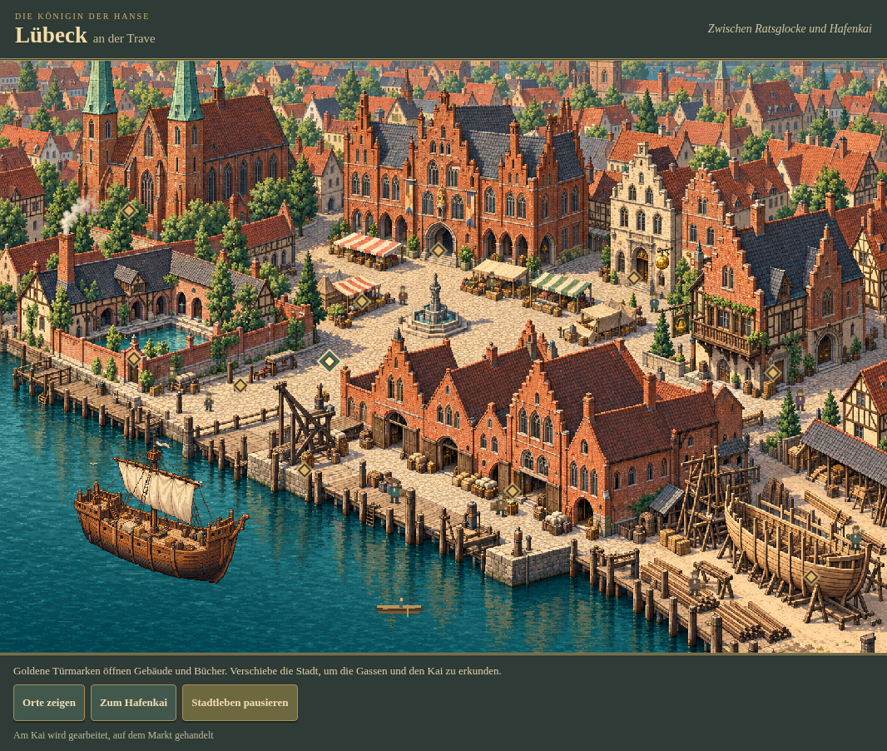

# Hansefürst 0.7a – Lübeck als lebendige Pixelstadt

25. Oktober 2026 · Arbeitszweig `feature/phase07a-living-luebeck`.

Ausgangspunkt: **07f53f9cdea4b4d7184edfac17876fa546d9da16**, integrierte Phase 0.6c. Grafisch und funktional geprüfter Endstand: **a2f81d407f1eef4cd6201309e80b81a551d3c7a5**. Letzter tatsächlich geprüfter Gesamtspielcode: **8908f6a6c312ea76f8261bc95fb78257022915b2**. Gegenüber dem grafischen Endstand enthält er ausschließlich einen Favicon-Metadateneintrag; danach wurden Quellgleichheit und Konsole geprüft. SHA-256: **7319a63d708f563ec74ce083c92d5f732ceb090264c481a12d6fca22247e10f3**.

## 1. Ergebnis

Lübeck besitzt jetzt eine zusammenhängende, direkt bedienbare Stadtbühne: Backsteinkirche, Rathausmarkt, Badehof, Kaufmannsgassen, Bank, Kontor, Lagerhäuser, Kai und Werft. Kleine Menschen und Hafenbewegungen beleben das Bild. Elf native Eingänge öffnen die vorhandenen Spielfunktionen. Auf schmalen Bildschirmen bleibt die Stadt groß und wird verschoben.

**Wirtschaft, Politik, V11 und die gespeicherten Daten bleiben unverändert.** Das gesamte bisherige Spielskript ist nach Herausnehmen des neuen visuellen Moduls, eines Zeichenaufrufs und der Versions-/Neuigkeitenanzeige exakt gleich. Es wurden keine vollständigen Wirtschafts- oder Karriereverläufe neu berechnet.

Meine visuelle Bewertung: Der Stadtzusammenhang und Hafen sind als erste eigenständige grafische Referenz überzeugend. Einfache Pixelsprites vor einem feineren Hintergrund, feste Laufwege und die größere HTML-Datei bleiben erkennbare Grenzen. Die Prüfung ist keine menschliche Langzeit- oder Safari-Geräteabnahme; die anderen zehn Städte wurden nicht neu gestaltet.



## 2. Vorherige Ausgangslage und erhaltene Grafik

Vorher zeigte Lübeck eine atmosphärisch gelungene statische Hafenillustration. Warme Backsteinfarben, Schiffe und die vorhandenen Innenräume passten bereits zur Hanse. Die kleinen Menschen bewegten sich nicht; auf dem Telefon schrumpfte das ganze Bild. Die Spielfunktionen lagen als davon getrennte Schaltflächen darunter. Werft, Lager, Bank und Badehaus waren im Bild nicht eindeutig als eigene Zugänge erkennbar.

[Vorher PC](../../tests/simulation/phase07a-20261025-01/before-1280.png), [vorher Mobil](../../tests/simulation/phase07a-20261025-01/before-390.png). Die alte Lübecker Hafenillustration und alle zwölf bisherigen eingebetteten Bildwerte bleiben **bytegleich** erhalten. Markt, Rathaus, Hafen/Werft, Kirche, Bank, Badehaus und Kontor verwenden weiterhin ihre bisherigen Innenraumbilder und Ansichten. Hamburg bis Venlo behalten die bisherige Stadtgrafik und Navigation. Bei einem Fehler des neuen Hintergrundbilds fällt Lübeck auf seine alte Ansicht samt bedienbaren Funktionen zurück.

## 3. Neue Stadtgestaltung und Grafikherkunft

Die neue erhöhte Dreiviertelansicht verbindet einen Rathausmarkt mit Gassen und einem durchgehenden Hafen. Marienkirchtürme, Staffelgiebel, Speicher, Krämerstände, Fässer, Säcke, Ladekran, Holzstapel und ein unfertiger Rumpf prägen die Bereiche. Warmes Ziegel-/Holz-/Pergamentlicht und gedämpftes Tealwasser verbinden Gebäude und Hafen. Das Bild zeigt einen interpretierenden Stadtausschnitt um 1350, keinen vermessenen historischen Stadtplan. Kein später erbautes Holstentor ergänzt.

Stadtszene und transparentes Frachtschiff wurden eigenständig für Hansefürst erzeugt; keine Originalgrafiken anderer Spiele übernommen. [Originaldateien, Herkunft und Einbettung](../../assets/cities/luebeck/README.md). Die Hintergrundtextur ist feiner und farbreicher als eine streng begrenzte historische 32-/64-Farben-Grafik. Ein exakt einheitliches historisches Pixelraster wird deshalb nicht behauptet.

Die erzeugten PNG-Originale bleiben unverändert. Ausschließlich für den Transport entstanden verlustfreie WebP-Kopien. Jede dekodierte RGBA-Bytefolge wurde mit dem Original verglichen; keine Verkleinerung oder Umfärbung. [Kodierungsnachweis](../../assets/cities/luebeck/encoding.json).

| Grafik | Original-PNG | Verlustfreie WebP-Kopie |
|---|---:|---:|
| Stadt, 1.536×1.024 | 3.832.314 Bytes | 2.639.022 Bytes |
| Kogge, 1.448×1.086, transparent | 1.471.602 Bytes | 1.101.844 Bytes |
| Gesamt | 5.303.916 Bytes | 3.740.866 Bytes |

Alle Bilder sind weiterhin in der einzelnen HTML-Datei eingebettet. Beim Spielen benötigt die Stadt keinen zusätzlichen Grafikserver. Die endgültige HTML-Datei wächst von **2.014.900 auf 7.022.238 Bytes**. Das ist ein relevanter Nachteil beim ersten Herunterladen, auch wenn sich die eigentliche Animation als sparsam erweist. Die unveränderten Originalbilder bleiben bewusst für Bestandsansichten und Rückfall erhalten.

## 4. Was sich bewegt

- **Zehn kleine Personen:** Kaufleute, Bürger, ein Geistlicher, Fassarbeiter, ein Verkäufer und ein Werftarbeiter. Unterschiedliche Wege, Geschwindigkeiten, Startphasen und kurze Aufenthalte verhindern gleichzeitiges Gleichschreiten. Kappen, Gesichter, Schultern, getrennte Stiefel und Lasten wurden nach der Nahprüfung deutlicher gezeichnet.
- **Hafen:** eine leicht schaukelnde Frachtschiffgrafik, ein kleines Dienstboot, begrenzte helle Wasserstriche und drei kleine Möwen.
- **Stadtdetails:** dezenter Rauch und eine kleine bewegte Fahne. Ein Werftarbeiter hebt sein Werkzeug; Arbeiter tragen sichtbare Fässer.

Die Boote und Menschen sind Dekoration. Sie sind keine zusätzlichen Schiffe, Waren, Arbeiterkonten oder politischen Ereignisse im Spielstand. Es gibt keine neue Wetter-/Tageszeitmechanik. Die warm beleuchtete Grundszene bleibt konstant; kein Einfluss auf Reisezeiten oder Preise.

„Stadtleben pausieren“ hält die Bewegung an. Eine Betriebssystempräferenz für reduzierte Bewegung startet die Szene ruhend; ausdrückliches Einschalten bleibt möglich. Diese Einstellung gilt für die laufende Seite und wird nicht in V11 gespeichert. Bei geöffneter Spielansicht, verstecktem Dokument oder einer aus dem Sichtbereich gescrollten Stadt ruht die Schleife ebenfalls. Die verborgene Dokumentlage wurde im Browser kontrolliert ausgelöst, nicht als physischer Geräte-Hintergrundtest ausgegeben.

## 5. Direkte Gebäudefunktionen

Goldene Türmarken dienen als Zugänge. Namen erscheinen bei Maus/Fokus oder über „Orte zeigen“. Die Markierungen verwenden native Knöpfe mit vollständigen zugänglichen Namen und sichtbarem Tastaturfokus. Die transparenten Klickflächen sind jeweils **48×48 CSS-Pixel** groß; die elf Rechtecke überschneiden sich in den geprüften Größen nicht.

| Eingang oder Gegenstand | Vorhandene Funktion |
|---|---|
| Kirche | Spenden und Ansehen |
| Rathaus | Rivalen, Ratsbriefe, Leistungsbuch, Bürgermeister und Hanseversammlung |
| Marktplatz | Kaufen, Verkaufen, Preise, Vorräte und Ladung |
| Badehaus | Bad, Gerüchte und Handelsinformationen |
| Bankhaus | Einzahlen, Abheben, Kredit und Tilgung |
| Kontor | Persönliches Kaufmannsbuch, Start-/Aufenthalts-/Amtsort und Bilanz |
| Lagerhaus | Ein-/Auslagern, Kapazität, Mietbuch und Mietschulden |
| Hafenmeister | Schiffe, Reparatur/Bewaffnung, Flotte, Konvois und Hafenarbeit |
| Schiffswerft | Derselbe Hafenbereich, direkt bis zu Materialbedarf und Bauaufträgen gescrollt; vorhandener Schiffsverkauf |
| Seekarte am Kai | Routen, Reiseplanung und Abfahrt |
| Handelsbuch | Eigene datierte Preisaufzeichnungen |

Die bestehenden Fußleisten für Spielstand, Flotte, Aufträge und Chronik bleiben erreichbar. Neue Funktionen wurden durch diese Zugänge nicht eingeführt. Gewollte Aktionen wie Kauf, Spende oder Bauauftrag ändern weiterhin die Partie; reine Dekorationszeit tut dies nicht.

## 6. Smartphone, Tablet und PC

Die logische Szene misst 960×640. Eine Mindestbreite von 900 CSS-Pixeln verhindert, dass das Telefon sämtliche Türen und Figuren zur Miniatur verkleinert. Der Ausschnitt lässt sich seitlich und bei Bedarf senkrecht verschieben; normales Seitenrollen und Pinch-Zoom bleiben vorgesehen. „Zum Hafenkai“ verschiebt den Ausschnitt zum Hafen und setzt den Fokus. Ein kurzer Hinweis erklärt die Türmarken und Ortshilfe.

390×844 zeigt bewusst einen erlebbaren Ausschnitt mit Rathausmarkt und Speichern. Für Kirche, Badehof oder Werft muss der Spieler verschieben. Das benötigt mehr Orientierung als eine komplette Übersicht; die Ortshilfe ist deshalb wichtig. Auf 820×1180 steht deutlich mehr Stadtfläche zur Verfügung. Der PC zeigt die gesamte Breite mit Maus-Hervorhebung. Tab und Enter öffnen echte Gebäudefunktionen, auch wenn der fokussierte Eingang vorher außerhalb des Ausschnitts lag.

Echte Chromium-Touchscroll-Geste und nicht nur programmatisches Verschieben zusätzlich geprüft. Keine unbeabsichtigte Gebäudeaktivierung oder Spielstandänderung dabei. Der tatsächliche lokale Aufruf der Einzeldatei über `file://` wurde im Cloud-Browser mit `net::ERR_BLOCKED_BY_ADMINISTRATOR` blockiert. Deshalb ist der lokale Dateistart dort **nicht abgenommen**. Die eingebetteten Bildbytes und HTTP-Ausführung sind geprüft; keine Umgehung der administrativen Browserrichtlinie versucht. Keine Aussage über Safari-Dateiverwaltung oder physische Apple-Geräte.

## 7. Technische Architektur und Wiederverwendung

[Renderer](../../assets/cities/city-life.js) und [CSS](../../assets/cities/city-life.css) bilden eine eigene Stadtbühne: statischer Hintergrund, transparente Pixelanimation, native Eingänge. Die Bühne erhält nur Stadtindex und Navigations-/Rückfallfunktionen, keinen Spielstand. Sie verwendet weder `Math.random`, `Date.now`, Spieluhr, Speicherzugriffe noch Testlog-Ereignisse. Ihre unabhängige Zeitbasis bestimmt nur Zeichnungen.

Eine vorhandene Zeichenfunktion erhält einen einzigen Aufruf zur Stadtbühne. Nur Stadtindex null verwendet sie. Eine Instanz bleibt erhalten; beim Verlassen pausiert sie. `requestAnimationFrame` plant höchstens einen eigenen Callback, die eigentliche Zeichnung ist auf höchstens 20 Bilder pro Sekunde begrenzt. Eine begrenzte Messliste hält maximal 300 Zeichendauern. Sichtbarkeits-, Dialog- und Bewegungsbeobachter werden einmal angelegt.

Wiederverwendbar sind native Eingänge/Fokus, verschiebbare Bühne, unabhängige Uhr und Pausen, Weginterpolation, Figuren-/Lastenbausteine, Boote und Umgebungsdetails. Spätere Städte brauchen eigene Grafiken, Eingangslagen, Wege, Wasserflächen und Palette. Eine vollständige parametrisierte Registrierung aller elf Städte ist noch nicht gebaut; Lübecks Geometrie wird nicht automatisch auf Bergen oder Nowgorod kopiert.

`python tools/embed-city-life.py` bettet die Quelldateien unverändert und die Grafikbytes in die HTML-Datei ein. Die neuen Bilder liegen in einem inerten Template außerhalb des Spielskripts, sodass die Headless-Regeltests sie nicht ausführen müssen. `python tools/encode-city-art.py` erzeugt die pixelgleichen Transportkopien.

## 8. Schutz von Spielständen, Wirtschaft und Politik

**V11 bleibt V11; keine neuen gespeicherten Werte.** Die Figurenwahl und freie Startstadtwahl bleiben erhalten. Sämtliche bisherigen Funktionen für R1, Preise, Warenherkunft, Lager/Mieten, Werftmaterialien/Bauzeit, Bank/Kredit, Piraten/Konvois, Ratsdienste, Ämter und Eldermann sind unverändert. Alte Originalbackups, Import und Export bleiben bestehen.

Der vollständige Quellvergleich erlaubt nur das visuelle Modul, den `drawCity`-Aufruf und Versions-/Neuigkeitenanzeige. Zusätzlich: 44 Startkombinationen exakt wie vorher; zwei Seeds mit je 150 kontrollierten Spieltagen und derselben nächsten Zufallszahl. Das sind begrenzte technische Kontrollen, keine vollständigen Karrieren.

**330 gesicherte politische Endstände** aus den Hauptreihen 0.6b/0.6c wurden ausschließlich geladen und mit der bisherigen Übernahme verglichen. **2.065 historische Ergebnis-, Protokoll-, Bild- und Prüfsummendateien bleiben bytegleich.** Unterstützte Altformate und persönliche Profile werden außerdem durch die vorhandenen Start-/Politikprüfungen abgedeckt.

Die früheren Wirtschafts-/Karriereergebnisse bleiben historisch: beispielsweise 104 Bürgermeister, 102 Eldermänner und keine finanzielle Reiseblockade in 110 0.6c-Hauptfällen. Sie wurden **nicht neu berechnet** und sind kein neuer 0.7a-Balancenachweis. Die Schutzbehauptung dieser Phase beruht auf exakten Regelquellen, gespeicherten Zuständen und gezielten tatsächlichen Aktionen. Keine neuen Aussagen zu Vermögensentwicklung, Insolvenz oder menschlicher Spieldauer aus Dekorationssekunden ableiten.

## 9. Tatsächlich ausgeführte Prüfungen und Quellstände

| Prüfung | Tatsächlicher Spielcode | Ergebnis |
|---|---|---|
| Fünf Quell-/Kompatibilitätsgruppen | endgültig a2f81d4 | Bestanden; alte Regeln, Bildwerte, 44 Starts, begrenzte Seedkontrollen und historische Endstände/Dateien. |
| Zwölf bestehende Programme | f314315 | Alle bestanden; siehe unten. |
| Breite Chromium-Abnahme, 15 Gruppen | f314315 | Drei Größen, elf Eingänge, echte Aktionen und Bewegungs-/Lebenszyklusprüfungen bestanden. |
| Politische UI-Zusatzprüfung | f314315 | Historisches verdientes/finanziertes Fixture, Ratsbrief, tatsächliche Hanseversammlung und Weiterhandel bestanden. |
| Gezielte endgültige Stadtprüfung, drei Gruppen | a2f81d4 | Alle elf Eingänge in jeder Größe, neue Figuren, Bewegung, Pause, unveränderter Spielstand/RNG, Seitenbreite bestanden. |
| Echte Touchgeste / lokaler Dateistart | a2f81d4 | Touch-Verschieben ohne Fehlaktivierung bestanden; `file://` durch Cloud-Browserrichtlinie blockiert, nicht abgenommen. |
| Abschließende Quell-/Konsolenprüfung | 8908f6a | Gesamtes HTML bis auf Favicon-Verweis gleich a2f81d4; keine Konsolenfehler/-warnungen oder fehlgeschlagenen Anfragen. |

Zwölf Programme: `test-v04` (19 Prüfungen), `phase1` (18), `telemetry`, `share`, `warehouse-checks` (19), `warehouse-cities-checks` (13), `warehouse-capacity-checks` (17), `warehouse-arrears-checks` (19), `politics-checks` (22), politische Nebenläufigkeit mit Schiffbau/Hafenarbeit, erneutes Amt nach Eldermann, `start-selection-checks` (11 Gruppen). [Befehle und Rückgabecodes](../../tests/simulation/phase07a-20261025-01/regressions.json).

Nach der breiten Abnahme wurden ausschließlich Figurensilhouette, Kirchmarke und ein Spazierweg verbessert. Ein vollständiger Quelldifferenznachweis grenzt diese Änderungen ein; alle übrigen HTML-/Spielquellen stimmen mit dem breit geprüften Stand überein. Die zwölf Programme und sämtliche breiten Aktionsszenarien wurden deshalb nach dieser rein visuellen Verfeinerung nicht pauschal wiederholt. Endcode erhielt die genannten eigenen Quell- und Browserprüfungen. Ein früher Zwischenstand f03e6f4 samt eigenen Bildern/Protokollen bleibt archiviert.

Konkrete Browseraktionen: örtlicher Kauf-/Lager-/Verkaufsrundlauf mit jeweils zwei Fass ohne Gewinn, Bankeinzahlung und -abhebung, Spende, Exportdownload und FileReader-Import, echte Reise nach Hamburg und zurück. Finanzierte technische Fixture: tatsächliche Materialkäufe, 2.500 G Werftlohn, offener Schniggenauftrag nach Neuladen, Mietschuld von 1 G und vollständige Tilgung. Politisches Fixture ist ein gespeicherter technischer Aufbau aus 0.6b, keine neu gestartete reguläre Karriere. Animation zwischen den Aktionen ändert deren Zustände nicht.

Fehlerprotokolle bleiben erhalten: eine nachgebildete DOM-Diagnose fehlte `classList.contains`; der Testadapter wurde ergänzt. Ein Browserlauf erwartete die Schuld ohne die angezeigte Einheit „G“; Erwartung und Knopfselektor wurden korrigiert, keine Schutzprüfung entfernt. Der zusätzliche CDP-Scrollhelfer bewegte zunächst nichts; echte Touch-Start-/Move-/End-Ereignisse im mobilen Browserkontext bestätigten danach das native Verschieben. Der anschließende lokale Dateiaufruf wurde administrativ blockiert und bleibt ungeprüft. Die visuelle Nachprüfung führte zu kräftigeren Menschen, einer besseren Kirchmarke und einem freien Kaipfad. Der zusätzliche tatsächliche Konsolencheck identifizierte außerdem den automatischen 404-Aufruf eines fehlenden `favicon.ico`. Ein leerer Inline-Icon-Verweis verhindert die Anfrage; erneuter Test mit Konsole einschließlich Warnungen bestanden. Keine Stadt- oder Wirtschaftsänderung. [Vorher identifiziert](../../tests/simulation/phase07a-20261025-01/console-resource-before.json), [letzte Abnahme](../../tests/simulation/phase07a-20261025-01/console-final.json). Keine wirtschaftliche Korrektur nötig.

## 10. Animation, Leistung und Stabilität

Endgültige zeitlich getrennte Aufnahmen über mindestens **1,7 Sekunden** unterscheiden sich in **26.173 Pixeln (3,45 %)**. Figurenpositionen ändern sich mit unterschiedlichen Phasen; die Aufnahmen und Quellprüfung belegen echte Darstellungstätigkeit. Zugleich bleiben Spielstand und Wirtschaftszufallsfolge unverändert. [Bewegungsbild A](2026-10-25_0.7a_bewegung-release-a.png), [B](2026-10-25_0.7a_bewegung-release-b.png), [Pixelvergleich](../../tests/simulation/phase07a-20261025-01/motion-pixels-release.json).

| Endcode, Chromium-Viewport | Beobachtete Bilder | Median reine JS-Zeichenzeit | P95 | Einzelmaximum |
|---|---:|---:|---:|---:|
| 390×844 | 53 | 0,3 ms | 0,6 ms | 1,8 ms |
| 820×1180 | 54 | 0,3 ms | 0,7 ms | 1,9 ms |
| 1280×900 | 56 | 0,3 ms | 1,0 ms | 2,8 ms |

Das sind kurze Messungen im Cloud-Desktop-Chromium, ohne vollständige GPU-/Kompositor-/Netzwerkkosten. Die breite frühere Prüfung beobachtete bei 4× CPU-Drosselung 34 gezeichnete Bilder in 1,8 Sekunden, P95 1,5 ms und maximal 3,2 ms. Dieser Drosseltest gehört zum Stand vor der letzten Figurenverfeinerung.

Nach 30 kontrollierten Stadtwechseln bleiben eine Stadtbühne, elf Eingänge und eine angelegte Instanz. Maximal ein eigener Callback war geplant. JS-Heap nach kontrollierter Garbage Collection: 4.654.012 → 4.662.060 Bytes. Das zeigt im begrenzten Versuch keinen anwachsenden Instanzbestand, beweist aber keine beliebig lange Speicherleckfreiheit und misst keinen gesamten nativen/GPU-Speicher. Zusätzlich tatsächliche Reise mit alter Navigation und Rückkehr geprüft; die 30 Wechsel selbst waren ein kontrollierter Darstellungsversuch.

Dialoge liegen über Grafik und Eingängen, keine Überdeckung der Bedienelemente oder horizontaler Seitenüberlauf in den geprüften Größen. Breite Abnahme ohne JavaScript- oder fehlgeschlagene Ressourcenanfragen; Endcode ohne JavaScriptfehler. Manuelle Pause, reduzierte Bewegung, tatsächliches Herausscrollen und kontrollierter Sichtbarkeitswechsel bestanden. Keine Aussage über Akkuverbrauch oder jedes langsame Telefon.

## 11. Bilder und visuelle Qualitätsprüfung

**Chromium 154.0.8037.57**, echte Browserdarstellung bei 390×844, 820×1180, 1280×900. Keine physische iPhone-/iPad- oder Safari-Prüfung.

| Motiv | Mobil | Tablet | PC |
|---|---|---|---|
| Endgültige Stadt | [390](2026-10-25_0.7a_luebeck-release-390.png) | [820](2026-10-25_0.7a_luebeck-release-820.png) | [1280](2026-10-25_0.7a_luebeck-release-1280.png) |
| Rathaus, breite Abnahme f314315 | [390](2026-10-25_0.7a_rathaus-390.png) | [820](2026-10-25_0.7a_rathaus-820.png) | [1280](2026-10-25_0.7a_rathaus-1280.png) |
| Werft, breite Abnahme f314315 | [390](2026-10-25_0.7a_werft-390.png) | [820](2026-10-25_0.7a_werft-820.png) | [1280](2026-10-25_0.7a_werft-1280.png) |

Mobil- und PC-Endbilder, Bewegungsbilder, frühe Entwürfe und Detailausschnitte wurden visuell betrachtet. Die zunächst zu schwachen Figuren wurden nicht allein wegen bestandener Funktionstests akzeptiert, sondern nachgezeichnet. Die endgültige Szene zeigt nun erkennbar Menschen auf dem Markt und am Kai.

| Qualitätsfrage | Bewertung und Grenze |
|---|---|
| Zusammenhängende Hanse-Handelsstadt? | Ja: Gassen, Rathausmarkt und durchgehender Kai verbinden die Bereiche. Keine isolierten Gebäudekacheln. |
| Erkennbarer, lebendiger Hafen? | Ja: Schiff, Arbeiter, Lasten, Werft, Wasser und Möwen; bewusst geringe Bewegungsmenge. |
| Größen und Figuren lesbar? | Nach Verfeinerung besser; im vollen Stadtbild weiterhin kleine Menschen, keine ausgearbeiteten Porträts. |
| Perspektive, Palette und Stil? | Gebäude und Schiffsasset sind kohärent; einfachere Figuren haben geringeren Detailgrad als die fein strukturierte Hintergrundgrafik. |
| Angenehme Bewegung? | Ruhige versetzte Schleifen und kurze Aufenthalte; vollständig abschaltbar. Keine menschliche Mehrstundenbewertung durchgeführt. |
| Mobile Erlebbarkeit? | Große Details und sichere Ziele; Verschieben und gelegentliche Ortshilfe sind erforderlich. |
| Intuitive Gebäudeerkennung? | Rathaus, Markt, Speicher und Werft klar; Kirche/Bank/Badehof werden durch Türmarken und Namen unterstützt. Noch lernbedürftig ohne Ortshilfe. |

**Grafische Referenzbewertung:** Für Stadtaufbau, Farbwelt, direkte Gebäudebedienung und sparsame Bewegung ist Lübeck eine brauchbare, überzeugende erste Referenz. Die folgenden Punkte sind keine abgeschlossene grafische Endfreigabe für sämtliche weiteren Städte: separate Richtungs-/Trage-/Arbeits-Spriteblätter, feinere Tiefenmasken an Vordergrundobjekten und langfristige menschliche Beurteilung von Tempo/Lesbarkeit. Die Stadtbühne ist funktional und visuell ausgearbeitet; ein abschließender gemeinsamer Detailstandard bleibt noch festzulegen.

## 12. Quellen, Wiederholung und offene Grenzen

[Endgültige Quell-/Altdateiprüfung](../../tests/simulation/phase07a-20261025-01/technical-release.json), [breite Browserabnahme](../../tests/simulation/phase07a-20261025-01/browser.json), [politische Zusatzprüfung](../../tests/simulation/phase07a-20261025-01/browser-politics.json), [Endcode-Browserprüfung](../../tests/simulation/phase07a-20261025-01/browser-release.json), [Touch/Einzeldatei](../../tests/simulation/phase07a-20261025-01/touch-offline.json), [gesicherte Zwischenstände](2026-10-25_0.7a_fortschritt.md).

[Abschließende Evidenzzuordnung](../../tests/simulation/phase07a-20261025-01/release.json) und [91 geprüfte SHA-256-Einträge](../../tests/simulation/phase07a-20261025-01/SHA256SUMS) sichern Quellstände, Bilder und Protokolle. Entwicklungsberichte/Index und die Prüfsummenliste selbst sind von der Liste ausgenommen; die unveränderte Grafikherkunftsdatei ist enthalten. Die Einbettung wurde zusätzlich als bytegleich wiederholbar geprüft.

Ausgeführte Kommandoformen; neue Ergebnisnamen verwenden:

```text
python tools/encode-city-art.py
python tools/embed-city-life.py
node tests/simulation/city-life-checks.cjs <neuer Ergebnisname>
node tests/simulation/city-life-browser.cjs <neuer Ergebnisname>
node tests/simulation/city-life-politics-browser.cjs <neuer Ergebnisname>
node tests/simulation/city-life-visual-final.cjs <neuer Ergebnisname> --release
node tests/simulation/city-life-touch-offline.cjs <neuer Ergebnisname> --known-file-policy-block
node tests/simulation/city-life-console.cjs <neuer Ergebnisname>
```

Der Schalter `--known-file-policy-block` übernimmt ausschließlich den konkret im ersten Dateiaufruf protokollierten Richtlinienblock; er behauptet keinen bestandenen Dateistart und wiederholt den blockierten Aufruf nicht. Ohne Schalter prüft das Programm in einer dafür zulässigen Umgebung den Dateistart selbst. Die zwölf bestehenden Befehle stehen im verlinkten Regressionsprotokoll. Ergebnisdateien werden nicht überschrieben. Verschiedene dokumentierte Spielcode-Stände dürfen bei einer historischen Reproduktion nicht vermischt werden. Keine alten vollständigen 1.500er-/0.6b-/0.6c-Reihen gestartet. Keine Simulationstage in menschliche Stunden umgerechnet.

Offen bleiben der in dieser Cloud administrativ blockierte lokale Dateistart, die anfangs größere Einzeldatei, echte Safari-/Gerätetests, Akku-/Langzeitmessungen und eine menschliche visuelle Spielrunde. Figuren nutzen feste einfache Wege und keine allgemeine Tiefen-/Kollisionssimulation. Hochwertigere Richtungs- und Arbeitssprites sowie detailliertere Vordergrundmasken fehlen für einen vollständig einheitlichen späteren Animationsstandard. Dafür wurden keine weiteren Städte oder Folgeaufgaben begonnen.

## 13. GitHub-Sicherung

- [3e34ca1274540a552016a842425ba826fc32bea9](https://github.com/psonnen-lgtm/Hansef-rst/commit/3e34ca1274540a552016a842425ba826fc32bea9): Bestandsaufnahme, Vorherbilder und visueller Plan.
- [f31431575666daa1a7c79fdd468419c05f11392c](https://github.com/psonnen-lgtm/Hansef-rst/commit/f31431575666daa1a7c79fdd468419c05f11392c): neue Stadt, originale Grafikassets, Eingänge und unabhängiges Stadtleben.
- [5dd892cbcfadd6a29565e784c143b9282c187fce](https://github.com/psonnen-lgtm/Hansef-rst/commit/5dd892cbcfadd6a29565e784c143b9282c187fce): breite Browserabnahme, Schutz-/Leistungsprüfungen und ehrliche visuelle Zwischenbewertung.
- [a2f81d407f1eef4cd6201309e80b81a551d3c7a5](https://github.com/psonnen-lgtm/Hansef-rst/commit/a2f81d407f1eef4cd6201309e80b81a551d3c7a5): endgültiger Spielcode mit klareren Figuren, Kirchzugang und freiem Kaipfad.
- [8908f6a6c312ea76f8261bc95fb78257022915b2](https://github.com/psonnen-lgtm/Hansef-rst/commit/8908f6a6c312ea76f8261bc95fb78257022915b2): letzter Spielcode, unnötigen Favicon-404-Aufruf unterdrückt; Stadt und Regeln unverändert.
- [cdf030c4051cc02256422a42f5bdff79178cdc74](https://github.com/psonnen-lgtm/Hansef-rst/commit/cdf030c4051cc02256422a42f5bdff79178cdc74): endgültige Bild-/Bewegungsnachweise und Quellenprüfung gesichert.

[Bericht auf GitHub](https://github.com/psonnen-lgtm/Hansef-rst/blob/feature/phase07a-living-luebeck/docs/entwicklungsberichte/2026-10-25_0.7a_luebeck_lebendige_pixelstadt.md). Kein Merge nach `development/v04-foundation` oder `main`; keine weiteren Städte und keine Folgephase begonnen.
