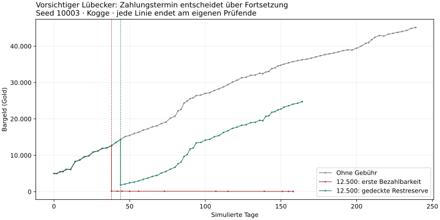

# Q1.05 – Kaufmannsgilde als wirtschaftlicher Meilenstein

29.10.2026 · Analysebranch `audit/q1-05-guild-milestone` · Basis `02ee6b8fc1507ad078b6b596c333e50d91eeea64`.
Produkt **0.8d.1b/V13**, letzter Produkt-Commit **`c42c25cf5cf372c210b47f25b00b9f0106044ed3`**, SHA 256 **`c8ad9d2ef453e0c80ae51dfef8a2d21f8e17dc4cad49bd583568cf0721cdd924`**. Spielcode und Wirtschaftsregeln unverändert. Keine Gebühr beschlossen.

**Der untere geprüfte Bereich um 12.500 Gold ist derzeit der stärkste Kandidat.** Er verlangt in den geprüften regulären Starts mehrere Handelsreisen und lässt bei passendem Zahlungszeitpunkt Handel zu.18.000 belastet langsame Profile stärker; 26.500 schließt innerhalb des Beobachtungsfensters viele davon aus. Zwischenbeträge sind ungeprüft. Dies ist eine begründete Empfehlung, keine Preisentscheidung.

Die wichtigste Erkenntnis ist der **Zahlungszeitpunkt**: Wer die Kasse beim ersten Erreichen der Gebühr leert, kann danach ohne sinnvolle Käufe weitersegeln und schließlich sogar die Abfahrt verlieren. Eine höhere Gebühr allein beweist kein tragfähiges Unternehmen.

## 1. Was bedeutet wirtschaftlich gefestigt?

Vier Dinge bleiben getrennt: einmalig genug Bargeld; dauerhaft gedecktes Betriebskapital; wiederholt profitabler beladener Handel; tatsächliche Fortsetzung nach größerer Ausgabe. Für diese Untersuchung bedeutet „E erreicht“ mindestens 4 sinnvoll beladene Reisen, positiver erwirtschafteter Nettogeldzuwachs, positive Summe der letzten 3 beladenen Reisen mit mindestens 2 positiven und gedeckte Abschlussreserven. Sinnvoll beladen bedeutet hier mindestens 10 gekaufte Einheiten je Reise. Das ist eine transparente Analyseannahme, keine universelle Spielerdefinition oder zusätzliche Aufnahmebedingung.

E tritt in Lübeck erstmals an Tag 10–16, Bergen 50–64 und Nowgorod 75 auf. **Die Gildenausgabe ist deshalb noch nicht automatisch tragbar**; dafür muss nach Zahlung Betriebskapital bleiben. Weder ein zusätzlicher Vermögenstest noch Pflichtreisen oder Wartezeiten werden empfohlen.

## 2. Wie unterscheiden sich Spielstile, Städte und Schiffe?

| Szenario, je 15 Fälle | Endtage | Sinnvoll beladene Reisen | Bargeld Ende | E erstmals (Tag) |
|---|---|---|---|---|
| Lübeck/Kogge | 238–240 | 78–86 | 40.662–99.231 | 10–16 |
| Bergen/Kogge | 235–240 | 21–22 | 17.331–49.191 | 50–64 |
| Nowgorod/Kogge | 235–238 | 14 | 14.366–37.165 | 75 |
| Lübeck/Schnigge* | 240 | 107–119 | 30.666–97.024 | 10–14 |
| Lübeck/Kogge+Holk* | 237–240 | 64–70 | 48.575–127.673 | 15 |

Die mit einem Stern markierten Profile sind synthetische bestehende Unternehmen, keine regulären Neustarts. Der Konvoi beginnt mit 8.000 Gold und bereits Kogge+Holk; seine bessere Ausstattung wurde nicht im Spiel verdient. Schnigge beginnt mit 5.000. Die 45 regulären Fälle beginnen in drei Städten mit 5.000/Kogge, aggressiv zusätzlich 1.500 echter Kredit. Je Profil 5 Stile ×3 gemeinsame neue Seeds, keine 15 unabhängigen Spieler.

Vorsichtig hält mehr Kasse zurück und lädt weniger. Normal/Aggressiv bewegen mehr Ware; aggressiv bindet zusätzlich Kredit und darf nicht anhand der Bruttokasse allein gewinnen. Optimierung verwendet ausschließlich selbst beobachtete, datierte Preise. Fehlentscheidungen verursachen in allen 15 entsprechenden Baselines reale Anfangsverluste; später wird die normale Strategie fortgesetzt. Keine extremen 20-/30-Verlustkrisen neu geprüft.

Die Laufzeiten betragen 235–240 Tage. Unterschiede sind Szenarioergebnisse aus Startort, beobachteter Routenwahl, Stil, Kapazität, Geschwindigkeit und Ereignissen, **keine isolierten Stadteffekte**. Der reichere Konvoi ist kein kausaler Flottenkaufvergleich. Tages- und Reisevergleiche stehen nebeneinander; keine Rangliste aus ungleichen Endkassen.

## 3. Welche Gebühren wurden wie ausgewählt?

Erst nach 75 Baselines: alle 45 regulären Starts, letzter beobachteter Kontrollpunkt bis Tag 120; strategiegerecht freie Kasse nur bei erreichtem E, sonst 0. Die vorab festgelegten 25/50/75%-Quantile sind 12.495 /17.570 /26.437 Gold.500er-Aufrundung und vorab definierter Mindestabstand ergeben **12.500 /18.000 /26.500**. Das Raster ist eine Versuchsannahme, keine Preisfreigabe. Reichere synthetische Flotten beeinflussen die Auswahl nicht.

Frischer Start kann über die unveränderte Bank ohne Tageswechsel **5.000+4.482=9.482 Gold** verfügbar machen. Daher würde eine Gebühr lediglich oberhalb 5.000 die unmittelbare Kreditfinanzierung nicht sicher verhindern. Alle drei Kandidaten liegen über dieser regelkonformen Startliquidität; mögliche Q-001-Manipulation ist damit nicht gelöst.

## 4. Wann sind Gebühren bezahlbar und tragbar?

In regulären Baselines erreicht 12.500 nominal Tag 15–219, mit E und verbleibender Reserve Tag 25–235 (45/45).18.000 nominal 39–236 (42/45), tragbar 43–219 (41/45).26.500 nominal 60–236 (34/45), tragbar 63–235 (31/45). Das sind jeweils verschiedene erreichende Fälle; kein Pauschalaufschlag auf dieselbe Person. Nicht erreichte Fälle sind bis spätestens 240 Tagen zensiert, nicht lebenslang ausgeschlossen. [Alle Stadt-/Gebührenzahlen](Q1_05_gildengebuehren_vergleich.md).

## 5. Wie läuft Handel nach tatsächlichem Testabzug weiter?

36 gezielte Gegenläufe: 3 Gebühren ×2 Zeitpunkte ×6 vorab ausgewählte Fälle, darunter zwei vorsichtige.31 Zahlungen,5 innerhalb des Fensters nicht erreicht. Vollständige Kontrolle aller Vorzahlungspfade gegen die passenden Baselines. Gebühr einmalig nur im Testzustand, keine Mitgliedschaft/Ruf-/Rangwirkung.

| Gebühr | Zahlungszeitpunkt | Bezahlt | Anhaltender Stillstand | Auch vorübergehende Hinweise | Abfahrt geldbedingt blockiert | ≥120 Tage +3 Reisen beobachtet |
|---|---|---|---|---|---|---|
| 12.500 | Erstes Bargeld | 6/6 | 5 | 5 | 3 | 3 |
| 12.500 | E + Restreserve | 6/6 | 0 | 0 | 0 | 6 |
| 18.000 | Erstes Bargeld | 5/6 | 3 | 4 | 0 | 5 |
| 18.000 | E + Restreserve | 5/6 | 0 | 0 | 0 | 5 |
| 26.500 | Erstes Bargeld | 5/6 | 2 | 2 | 1 | 3 |
| 26.500 | E + Restreserve | 4/6 | 0 | 0 | 0 | 4 |

Anhaltender Stillstand bedeutet mindestens 3 zuletzt aufeinanderfolgende Reisen mit weniger als 10 gekauften Einheiten oder geldbedingte Abfahrtsblockade. In den 10 anhaltenden nominalen Gegenfällen gibt es nach Zahlung **überhaupt keine Käufe**; leeres Reisen wird ausdrücklich als wirtschaftlicher Stillstand gewertet. Es ist kein Beweis unwiderruflicher Insolvenz für einen Menschen mit anderen Handlungsmöglichkeiten. Einer der 18.000-Fälle hat vorübergehend einen Stillstandshinweis und erholt sich wieder.

Bei stabilisiertem Zeitpunkt handeln alle 15 zahlenden Fälle mindestens 120 weitere Tage und 3 Reisen ohne Stillstandshinweis; sie absolvieren 8–58 weitere sinnvoll beladene Reisen. Die nicht zahlenden 5 Akten sind kein Erfolg. Keine Stichprobenquote ist eine allgemeine Spielerwahrscheinlichkeit.

## 6. Vorsichtiger Händler besonders geprüft

Lübeck/Kogge, Seed 10003,12.500: erste Bezahlbarkeit Tag 38,12 beladene Reisen vorher, **146 Restgold**. Danach 0 Käufe,11 leere Reisen, Endkasse 80 an Tag 158. Zahlung erst an Tag 44 nach 14 beladenen Reisen lässt 1.839 Gold und 559 freie Reserve; anschließend 45 beladene Reisen und 24.762 Gold an Tag 164. Keine zusätzliche Pflichtfrist: Das spätere Datum ergibt sich aus verdientem Betriebskapital.

Bergen/Kogge, gleicher Seed: 12.500 nominal Tag 141 mit 615 Restgold; leere Fortsetzung endet bei 543. Mit Reserve Tag 163,1.564 Restgold,11 beladene Folgefahrten,5.954 Gold an Tag 284.18.000/26.500 wird bis Tag 240 nicht bezahlt. Das zeigt eine reale Benachteiligung langer Routen im geprüften vorsichtigen Profil. Andere menschliche Routen sind ungeprüft.

## 7. Was ist empirisch, was bleibt Einschätzung?

Empirisch: native Ereignisse/Bilanzen, echte Käufe/Verkäufe, Schulden, Reise-/Reparatur-/Pirateriekosten, E-Kontrollpunkte, tatsächliche Testzahlungen und weitere Handelsaktivität. Qualitativ: 12.500 passt eher zu einem verdienten Zwischenmeilenstein als sofort bezahlbare Kleingebühren; 18.000/26.500 können langsame Firmen länger vom Einstieg fernhalten. Das subjektive Fortschrittsgefühl und politische Verzögerung wurden nicht gemessen.

**Keine menschliche aktive Zeit gemessen.90 aktive Stunden bis Eldermann und der zeitliche Anteil der Gildenphase bleiben unvalidiert.** Keine Karriere simuliert und keine Spieltage in Stunden umgerechnet. Beschlossene Gilde/Politik sind noch nicht implementiert: der heutige alte Mischruf wächst weiter durch native Wirtschaft, wird hier ignoriert; alle Ränge bleiben 0.

## 8. Welche Tests bestanden, wo gab es Probleme?

75 auswertbare Baselines,3 erfolgreiche exakte Pilotreplays,36 Gegenläufe,1 native Kreditprobe; zusätzlich 2 voll ausgeführte, aber nicht als Rohakte gesicherte Pilot-Ausführungen vor einer zu engen Abdeckungsassertion. **81 Baseline-/Pilot-/Mechanikinstanzen plus 36 Gegenläufe=117 Engineinstanzen**; davon 116 Handelspfade und 1 Kreditprobe.111 gespeicherte Fallakten sind nicht 111 unabhängige Zufallsstichproben: gemeinsame Seeds und gleiche Zahlungszeitpunkte erzeugen Abhängigkeiten.

Alle 111 gespeicherten Akten: unabhängige Kassen-/Schulden-/realisierte Nettobilanz, Reserven, E-Kriterien, Käufe/Verkäufe und Quellenhashes bestanden.36 Vorzahlungspfade identisch. Der ursprüngliche Abbruch „mindestens 3 Häfen je Pilotfall“ bleibt mit Fehlerlog erhalten; nach begrenzter Korrektur und dokumentierter Wiederholung wurden echte Routen statt erzwungener Exploration geprüft. Kein Fehler des nativen Wirtschaftskerns nachgewiesen. [Befehle, Quellcommits und Abdeckung](Q1_05_testgrundlagen.md).

## 9. Empfehlung und verbleibende Risiken

Unterer geprüfter Bereich **um 12.500 Gold** als stärkster Diskussionskandidat; 18.000 nur bedingt,26.500 derzeit kein allgemeiner Standard. Ein vorsichtiger Spieler muss nach Zahlung handelstüchtig bleiben. Keine künstliche Wartephase oder zusätzliche Zugangshürde. Beträge zwischen 9.482 und 12.500 sowie zwischen den Testpunkten sind ungeprüft; kein allgemeines Optimum behauptet.

Q-001/Buchwertmanipulation und Q-003/Fernvorsprache bleiben offen. Keine W1/W2-Implementierung. Nur drei Seeds, eingeschränkte Strategieauswahl und keine Rettungsaktionen, Lager-/Bau-/Auftrags-/Kriegsstrategie oder menschliche Bedienung. Reserve deckt einen Modellpuffer, keine beliebige Serie von Katastrophen. Schon beim hohen optimierten Fall bleiben nach stabilisierter Zahlung nur 8 Gold **über** der angenommenen Reserve; guter späterer Verlauf ist keine Sicherheitsgarantie.

## 10. Quellen und Veröffentlichung

[Q1.01](https://github.com/psonnen-lgtm/Hansef-rst/tree/d4cf42868a5347ec6e660f52faafb8132df5b209/docs/entwicklungsberichte/Q1_01), [Q1.02](https://github.com/psonnen-lgtm/Hansef-rst/tree/8b20432506940ef1d33bf7af7f162884eec63c01/docs/entwicklungsberichte/Q1_02), [Q1.03](https://github.com/psonnen-lgtm/Hansef-rst/tree/15df03c02d6c3af3fdb9c8f24052f038885c2bb1/docs/entwicklungsberichte/Q1_03), [Q1.04](https://github.com/psonnen-lgtm/Hansef-rst/tree/e403e43e1488cd9930b5ff2ae8b7fe0184ff4d36/docs/entwicklungsberichte/Q1_04) commitfest verwendet; keine Archive erneut simuliert. Die frühere 1.100-Empfehlung ist ausdrücklich nicht übernommen.

[Ergebnisdaten und reproduzierbare Skripte](../../../tests/analysis/q1_05/README.md), [Audit](../../../tests/analysis/q1_05/results/audit.json), [Bargeld-/Rücklagenverläufe CSV](../../../tests/analysis/q1_05/results/trajectories.csv), [Gebührenfortsetzungen CSV](../../../tests/analysis/q1_05/results/fee-continuations.csv).

[Branch](https://github.com/psonnen-lgtm/Hansef-rst/tree/audit/q1-05-guild-milestone) · [Vergleich](https://github.com/psonnen-lgtm/Hansef-rst/compare/development/v04-foundation...audit/q1-05-guild-milestone). Veröffentlichte Prüfcommits siehe Testgrundlagen; Abschluss und tatsächliches GitHub-Rücklesen werden in der abschließenden Übergabe nachgetragen. Kein Merge, keine Pages-/Produkt-/Spielstandänderung. Auftrag endet nach Sicherung und Rücklesen; keine Folgephase.

[Gesamtbericht](Q1_05_gesamtbericht.md) · [Testgrundlagen](Q1_05_testgrundlagen.md) · [Meilensteine](Q1_05_wirtschaftliche_meilensteine.md) · [Gebührenvergleich](Q1_05_gildengebuehren_vergleich.md) · [Spielspaß/Karriere](Q1_05_spielspass_und_karriere.md) · [Entscheidungsvorlage](Q1_05_entscheidungsvorlage.md)

## Abschließende lokale Kontrolle

Alle3.232 vorbestehenden Dateien gegen die Entwicklungsbasis geprüft: ausschließlich Index angehängt, übrige Dateien byteidentisch. Sechs Pflichtberichte,56 relative Verweise,111 Rohakten,CSV-Zeilenzahlen und eingefrorene Quellen geprüft; vollständiger Git-Diff ohne Formatbefund. [Prüfnachweis](../../../tests/analysis/q1_05/results/verification.json). GitHub-Rücklesen folgt nach Veröffentlichung des vollständigen Pakets.
