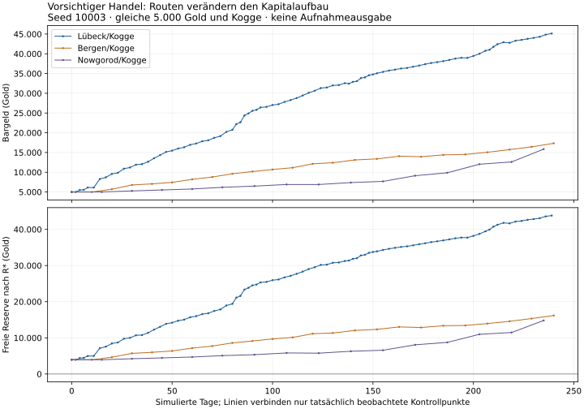

# Q1.05 – Vom Startkapital zum tragfähigen Unternehmen

29.10.2026 · Analysebranch `audit/q1-05-guild-milestone` · Basis `02ee6b8fc1507ad078b6b596c333e50d91eeea64`.
Produkt **0.8d.1b/V13**, letzter Produkt-Commit **`c42c25cf5cf372c210b47f25b00b9f0106044ed3`**, SHA 256 **`c8ad9d2ef453e0c80ae51dfef8a2d21f8e17dc4cad49bd583568cf0721cdd924`**. Spielcode und Wirtschaftsregeln unverändert. Keine Gebühr beschlossen.

## Vier unterscheidbare Zustände

| Begriff | Hier überprüfte Bedeutung | Was er nicht beweist |
|---|---|---|
|Nominal bezahlbar|Bargeld mindestens so hoch wie Ausgabe|Rücklagen, positive Geschäfte oder Schuldenfreiheit|
|Nachhaltige Liquidität|Modellreserve R* wiederholt gedeckt|Schutz gegen jede künftige Katastrophe|
|E: tragfähiges Unternehmen|≥4 sinnvoll beladene Reisen, positive echte Nettogeldentwicklung, letzte 3 beladene Reisen zusammen positiv/≥2 positiv, deren und aktuelle Reserve gedeckt|Eine neue rechtliche Beitrittsbedingung oder menschliches Meistergefühl|
|Belastbar nach Ausgabe|Einmaliger Abzug und weitere tatsächliche Käufe/Verkäufe über≥120 Tage/≥3 Reisen, ohne Stillstand|Dauerhafte Sicherheit außerhalb Horizont/Strategie|

Die 10-Einheiten-Definition sinnvoller Beladung ist ein konservativer Analysemesspunkt. Kleine gewinnbringende menschliche Geschäfte können ebenfalls sinnvoll sein. Die beobachteten anhaltenden Gebührenstillstände haben allerdings **gar keine** weiteren Käufe, nicht lediglich 9 statt 10 Einheiten.

## Wie die Rücklagen berechnet werden

R0 enthält je Rumpf eine 10-Einheiten-Ladung zum günstigsten örtlichen Kurs bei genügend Bestand, zwei native Flottenhafengebühren,80 Gold für einen weiteren maximalen Sturm, aktuelle Vollreparaturkosten, gesamte Kredithauptschuld plus Zins für die kürzeste örtliche Hin-/Rückreise sowie verbindliche Mietkosten/Altlasten. Im Test keine Mieten/Altlasten, keine Bankanlage. Das ist ein vorsichtiger Liquiditätspuffer, kein in den Spielregeln fälliger Soforttilgungsbetrag.

Die Handelsstile halten zusätzlich Kasse zurück: `max(fester Puffer, Anteil der Restkasse)`. Deshalb muss Restkasse sowohl `R0 + fester Puffer` als auch `R0/(1−Anteil)` decken. Größere der beiden Zahlen ist R*. **Freie Reserve = Bargeld − R***. Tragfähige Gebührenschätzung = Bargeld − R*, sofern E erreicht. Dadurch wird die Q1.04-Falle „Reserve reicht, aber Bot darf nichts mehr kaufen“ ausdrücklich berücksichtigt. Diese neue Analyseannahme ist an 15 tatsächlichen stabilisierten Zahlungen geprüft, keine allgemeine Garantie und keine Spielregel.

Keine Gleichsetzung von Waren-/Schiffsbuchwerten mit Gold. Erwirtschaftetes Nettogeld = Gold+Bank−Schulden−ursprüngliche Kasse, bei der Handelsleistung wird ein hypothetischer Gebührenabzug separat ausgewiesen. Kredite schaffen keine Eigengewinne. Alle Waren werden nach Ankunft verkauft, am Kontrollpunkt keine Restwaren oder Lagerwerte. Q-001 wird damit im Fahrer vermieden, nicht behoben.

## Baselines: Aufbau statt nur Goldschwelle

| Szenario, je 15 Fälle | Endtage | Sinnvoll beladene Reisen | Bargeld Ende | E erstmals (Tag) |
|---|---|---|---|---|
| Lübeck/Kogge | 238–240 | 78–86 | 40.662–99.231 | 10–16 |
| Bergen/Kogge | 235–240 | 21–22 | 17.331–49.191 | 50–64 |
| Nowgorod/Kogge | 235–238 | 14 | 14.366–37.165 | 75 |
| Lübeck/Schnigge* | 240 | 107–119 | 30.666–97.024 | 10–14 |
| Lübeck/Kogge+Holk* | 237–240 | 64–70 | 48.575–127.673 | 15 |

*Schiffsprofile mit Schnigge oder Konvoi sind synthetische Firmen, nicht reguläre Starts. Konvoi mit 8.000 statt 5.000 und bereits zwei Rümpfen; seine Überlegenheit darf nicht als im selben Startkapital verdienter Erfolg gelten. Keine Käufe dieser Flotte simuliert.

E erstmals ist nur der Beginn wiederholt funktionierender Handelsführung. Die Gebühr muss danach noch angespart werden: 12.500 wird mit Reserve in regulären Fällen nach 4–21 sinnvoll beladenen Reisen getragen; 18.000 nach 8–36,26.500 nach 10–58, jeweils nur erreichte Fälle. Keine verpflichtende Reisezahl vorgeschlagen.

## Vergleich der Stile bei gleicher Lübeck/Kogge-Ausstattung

| Lübeck/Kogge, je 3 Seeds | Endkasse | Kasse − Schuld | Erwirtschafteter Nettozuwachs | Freie Reserve Ende |
|---|---|---|---|---|
| Vorsichtig | 40.662–45.133 | 40.662–45.133 | 35.662–40.133 | 39.480–43.819 |
| Normal | 58.640–61.337 | 58.640–61.337 | 53.640–56.337 | 57.876–60.655 |
| Aggressiv (1.500 Kredit) | 68.678–99.231 | 67.119–97.672 | 62.119–92.672 | 66.623–97.093 |
| Optimiert, beobachtet | 65.950–77.478 | 65.950–77.478 | 60.950–72.478 | 65.186–76.848 |
| Fehlentscheidungen → normal | 54.412–58.916 | 54.412–58.916 | 49.412–53.916 | 53.598–58.152 |

Je 3 Seeds, Endtage 238–240 im Lübeck/Kogge-Profil; detaillierte Endtage stehen im CSV. Aggressiv schuldet am Ende noch rund 1.559 Gold; Bruttokasse ist deshalb größer als unbelastetes Kapital. Keine signifikante Rangfolge aus drei Seeds behauptet. Unterschiedliche Gewinne resultieren auch aus anders konsumierter Zufallsfolge und Streckenwahl.

Über alle 75 Baselines: realisierter Handelsgewinn 9.804–121.847, Hafengebühren 90–1.065, Reparaturen 0–1.088, Zinsen 0–59,42, verlorener Piratenwareneinsatz 0–1.950 Gold. Piratenereignisse einschließlich Abwehr 1–17, Stürme 1–25 pro Fall. Getrennte native Ereignisse statt interner Strategieschätzer. Endvermögen 19.000,50–140.204,90 enthält Schiffsbuchwerte; es ist nicht vollständig verfügbares Gold.

## Routen und Waren

Bergen-Baselines fahren 335 Reisen ausschließlich Bergen↔Hamburg. Nowgorod fährt überwiegend Nowgorod↔Visby (225 Fahrten), mit wenigen anschließenden Abzweigen. Lübeck/Kogge überwiegend Lübeck↔Hamburg (1.164 Fahrten), weitere Strecken vorhanden. Das sind **real gemessene Bot-Routen**, keine erschöpfende Handelskarte.

Häufig gekaufte Waren nach Einheiten: Lübeck/Kogge Hansegras 13.769, Pelze 9.798, Eisenwaren 9.165; Bergen Hansegras 3.512, Eisenwaren 2.817, Pelze 2.436; Nowgorod Pelze 2.286, Eisenwaren 2.281, Bier 1.659. Diese Mengen sind keine Gewinnrangliste pro Ware. Alle elf Waren haben echte Käufe/Verkäufe in der Gesamtserie. Fernrouten brauchen weniger, aber längere Zyklen; veraltete Zielkurse sind ein echtes Risiko. Ereignisse werden nativ je Reise gewürfelt, nicht proportional zu Tagen. Keine Fernhandelsregel korrigiert.

## Verlauf statt nur Endstand

| Vorsichtig, Seed 10003 | Referenztag | Beobachtet an Tag | Bargeld | Schuld | Freie Reserve | E erfüllt |
|---|---|---|---|---|---|---|
| Lübeck/Kogge | 30 | 29 | 11.193 | 0 | 9.993 | True |
| Lübeck/Kogge | 60 | 59 | 16.944 | 0 | 15.684 | True |
| Lübeck/Kogge | 120 | 118 | 30.114 | 0 | 29.022 | True |
| Lübeck/Kogge | 240 | 239 | 45.133 | 0 | 43.819 | True |
| Bergen/Kogge | 30 | 30 | 6.775 | 0 | 5.713 | False |
| Bergen/Kogge | 60 | 60 | 8.203 | 0 | 7.171 | True |
| Bergen/Kogge | 120 | 120 | 12.135 | 0 | 11.143 | True |
| Bergen/Kogge | 240 | 240 | 17.331 | 0 | 16.179 | True |
| Nowgorod/Kogge | 30 | 30 | 5.267 | 0 | 4.225 | False |
| Nowgorod/Kogge | 60 | 60 | 5.751 | 0 | 4.699 | False |
| Nowgorod/Kogge | 120 | 107 | 6.895 | 0 | 5.827 | True |
| Nowgorod/Kogge | 240 | 235 | 15.861 | 0 | 14.813 | True |
| Lübeck/Schnigge* | 30 | 30 | 11.001 | 0 | 9.841 | True |
| Lübeck/Schnigge* | 60 | 60 | 14.897 | 0 | 13.643 | True |
| Lübeck/Schnigge* | 120 | 120 | 24.886 | 0 | 23.678 | True |
| Lübeck/Schnigge* | 240 | 240 | 44.558 | 0 | 43.416 | True |
| Lübeck/Kogge+Holk* | 30 | 30 | 11.955 | 0 | 10.342 | True |
| Lübeck/Kogge+Holk* | 60 | 60 | 18.549 | 0 | 16.642 | True |
| Lübeck/Kogge+Holk* | 120 | 120 | 29.410 | 0 | 27.326 | True |
| Lübeck/Kogge+Holk* | 240 | 239 | 61.326 | 0 | 59.073 | True |

„Referenztag“ ist ein Auswertungsraster, „beobachtet“ der wirkliche letzte Verkaufskontrollpunkt davor. Zwischenwerte sind nicht simulierte Tageskassen. Linien in der Grafik verbinden Kontrollpunkte, keine vollständig gemessenen täglichen Bargeldstände. E kann später wieder entfallen; es ist kein dauerhaft verliehener Titel.

## Schlechte Entscheidungen und Erholung

Alle 15 Stress-Baselines haben reale negative Anfangsphasen. Lübeck/Kogge verliert zunächst 1.154–2.468 netto, tiefste Kasse 2.532–3.846, erreicht ursprüngliche 5.000 wieder an Tag 8–16. Bergen verliert 1.566–2.548 und kehrt an Tag 50–64 zu 5.000 zurück. Nowgorod verliert 516–1.548 und erholt sich jeweils an Tag 60. Schnigge erholt sich an Tag 12–14, Konvoi an Tag 12–15 auf seine ursprünglichen 8.000.

Nowgorod wechselt wegen des 30-Tage-Limits schon nach einem real negativen Verkauf in normale Führung, nicht nach zwei nachgewiesenen Verlustreisen. Mehrschiffereignisse zählen je Verkauf/Rumpf. Keine 20-/30-Verlustserie und keine allgemeine Krisenrettung nachgewiesen. Der tiefste Stressfall ist kein zahlungsunfähiger Start; Normaltätigkeit bleibt finanziert.

Quellen: [Baseline-CSV](../../../tests/analysis/q1_05/results/baseline-summary.csv), [alle Kontrollpunkte](../../../tests/analysis/q1_05/results/trajectories.csv), [Audit/Rohaktenschlüssel](../../../tests/analysis/q1_05/results/audit.json), vollständige Ereignisse in`tests/analysis/q1_05/results/runs/*.json.gz`.

[Gesamtbericht](Q1_05_gesamtbericht.md) · [Testgrundlagen](Q1_05_testgrundlagen.md) · [Meilensteine](Q1_05_wirtschaftliche_meilensteine.md) · [Gebührenvergleich](Q1_05_gildengebuehren_vergleich.md) · [Spielspaß/Karriere](Q1_05_spielspass_und_karriere.md) · [Entscheidungsvorlage](Q1_05_entscheidungsvorlage.md)
