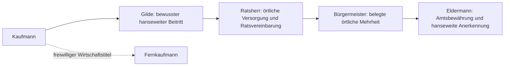

# Q1.06 – Empfohlene Karriere und bestehende Grundlagen

29.10.2026 · **Konzept, keine Umsetzung.** Basis `02ee6b8fc1507ad078b6b596c333e50d91eeea64`, Produkt0.8d.1b/V13, HTML-Commit `c42c25cf5cf372c210b47f25b00b9f0106044ed3`, SHA256 `c8ad9d2ef453e0c80ae51dfef8a2d21f8e17dc4cad49bd583568cf0721cdd924`. Alle neuen Regeln sind Empfehlungen bis zur Nutzerentscheidung.

## Zwei unterscheidbare Arten von Anerkennung

Empfohlen: **Kaufmann → bewusster Gildenbeitritt → Ratsherr → Bürgermeister → Eldermann**. Fernkaufmann läuft daneben als freiwilliger wirtschaftlicher Ehrentitel. Weder Vermögen noch dieser Titel ersetzen politische Taten. Bestehende fünf Rangcodes nicht umnummerieren.

Das Diagramm zeigt einen **Vorschlag**, keinen bereits spielbaren neuen Ablauf. Die Gildenregeln sind beschlossen; 12.500 Gold ist vorläufig, nicht endgültig. Alle weiteren konkreten Stufenbedingungen unten benötigen Freigabe.

## 1. Kaufmann und Gilde

**Voraussetzung:** Neuer Start bleibt5.000 Gold/eine Kogge in frei gewählter Startstadt, keine politische Qualifikation. Mitgliedschaft einmal bewusst und persönlich im Gildenhaus beantragen, vorläufig12.500 Gold, hanseweit, keine zusätzliche Vermögensschranke oder Aufnahmeaufgabe. Das Gildenhaus ist als Funktion neu vorzubereiten; es gibt heute keinen entsprechenden Aktionspfad.

**Nutzen/Rechte:** Zugang zur neuen politischen Laufbahn und verständliche Informationen über bereits vorhandene Unterstützerkreise. Kein Rang, keine Stimme, kein Rufbonus, kein Rabatt oder günstigerer Kredit. Wirtschaft bleibt normal. Keine weitere Pflicht zur Reservehaltung als Zugangssperre.

**Einordnung/Risiko:** Q1.05 zeigt den Geldaufbau, keine gemessene aktive Dauer.12.500 nach erster Bezahlbarkeit auszugeben kann den Handel lahmlegen. Ein späterer verständlicher Kassenhinweis wäre eine gesondert freizugebende Bedienempfehlung, keine automatische zusätzliche Eintrittsbedingung. Zahlungsstatus und Betrag müssten in einer kanonischen Transaktion gespeichert werden; keine Implementierung hier.

## 2. Fernkaufmann: wirtschaftlicher Ehrentitel, keine politische Stufe

**Konkrete Empfehlung F2:** Freiwilliger wirtschaftlicher Titel, ohne Gilde und ohne politische Wirkung erreichbar. Als späteren Testkandidaten die bestehende18.000er-Größenordnung behalten, aber anhand **Gold+Bank−Schuld**, nicht manipulierbarer Warenbuchwerte; dazu eine gültig beurkundete gewöhnliche Fremdwarenlieferung unter den neuen Regeln. Kein zusätzlicher Auftragstyp nötig. Betrag und Nachweisumfang sind **nicht beschlossen**.

**Warum:** Der Name beschreibt Fernhandel, der alte bloße Buchvermögensschwellwert nicht. Schulden sind kein verdienter Wohlstand. Ein tatsächlicher Fremdlieferbeleg verhindert eine bloß durch leere Fahrten erworbene Fernhandelsbehauptung. Liquides Kapital ist trotzdem kein reiner Gewinnnachweis: auch vorhandene Schiffe können rechtmäßig liquidiert worden sein. Deshalb weder „18.000 erwirtschafteter Gewinn“ noch allgemeine Stabilität daraus behaupten.

**Alternative F1:** Ehrenname schon nach erster belegter Fremdlieferung, ohne Kapitalwert. Weniger technische Daten, aber möglicherweise sehr früh und weniger als Entwicklungsrang wahrnehmbar. F2 ist die Empfehlung; kein Politikzugang hängt davon ab. Ein Ratsherr darf den Ehrentitel noch nicht besitzen.

**Technik/Save:** `completed` zählt alte Handelsaufträge, speichert aber keinen vollständigen einzelnen Liefernachweis; Opt-in-Testlog ist kein kanonisches Leistungsbuch. Für neue Verleihungen wäre eine kleine eindeutige wirtschaftliche Ehrenurkunde mit Quelle nötig, keine neue Punktewährung und keine vollständige Handelsbuch-Engine. Bestehenden Rang1 als alten Fernkaufmann erhalten, seinen Erwerbsweg nicht erfinden. Neue politische Ränge2/3/4 bleiben numerisch stabil; getrennte Ehrentitelanzeige benötigt M2-Metadaten. Keine echten Titel umgeschrieben.

## 3. Ratsherr: erste örtliche Anerkennung

**Empfohlene Voraussetzungen:** Gilde oder ausdrücklich geschützter Altzugang; mindestens ein gültiger Versorgungsbrief und eine gültige Ratsvereinbarung **derselben Antragsstadt**; persönlicher Antrag dort. Kein Fernkaufmannzwang, kein Mindestvermögen, kein allgemeiner Rufwert, keine neue Wartezeit. Die alten45.000 Gold/25 Ruf entfallen nach künftiger ausdrücklicher Freigabe.

**Begründung/Nachweis:** Zwei vorhandene Arten prüfen Versorgung und persönlich eingehaltene Zusage. Sie sind für einen ersten Rang ausreichend; kein dritter Pflichtdienst nur zur Verlängerung empfohlen. Ein gewöhnlicher bezahlter Handelsauftrag zählt nicht automatisch als Versorgungsbrief. IDs, Stadt, Frist, gültige Fremdherkunft und echte Vorsprache müssen nachvollziehbar sein. Zwei alte unterschiedliche Belege dürfen nicht zu vier neuen Leistungen werden.

**Heimat:** Örtliche Bindung ja, zwingend an den Starthafen nein. Die persönlich gewählte Antragsstadt wird auf der Ratsherrurkunde genannt und ist die erste politische Ratsstadt. Keine stille Zuweisung aus einer Fernansicht. Eine spätere Bürgermeisterkandidatur darf in einer anderen Stadt nur auf **deren** eigenen Belegen und Mehrheit beruhen. Für die Hanse bleibt das tatsächlich bewährte Amt der Heimatnachweis; Starthafen, Antragsstadt, Amtsstadt und Personenort sind verschiedene Begriffe. Diese örtliche Flexibilität ist eine Empfehlung, keine geänderte Regel.

**Rechte/Nutzen/Wirtschaft:** Sichtbare Ernennung im Rathaus, Ratsbrief im Kontor, Zugang zu Kandidatur und politischen Informationen; keine automatischen Einkünfte, Rabatte, Steuern oder erweiterten Kreditrahmen. Die normale wirtschaftliche Finanzierung der Leistungen bleibt nötig.

**Dauer:** Eine reine Koggen-Ratsrunde Lübeck↔Hamburg benötigt rechnerisch4 Welttage/12 Gold Hafengebühren, Bergen↔Hamburg20, Nowgorod↔Visby30; Versorgung kann verbunden werden, sofern Ware/Frist passen. Das ist kein durchgespielter politischer Aufstieg und keine aktive Zeitmessung. Fremdware kostet variable Marktpreise, zusätzliche Reisen, Zinsen und Schäden können anfallen. Q1.05-Gebührendaten enthalten keine anschließenden Ratsdienste. Keine exakte Ratsherrdauer belegt.

**Technik/Risiko:** `politicalRecord`, Herkunftslose, `politicalAction` und bestehende Briefe wiederverwenden. Eigene Ratsherr-Verleihungsreferenz auf die zwei Urkunden und Stadt, nicht neue XP speichern. Präsenzschutz Q-003 ist Voraussetzung vor Umsetzung. Keine neue Anforderung an alte Ratsherren stellen.

## 4. Bürgermeister: belegte Mehrheit und Entscheidungen im Amt

**Empfehlung für neue Regeln:** Ratsherr und Gilde/Altzugang, persönliche Kandidatur in der Stadt mit gültiger örtlicher Versorgung und Vereinbarung, keine offenen Lagermietrückstände wie bisher, passende politische Unterstützung nach ModellA. Kein45.000-/85.000-Gold- oder55-Ruf-Test. Bewährte Zulässigkeitsprüfung und transparente deterministische Wahl wiederverwenden.

**Kalender und Mindestmengen ausdrücklich offen:** Die heutige harte Vorgabe sechs Dienste/drei Abschnitte ist **keine neue Empfehlung zur Spielzeitstreckung**. Für den Zielentwurf soll die belegte Mehrheit mit beiden Arten zählen; separate Sechs-/Drei-Sperren entfallen als Zulassungsbedingungen, sofern die späteren überprüften Gelegenheiten Wiederholungsfarmen verhindern. Bestehende Formelzusagen und Angebotsquoten hängen aber ebenfalls an Abschnitten. Ohne angepasste Gelegenheiten bleibt diese Wirkung bestehen. Das ist gemeinsam zu entscheiden, nicht bloß ein Textwechsel. Die Modellrechnung hält alte Sperren nur für einen unverfälschten Vergleich fest.

**Rechte/Nutzen:** Eine begrenzte örtliche Versorgungspriorität und eine begründete Vermittlungsentscheidung als erste optionale Amtsfunktionen, siehe Amtsbericht. Keine freie Stadtkasse oder automatischen finanziellen Vorteile. Ernennung muss die Welt sichtbar verändern, nicht nur den Kontorhintergrund.

**Bewährung:** Mindestens zwei **neue** unterschiedliche örtliche Amtsleistungen nach Amtsbeginn, darunter eine Vermittlung/Vereinbarung, als konkrete Empfehlung. Nicht dieselben voramtlichen Urkunden erneut verwenden. Zwei verschiedene Kalenderabschnitte sollen im Zielmodell kein zusätzlicher reiner Wartebeweis sein; geeignete unabhängige Anlässe müssen dafür definiert/getestet sein. Keine neue längere Amtswartephase; heutige360 Tage sind ein Amtsende, bereits heute keine zwingende Wartezeit bis Eldermann.

**Technik/Save/Risiko:** `office`, `firstReceipt`, `appointments`, `terms`, Wahlgründe und Titelbestand erhalten. Unterstützung neu ableiten, historische Wahlergebnisse mit ihrer damaligen Regel erklären. Aktives Amt und dauerhaft erworbener Titel getrennt. Keine bestehende Amtszeit verkürzen oder Altbewährung entwerten.

## 5. Eldermann: hanseweiter Schlussakt

**Konkrete Empfehlung:** Gilde/Altzugang; nachgewiesene Bürgermeisterbewährung; Heimatmandat plus drei auswärtige Fürsprecher (=vier Stadtsiegel), mindestens zwei Handelsräume; gehaltenen Hansevertrag persönlich mit mindestens zwei auswärtigen bereits unterstützenden Städten verhandeln und am Amtsort beurkunden. Bestehende Heimat-/Regions-/Siegelstruktur nicht durch neue Punkte ersetzen.180.000 Gold und90 globaler Ruf entfallen im Zielmodell.

**Echte Leistung:** Jeder auswärtige Fürsprecher braucht beide gültigen lokalen Arten; nur Urkunden aus der betreffenden Stadt. Vertrag referenziert echte Verhandlungen und die beteiligten Siegel, nicht nur eine Summe von Briefen. Kein Sieg allein durch reiches Warenbuch, Spenden oder zehnmal dieselbe Urkunde. Belegte Zusammenarbeit und Amtsführung sind die Qualitätsschranken.

**Rechte/Einordnung:** Anspruchsvollster politischer Rang, sichtbarer hanseweiter Abschluss; danach freiwillige Vermittlung und koordinierte Hilfe, keine weitere Pflicht-Rangtreppe. Eine neue Abwägung im bestehenden Vertrag ist sinnvoller als ein fünftes Pflichtsiegel. Keine freie Geldschöpfung, Tribut-/Steuerrechte oder garantierten sicheren Routen.

**Technik/Save:** Bestehende `endorsements`, `league/visited`, `terms`, `elderman` und Urkunden-IDs wiederverwenden; Präsenz und Regelrevision ergänzen. Späterer Verlust einer alten Mehrheit darf den erworbenen Titel nicht zurücknehmen. Heimat-/Siegel-/Vertragsdaten und laufendeFristen geschützt übernehmen. Keine neuen Hansefunktionen implementiert.

## Bestandsmatrix – Ablauf, Nutzen und Schwächen

| ID / Element | Aktueller Ablauf | Nutzen | Schwäche |
|---|---|---|---|
|K01 Kaufmann|Neustart5.000 Gold/Kogge, Rang0|Sofortiger Handel, freie Startstadt|Wirtschaft und politische Zukunft noch vermischt erklärt|
|K02 Fernkaufmann|Antrag ab18.000 Buchvermögen, kein Rufminimum|Sichtbarer früher Titel/Kontorstufe|Kein erforderlicher echter Fernhandelsbeleg; Buchwertangriff|
|K03 Ratsherr|Danach45.000 Buchvermögen/25 Ruf|Kandidaturstufe, keine Geldrechte|Handels-/Spendenruf ersetzt konkrete Rangverdienste|
|K04 Bürgermeister|Ratsherr, Vermögen/Ruf,6 Dienste/3 Abschnitte/2 Arten, Zielmehrheit, Mietfreiheit/Wahlfrist|Örtliches Amt und Zugang zur Hanse|Finanz-/Rufmix, wenige eigentliche Amtsentscheidungen|
|K05 Eldermann|Bewährtes Amt,180.000/90 Ruf,4 Siegel/3 auswärtige/2 Räume, Vertrag|Hanseweiter Karriereschluss, Weiterhandel|Geld-/Rufhürde neben echten Nachweisen; spätes Wiederholungsrisiko|
|K06 Gilde/gesellschaftliche Funktion|Keine Mitgliedschaft oder eigene Gildenaktion; Kontor/Kirche/Bad vorhanden|Vorhandene Weltgebäude als Dialograhmen|Gilde bisher nur Konzept, kein verfügbarer Eintritt|
|K07 Politischer Ruf|Ein globales `s.rep` aus Handel, Ankunft, Quest und Spende|Bekanntheit und heutige Zulassung|Quellen nicht sauber trennbar; Spenden wiederholbar|
|K08 Örtliche Unterstützung|Ableitung aus Geld/Ruf/Diensten/Zusagen/Vereinbarungen|Erklärte Mehrheit je Stadt|Globalanteile25; lokale75 reichen drei Städten nicht|
|K09 Ratsvereinbarung|Brief annehmen, Partner besuchen, zurückberichten|Persönliche Zusage als lokaler Tatbeleg|Ansichtswechsel als Anwesenheit; Partnerrotation nur drei nahe Städte|
|K10 Versorgung|6–8 passende Fremdwareneinheiten innerhalbFrist verkaufen|Örtliche Versorgung, Herkunftsguard|Kein eigenständiger realer öffentlicher Warenverbrauch, oft ähnliche Fahrt|
|K11 Wahl|Deterministischer Unterstützungsvergleich, nächste Wahl nach30/60 Tagen je Altregel|Kein versteckter Würfel; Niederlage löscht keine Urkunden|Rivalen nur feste Gruppen; Wiederantragsfrist kann Leerlauf erzeugen|
|K12 Amtsbewährung|2 neueDienste in2 Abschnitten einschließlich Vereinbarung; `firstReceipt`|Neue Arbeit nach Amtsgewinn belegt|Bisher gleiche Typen, Abschnittsgate statt vielfältiger Entscheidungen|
|K13 Urkunden|Einmalige IDs Art/Stadt/Abschnitt, maximal8.192|Dauerhafter überprüfbarer Fortschritt|Keine allgemeine Serverintegrität, Limit und Indexreferenzen beachten|
|K14 Stadtsiegel|Amtsort als Heimatsiegel, auswärtige gesondert beantragt|Geografisch konkrete Anerkennung|Heimatmandat ist kein eigener identischer `endorsement`-Eintrag|
|K15 Fürsprecher|Beide örtlichen Diensttypen, Hansezugang, einmaliger Stadtbeleg|Zusammenarbeit verschiedener Städte|Keine aktive Konkurrenz, ähnliche Besuchsschleifen|
|K16 Hansevertrag|Zwei auswärtige Vorsprachen,2 Räume inklusiveHeimat, Rückbericht,720 TageFrist|Verknüpfter überregionaler Nachweis|Ablauf überwiegend Rundreise, neue politische Entscheidung fehlt|
|K17 Ansehen/Unterstützung/Ämter insgesamt|Ratstafel, Rangarray, lokale Belege, globaler Ruf|Schon eine zusammenhängende Karriere|Ehrenname, Titel und aktuelles Amt nicht vollständig getrennt|

## Technikmatrix – Anpassung, Wiederverwendung und Speicherfolgen

| ID | Heutige technische Grundlage | Empfohlene Anpassung | Wiederverwendbar | Savefolge (nur Konzept) |
|---|---|---|---|---|
|K01|`fresh`110, `newMerchantGame`1052|Einstieg erklären, keine Wirtschaftsänderung|Startauswahl, `beginning`, Kasse/Flotte|Keine geänderten Startwerte, später Politikrevision|
|K02|`promote`988, `rank`799|F2 als getrennten Ehrentitel entscheiden|Titelname, Ehrenverleihung, vorhandener Lieferablauf|Alt-Rang1 erhalten; neuer eindeutiger Ehrenbeleg nötig|
|K03|`promote`988, `politicalRecord`433|Gilde + zwei örtliche Arten + Präsenz|Tatbelege, Rathausantrag, Titelcode2|NeueVerleihungsreferenz, geschützte Alttitel|
|K04|`mayorQuote`368, `runMayorElection`461|Geld/Ruf entkoppeln, ModellA und Kalenderentscheidung|Gründe, Wahl-/Amtsdaten, deterministische Abstimmung|Revision/Alt-Wahlsnapshot, aktive Ämter bewahren|
|K05|`hanseQuote`400, `runHanseAssembly`488|Kein Geld/Ruf-Test, reale Belege/Präsenz|Qualitätsnachweise, Hanseversammlung|Altrang4/`elderman` unverändert erhalten|
|K06|`show`886, Stadtszenen1082, Kirche909/Bad906/Kontor986|Gildenhaus als genehmigtes Ziel später in Welt integrieren|Renderer/Hotspots/Dialoge statt neuer Hauptmenüs|Mitgliedschaft/Bezahlbeleg in M2, keine neue Währung|
|K07|`trade`905, `arrive`1026, `donate`910, `completeQuests`990|Alt-Mischruf anzeigen, nicht politisch verwerten|Gespeicherten Altwert/Chronik bewahren|Keine Herkunft erfinden; Aktivierungszeitpunkt dokumentieren|
|K08|`politicalSupport`362, Städte607|A normieren; Pledge-/Gelegenheitsregeln gesondert|Lokale Urkunden/abgeleitete Zusagen|Kein gespeicherter Stadt-XP-Wert; Altwert nicht überschreiben|
|K09|`acceptPoliticalJob`425, `witnessPoliticalJob`453, `finishPoliticalAccord`457|Persönliche Stationen verbindlich prüfen|Annahme/Frist/`witnessed`/ID|Altfortschritte erhalten, fehlende Stationen erklären|
|K10|`politicalOffer`356, `completePoliticalSupply`440, `politicalTrade`443, `consumeOrigins`790|Gilden-/Quell-/Präsenzguard; Prioritätswahl nur nach Beschluss|Fremdherkunft, atomarer Verkaufs-/Urkundenpfad|Keine erfundenen Herkunftslose; neue Auswahl braucht Validatorrevision|
|K11|`nextElection`, `appointments`, `politicsClock`390|Keinen neuen bloßen Warteblock, Wiederantrag an reale Änderung erwägen|Wahlergebnis, verlorene Wahl ohne Verlust|Alte Fristen und Ergebnisse nach eigener Regel schützen|
|K12|`politicalOfficeProof`382, `politicalCloseOffice`386|Unterschiedliche neue Amtsanlässe statt neuer Zeitpflicht|`firstReceipt`, neue Belege, `terms`|Keine Belegliste sortieren/kürzen, sonst Indexbruch|
|K13|`politicalId`352, `politicalRecord`433, `validatePolitics`495|Quelle/Anlass und einmalige Verleihung strikt prüfen|IDs, Beleglisten, Limitprüfung|M2 erweitert streng; unbekannte Felder nicht still zurücksetzen|
|K14|`politicalHome`399, `hanseQuote`400|Heimat aus realem Amt statt ausgewähltem Hafen|Mandat, `terms`, Siegelanzeige|Altamtsort priorisieren, fehlendeHeimat nicht erfinden|
|K15|`requestPoliticalEndorsement`472, `politicalLeagueAccess`398|Präsenz/Gilde/örtliche Referenzen|ZweiDienst-IDs, Stadt-/Tagesbeleg|Bezahlte Mitgliedschaft nicht aus Siegeln rückrechnen|
|K16|`accept/witness/finishHanseAgreement`476/480/484|Echte Stationen, kleiner Entscheidungszweig statt weiterer Stempel|`league`, `visited`, Frist, Abschlussurkunde|IDs/Fristen/Altbesuche bewahren; Regelwechsel gesondert|
|K17|`politicalCareerModel`555, `politicalCareerBoard`573, `validatePolitics`495|Eine Karriereansicht mit klaren Bedeutungen|Ratstafel, Kontor, Weltgebäude|Politik2/Altzugang planen; keine Änderung dieser Phase|

Funktionszeilen beziehen sich ausschließlich auf das oben genannte unveränderte HTML. [Lesendes Funktionsinventar](../../../tests/analysis/q1_06/results/inspection.json). Die Matrix enthält Empfehlungen, keine bereits implementierten Änderungen.
