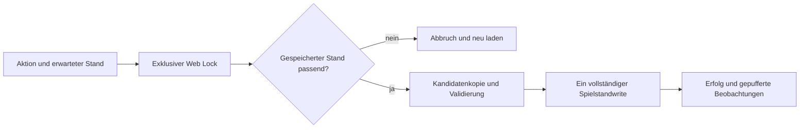

# Q1.09 – Gemeinsame Schreibgrenze und lokale Wiederherstellung

30.10.2026 Europe/Berlin · Branch `fix/q1-09-safety-foundation` · Basis `02ee6b8fc1507ad078b6b596c333e50d91eeea64`. Tatsächlich getesteter Spiel-/Teststand **`15c2e3792d855afcddf26ba0572d6317504d8b46`**, Produktdatei `Hansefuerst_0_4.html`, SHA 256 **`dd17d5fb6bbf2126652f93ede24add5528a0f2829c67ed20cd7a0a25e9aaaa95`**. Nominale Spielversion weiterhin 0.8d.1b; Root-V13 mit minimaler Politik-Unterrevision 2/Sicherheit 1. Keine neue Karriere oder Wirtschaftsregel aktiviert.

## Von Teilwrites zu einem kanonischen Commit

Vorher schrieben `save`, Politik, Handel, Lager, Werft, Informationen, Import und Neustart an mehreren Stellen direkt. Teilweise wurde Geld im Arbeitsspeicher geändert, während ein Speicherfehler nur eine Warnung erzeugte. Ein einzelnes Busy-Flag oder vorheriger LocalStorage-Vergleich schließt ein zweites Fenster nicht aus.

Jetzt: `navigator.locks.request` exklusiv mit gemeinsamem Lock-Namen; anschließend vollständiger Stale-Vergleich. Unter der Sperre eine Kopie bearbeiten, alle alten aktiven Writes nur vormerken, ganzen Kandidaten validieren und **genau einen** finalen aktiven LocalStorage-Write ausführen. Quota/Validierungsfehler davor: vollständige Rücknahme. Nach erfolgreichem Write ist die Aktion gespeichert; ein späterer Anzeige-/Testlogfehler wird nicht als ungespeicherte Aktion zurückgerollt.

Der Vergleich ist **keine eigenständige atomare CAS-Operation**. Web Locks liefern die Ausschließung für kooperierende Clients; der Vergleich erkennt veraltete Inhalte innerhalb dieser Grenze. Vollständiger Spielstand und Sicherheitsrevision sind in derselben JSON-Zeichenfolge, keine getrennte revisionsbehaftete Metadatenbank.

## Gleichzeitige Aktionen und Fehler

Zwei Fenster dürfen denselben Stand lesen. Nach dem ersten Commit ist der zweite geladene Inhalt veraltet und wird abgewiesen. Ebenso zwei gleichzeitig gestartete Bestätigungen derselben Anzeige: zweite Aktion verlangt neuen Stand. Wiederholbare Spenden bleiben nach ordnungsgemäßer neuer Aktion wiederholbar; es wurde kein allgemeines Spendenverbot eingeführt.

Import merkt den erwarteten Stand bereits bei Dateiauswahl. Ändert sich die Partie während FileReader liest, wird der Import abgewiesen. Datei-/Backup-/Quota-/Validierungsfehler lassen die aktive Partie bestehen. Auch eine unlesbare/neue aktive Revision darf nur nach ausdrücklicher Ersatzbestätigung und bytegenauem Backup ersetzt werden. Malformed-JSON-Original wird dabei nicht weggeworfen.

Bei Prozessende gilt die atomare einzelne WebStorage-Zeichenfolge: entweder vorheriger oder vollständiger neuer Zustand. Getestet sind Fehler vor Write und Beobachterfehler nach Commit sowie Reload, **kein echter Browserprozess während eines Schreibens beendet**.

## Originale und Export

Aktiver neuer Schlüssel `hansefuerst-v04-safety1`; alter `hansefuerst-v04` bleibt unverändertes Original. Nummerierte Original-, Import- und Vorersatzsicherungen werden nicht überschrieben. Identische Bytes werden wiedererkannt; maximal 100 Plätze je Sicherungsgruppe, bei Überlauf sicherer Abbruch. Freier Speicher wird nicht durch Löschen alter Originale erzwungen.

Manueller Export liefert einen vollständig gespeicherten konsistenten Stand, nicht eine halb angewendete Kandidatenkopie. Im **bestehenden** Sicherungsdialog gibt es zusätzlich den optionalen Download des unveränderten Erstübernahmeoriginals. Auch die erste manuelle V13-Übernahme auf einem leeren Gerät erhält diesen Originaldownload. Dateiinhalte/alte Leser wurden in VM geprüft; der tatsächliche Browser-Download-/Geräteübertragungsdialog ist nicht abgenommen.

Originale älterer Clients liegen getrennt; neue Politikrevision 2 wird von unverändertem alten V13-Validator abgewiesen. Alte Clients dürfen nicht in den neuen aktiven Schlüssel schreiben. Unterschiedliche Browser/Origins bleiben getrennte lokale Partien, keine Synchronisierung.

## Beobachtungen und Benutzeroberfläche

Testereignisse und Momentaufnahmen werden erst nach erfolgreichem Spielstandcommit veröffentlicht; fehlgeschlagene Aktionen erzeugen keine Geisterurkunde/-ankunft. Ihre ursprünglichen Spieltage/Finanzwerte werden beim Vormerken erfasst, damit tägliche Zinsen einer Reise nicht alle fälschlich am Ankunftstag erscheinen. Der echte Opt-in-Logger wurde dafür kontrolliert in VM geprüft. Freiwillige Aufzeichnung bleibt freiwillig/lokal, keine neue Telemetrieübertragung.

Der vorhandene Speicherstatus zeigt Abbruch/Stale-Zustand und „Aktuellen Stand laden“/Export. Keine neue Pflichtmenükette, keine Cloud, keine Serverabhängigkeit. Ein vorheriger Warntext über ungesicherte Teilhandlungen wurde der nun vollständigen Rücknahme angepasst.

## Plattformgrenzen

Ohne Web Locks oder bei verweigertem API-/Speicherzugriff **keine Mutation**; lesende Ansichten/Originalexport soweit Speicher lesbar bleiben möglich. Kein unsicherer LocalStorage-Lockfallback. HTTPS/localhost sind typische sichere Kontexte; Datei-URLs hängen vom Browser ab. Der Schutz selbst braucht keine Netzwerkverbindung und keine Datenbank auf einem Server. Bestehende Offline-Nutzung ist nur bei verfügbarem API-Kontext schreibend möglich.

Zwölf Speichergruppen sowie weitere Fehler-/Wiederherstellungsgruppen in VM bestanden. Konkurrenz ist mit einer gemeinsamen kontrollierten Lock-API für zwei VM-Kontexte geprüft. **Echte native Web Locks, tatsächliche zwei Tabs, Safari-Speicherspezifika und physische Geräte fehlen noch.** Die Implementierung ist daher nicht vollständig browserabgenommen.

[Gesamtbericht](Q1_09_gesamtbericht.md) · [Regressionen](Q1_09_regressionstests.md) · [Offene Entscheidungen](Q1_09_offene_entscheidungen.md)
